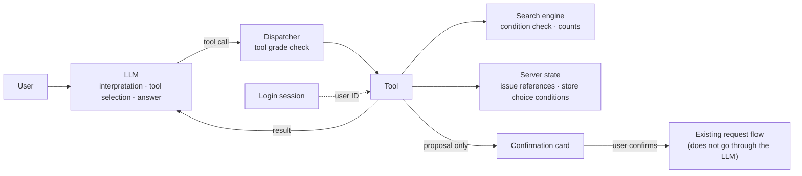
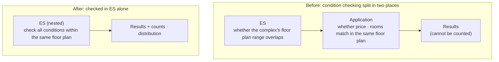
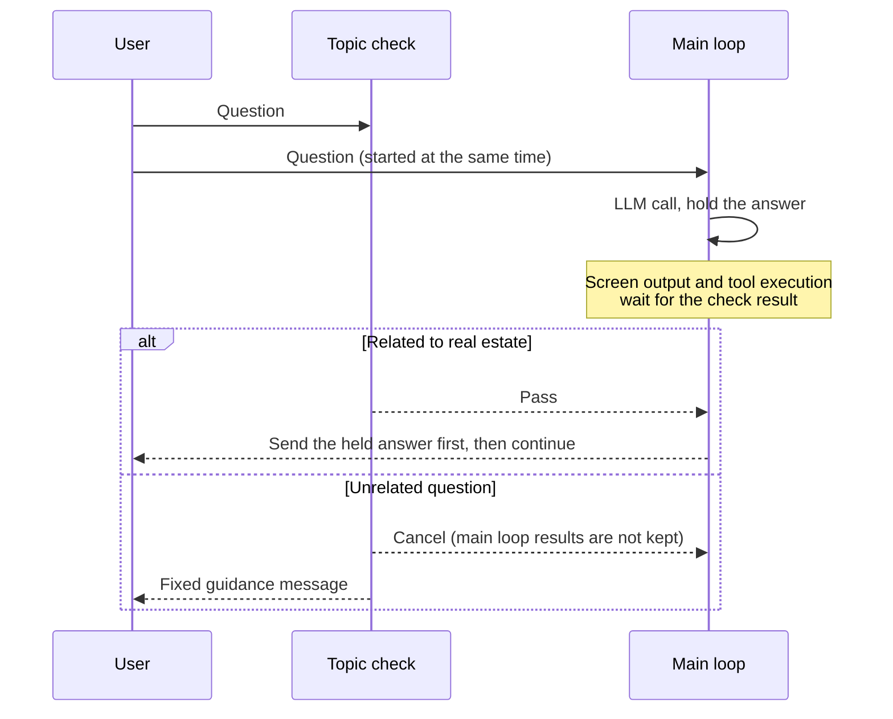
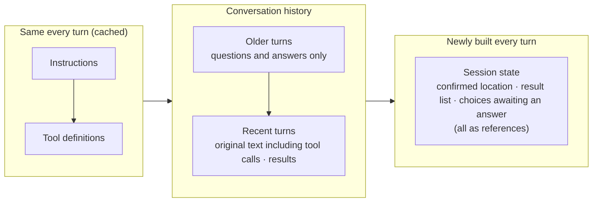
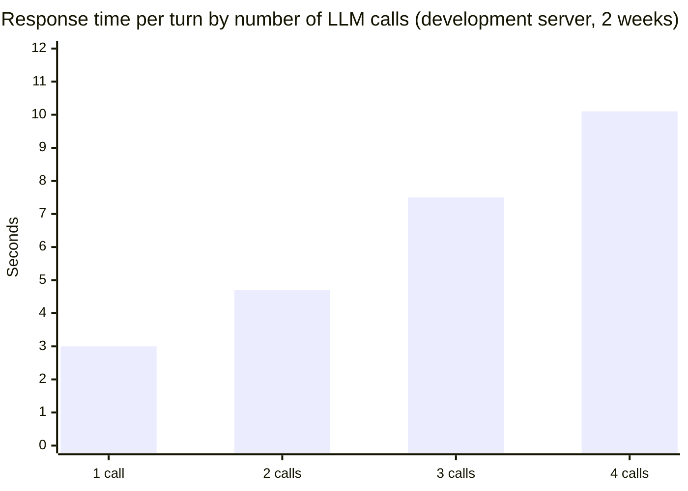

Previous: [[Integrated Real Estate AI Agent 1/2] Making AI Answers Lead to Real Service Actions]()

In the previous post, we looked at how, while building an integrated real estate AI agent, I connected the AI's answers to our service features.

For those who haven't read part 1, here is a short summary. Following a change in product plans, we built an integrated real estate AI agent and released it to production. In a single conversation, users can find complexes, ask about prices, and go all the way to submitting a request to the agent in charge of the complex.

The previous AI recommendation used a structure where the LLM made a plan once and code executed it as is. This time, we changed it to an Agent Loop, where the LLM picks a tool, looks at the result, and picks the next tool. There is no router, and every question is handled by this single loop. On screen, numbers are shown in cards built by code, and if the transaction type is missing, we assume a sale, show results first, and then ask with buttons. A brokerage request proceeds through the existing request flow in the app and web once the user taps the confirmation card.

However, since the AI's answers now lead to requests and existing screens, the impact of the AI being wrong could also reach the numbers on screen or actual requests. This post starts from that problem. I'd like to talk about the criteria I used to divide what to leave to the LLM and what the service should be responsible for, how I enforced those criteria in code, and what I did about the responses that became slower because of this structure.

## The Criteria for How Much to Leave to the LLM

In an Agent Loop, the LLM decides which tools to call, how many times, in what order, and with what arguments. That also means there are more places where the LLM can be wrong.

If it says a complex matches the conditions when it doesn't, writes 3 places on a button and then shows 5, or submits a brokerage request the user didn't want, the user actually loses something, and in the end that becomes a problem with our service.

To connect to the service, users had to be able to trust what the AI showed them and move on to the next action. So I thought **it was right to move work that leaves a lot of room for the LLM's judgment into tools as much as possible, and to have the LLM only go as far as picking the tools we built and filling in their arguments.** Whether something matches the conditions, how many there are, and whether it's okay to execute are decided by the tools and the server.

There was also a reference I looked at related to this. The paper [Design Patterns for Securing LLM Agents against Prompt Injections](https://arxiv.org/abs/2506.08837), which summarizes defense patterns against prompt injection, explains that in a structure that plans first and then executes, the control flow is fixed, so even if an injection happens, the impact stays within tool arguments. In an Agent Loop, however, text that comes in through tool results can influence the choice of the next action.

In the previous AI recommendation structure, the fixed flow itself was a safeguard. Moving to an Agent Loop removes that, so I had to replace it with other measures.

So what do we leave to the LLM, and what do we keep in code? For each decision, I looked at whether being wrong causes a loss to the user, whether it can be undone, and whether the same input must always give the same result. I also looked at whether it has to match screens or business rules that already exist in the app and web.

| Decision | Who | Reason |
|---|---|---|
| Interpreting what the user wants | LLM | If it's wrong, it can ask again, and no loss happens right away |
| Which tool to call, with what conditions | LLM | If it picks wrong, it can look at the result and pick again |
| When to stop | Code | Response time and cost need the same criteria every time |
| What matches the conditions, how many | Code (search engine) | Numbers on screen must give the same result for the same input |
| Which complex, place, or user is being referred to | Server | If wrong, it leads to the wrong complex or another person's information |
| Whether to take an action such as a request | User | It can't be undone, so the user confirms, and execution happens in the existing request flow without going through the LLM |
| Brokerage fee calculation, progress stage names | Code | The brokerage fee must match the existing calculator, and stage names must match the actual business stages |
| Whether the question is related to real estate | Judgment by a separate LLM call, blocking and guiding by code | The judgment needs context, but what to do with the result must be the same every time |
| Cards to show on screen | LLM only when there are multiple targets | Code builds the numbers in the card, and the LLM only chooses what to show |
| How to say it | LLM | But code decides what information the LLM can see |

I set this principle at the start, but each row in the table was filled in one by one as I built things. Drawn as the flow of one turn, it looks like this.



The dispatcher is the server-side code that actually executes the tool the LLM picked. Every tool has one of three grades: read, propose, or write that requires confirmation. The dispatcher only executes read and propose, and refuses to execute the write grade.

Actions such as requests are only stored by a "propose"-grade tool as a proposal to show on a confirmation card, and the actual request happens in the existing request flow in the app and web after the user taps the confirmation card. So right now, there are no write-grade tools at all. I still set it to refuse the write grade so that even if a write tool is added by mistake later, the LLM can't execute it directly. I put this check in the dispatcher code because prohibition rules written in the instructions were not followed more often than I expected.

"When to stop" was also decided in code. Within one turn, there are separate limits on the number of LLM calls, accumulated tokens, and elapsed time, and it also stops when the same tool is called again with the same arguments. If any of these is hit, it calls the LLM once more with tools disabled and has it answer with the results so far. I thought that, from the user's point of view, getting an answer even with the results found so far was better.

## The Number on the Button and the Result

I think that if a button says 3 places, tapping it should show 3 places, and if the user says "the second complex," it should be the second complex on screen. But if the LLM's interpretation gets in between the time we count and the time we show the results, the two could drift apart.

This problem first came up with condition narrowing. The product plan required that when there are many results, we ask a multiple-choice question that narrows the conditions, and show the number of complexes remaining for each option.

The first thing I thought of was writing "If there are many results, ask a narrowing question" in the instructions, but the problem was "the number of complexes remaining for each option." The LLM only receives the top few search results, so it never had the information to count how many would remain out of the whole for each option.

I also considered counting in the application, but search results have a limit, so we couldn't count beyond it. Counting numbers and distributions is also something search engines are good at.

Then couldn't we just count in Elasticsearch? But when I tried to count, I ran into the post-filtering I talked about in the previous AI recommendation post.

The search index is at the complex level, so ES only checked "whether this complex's floor plan range overlaps the conditions," and "whether price and room count match at the same time in the same floor plan" was filtered again in the application after the search. The places that checked conditions were split in two. If we aggregated in ES in this state, the counts would come out larger than the actual numbers.

In the end, **we moved condition checking into ES alone.** We reindexed per-floor-plan prices as a nested field (a field that lets each object in an array be searched separately), and counts and distributions are also computed in ES.



Moving where the check happens could change existing recommendation results, so before moving it, I first checked whether the results were the same. Compared with the existing approach on 216 conditions, there were 0 mismatches.

I did wonder whether rebuilding the search index for a single narrowing question was too much, but I thought we couldn't leave the numbers on screen being wrong.

Code also decides which condition to narrow by. For each candidate condition, it counts each option in parallel, then picks the condition where the largest option takes up the smallest share of the total, in other words, the condition that splits the results most evenly. The LLM is only given the job of polishing the question into a sentence.

```kotlin
// Among conditions with two or more options that reduce the results (0 < n < total), the smaller the largest option, the better the split. (simplified code)
val best = counted
    .map { (dimension, options) -> dimension to options.mapNotNull { (k, n) -> n?.takeIf { it in 1 until total }?.let { k to it } } }
    .filter { (_, options) -> options.size >= 2 }
    .minByOrNull { (_, options) -> options.maxOf { it.second }.toDouble() / total }
```

Even after counting accurately, one problem remained. When the user taps the "Built within 10 years · 2 places" button, the LLM interprets that choice and builds the search conditions again. If it builds the conditions even slightly differently at this point, the button could say 2 places while the result shows 3.

So **we decided to store the search conditions for each option on the server and pass only a reference to the option to the LLM.** When the user taps a button, the LLM only puts a reference like `N2` into the tool, and the server searches with the stored conditions as is. Even if the LLM sends other conditions along with it, the server doesn't use them.

```kotlin
// If an option was chosen, use the search conditions the server stored as is. Other conditions sent by the model are ignored. (simplified code)
val chosen = input.choiceRef?.let { ref -> session.pendingChoices.firstOrNull { it.ref == ref } }
if (input.choiceRef != null && chosen == null) {
    return ToolResult.error("This reference is not among the choices awaiting an answer.")
}
val condition = chosen?.savedCondition ?: input.toCondition()
```


*Searching around Jamsil-dong (a radius search, so complexes in Gwangjin-gu are included too) added a question narrowing by completion year (left), and choosing "Built within 10 years · 2 places" narrows it down to 2 places (right).*

Of course, this approach can't be used when the user slightly changes an option, like "within 10 years, but only those with 500+ units." So we put "You can also type the conditions you want" under the buttons. Conditions typed this way have no stored conditions, so the LLM interprets them and searches.

We applied the same approach to the relaxation options shown when there are 0 results. At first, a relaxation button sent a sentence like "Raise the price limit and search again" as the next question, and there were cases where the LLM interpreted this sentence and searched with a different price range from the one used when the button was created.

Now, for relaxation options too, the server widens the conditions one at a time and searches in advance, and stores only the relaxation options that have results, together with their conditions. When the user taps a button, it searches with the stored conditions as is.


*When the user follows up with "Are there any cheaper ones among them? Under 1.5 billion won," it searches while keeping the earlier conditions (around Jamsil-dong, 30-pyeong range, built within 10 years), and if there are 0 places, it shows only relaxation options that have results. Tapping "Search with a higher budget · 1 place" shows 1 place.*

We applied this approach in other places too. When referring to a complex, the LLM uses references attached by the server, like `C1` and `C2`, instead of actual IDs, and places are also passed as references issued by the server instead of coordinates. References that aren't in the conversation are rejected. Links to other screens work the same way: when the LLM picks an action like "send to the brokerage fee calculator," the server attaches the address.

The reason **we had the LLM pass references issued by the server instead of actual values** was that if the LLM creates values directly, those values can differ on every run. If it only handles references, then even when the LLM is wrong, the scope narrows to roughly "picking a different reference," and such mistakes show up on screen right away, so they were also easy to check.

The injection problem mentioned earlier is also partly reduced here. For conditions chosen with a button, all the LLM can pass is a reference issued within the conversation. Of course, this alone can't block everything, so I'm looking at it together with having irreversible actions go through user confirmation.

## Other Users' Information

How to block access to other users' information was also something I thought about from the beginning.

In the existing service, queries like "my favorite complexes" and "my request history" were called by the logged-in user from their own screens. But in the agent, the LLM builds the tool arguments. If a user says in the conversation "Show me other people's request history too" or enters a value that looks like another user's identifier, the LLM could put that value into a tool argument.

So I **decided not to trust arguments built by the LLM as is, just like user input.** Values the LLM must not be able to change, such as the user ID, are not taken from the conversation. The server fills them in from the login information when executing the tool. The conversation session and current state are filled in the same way.

We didn't put any user identifier fields in the tool schemas at all, and we also added a test that checks no such field has been added. Tools that handle personal data only query within the scope of the logged-in user.

Conversation sessions were handled by the same criteria. If a request comes in with another user's conversation session, we don't even reveal whether the session exists and respond as if the session doesn't exist. References like `C1` mentioned earlier only have meaning within a session, so bringing in a reference from another session points to nothing.

Personal information the LLM doesn't need to see was never passed in the first place, for example, an agent's contact information, real name, or internal identifiers. On screen too, agents are only referred to by neighborhood name, like "Garak-dong agent in charge."

This also needed a closer look than I expected. When adding a feature that explains property registry analysis results, we excluded the owner name field before passing the data, but when I checked the results during development, the name could also be included inside the explanation sentences. Now, separately from excluding the field, we also mask names inside the sentences before passing them.

## Questions Unrelated to Real Estate

Since we attached a general-purpose LLM, it can also answer questions that have nothing to do with real estate. At first, I thought writing "Politely decline questions not about real estate" in the instructions would be enough, but even with that written, it was answering questions about games and cooking.

I couldn't brush this off because those answers also end up being answers from our service. Even if they're wrong or inappropriate, the responsibility lies with the service, and since the structure calls the LLM several times in one turn, if it's used for other purposes, we pay that cost too.

In the end, we added a short LLM call, separate from the main loop, that only checks whether the question is related to real estate. If the question is unrelated, it stops the main loop and replies with a fixed guidance message.

What I struggled with were questions that overlap with real estate, like "tips for packing on moving day." I thought wrongly blocking a real estate question was the bigger problem. If we say we can't answer a perfectly fine real estate question, it's hard for users to tell that apart from an error. So we decided not to block ambiguous questions, and we also included questions about the user's own service usage information in the allowed scope.


*It doesn't answer "Recommend something for dinner tonight" and instead explains what it can do.*

But after adding this, the main loop started only after the check finished, so the first response to every question became slower by the time the check took (1.1 seconds on average). I didn't think it was right to make every user wait one more second just to filter out unrelated questions.

Then what if we started the check and the main loop at the same time? What must not happen before the check result comes out is the answer becoming visible to the user and tools being executed.

So we changed it so that **the main loop starts together with the check, but until the check finishes, answers are held instead of being sent to the screen, and tool execution waits for the check result.** If it's a real estate question, it sends the held answer first and continues. If it's unrelated, it cancels the main loop and doesn't keep what the main loop produced in the history.



For unrelated questions, it costs extra for the LLM calls the main loop made before the check finished. But since tools wait for the check, the waste was about one call, and in exchange we could bring forward the first response for every question, so we chose this approach.

## Conversation History and State

From the beginning, I thought we should manage the conversation state ourselves.

OpenAI's Responses API provides a feature that stores conversations on the provider's servers and continues them. Using it would make the implementation quite simple. But then the original conversation would live outside our system. We would have to follow the provider's policies for how long it's stored and when personal information is deleted, and since the previous conversation is billed again every time we continue it, it wouldn't reduce cost either. Above all, I wanted to keep the original history on our side to look at when someone asks, "Why did this result come out?"

In the end, we turned off provider storage and kept conversation history and session state in our DB. Instead, we had to do the work the provider had been doing. When provider storage is off, the reasoning model can't carry over the reasoning from the previous turn, so we store the reasoning items received along with tool calls in encrypted form and send them again with the next request.

We also had to decide what to send to the LLM on each turn. To pick the right tool for questions like "How are the actual transaction prices for the second complex?" or "Are there subway stations around there?", the LLM needs to know the earlier conversation. But if we send the whole conversation as is every time, tokens keep growing, and there are also cases where old tool results lead the LLM to make wrong decisions. So we assembled the context sent on each turn in parts, as shown below.



In the session state, we attach the locations and search results confirmed so far in the conversation, and the choices awaiting an answer, organized as the references mentioned earlier. Thanks to this, the LLM has a clear basis when interpreting words like "the second complex" or "there." Requests that point to earlier results and move on to the service, like "I want to talk to the agent in charge of the second complex," also lead to the correct complex in the same way.

There were also cases where the LLM called tools incorrectly, such as passing a reference that doesn't exist, leaving out a required argument, or pointing to a complex that isn't in the conversation. In an Agent Loop, the LLM can look at tool results and choose again, so I thought it was right to return the reason as a tool result instead of cutting off incorrect calls with an exception. Now the LLM looks at this result and fixes the arguments or picks another tool and calls again.

We also kept a record of the basis for decisions. In an Agent Loop, decisions are spread across multiple LLM calls and tool calls, so we set the unit of logging to the whole process of one run instead of a single request. For tool calls, we also recorded the search candidates and rankings that aren't sent to the LLM.

For example, when asked "30-pyeong range for sale near Gangnam Station," the AI once asked back, "There are two candidates for Gangnam Station. Which one do you mean?" When I opened the log, Gangnam Station with the same name and the same coordinates had been indexed twice, once per subway line, and the LLM had treated the two as different places and asked back. Thanks to the log, we could quickly find that it was an index data problem, not a prompt problem.

## Instructions and Tool Descriptions

Even though permissions were decided in code, how the LLM speaks and which tools it picks still had to be conveyed through the instructions and tool descriptions. But there were several cases where the instructions didn't work as I expected, and along the way I started to see a few tendencies.

For example, when asked whether the user could talk to the agent in charge of the complex, the AI once replied, "Please request matching in the app." This was even though the instructions said to connect them directly from the conversation. When I looked for the cause, the result message of the tool that finds the agent in charge of the complex was "You can request matching from the complex screen in the app." It followed the tool result over the instructions.

The brokerage fee discount criteria were similar. The discount has a transaction amount threshold, and there were cases where the LLM left this threshold out or stated it differently. I tried writing the threshold in the instructions, but nothing changed, and it was only resolved after we always included the threshold amount in the brokerage fee calculation tool's result.

Why did this happen? I didn't measure it with an experiment, but in both cases, fixing the instructions didn't change anything, and fixing the tool description or tool result message resolved it. I think **it may be because the text right before the point where the LLM makes its decision is the tool description and the tool result.**

After learning this, I changed a few things. First, I started writing tool result messages as if they were sentences to be shown to the user. As a backend developer, I had thought of tool results as just data, but the tool result messages were being reflected directly in the tone and content of the answers.

In tool descriptions, I wrote not only what the tool does but also when not to use it. We started with about 5 tools, such as place search, complex search, complex details, actual transaction prices, and nearby facilities, but since we were aiming for an integrated AI agent, it has now grown to 30.

As tools increased, there were cases where the LLM picked the wrong one among similar tools, and OpenAI's agent guide also says that problems with many tools come from the similarity between tools rather than their number. So we wrote the criteria between similar tools in the descriptions, for example, the brokerage request proposal is used when the user expresses an intention to make a deal, like "I want to buy here," and not when the user only shows interest, like "I like it."

```text
Brokerage request proposal tool description (simplified example)
- Use when: the user clearly expresses an intention to make a deal, like "I want to buy here" or "Can I visit and see it?"
- Do not use when: the user only shows interest, like "I like it" (in this case, use the suggestion tool, and the server decides whether to suggest alerts first)
```

In the previous AI recommendation post, I wrote "can the LLM explain this tool's role in a single sentence?" as the criterion for splitting tool boundaries. This time, I think "can you explain in a single sentence when this tool should not be used?" has been added.

Information that must not be shown to the user wasn't handled by writing "don't say this." Instead, we removed it entirely from where the LLM can see it. When a prohibition sentence wasn't followed, it was also hard to find the cause.

And rules that weren't followed through the instructions were moved into code. For example, the instructions said not to add other choice buttons in a response that already includes a narrowing question, but when I tested it, it created more buttons quite often. If two sets of buttons appear in the same response, the user can't tell which one to tap. So if the LLM creates choice buttons again in a response where a narrowing question has already gone out, the server discards those buttons and keeps the narrowing question.

The suggestion rules mentioned in part 1 were the same. Rules such as not suggesting brokerage twice for the same complex, or not suggesting it for complexes without an agent in charge, weren't followed well just by writing them in the instructions, so the server checks them inside the suggestion tool. Since then, if a rule must always be followed, I put it in code first before writing it in the instructions.

## Did It Get Worse?

While changing the structure, I wanted to check that it hadn't gotten worse than the existing feature.

First, I put the same 16 example questions used in the existing AI recommendation into both, and compared whether the search conditions were captured as intended. At first, only 7 of the 16 captured the intended conditions, but looking at them one by one, most of the differences came from asking back before capturing the conditions. The initial instructions described the cases where it should ask back too broadly, so it was asking even when the conditions were sufficient. After fixing the instructions, 15 of the 16 were correct.

However, since I fixed the instructions while looking at these 16, it was hard to say it had improved based on this number alone. I also checked separately with questions I hadn't looked at while fixing them.

| Check method | Result |
|---|---|
| 16 existing recommendation example questions (before → after fixing instructions) | 7 → 15 as intended |
| Direct conversations with 48 product-plan scenarios | Appropriate 27 / Needs improvement 14 / Feature not available at the time 7 |
| 86 existing features, twice each, whenever a feature changed | Regression check for whether it's the same as before |
| The same 27 questions twice without changing anything | 19 automatically the same / 8 checked by a person |

The 7 without features were conditions for which we didn't have data or tools at the time, such as commute time, an elementary school right next to the complex, gap investment amount, and urgent sales.

While comparing the 16 questions, the limits of the existing path also became visible. When asked "jeonse near Asan Medical Center," the existing recommendation picked a hospital with a similar name in another region and recommended complexes in Gimpo, while the new structure looked at the place candidates, picked the Asan Medical Center that fit the context, and recommended complexes in Songpa.

The hardest part of the evaluation was that even the same question gives a slightly different answer every time it runs. We couldn't just run it once, see that it was right, and call it done.

So **to be able to compare whenever we changed the instructions later, I first measured how much the results differ when running the same question twice without changing anything.** The last row of the table is that result, and I picked 27 questions from the product-plan scenarios and the existing recommendation examples to run. I thought we needed a baseline of how much it normally fluctuates to tell whether a difference after changing the instructions is an improvement or just fluctuation.

For comparisons, instead of scoring, we put the existing answer and the changed answer side by side without revealing which is which, and a person picks the better one. I also considered having an LLM score them, but I thought it would be hard to use those scores as a baseline when the judging side also fluctuates in the same way.

## Slower Response Times

In the 16-question comparison above, the median response time was 4.9 seconds for the existing structure and 7.4 seconds for the new structure, so responses became slower.

This was somewhat expected. Since we left choosing the next tool to the LLM, multiple LLM calls are unavoidable, and this was one of the reasons I didn't choose an Agent Loop in the previous AI recommendation post. Handling even structured questions with a single loop without a router also had an effect.

Still, I think what mattered more this time was being able to do what users expect. The existing structure couldn't understand follow-up questions, and it couldn't look at results and ask back or change conditions.

To reduce the slowdown, I first measured where the time was being spent. Splitting the 1,458 turns accumulated over 2 weeks on the development server by the number of LLM calls looked like this.



Each additional call increased response time by 1.7 to 2.8 seconds, and in turns that called the LLM three times, 91% of the response time was spent waiting for the LLM. So I focused on reducing the time spent waiting for the LLM, or bringing forward what could be shown first while waiting.

First, I reduced the time until results become visible. The initial version attached cards after the answer was completely finished, and changing it to draw cards before the answer finished made results visible about 3 seconds sooner. Running the topic check at the same time as the main loop had the same purpose. I thought the time until something first appears matters for how users perceive speed, so we also record the time until the first character appears separately in our logs.

Next, I fixed the order of context assembly so the prompt cache wouldn't break. An Agent Loop calls the LLM multiple times in one turn and sends the instructions and tool definitions again each time. By putting the parts that don't change at the front, as in the earlier diagram, and attaching the session state that changes every turn at the end, 95% of input tokens hit the cache over the same 2 weeks. Even a change in the order of tool definitions breaks the cache, so the order of tool definitions is also fixed in code.

And I fixed tools that weren't respecting their time limits. Each tool had an execution time limit, but a single search wasn't cut off even when it took several times that long. Coroutine `withTimeout` only checks for cancellation at points where the coroutine suspends, and most tools were blocking code calling ES or HTTP, so there were no suspension points. So I separated it so that tools run in a separate scope, and the loop applies the time limit only on the side waiting for the result.

```kotlin
/**
 * Runs the tool in a separate scope and applies the time limit only to the waiting side.
 * When the wait is cut off, the loop receives a timeout result and moves straight on to the next decision, and results that finish late are discarded.
 */
private suspend fun withWallClockTimeout(block: suspend () -> ToolResult): ToolResult =
    withContext(Dispatchers.IO) {
        val running = toolScope.async { block() }
        try {
            withTimeout(toolTimeout) { running.await() }
        } finally {
            running.cancel()
        }
    }
```

Thanks to this, even if one tool is slow, the loop moves on to the next decision once the time limit passes.

Lastly, along with the time for a single response, I also tried to look at the total time it takes to get the desired result. If one ask-back happens, the user spends one more conversation turn, several more seconds. So I treated reducing unnecessary questions as part of reducing response time as well. Changing it to show results first, and having the server search relaxation options in advance for 0 results and show only those with results as buttons, were for the same reason.

On the development server over 2 weeks, the median response time was 5.3 seconds, and the top 10% was 9.5 seconds. The sample is different from the 16-question comparison above, so it can't be compared directly, and I plan to measure again with the same questions.

{}
To fill in after the production release (released 2026-11-12, once data accumulates)
- Production response time P50 / P95, time until the first result is visible P50 / P95
- Median for the same 16 questions measured again with the current structure (comparison with matched samples)
- Turn budget exceeded rate, average LLM calls and cost per turn
{}

## Looking Back

In trying to keep the goal of part 1, it took quite a bit of time to decide who to leave each decision to: the LLM, code, or the user. For the parts not left to the LLM, we took on that much more work ourselves, such as the user tapping a confirmation button one more time, the rebuilt search index, and the conversation history we have to manage ourselves. Still, most of these costs could be anticipated in advance, and at our team's size, I think they were manageable compared to cleaning up after the LLM is wrong.

There is still a lot left. Evaluation still involves a lot of manual review, so I keep thinking about how much of the judging can be automated. For response speed, even though I did several things, it was slower than before when compared with the same questions, so it needs to be reduced further. As features that execute after user confirmation increase, I think the criteria set this time will also need to be reviewed again each time.

## Closing

At the end of the previous AI recommendation post, I wrote, "next time I build something similar, I'd start by clearly defining 'what the LLM should do' and 'what code should do' upfront." This time, I think I set the principles early: whether being wrong causes a loss, whether it can be undone, whether it must give the same result, and whether it must match existing screens. Whenever a decision was unclear, I decided it in light of those principles.

For reference, during this work, we separated the AI module into its own service. A single AI request takes several seconds to tens of seconds, so its load characteristics are quite different from other features. The decision was to keep problems on the AI side from spreading to other features. I plan to write about this process separately, following up on [the modular monolith transition post]().

Compared to the goal of an integrated real estate AI agent, I think this work is a first step. I hope it is of some help to those who are thinking about similar problems while attaching an LLM to their service.

Thank you for reading this long post.

---

## References

### Related Posts

- [[Integrated Real Estate AI Agent 1/2] Making AI Answers Lead to Real Service Actions]()
- [Building an AI Property Recommendation System — How We Handle 'Recommend me a new apartment near Gangnam Station, around 30 pyeong']()
- [MSA Was Too Much for Us - Our Journey to Modular Monolith]()

### Further Reading

- Anthropic - [Building Effective Agents](https://www.anthropic.com/engineering/building-effective-agents)
- Anthropic - [Writing effective tools for agents](https://www.anthropic.com/engineering/writing-tools-for-agents)
- OpenAI - [A practical guide to building agents](https://cdn.openai.com/business-guides-and-resources/a-practical-guide-to-building-agents.pdf)
- OpenAI - [Responses API](https://platform.openai.com/docs/api-reference/responses)
- OWASP - [LLM01: Prompt Injection](https://genai.owasp.org/llmrisk/llm01-prompt-injection/)
- Beurer-Kellner et al. - [Design Patterns for Securing LLM Agents against Prompt Injections](https://arxiv.org/abs/2506.08837) (arXiv, 2025)
