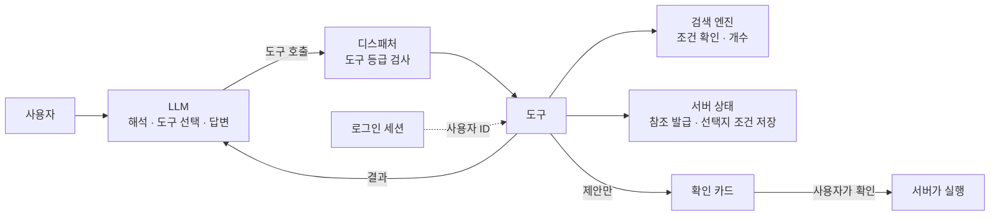
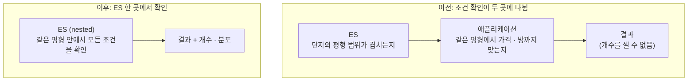
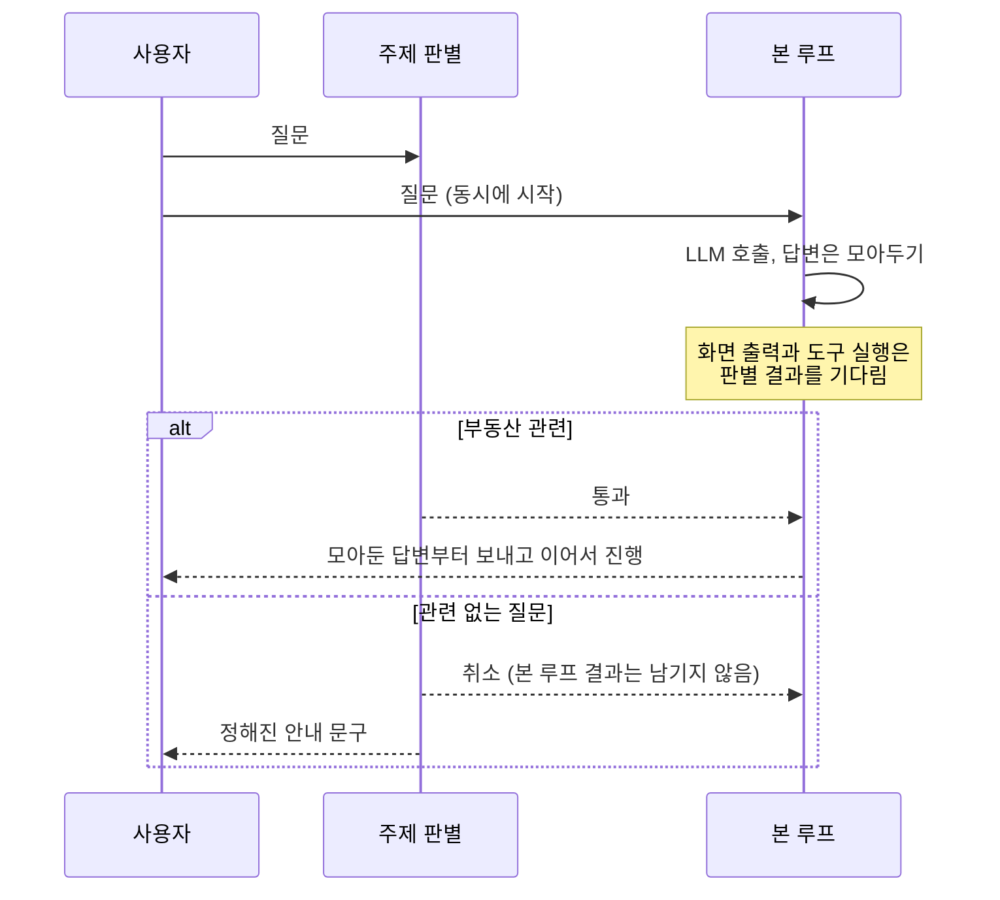
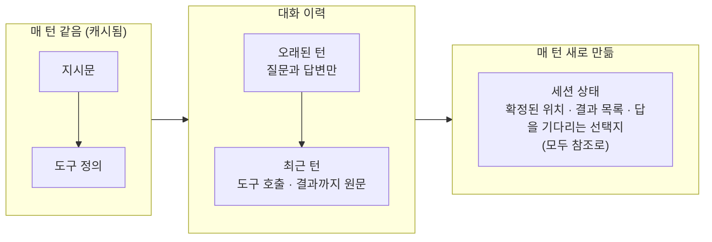
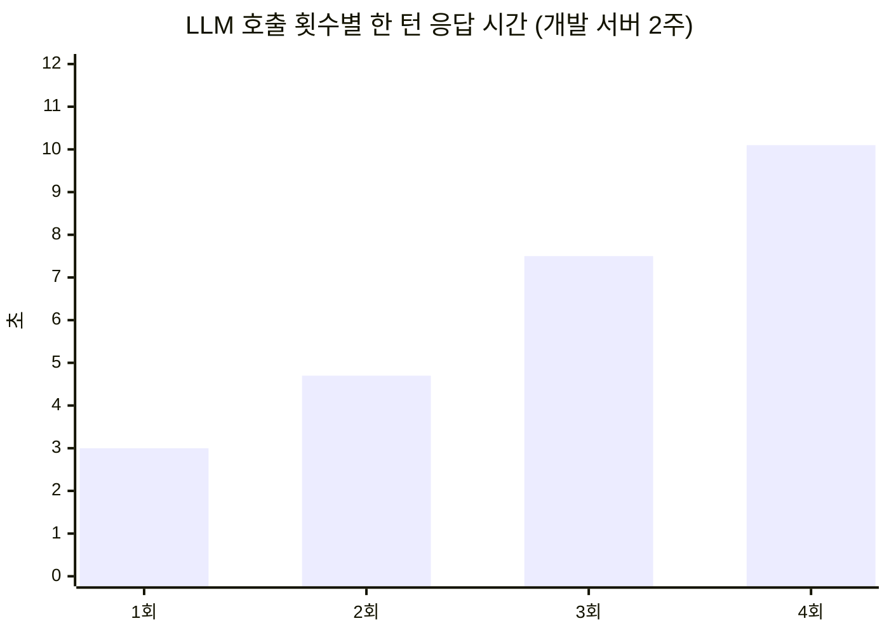

전편: [[부동산 통합 AI 에이전트 1/2편] AI의 답을 서비스로 이어지게 만들기까지]()

안녕하세요. 프롭테크 플랫폼에서 백엔드 개발자로 근무 중인 정정일입니다.

이번엔 지난 글에 이어서, 부동산 통합 AI 에이전트를 만들면서 LLM에게 어디까지 맡기고 무엇을 코드에 둘지 정한 이야기를 해볼까 합니다.

1편을 짧게 정리하면 이렇습니다. 저희는 기존의 AI 매물 추천을, 대화 하나에서 단지를 찾고 시세를 묻고 담당 중개사에게 신청하는 것까지 이어지는 에이전트로 다시 만들었습니다. LLM이 도구를 고르고, 결과를 보고, 다음 도구를 고르는 Agent Loop 구조이고, 목표는 AI의 답이 중개 신청 같은 서비스의 실제 기능으로 이어지게 하는 것이었습니다.

그런데 AI가 서비스의 기능으로 이어지면, AI가 틀렸을 때 사용자에게 실제로 손해가 생길 수 있습니다. 그래서 이번 글은 그 문제에서 출발해볼까 합니다. LLM에게 맡길 일과 서비스가 책임질 일을 어떤 기준으로 나눴는지, 그 기준을 코드로 어떻게 지켰는지, 그리고 이 구조 때문에 느려진 응답은 어떻게 다뤘는지까지 다뤄보도록 하겠습니다.

## 어디까지 맡길지 정한 기준

Agent Loop에서는 어떤 도구를 몇 번, 어떤 순서로, 어떤 인자로 부를지 LLM이 정합니다. 그만큼 LLM이 틀릴 수 있는 곳도 많아지죠. 조건에 맞지 않는 단지를 맞다고 하거나, 버튼에 3곳이라고 적어놓고 5곳을 보여주거나, 사용자가 원하지 않았는데 중개 신청을 넣어버리면 사용자에게 실제로 손해가 생깁니다. 그 책임은 저희 서비스에 있고요.

서비스로 이어지게 하려면 사용자가 AI가 보여주는 것을 믿고 다음 행동으로 넘어갈 수 있어야 했습니다. 버튼에 적힌 숫자를 믿고 누르고, 확인 카드를 믿고 신청을 누를 수 있어야 하니까요. 그래서 저는 LLM이 판단할 여지가 큰 일은 가능한 한 도구 안으로 옮기고, LLM에게는 저희가 직접 구성한 도구를 쥐여주는 쪽을 택했습니다. LLM은 도구를 고르고 인자를 채우는 데까지만 하고, 조건에 맞는지나 몇 곳인지, 실행해도 되는지는 도구와 서버에서 정하는 거죠.

이 고민과 관련해서 참고한 자료도 있었습니다. 프롬프트 인젝션 방어 패턴을 정리한 [Design Patterns for Securing LLM Agents against Prompt Injections](https://arxiv.org/abs/2506.08837) 논문을 보면, 계획을 먼저 세우고 실행하는 구조는 제어 흐름이 고정돼 있어서 인젝션이 일어나도 영향이 도구 인자에 그치지만, Agent Loop에서는 도구 결과로 들어온 텍스트가 다음 행동 선택에 영향을 줄 수 있다고 설명합니다. 지난 구조에서는 흐름이 고정돼 있다는 것 자체가 안전장치였는데, Agent Loop로 가면 그게 없어지게 되니 다른 방법으로 대신해야 했습니다.

그렇다면 무엇을 LLM에게 맡기고 무엇을 코드에 둘까요? LLM이 관여하는 판단들을 하나씩 놓고 보니 기준은 크게 세 가지 정도로 정리할 수 있었습니다. 틀렸을 때 사용자에게 손해가 생기는지, 되돌릴 수 있는지, 같은 입력에 항상 같은 결과가 나와야 하는지였습니다. 그리고 저희 서비스에는 하나가 더 있었는데, 앱과 웹에 이미 있는 규칙과 같아야 하는지였습니다.

| 판단 | 누가 | 이유 |
|---|---|---|
| 사용자가 무엇을 원하는지 해석 | LLM | 틀려도 되물으면 되고, 손해가 바로 생기지 않는다 |
| 어떤 도구를, 어떤 조건으로 부를지 | LLM | 잘못 고르면 결과를 보고 다시 고를 수 있다 |
| 언제 멈출지 | 코드 | 응답 시간과 비용은 매번 같은 기준이어야 한다 |
| 무엇이 조건에 맞는지, 몇 곳인지 | 코드 (검색 엔진) | 화면의 숫자는 같은 입력에 같은 결과여야 한다 |
| 어떤 단지·장소·사용자를 가리키는지 | 서버 | 틀리면 엉뚱한 단지나 다른 사람의 정보로 이어진다 |
| 신청 같은 행동을 할지 | 사용자 (실행은 서버) | 되돌릴 수 없으니 사용자가 확인하고, 실행 규칙은 앱·웹과 같아야 한다 |
| 부동산과 관련 있는 질문인지 | 판단은 별도 LLM 호출, 막고 안내하는 건 코드 | 판단은 문맥을 봐야 하지만, 그 결과로 무엇을 할지는 매번 같아야 한다 |
| 화면에 보여줄 카드 | 대상이 여럿일 때만 LLM | 카드 안의 숫자는 코드가 만들고, LLM은 무엇을 보여줄지만 고른다 |
| 어떻게 말할지 | LLM | 다만 LLM이 볼 수 있는 정보는 코드가 정한다 |

한 턴의 흐름으로 그려보면 이렇습니다.



디스패처는 LLM이 고른 도구를 실제로 실행하는 서버 쪽 관문입니다. 모든 도구는 조회, 제안, 확인이 필요한 쓰기 중 하나의 등급을 가지는데, 디스패처는 조회와 제안만 실행하고 쓰기 등급은 실행을 거부합니다. 신청 같은 행동은 "제안" 등급의 도구가 확인 카드에 띄울 제안으로만 저장하고, 실제 실행은 사용자가 확인 카드를 누른 뒤 LLM을 거치지 않는 경로에서 일어납니다. 이 분기를 디스패처 한 곳에만 둔 건, 뒤에서 이야기하겠지만 지시문에 적은 금지 규칙이 생각보다 자주 지켜지지 않았기 때문입니다.

"언제 멈출지"도 코드로 정했습니다. 한 턴에서 LLM을 부르는 횟수와 누적 토큰, 경과 시간에 각각 상한을 두고, 하나라도 넘으면 도구를 쓸 수 없게 한 상태로 한 번 더 불러서 지금까지의 결과로 답하게 합니다. 아무 답도 못 받는 것보다는 지금까지 찾은 걸로라도 답을 받는 게 낫다고 봤습니다.

이 표를 정한 뒤로는 각 항목을 코드 어디에서 지키게 할지 정하는 작업이 대부분이었습니다.

## 버튼에 적힌 숫자와 결과

버튼에 3곳이라고 적었으면 눌렀을 때 3곳이 나와야 하고, "두 번째 단지"라고 하면 화면의 두 번째 단지여야 합니다. 당연한 것 같지만, 개수를 세는 시점과 결과를 보여주는 시점 사이에 LLM의 해석이 들어가면 둘이 어긋날 수 있었습니다.

이 문제가 처음 드러난 건 조건 좁히기였습니다. 기획에는 결과가 많으면 조건을 좁히는 객관식 질문을 하고, 선택지마다 남는 단지 수를 보여주자는 요구가 있었습니다.

처음 떠올린 건 지시문에 "결과가 많으면 좁히는 질문을 하라"고 적는 방법이었는데, 문제는 "선택지마다 남는 단지 수"였습니다. LLM은 검색 결과 중 상위 몇 곳만 받기 때문에, 선택지마다 전체에서 몇 곳이 남는지 셀 정보가 애초에 없었습니다. 그다음으로 검색 후보를 애플리케이션 메모리에 올려서 세는 방식도 구현해봤는데, 다시 보니 맞지 않는 방식이었습니다. 개수와 분포를 세는 건 검색 엔진이 잘하는 일인데 후보를 전부 메모리에 올려 애플리케이션이 세는 건 역할이 맞지 않았고, 검색 결과에 상한이 있어서 그 이상은 셀 수도 없었거든요.

그렇다면 Elasticsearch에서 세면 되겠다 싶었는데, 막상 세려고 보니 기존 구조의 문제가 보였습니다. 지난 AI 추천 글에서 이야기했던 포스트 필터링 때문이었습니다. 검색 인덱스는 단지 단위라서 ES는 "이 단지의 평형 범위가 조건과 겹치는지"까지만 보고, "같은 평형에서 가격과 방 개수가 동시에 맞는지"는 검색 후에 애플리케이션에서 다시 걸렀습니다. 조건을 확인하는 곳이 두 곳으로 나뉘어 있었던 거죠. 이 상태로 ES에서 집계를 하면 개수가 실제보다 크게 나옵니다.

개수를 정확히 세려면 조건 확인을 한 곳으로 모아야 했습니다. 그래서 평형별 시세를 nested 필드(배열 안의 객체 하나하나를 따로 검색할 수 있게 하는 필드)로 다시 색인해서 조건 확인을 ES 한 곳으로 모으고, 개수와 분포도 ES에서 세게 됐습니다.



확인하는 위치를 옮기면 기존 추천 결과가 바뀔 수 있어서, 옮기기 전에 결과가 같은지부터 확인했습니다. 기존 방식과 216개 조건을 비교했고 불일치는 0건이었습니다. 이 과정에서 시세를 부분 갱신하던 방식 때문에 평형별 가격 데이터가 원본과 어긋나 있던 경우도 찾아서, 다시 색인하면서 함께 정리했습니다. 좁히기 질문 하나 때문에 검색 인덱스를 다시 만드는 게 과한가 싶기도 했지만, 화면에 보이는 숫자가 틀리는 것보다는 낫다고 판단했습니다.

어떤 조건으로 좁힐지도 코드가 고릅니다. 후보 조건마다 선택지별 개수를 병렬로 세고, 가장 큰 선택지가 전체에서 차지하는 비율이 가장 작은 조건, 즉 결과를 가장 고르게 나누는 조건을 고릅니다. LLM은 그 질문을 문장으로 만들기만 합니다.

```kotlin
// 결과를 줄이는 선택지(0 < n < 전체)가 둘 이상 남는 조건 중, 가장 큰 선택지가 작을수록 잘 나누는 조건이다.
val best = counted
    .map { (dimension, options) -> dimension to options.filter { (_, n) -> n != null && n in 1 until total } }
    .filter { (_, options) -> options.size >= 2 }
    .minByOrNull { (_, options) -> options.maxOf { it.second }.toDouble() / total }
```

그런데 개수를 정확히 세는 것만으로는 부족했습니다. 사용자가 "10년 이내 준공 · 2곳" 버튼을 누르면 LLM은 그 선택을 해석해서 검색 조건을 다시 만듭니다. 이때 조건을 조금이라도 다르게 만들면 버튼에는 2곳인데 결과는 3곳이 나올 수 있습니다.

그래서 선택지마다 검색 조건을 서버에 저장해두고, LLM에게는 선택지의 참조만 넘기게 했습니다. 사용자가 버튼을 누르면 LLM은 `N2` 같은 참조만 도구에 넣고, 서버는 저장해둔 조건으로 그대로 검색합니다. LLM이 다른 조건을 같이 보내도 무시합니다.

```kotlin
// 고른 선택지가 있으면 서버가 저장해둔 검색 조건을 그대로 쓴다. 모델이 함께 보낸 다른 조건은 무시한다. (이름은 단순화)
val chosen = input.choiceRef?.let { ref -> session.pendingChoices.firstOrNull { it.ref == ref } }
if (input.choiceRef != null && chosen == null) {
    return ToolResult.error("답을 기다리는 선택지에 없는 참조입니다. 조건을 직접 넣어 다시 검색하세요.")
}
val condition = chosen?.savedCondition ?: input.toCondition()
```


*21곳이 나오자 준공 시기로 좁히는 질문이 붙었고(왼쪽), "10년 이내 준공 · 2곳"을 고르면 2곳으로 좁혀집니다(오른쪽).*

대신 사용자가 "10년 이내인데 그중에 500세대 이상만"처럼 선택지를 조금 바꿔서 말하는 경우에는 이 방식을 쓸 수 없습니다. 그래서 버튼 아래에 "원하는 조건을 직접 입력할 수도 있어요"를 항상 두었습니다. 버튼으로 고르면 서버가 저장한 조건으로 정확하게 검색하고, 직접 입력하면 LLM이 해석해서 검색합니다.

결과가 0건일 때 보여주는 완화안에도 같은 방식을 적용했습니다. 처음에는 완화 버튼이 "가격 상한을 올려서 다시 찾아줘" 같은 문장을 다음 질문으로 보냈는데, 이 문장을 LLM이 해석하면서 버튼을 만들 때와 다른 가격 범위로 검색되는 경우가 있었습니다. 그래서 완화안도 서버가 조건을 하나씩 넓혀 미리 검색해보고, 결과가 있는 완화안만 조건과 함께 저장한 뒤 버튼에는 참조만 붙이게 됐습니다.


*"그 중에 더 싼 곳은 없어? 15억 이하로"라고 이어서 물으면 앞의 조건(잠실동 주변, 30평대, 10년 이내 준공)을 유지한 채로 찾고, 0곳이면 결과가 있는 완화안만 보여줍니다. "예산을 높여서 찾기 · 1곳"을 누르면 1곳이 나옵니다.*

이 방식은 다른 곳에도 그대로 적용했습니다. 단지를 가리킬 때도 LLM은 실제 ID를 다루지 않고 서버가 붙인 `C1`, `C2` 같은 참조로만 말합니다. 장소도 좌표 대신 서버가 발급한 참조로만 넘기고, 대화에 없는 참조는 거부합니다. 서비스의 다른 화면으로 보내는 링크도 LLM은 "복비 계산기로 보내기" 같은 행동만 고르고 실제 주소는 서버가 만듭니다.

만들고 나서 돌아보니 LLM에게 실제 값은 주지 않고 서버가 발급한 참조만 넘겨주는 방식을 여기저기서 쓰고 있었습니다. LLM이 값을 직접 만들면 그 값은 실행할 때마다 달라질 수 있는데, 참조만 다루게 하면 LLM이 틀려도 "다른 참조를 고르는 것" 정도로 범위가 좁아지고, 그건 화면에 바로 드러나서 확인하기도 쉬웠습니다. 앞에서 이야기한 인젝션 문제도 여기서 일부 줄어듭니다. 버튼으로 고른 조건이나 단지를 가리키는 일에서는 LLM이 넘길 수 있는 게 대화 안에서 발급된 참조뿐이기 때문이죠. 다만 이것만으로 다 막을 수 있는 건 아니어서, 되돌릴 수 없는 일은 1편에서 이야기한 것처럼 사용자 확인을 거치게 한 것과 함께 봐야 한다고 생각합니다.

## 다른 사용자의 정보

다른 사용자의 정보를 어떻게 막을지도 처음부터 고민했던 부분입니다.

기존 서비스에서 "내 관심 단지", "내 신청 내역" 같은 조회는 로그인한 사용자가 자기 화면에서 호출하는 구조였습니다. 그런데 에이전트에서는 LLM이 도구의 인자를 만듭니다. 사용자가 대화로 "다른 사람 신청 내역도 보여줘"라고 하거나 다른 사용자의 식별자처럼 보이는 값을 입력하면, LLM이 그 값을 도구 인자에 넣을 수 있죠. 그래서 LLM이 만든 인자는 사용자 입력과 똑같이 믿을 수 없는 값으로 보기로 했습니다.

그래서 사용자 ID는 대화에서 받지 않고 로그인 세션에서만 가져오게 했습니다. 도구를 실행할 때 사용자 ID, 대화 세션, 현재 상태처럼 LLM이 바꿀 수 없어야 하는 값은 서버가 로그인 정보로 채워 넣고, 도구 스키마에는 사용자 식별자 필드를 아예 두지 않았습니다. LLM이 다른 사람의 ID를 넣고 싶어도 넣을 곳이 없는 거죠. 도구 스키마에 사용자 식별자가 없는지 검사하는 테스트도 두었습니다.

대화 세션도 같은 기준으로 처리했습니다. 다른 사용자의 대화 세션으로 요청이 들어오면 세션이 있는지조차 알려주지 않고 없는 세션처럼 응답합니다. 앞에서 이야기한 `C1` 같은 참조도 세션 안에서만 의미가 있어서, 다른 세션의 참조를 가져와도 아무것도 가리키지 않습니다.

LLM이 볼 필요가 없는 개인정보는 처음부터 넘기지 않았습니다. 중개사 연락처나 실명, 내부 식별자 같은 것들이었죠. 그래서 화면에서도 중개사는 "가락동 담당중개사"처럼 동네 이름으로만 안내합니다. 그런데 이것도 생각보다 꼼꼼하게 봐야 했습니다. 등기분석 결과를 설명하는 기능을 붙일 때 소유자 이름 필드는 빼고 넘겼는데, 개발 중에 결과를 확인해보니 설명 문장 안에도 이름이 들어 있을 수 있었습니다. 그래서 필드를 빼는 것과 별도로 문장 안의 이름까지 가린 뒤 넘기게 됐습니다.

## 부동산과 관련 없는 질문

범용 LLM을 붙였으니 부동산과 상관없는 질문에도 답할 수 있습니다. 처음에는 지시문에 "부동산 외 질문에는 정중히 거절해"라고 적어두면 될 거라고 생각했는데, 그렇게 적어둔 상태에서도 게임이나 요리 질문에 답하고 있었습니다.

이걸 가볍게 넘길 수 없었던 이유는 두 가지였습니다. 그 답은 저희 서비스의 이름으로 나가니 틀리거나 부적절해도 책임은 서비스에 있고, 한 턴에 LLM을 여러 번 부르는 구조라 다른 용도로 쓰이면 그 비용도 저희가 냅니다.

그래서 본 루프와 별개로 부동산 관련 여부만 판별하는 짧은 LLM 호출을 두고, 관련 없는 질문이면 본 루프를 멈추고 정해진 안내 문구로 답하게 했습니다. 고민했던 건 애매한 질문이었습니다. "이사 가는 날 짐 싸는 팁"은 부동산 질문일까요? 저는 부동산 질문을 잘못 막는 쪽이 더 문제라고 봤습니다. 사용자는 서비스가 고장 났다고 느낄 테니까요. 그래서 판별 기준을 넓게 잡았고, "내 일정 언제야?"처럼 본인의 서비스 이용 정보를 묻는 질문이 막히던 문제도 허용 범위에 명시해서 해결했습니다.


*"오늘 저녁 메뉴 추천해줘"에는 답하지 않고, 할 수 있는 일을 안내합니다.*

그런데 이걸 붙이고 나니 판별이 끝난 뒤에 본 루프가 시작돼서, 판별에 걸리는 시간(평균 1.1초)만큼 모든 질문의 첫 반응이 늦어졌습니다. 가끔 들어오는 관련 없는 질문 때문에 모든 사용자가 1초를 더 기다리는 건 맞지 않다고 생각했습니다.

그래서 판별과 본 루프를 동시에 시작하게 바꿨습니다. 이때 판별 결과가 나오기 전에 일어나면 안 되는 건 두 가지였습니다. 사용자에게 답변이 보이는 것, 그리고 도구가 실행되는 것이었죠. 본 루프는 판별과 함께 시작하되, 판별이 끝날 때까지 답변은 화면에 보내지 않고 모아두고 도구 실행은 판별 결과를 기다립니다. 부동산 질문이면 모아둔 답변부터 보내고 이어서 진행하고, 관련 없는 질문이면 본 루프를 취소하고 본 루프가 만든 내용은 이력에 남기지 않습니다.



관련 없는 질문은 많지 않으니, 판별을 기다리는 시간만큼 모든 질문의 첫 반응을 앞당기는 쪽을 택했습니다.

## 대화 이력과 상태

대화 상태는 처음부터 저희가 관리해야 한다고 생각했습니다. Responses API는 대화를 공급자 서버에 저장해두고 이어 쓰는 기능을 제공하고, 이걸 쓰면 구현이 훨씬 간단해집니다. 하지만 그러면 대화의 원본이 저희 밖에 있게 됩니다. 저장 기간도, 개인정보를 언제 지울지도 공급자 정책을 따라야 하고, 이어 쓸 때마다 앞의 대화가 다시 과금되니 비용이 줄어드는 것도 아니었습니다. 무엇보다 "왜 이런 결과가 나왔어요?"라는 질문을 받았을 때 설명할 근거가 저희에게 없게 되죠.

그래서 공급자 저장은 끄고 대화 이력과 세션 상태를 저희 DB에 두었습니다. 대신 공급자가 해주던 일을 직접 해야 했습니다. 공급자 저장을 끄면 추론 모델이 이전 턴의 추론을 이어받지 못하기 때문에, 도구 호출과 함께 받은 추론 항목을 암호화된 형태로 저장했다가 다음 요청에 다시 보내야 했습니다. 예산을 넘겨 실행하지 않은 도구 호출처럼 결과와 짝이 맞지 않는 항목은 이력에서 빼야 했고, 같은 대화에 요청이 동시에 들어오는 경우도 대화 단위 락과 상태 버전 확인으로 막았습니다.

매 턴 LLM에게 무엇을 보낼지도 저희가 정해야 했습니다. "두 번째 단지 실거래가 어때?", "거기 주변에 지하철역 있어?" 같은 질문에 맞는 도구를 고르려면 LLM이 앞의 대화를 알아야 합니다. 그렇다고 대화 전체를 매번 그대로 보내면 토큰이 계속 늘어나고, 오래된 도구 결과 때문에 LLM이 잘못 판단하는 경우도 생깁니다. 그래서 매 턴 보내는 문맥을 나눠서 조립했습니다.



세션 상태에는 지금까지 대화에서 확정된 위치와 검색 결과, 답을 기다리는 선택지를 앞에서 이야기한 참조로 정리해서 붙입니다. 덕분에 "두 번째 단지"나 "거기" 같은 말을 LLM이 해석할 때 근거가 분명해졌습니다. "두 번째 단지 담당 중개사와 이야기하고 싶어"처럼 앞의 결과를 가리키며 서비스로 넘어가는 요청도 이 상태 덕분에 정확한 단지로 이어지고요. 바뀌지 않는 부분을 앞에, 매 턴 바뀌는 부분을 뒤에 둔 건 뒤에서 이야기할 프롬프트 캐시 때문이기도 합니다.

이렇게 해두니 반대 문제도 생겼습니다. 마포구 전세를 찾다가 "이제 송파구 매매로 볼래"라고 하면 앞의 조건이 새 검색에 섞여 들어가는 경우가 있었습니다. LLM 입장에서는 앞의 대화가 다 보이니 이어지는 질문으로 해석한 거죠. 그래서 처음에는 화면에 조건 초기화 버튼을 두고, 초기화하면 그 이전 턴을 LLM에게 보내지 않게 했습니다. 그런데 초기화 직후 이전 답변에 달린 버튼을 누르면, LLM이 그 버튼이 어떤 조건에서 나온 건지 몰라 엉뚱하게 검색하는 문제가 생겼습니다. 그래서 지금은 초기화하면 지도만 비우고 대화는 그대로 보내며, 이전 조건을 이어 쓸지는 LLM이 사용자의 문장을 보고 판단하게 했습니다. 대화를 끊는 것보다 판단할 근거를 남겨두는 쪽이 결과가 나았습니다.

LLM이 도구를 잘못 부르는 경우도 있었습니다. 없는 참조를 넣거나, 필요한 인자를 빼먹거나, 대화에 없는 단지를 가리키는 경우들이었죠. 처음에는 이런 경우 예외를 던져 턴을 실패로 끝냈는데, 사용자 입장에서는 그냥 에러가 난 것처럼 보였습니다. Agent Loop에서는 LLM이 도구 결과를 보고 다시 고를 수 있으니, 잘못된 호출도 예외로 끊지 않고 이유를 도구 결과로 돌려주는 게 맞다고 봤습니다. 지금은 LLM이 이 결과를 보고 인자를 고치거나 다른 도구를 골라 다시 부릅니다.

판단 근거도 남겼습니다. Agent Loop에서는 판단이 여러 번의 LLM 호출과 도구 호출에 흩어지기 때문에, 요청 단위가 아니라 실행 한 번의 전체 과정을 기록 단위로 잡았습니다. 도구 호출에는 LLM에게 보내지 않는 검색 점수나 후보 목록도 같이 남겼습니다. 처음 "강남역 근처 30평대 매매"를 물었을 때 AI가 "강남역 후보가 두 곳 있는데 어느 쪽인가요?"라고 되물은 적이 있습니다. 강남역은 하나인데 말이죠. 기록을 열어보니 같은 이름, 같은 좌표의 강남역이 노선별로 두 번 색인되어 있었고, LLM은 그 둘을 다른 장소로 보고 되물은 거였습니다. 기록 덕분에 프롬프트가 아니라 색인 데이터 문제라는 걸 바로 찾을 수 있었습니다.

## 지시문과 도구 설명

권한을 코드로 정했다고 지시문이 필요 없어지는 건 아닙니다. LLM이 어떻게 말하고 어떤 도구를 고를지는 결국 텍스트로 알려줘야 하니까요. 그런데 지시문이 생각대로 동작하지 않는 경우가 여러 번 있었고, 그러다 보니 몇 가지 경향이 보이더라고요.

1편에서 이야기한 것처럼 한때 거래 유형을 먼저 묻게 한 적이 있었는데, 지시문에 "거래 유형을 말하지 않으면 먼저 물어봐"라고 적었는데도 LLM이 계속 매매로 가정하고 바로 검색했습니다. 원인을 찾아보니 검색 도구 설명에 "거래 유형을 말하지 않았으면 매매"라는 한 줄이 남아 있었습니다. 지시문보다 도구 설명을 따른 거죠. 담당 중개사와 이야기할 수 있냐고 물었더니 AI가 "앱에서 매칭을 신청해 주세요"라고 답한 적도 있는데, 담당 중개사를 찾는 도구의 결과 문구가 "앱의 단지 화면에서 매칭을 신청할 수 있습니다"였기 때문이었습니다.

복비 할인 기준을 안내할 때는 이 차이가 더 분명하게 보였습니다. 할인은 거래금액이 일정 금액 이상일 때 적용되는데, LLM이 이 기준을 빼먹거나 다르게 말하는 경우가 있었습니다. 처음에는 지시문에 기준을 명시했는데 그대로였고, 다음에는 지식 검색에서 엉뚱한 문서가 섞여 들어오는 걸 막아봤는데 역시 그대로였습니다. 결국 복비 계산 도구의 결과에 기준 금액을 항상 같이 담아 보내고 나서야 해결됐습니다.

왜 이런 일이 생길까요? 제가 겪은 범위에서는 LLM이 지시문의 일반적인 규칙보다, 도구를 고르고 답을 만드는 시점에 가까이 있는 구체적인 텍스트를 더 따랐습니다. 위의 세 사례 모두 지시문을 고쳤을 때는 그대로였고, 도구 설명이나 도구 결과 문구를 고쳤을 때 해결됐습니다. 실험으로 잰 건 아니지만, 저는 LLM이 판단하는 시점 바로 앞에 있는 게 도구 설명과 도구 결과이기 때문이지 않나 싶습니다.

| 사례 | 지시문을 고쳤을 때 | 해결한 곳 |
|---|---|---|
| 거래 유형을 먼저 묻지 않음 | 그대로 | 도구 설명의 기본값 문구 삭제 |
| 대화 대신 앱으로 신청하라고 안내 | 그대로 | 도구 결과 문구 수정 |
| 복비 할인 기준 누락 | 그대로 | 도구 결과에 기준 금액 포함 |

이걸 알고 나서 몇 가지를 바꿨습니다. 먼저 도구 결과 문구를 사용자에게 보여줄 문장이라고 생각하고 쓰게 됐습니다. 저는 백엔드 입장에서 도구 결과를 그냥 데이터로 생각했는데, 도구 결과 문구가 답변의 말투와 내용에 그대로 반영되고 있었거든요.

도구 설명에는 무엇을 하는지뿐 아니라 언제 쓰지 말아야 하는지도 적었습니다. 처음에는 장소 검색, 단지 검색, 단지 상세, 실거래가, 주변 시설 정도의 도구 5개로 시작했는데, 통합 AI 에이전트를 목표로 하다 보니 지금은 30개가 됐습니다. 도구가 늘면서 비슷한 도구 사이에서 잘못 고르는 경우가 생겼는데, OpenAI의 에이전트 가이드에도 도구가 많을 때의 문제는 개수보다 도구 사이의 유사성에서 생긴다는 내용이 있었습니다. 그래서 중개 신청 제안은 "여기 사고 싶어"처럼 거래 의사를 밝혔을 때 쓰고 "맘에 들어"처럼 관심만 보였을 때는 쓰지 않는다는 식으로, 비슷한 도구 사이의 기준을 설명에 적어뒀습니다. 지난 AI 추천 글에서 도구 경계를 나누는 기준으로 "LLM이 이 도구의 역할을 한 문장으로 설명할 수 있는가"를 적었는데, 이번에는 "이 도구를 쓰지 말아야 할 때를 한 문장으로 설명할 수 있는가"가 추가된 것 같습니다.

사용자에게 보이면 안 되는 정보는 "말하지 마"라고 적지 않고, LLM이 볼 수 있는 곳에서 아예 뺐습니다. 금지한 단어가 오히려 힌트가 되기도 했고, 지켜지지 않을 때 원인을 찾기도 어려웠습니다.

그리고 지시문으로 지켜지지 않는 규칙은 코드로 옮겼습니다. 예를 들어 좁히기 질문을 낸 응답에서는 다른 선택지 버튼을 또 내지 말라고 지시문에 적어뒀는데, 테스트해보니 버튼을 또 만드는 경우가 꽤 많았습니다. 같은 응답에 버튼 묶음이 두 개 생기면 사용자는 어느 쪽을 눌러야 할지 알 수 없습니다. 그래서 이 경우는 서버가 뒤의 버튼을 버리게 했고, 1편에서 이야기한 권유 규칙도 같은 이유로 서버에서 지키게 했습니다. 그 뒤로는 반드시 지켜야 하는 규칙이면 지시문보다 코드에 먼저 두는 쪽으로 정리하게 됐습니다.

## 나빠지지는 않았는지

구조를 바꾸면서 기존 기능보다 나빠지지 않았는지 확인하고 싶었습니다. 먼저 기존 AI 추천에서 쓰던 예시 질문 16개를 양쪽에 똑같이 넣고, 검색 조건이 의도대로 잡혔는지 비교했습니다. 처음에는 16개 중 7개만 의도한 조건이 잡혔는데, 하나씩 보니 대부분은 틀렸다기보다 되물어서 생긴 차이였습니다. 처음 지시문이 너무 신중해서 조건이 충분한데도 묻고 있었던 거죠. 지시문을 고친 뒤에는 16개 중 15개가 맞았습니다.

다만 지시문을 고칠 때 이 16개를 보면서 고쳤으니, 이 숫자만으로 나아졌다고 말하기는 어려웠습니다. 그래서 고칠 때 보지 않은 질문으로도 확인했습니다. 기획팀이 정리한 시나리오 48개로 직접 대화해봤을 때는 적절하게 답한 게 27개, 개선이 필요한 게 14개, 아직 기능이 없는 게 7개였습니다. 기능이 없는 7개는 통근 시간, 초품아, 갭 투자 금액, 급매처럼 당시 데이터나 도구가 없던 조건들이었습니다. 이후에는 기능을 바꿀 때마다 기존 기능 86개를 두 번씩 돌려서 이전과 같은지 비교하는 회귀 확인을 같이 했습니다.

이 비교에서 기존 경로의 한계가 보이기도 했습니다. "서울아산병원 근처 전세"를 물었더니 기존 추천은 이름이 비슷한 다른 지역의 병원을 잡아 김포의 단지를 추천했고, 새 구조는 장소 후보를 보고 문맥에 맞는 서울아산병원을 골라 송파의 단지를 추천했습니다.

평가에서 가장 어려웠던 건 같은 질문도 실행할 때마다 답이 조금씩 달라진다는 점이었습니다. 한 번 돌려서 맞았다고 끝낼 수가 없었죠. 그래서 지시문을 바꾸기 전에, 아무것도 바꾸지 않고 같은 질문을 두 번 돌렸을 때 결과가 얼마나 달라지는지부터 쟀습니다. 기획 시나리오에서 고른 27개 질문 중 19개는 자동 비교에서 같게 나왔고, 8개는 사람이 직접 봐야 했습니다. 원래 이 정도는 흔들린다는 기준선이 있어야, 지시문을 바꾼 뒤의 차이가 개선인지 그냥 흔들림인지 구분할 수 있었습니다. 비교도 점수를 매기는 대신, 기존 답변과 바꾼 답변을 어느 쪽인지 모르게 나란히 놓고 사람이 더 나은 쪽을 고르는 방식으로 하고 있습니다. LLM에게 점수를 매기게 하는 방법도 검토했지만, 판정하는 쪽도 같은 방식으로 흔들리는 상태에서는 그 점수를 기준으로 삼기 어렵다고 봤습니다.

## 느려진 응답 시간

앞의 16개 질문 비교에서 응답 시간 중앙값은 기존 4.9초, 새 구조 7.4초였습니다. 응답이 느려진 건 사실입니다.

어느 정도는 예상했던 부분입니다. LLM이 결과를 보고 다음 도구를 고르는 구조라 LLM 호출이 여러 번 일어날 수밖에 없고, 지난 AI 추천 글에서 Agent Loop를 선택하지 않았던 이유도 이것이었습니다. 1편에서 이야기했듯 정형 질문까지 루프로 처리하게 된 것도 영향이 있었고요. 그래도 이번에 더 중요했던 건 사용자가 기대하는 동작을 할 수 있게 되는 것이었습니다. 기존 구조에서는 이어지는 질문을 이해하는 것도, 중개 신청까지 연결하는 것도 할 수 없었으니까요.

그래서 먼저 어디서 시간이 쓰이는지부터 쟀습니다. 개발 서버에서 2주 동안 쌓인 1,458턴을 보니 응답 시간의 91%가 LLM 왕복이었고, 왕복이 한 번 늘 때마다 응답 시간도 2.5초 안팎씩 늘었습니다.



도구를 아무리 빠르게 해도 LLM 왕복 횟수가 줄지 않으면 크게 달라지지 않는다는 뜻이었습니다. 그래서 한 일은 크게 네 가지였습니다.

먼저 결과가 보이기까지의 시간을 줄였습니다. 처음에는 답변이 다 끝난 뒤에 카드가 붙었는데, 1편에서 이야기한 것처럼 카드를 답변보다 먼저 그리게 바꾸면서 결과가 보이기까지 3초 정도 빨라졌습니다. 주제 판별을 본 루프와 동시에 돌린 것도 같은 목적이었습니다. 전체 응답 시간보다 처음 뭔가 보이기까지의 시간이 체감에 더 크다고 생각했고, 기록에도 첫 글자가 나오기까지의 시간을 따로 남겨 같이 보고 있습니다.

다음으로 프롬프트 캐시가 깨지지 않도록 문맥 조립 순서를 고정했습니다. Agent Loop는 한 턴에 LLM을 여러 번 부르고 그때마다 지시문과 도구 정의를 다시 보냅니다. 앞의 그림처럼 바뀌지 않는 부분을 앞에 두고 매 턴 바뀌는 세션 상태를 뒤에 붙이니, 같은 2주 동안 입력 토큰의 95%가 캐시에 적중했습니다. 도구 정의 순서 하나만 바뀌어도 캐시가 깨지기 때문에 순서도 고정했습니다.

그리고 제한 시간이 적용되지 않던 도구를 고쳤습니다. 도구마다 실행 시간 제한을 걸어뒀는데, 검색 하나가 그 몇 배가 걸려도 끊기지 않았습니다. 코루틴의 `withTimeout`은 코루틴이 중단되는 지점에서만 취소를 확인하는데, 도구 대부분이 ES나 HTTP를 호출하는 블로킹 코드라 중단 지점이 없었던 거죠. 그래서 도구는 별도 스코프에서 실행하고, 루프는 결과를 기다리는 쪽에만 제한 시간을 걸도록 나눴습니다.

```kotlin
/**
 * 도구를 별도 스코프에서 실행하고 기다리는 쪽에만 제한 시간을 건다.
 * 기다림을 끊으면 루프는 시간 초과 결과를 받고 바로 다음 판단으로 넘어가고, 늦게 끝난 결과는 버린다.
 */
private suspend fun withWallClockTimeout(block: suspend () -> ToolResult): ToolResult =
    withContext(Dispatchers.Default) {
        val running = toolScope.async { block() }
        try {
            withTimeout(toolTimeout) { running.await() }
        } finally {
            running.cancel()
        }
    }
```

이렇게 해서 사용자가 느린 도구를 끝까지 기다리지는 않게 됐고, 느린 검색 자체를 줄이는 작업은 따로 진행하고 있습니다.

마지막으로 응답 한 번의 시간보다 원하는 결과를 얻기까지의 전체 시간을 보려고 했습니다. 되묻기는 대화 한 턴이 늘어나는 일이라, 불필요한 질문 하나를 없애는 게 사용자에게는 응답 한 번을 1초 줄이는 것보다 크다고 생각했거든요. 결과를 먼저 보여주게 바꾼 것, 0건일 때 서버가 완화안을 미리 검색해 결과가 있는 것만 버튼으로 보여주게 한 것도 같은 이유였습니다.

이렇게 해서 개발 서버 2주 기준 응답 시간 중앙값은 5.3초, 상위 10%는 9.5초였습니다. 앞의 16개 질문 비교와는 표본이 달라 바로 비교할 수는 없지만, 기존 추천보다는 여전히 느린 편입니다.

{}
운영 반영 후 채울 것 (2026-11-12 반영, 데이터 쌓이면)
- 운영 응답 시간 P50 / P95, 첫 결과가 보이기까지의 시간 P50 / P95
- 같은 16개 질문을 지금 구조로 다시 잰 중앙값(표본을 맞춘 비교)
- 턴 예산 초과 비율, 턴당 평균 LLM 호출 수와 비용
{}

## 돌이켜보면

이번에 해보니 LLM에게 자율성을 얼마나 줄지보다, 판단 하나하나를 누구에게 맡길지 정하는 데 시간이 더 많이 들었습니다. 그리고 LLM에게 맡기지 않은 부분마다 비용이 따랐습니다. 사용자가 확인 버튼을 한 번 더 누르는 것, 다시 만든 검색 인덱스, 직접 관리해야 하는 대화 이력, 카드를 고르느라 늘어난 토큰 같은 것들이었죠. 그래도 이 비용들은 대부분 미리 계산할 수 있는 비용이었고, LLM이 틀렸을 때 생기는 문제보다는 관리하기 쉬웠습니다.

처음에는 권한을 나누는 일과 서비스로 잇는 일을 따로 생각했습니다. 그런데 만들고 보니 앞의 일이 뒤의 일을 가능하게 하는 조건이었던 것 같습니다. 확인 카드를 사용자에게 맡겨뒀기 때문에 1편에서 이야기한 것처럼 "사고 싶어" 한마디에 바로 신청 카드를 띄울 수 있었고, 버튼의 숫자를 서버가 세도록 했기 때문에 사용자가 그 버튼을 믿고 다음으로 넘어갈 수 있었습니다.

아직 남은 것도 많습니다. 평가는 여전히 사람이 직접 보는 부분이 많아서, 판정을 어디까지 자동으로 맡길 수 있을지는 계속 고민하고 있습니다. 응답 속도도 여러 작업을 했지만 기존보다 느립니다. 그리고 사용자 확인을 거쳐 실행하는 기능이 늘어날수록, 이번에 정한 기준들을 그때마다 다시 점검해야 할 것 같습니다.

## 마치며

지난 AI 추천 글 마지막에 "다음에 비슷한 기능을 만들 때는 처음부터 'LLM이 할 일'과 '코드가 할 일'의 경계를 먼저 정의하고 시작할 것 같다"고 적었습니다. 이번에는 실제로 그 경계를 먼저 정하고 시작했고, 그 경계 위에서 AI의 답을 서비스로 이어가는 데 대부분의 시간을 썼습니다. 물론 처음 정한 경계가 그대로 간 건 아니었고, 막힐 때마다 처음에 만들어둔 표로 돌아가서 틀리면 사용자에게 손해가 생기는지, 되돌릴 수 있는지를 다시 물어보면서 정리해 나갔습니다.

참고로 이번 작업 중에 AI 모듈은 별도 서비스로 분리했습니다. AI는 한 요청이 수 초에서 수십 초씩 걸려서 다른 기능과 부하 특성이 많이 다르다 보니, AI 쪽 문제가 다른 기능까지 영향을 주지 않게 하려는 결정이었습니다. 이 과정은 [모듈러 모놀리식 전환기]()에 이어서 따로 정리해볼 생각입니다.

부동산 통합 AI 에이전트라는 목표에 비하면 이번 작업은 첫 단계라고 생각합니다. 서비스에 LLM을 붙이면서 비슷한 고민을 하고 계신 분들께 조금이나마 도움이 되었으면 좋겠습니다.

긴 글 읽어주셔서 감사합니다.

---

## 참고 자료

### 관련 글

- [[부동산 통합 AI 에이전트 1/2편] AI의 답을 서비스로 이어지게 만들기까지]()
- [AI 부동산 매물 추천 시스템 구축기]()
- [MSA, 우리에겐 과했다 - 모듈러 모놀리식 전환기]()

### 참고 문헌

- Anthropic - [Building Effective Agents](https://www.anthropic.com/engineering/building-effective-agents)
- Anthropic - [Writing effective tools for agents](https://www.anthropic.com/engineering/writing-tools-for-agents)
- OpenAI - [A practical guide to building agents](https://cdn.openai.com/business-guides-and-resources/a-practical-guide-to-building-agents.pdf)
- OpenAI - [Responses API](https://platform.openai.com/docs/api-reference/responses)
- OWASP - [LLM01: Prompt Injection](https://genai.owasp.org/llmrisk/llm01-prompt-injection/)
- Beurer-Kellner et al. - [Design Patterns for Securing LLM Agents against Prompt Injections](https://arxiv.org/abs/2506.08837) (arXiv, 2025)
