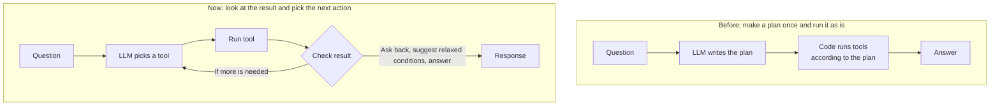
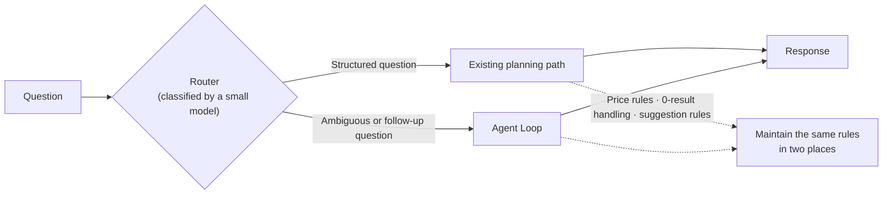
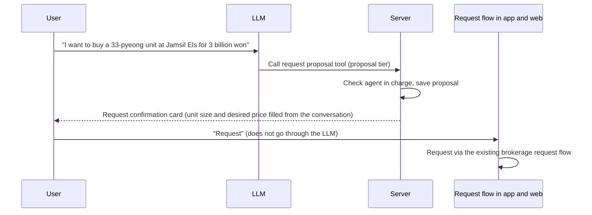
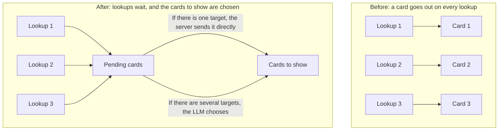

Hi, I'm Jeongil Jeong, a backend developer at a proptech platform.

This time, I'd like to talk about building a service aimed at an integrated AI agent that solves real estate problems in a single conversation, and shipping its first stage to production.

When a user asks "Find apartments for sale in the Seoul suburbs, 30-pyeong range, under 2 billion won," the feature finds apartment and officetel complexes that match the conditions and shows them on a map and as cards. The user can then ask about prices or school districts, and once they find a complex they like, they can send a request to the agent in charge of the complex, all within one conversation.

*Production screen. Just saying "Seoul suburbs" is enough for it to find the cities bordering Seoul, outline them on the map, and show the complexes that match the conditions as both cards and map pins.*

In my previous post, [Building an AI Property Recommendation System](), I chose Planned Tool Use over an Agent Loop, and I wrote down my reasoning like this:

> I believe Agent Loops are powerful when **you need to change your approach based on tool execution results**. (...) But real estate search isn't like that.

This time, however, the product plan changed, what the service wanted to do with AI changed with it, and I ended up rebuilding the structure as an Agent Loop.

What I thought about most in this work was **making the AI not stop at giving an answer, but lead naturally into real service features such as brokerage requests**. Along the way, I also had to decide how much to leave to the LLM.

I've split this post into two parts. Part 1 covers how we set the goal and how we connected the AI's answers to the service. The question of how much to leave to the LLM and what to keep in code continues in Part 2.

Before we start, though, this post describes the problems I ran into and the decisions I made in our service's situation, so it may not fit other situations. I'd appreciate it if you read it with that in mind.

## The AI Recommendation Built with the Plan Approach

In the existing AI recommendation, the LLM looked at the user's question and wrote an execution plan in JSON once, and then code ran the tools according to that plan. It would find a place, search for complexes near it, score them, and recommend them.

When recommendation was the goal, I think this structure fit well. The order of tool calls was mostly fixed, and since the flow was fixed, response time and cost were predictable too. The fact that the LLM couldn't change the execution flow after making the plan also worked as a safeguard.

## A Change in Plans and the Limits of the Existing Structure

This work started when we designed a new AI service together with the planning team. The planning team had collected 128 customer questions, and we grouped them into four journeys: finding an apartment, contracts, managing a home, and how to use the service.

Looking at the questions, what users wanted didn't end at "finding complexes that match my conditions." They wanted to know the actual transaction prices of the complexes they found or the listings currently on the market, and they also asked about nearby schools and subway stations, how much the brokerage fee would be, and whether the registry was clean.

And following the questions, many of them ended up at "I'd like to talk to the agent in charge of this complex." From the user's point of view, this was all one continuous process, but our service was offering it as separate features. The existing AI recommendation also finished its role once the recommendation was done, and after that the user had to go to the complex details page and then to the brokerage request screen on their own.

With the planning team, we set the goal as **"having the AI understand the user's problem, answer it, and lead them to the right feature in the service."** The idea was to take the growing range of user needs in a single conversation and reduce the steps to getting matched with an agent. We also made letting users use service features directly in natural language part of the goal. We decided to call this whole thing the "Integrated Real Estate AI Agent."

The direction was agreed on with the planning team, and I was responsible for deciding what structure to build the new service on. Since the goal was large, we decided to first build the most important flows in the existing service, from apartment recommendations to checking details and brokerage requests, and then add the rest on top one by one.

So, would extending the existing structure have been enough? At first, I thought I could just add a few more intents to the planning step and attach more tools. But when I analyzed the existing code again, there were problems that extending alone wouldn't solve.

- The messages sent to the LLM were only the system prompt and the current question, so it couldn't understand follow-up questions like "anything a bit cheaper around there?"
- Even when there were 0 results, there was no way to relax the conditions and search again.
- Places were fixed to the single top candidate, so "Sejong High School" was sometimes matched to a school with the same name in a different region. When there are multiple candidates it should ask back, but because the structure made the plan all at once, it couldn't stop midway and ask.

The first one could probably have been solved to some extent in the existing structure by sending the conversation history along. But relaxing conditions when there were 0 results, or asking back when there were multiple candidates, were things where we could only decide what to do after seeing the results of running a tool. This was the case where I'd written in my previous post that an Agent Loop is needed.

I think the reason I judged in my previous post that these situations rarely come up in real estate search was that what I built then was a feature that handled a single question. Once it becomes a conversation, the flow differs from user to user, and the next question depends on the earlier results. If I tried to write the flows of all 128 questions into the planning prompt, it seemed like it would end up resembling the fixed pipeline I had dropped in the previous post.

So I decided to go with an Agent Loop, where the LLM picks a tool, looks at the result, and picks the next tool. However, I limited what the LLM can do to tools we built ourselves, and I'll cover this in detail in Part 2.

### Why I Kept a Single Path

The first design wasn't an Agent Loop-only structure. It was a hybrid structure where a small model would classify the question first, sending structured questions like "near Gangnam Station, under 1 billion won, 30-pyeong range" down the existing planning path and only ambiguous or follow-up questions to the Agent Loop.

For structured questions, the tool order is fixed, so the existing path is faster and cheaper. The LLMCompiler paper I cited in my previous post also reported that, compared to the ReAct approach (think, call a tool, look at the result, and think again), it could reduce latency by up to 3.7x and cost by up to 6.7x.

But I decided not to build the router. With two paths, rules such as how to widen the price range, what to do when there are 0 results, and what to suggest have to be kept identical in two places. If a user mixes structured and follow-up questions during a conversation, the path keeps switching within a single conversation, and when the router misclassifies something, figuring out which side the problem is on takes work too.

Our team is small, so we had to keep fixing things even after building them once, and **I thought keeping the rules of two paths in sync would be hard in our situation.** Of course, we had to accept slower responses in exchange.

I chose the framework by similar criteria. Using a Spring AI version that supports OpenAI's Responses API (a new API that combines tool calls with reasoning models) would have required a major Spring Boot version upgrade, and it was hard to bundle an upgrade that affects the whole service with the AI work. LangChain4j would have added another abstraction layer, and it seemed like whenever a problem came up, I'd have to look at my code and the framework code together.

In the end, I built the loop myself on top of the Responses API in the official SDK. The loop itself was a few hundred lines, simpler than I expected.

## From AI Answers to Service Features

When I tried the early version, the LLM was quite good at answering, but it didn't move from the answer to a service feature. For example, when asked "What's the brokerage fee if I buy a 33-pyeong unit at Helio City for 2.9 billion won?", the AI calculated the brokerage fee accurately and stopped there. Even though a user who goes as far as calculating the brokerage fee to buy that complex is at a point where it would be worth talking to the agent in charge of the complex.

The planning team also saw this as the most important part. In the product plan, an answer is divided into three tiers: answer, evidence, and action, and of these, the "action" that leads to the right service feature was the core. The metric was also set as the rate at which AI answers led to service features such as brokerage requests or property registry analysis.

So how can we lead the AI's answers naturally into the service's real features? And what is needed so that, from the user's point of view, it doesn't feel like a forced suggestion?

## Leading All the Way to a Brokerage Request

The most direct result of leading into the service was a brokerage request, and I wanted the conversation to lead all the way to the request.

The first thing I decided was that **the LLM does not execute the request itself**. The LLM sometimes calls the same tool twice or misreads intent, and once a request goes in, it's delivered to the agent as is, so it's hard to undo. So I gave the LLM only a tool for "proposing" the request, and not a tool that executes it. Who would execute the request after the user confirmed it had to be decided separately.

In the first design, when the user pressed the confirm button, the request would come to the server without going through the LLM, and the server would submit the request using the proposal ID as an idempotency key. The design was meant to make sure the request went in only once, even if the network dropped and the request came in again. However, when I traced the existing brokerage request flow, it was structured to take values from the screen at each step to build the next request, so it didn't suit the server executing it in one go from the conversation.

So I decided to have the request made where it had always been made. Now the server only creates the request proposal. When the user presses "Request" on the confirmation card, the existing request flow used on the complex screen runs as is inside the card. The idea was to keep the request rules in one place and reuse a flow that had already been proven.

Because the server keeps only one proposal per response, even if the LLM calls the proposal tool several times, only one confirmation card appears and only the one request the user confirmed goes in.

*Production screens taken with my test account. On the left is the case of asking about the brokerage fee for a 1.8 billion won sale at Helio City. Since there is already a request in progress for this complex, it shows that request and a button to chat with the agent in charge instead of a new request card. On the right is the confirmation card after saying "I want to buy"; the unit size and desired price are filled in from the conversation, and the request only proceeds when the user presses "Request."*

Property registry analysis was added on the same principle. The conversation explains the results and goes only as far as preparing the request, and payment and the request itself happen on the existing property registry analysis screen.

## When to Suggest

Besides requests, there were several services the AI could suggest. But I felt this shouldn't come across as forced.

If "Shall I connect you with an agent?" were attached to every answer while someone is just browsing complexes, it would feel like an ad, and I think even I would stop the conversation. Attaching suggestions often would probably push the metric up, but I wasn't sure that would be good for the service.

At first, I wrote in the instructions, "Do not suggest a brokerage connection during complex recommendations, prices, or comparisons." Then, even when the user said "I want to buy here," the AI asked once more or didn't connect them at all. Because the instructions were written based only on the conversation topic, it didn't connect them even when the user wanted it directly.

So **I split whether to suggest by how clearly the user showed an intent to transact.** The custom brokerage request in the table below is our service's brokerage request, where the user passes their desired conditions to the agent in charge of the complex and asks about listings.

| Intent shown by the user | Example | What the AI does |
|---|---|---|
| Clear | "I want to buy here," "Can I visit and see it?" | Shows the request confirmation card without asking again (fills in unit size and desired price from the conversation) |
| Light interest | "I like it," asking about the prices or actual transaction prices of a specific complex | First suggests complex news alerts, which ask less of the user, and the custom brokerage request after that |
| Only general information | "How are the school districts?", "What should I watch out for in a jeonse contract?" | Does not suggest brokerage (only points to related screens such as calculators if needed) |

*The answer to "Show me actual transaction prices for 33-pyeong units at Helio City." After showing the actual transaction price card (left), an alert card that notifies of new transactions and new lows is attached at the end of the answer (right).*

The reason we could show the request confirmation card right away when the intent is clear is that, as mentioned earlier, we left the final confirmation to the user. Even after the card appears, the user has to press once more for the request to go in, so I thought showing it right away wouldn't put much burden on them.

Other services are connected based on the conversation topic.

- Jeonse (lump-sum lease) contracts or rights issues such as a mortgage lien: AI property registry analysis
- Budget, loans: loan calculator
- Talk of selling a home: listing a home for sale
- Talk of looking for or listing an office or retail space: office-specific custom brokerage request and listing

I also changed the wording. Internally we call it "matching," but "Shall I match you?" doesn't really land with users. Instead, I changed it to speak in terms of what the user gets, like "Would you like to ask the agent in charge of Helio City about listings in this price range?"

## Suggestion Rules

Besides when to suggest, there were a few more rules to follow. If the same suggestion repeats in the same conversation, it feels like the ad I was worried about earlier, and if brokerage is suggested for a complex without an agent in charge, there's nowhere to connect to even if the user presses it.

What kind of interest the user showed can only be known by looking at the conversation, so the LLM judges it and passes it to the suggestion tool, and whether it's okay to suggest is checked by the server inside that tool.

For example, the tool that suggests a custom brokerage request checks on the server whether it has already been suggested for this complex in the same conversation, whether there is an agent in charge, and whether there is a request in progress, and returns "do not suggest" if the conditions aren't met. Whether to suggest alerts first or the custom brokerage request right away is also decided by the server, based on the type of interest the LLM passed and the suggestion history, and only one of the two is kept in a single response. Just writing these rules in the instructions didn't make them followed reliably, and I'll continue that story in Part 2.

Conversely, if the user asks about the agent in charge directly, the button is attached again even if it was already suggested earlier, since the user asked for it first.

## Connecting to Existing Screens

I thought the places we connect to should be service screens that already exist. We could have built a new calculator or registry analysis inside the AI, but then the numbers seen in the AI and on the existing screens could differ.

The AI shows only the results within the conversation, and if the user wants to do more, it sends them to the existing screen. At that point, it sends them **with the values from the conversation already filled in**. Moving from a brokerage fee result to the calculator shows the result right away with the amount and transaction type filled in, and moving from the property registry analysis request confirmation opens the property registry analysis screen with the building, unit number, and deposit filled in.

*Pressing "Calculate with a different amount" on the brokerage fee card (left) for "What's the brokerage fee if I buy at Jamsil Els for 2.5 billion won?" opens the existing calculator with apartment, sale, and 2.5 billion won filled in, showing the same savings amount (right).*

The calculation results shown in the conversation also had to match the existing screens. I ported the brokerage fee logic from the web calculator code as is, down to the order of operations, and added tests that pin values obtained by actually running the web calculator as the expected answers. It's true that we now have one more copy of the calculation logic, but since even a single difference in rounding would make the brokerage fee differ between the AI and the calculator, I tied them together so that the tests break immediately if the AI-side calculation diverges from the web.

## A Screen Layout That Shows Results First

To lead into the service, the screen had to be different too. From the start, I didn't want this feature to look like a chatbot that shows long text. Listing the prices and unit sizes of ten complexes in sentences makes them hard to read and compare, and it's hard to see what to do next.

### Results Before Asking for Every Condition

The first version asked first when conditions were missing. It would confirm the transaction type, budget, and unit size one by one before searching. It was accurate, but users often got follow-up questions before results.

So after talking with the planning team, we switched to **making assumptions and showing results first**. If the transaction type isn't given, it assumes a sale and searches right away, and the answer points out that it assumed a sale. When there are many results, it shows the top few first and asks about missing conditions with buttons below the results.

*"Apartments in Mapo-gu, under 1.5 billion won, 30-pyeong range" has no transaction type. It assumes a sale, finds 33 complexes, and states this in the answer (left), and below it shows buttons for narrowing down the results along with the number of complexes (right).*

Later, I tried again an approach that asks only about the transaction type first. But when I compared conversation logs, asking back from the very first question increased significantly, and the flow that had naturally continued with sale as the default disappeared as well. Once results came out, an actual transaction price chart and alert suggestions would follow, but while the transaction type wasn't decided, those tools weren't called at all. So I went back to the approach of showing results first. Even if the transaction type was assumed wrong, the user can change it right away in the next question.

### Choosing Cards

Numbers such as prices and areas are shown in cards built by code, and the LLM only adds explanations that aren't in the cards to its answer. Actual transaction prices are shown as a chart, listings as a list that shows the % difference from recent transactions, and brokerage request progress as a bar that shows which step it's currently at.

*The screen for "Show me the listings for sale right now too." The card on the right shows the number of listings cheaper than the recent transaction average and each listing's % compared to recent transactions, and the map shows the lowest asking price per building.*

The early version attached cards after the answer was complete. To show results first, I changed it to draw a card immediately each time a tool ran a lookup, but then when the LLM looked up three complexes to form an answer, three cards piled up. The user asked about one thing, but the screen showed everything the LLM had checked. I tried blocking this by adding exception rules one at a time. However, that caused cards to go missing elsewhere, so I decided to separate lookup and display.

The results of tool lookups aren't drawn right away but collected, and **which cards to show is decided right before the answer starts.** If there is only one target to show, the server sends it out directly, and the LLM is asked to choose only when there are two or more different targets.

I compared 56 combinations of the same questions and screens before and after the change. 36 stayed the same, and 3 improved as intended. I opened the remaining 17 one by one as well, and they were within the level of variation that occurs even when running the same question twice without changing anything; there were no cases that got worse because of the new approach.

Of course, there were things we had to accept in return. With one more step where the LLM chooses cards, the calls and tokens used per turn also increased. So I narrowed the conditions under which the card selection step is needed and reset the token limit as well. Whether the added cost is at a manageable level is something I'll need to look at again once some production data builds up.

### Making Every Element on the Screen Look at the Same Data

After adding cards, there were multiple places on the screen showing information: the answer written by the LLM, the cards drawn by code, the pins on the map, and even the option buttons. Most of the problems that came up while using it were cases where these showed different content from each other.

- The answer listed complexes by distance, but the on-screen list was in recommendation rank order, so when the user said "the first complex," the first in the answer and the first on screen were different.
- When the LLM searched several times in one response, multiple sets of condition buttons piled up, but the server only remembered the conditions of the last set, so the earlier buttons and the conditions the server remembered could get out of sync.

I think both problems happened because the answer, cards, and buttons were looking at different data. So I aligned things so that **every element on the screen looks at the same data**.

Tools also pass results to the LLM in the same order as the screen. When sorting was needed, I put sorting such as by distance or price into the search tool, so the LLM doesn't have to come up with its own order. For buttons, the server sends the one last set it remembers when execution finishes. Tapping a button sends a question, and moving to another screen is done from cards.

The same went for the data itself. Since the agent uses search results, detailed information, and actual transaction prices together in one answer, the tools use the same data as the complex details screen.

The names of progress steps were the same kind of problem. When showing the progress of a brokerage request, the AI once said "assigning an agent," but our service has no step called assigning. Because we hadn't specified the step names, the LLM looked at the status value and made up a plausible-sounding name. Now code passes names that match the actual business steps, so the LLM doesn't make up new names.

{}
## What We Confirmed in Production (to be written once data builds up; this section will be the conclusion of Part 1)
- The rate at which AI answers led to service features (custom brokerage requests, property registry analysis, calculators, etc.): the key metric set by the planning team
- The rate of actual clicks relative to the number of times a suggestion was shown (to check whether suggestions were forced)
- Conversion rate from request confirmation card to actual request, by intent strength (clear / light interest)
- Actual usage: conversations per day, turns per user, app/web ratio
{}

## Wrapping Up Part 1

Here's a summary of what Part 1 covered.

1. For requests, the LLM only goes as far as proposing, and once the user confirms, the request proceeds through the existing request flow.
2. Suggestions were matched to how strongly the user showed an intent to transact.
3. Instead of long sentences, results and cards are shown first, and missing conditions are asked below the results.
4. Results within the conversation are shown with the same data and the same numbers as the existing screens.

Since this went into production only recently, I'll add the metric the product plan set, the rate at which answers lead into service features, once enough data has accumulated.

But when the AI leads into service features like this, the user can actually lose out when the AI is wrong. For example, they press a button trusting the number written on it and get a different result, or they see someone else's information. As I connected the AI to service features, I also had to decide how to divide the roles between the LLM and code.

**How much should we leave to the LLM?**

In Part 2, I'd like to talk about how I set and kept that boundary, and how I dealt with the slower responses.

Next: [[Integrated Real Estate AI Agent 2/2] Dividing the Roles Between the LLM and Code]()

You can try the features covered in this post on the web and app at [Bootalk Apartments](https://bootalk.co.kr/apt). Thank you for reading this long article.

---

## References

### Related Posts

- [Building an AI Property Recommendation System — How We Handle 'Recommend me a new apartment near Gangnam Station, around 30 pyeong']()

### Bibliography

- Anthropic - [Building Effective Agents](https://www.anthropic.com/engineering/building-effective-agents)
- OpenAI - [A practical guide to building agents](https://cdn.openai.com/business-guides-and-resources/a-practical-guide-to-building-agents.pdf)
- OpenAI - [Responses API](https://platform.openai.com/docs/api-reference/responses)
- Kim et al. - [An LLM Compiler for Parallel Function Calling](https://arxiv.org/abs/2312.04511) (arXiv, 2023)
