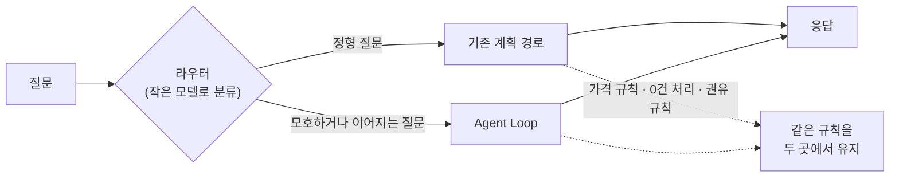
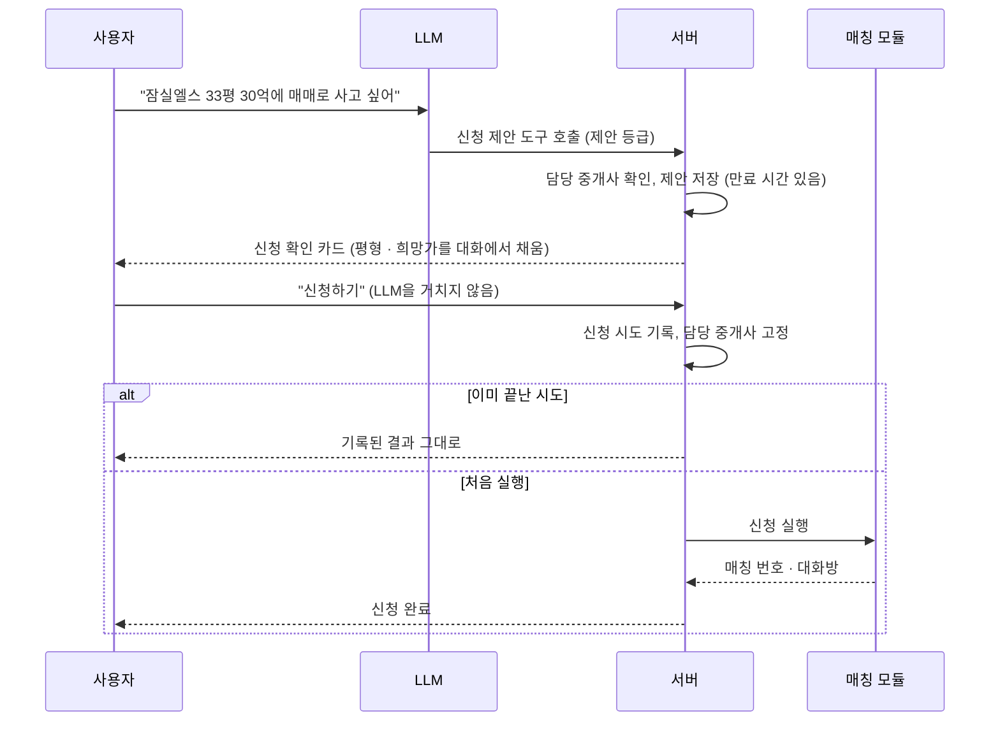
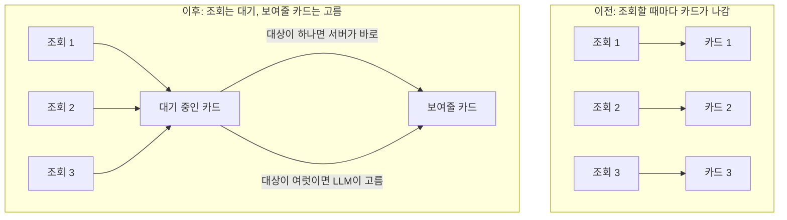

안녕하세요. 프롭테크 플랫폼에서 백엔드 개발자로 근무 중인 정정일입니다.

이번엔 부동산과 관련된 문제를 대화 하나로 해결하는 통합 AI 에이전트를 목표로 서비스를 만들고, 그 첫 단계를 운영에 반영한 이야기를 해볼까 합니다. 사용자가 "서울 근교 20억 이하 30평대 매매 아파트 찾아줘"라고 물으면 조건에 맞는 아파트·오피스텔 단지를 찾아 지도와 카드로 보여주고, 이어서 시세나 학군을 물어보고, 마음에 드는 단지가 생기면 담당 중개사에게 신청하는 것까지 하나의 대화 안에서 이어지는 기능입니다.

*운영 화면. "서울 근교"라고만 말해도 서울과 맞닿은 시들을 찾아 지도에 경계로 표시하고, 그 안에서 조건에 맞는 단지를 카드와 지도 핀으로 함께 보여줍니다.*

사실 저는 지난번 [AI 부동산 매물 추천 시스템 구축기]()에서 Agent Loop 대신 Planned Tool Use를 선택했고, 그 이유를 이렇게 적었었습니다.

> 저는 Agent Loop가 강력한 건 **도구 실행 결과를 보고 판단을 바꿔야 하는 경우**라고 생각합니다. (...) 하지만 부동산 검색은 그렇지 않았습니다.

그런데 이번에는 Agent Loop로 다시 만들게 됐습니다. 서비스가 AI로 하려는 일이 달라졌기 때문입니다.

이번 작업에서 가장 많이 고민한 건 AI가 답만 하고 끝나지 않고, 중개 신청 같은 서비스의 실제 기능으로 자연스럽게 이어지게 하는 일이었습니다. 그리고 그러다 보니 LLM에게 어디까지 맡길지를 정해야 하는 문제를 만나게 됐죠. 그래서 이 글은 두 편으로 나눠봤습니다. 1편에서는 목표를 어떻게 잡았고 AI의 답을 서비스로 어떻게 이어지게 했는지를, 2편에서는 그 과정에서 LLM에게 어디까지 맡기고 무엇을 코드에 둘지 정한 이야기를 다뤄보도록 하겠습니다.

다만 시작하기에 앞서, 이 글은 정답을 공유하기보다는 저희 서비스 상황에서 문제를 만나고 판단한 과정을 기록으로 남긴 글에 가깝습니다. 그 점을 감안하고 봐주시면 감사하겠습니다.

## Plan 방식으로 만들었던 AI 추천

기존 AI 추천은 LLM이 사용자의 질문을 보고 실행 계획을 JSON으로 한 번 세우면, 코드가 그 계획대로 도구를 실행하는 구조였습니다. 장소를 찾고, 그 근처 단지를 검색하고, 점수를 매겨 추천하는 식이었죠. 질문 한 번에 답 한 번이었습니다.

추천이 목표였을 때는 이 구조가 잘 맞았습니다. 도구를 부르는 순서가 거의 정해져 있었고, 흐름이 고정돼 있으니 응답 시간과 비용도 예측할 수 있었습니다. LLM이 계획을 세운 뒤에는 끼어들 틈이 없다는 점도 안전장치 역할을 해줬고요.

## 기획 변경과 기존 구조의 한계

이번 작업은 기획팀과 새 AI 서비스를 함께 설계하면서 시작됐습니다. 기획팀이 정리해 온 고객 질문이 128개였고, 이 질문들을 아파트 찾기, 계약, 집 관리, 서비스 이용 방법이라는 4개의 여정으로 묶었습니다.

질문들을 보니 사용자분들이 원하는 건 "조건에 맞는 단지 찾기"에서 끝나지 않았습니다. 찾은 단지의 실거래가나 지금 나와 있는 매물을 궁금해하시고, 근처 학교나 지하철, 복비가 얼마나 나오는지, 등기는 괜찮은지도 물어보셨습니다. 그리고 그 끝에는 대부분 "이 단지 담당 중개사와 이야기해 보고 싶다"가 있었습니다. 사용자분들 입장에서는 이게 다 이어지는 과정인데, 저희 서비스는 이걸 기능마다 따로 나눠서 제공하고 있었죠. 기존 AI 추천도 추천이 끝나면 역할이 끝났고, 그다음은 사용자가 직접 단지 상세로, 다시 중개 신청 화면으로 넘어가야 했습니다.

그래서 기획팀과 목표를 "사용자의 문제를 AI가 이해하고, 답을 드리고, 서비스 안의 알맞은 기능으로 이어드리는 것"으로 잡았습니다. 늘어난 사용자 요구를 대화 하나에서 받고, 중개사 매칭까지 가는 단계를 줄이고, 자연어로 서비스 기능을 바로 써볼 수 있게 하자는 것이었습니다. 이걸 모두 합치면 부동산 문제를 대화 하나에서 해결하는 통합 AI 에이전트가 됩니다. 방향은 기획팀과 협의해서 정했고, 제가 맡은 건 바뀐 서비스를 어떤 구조로 만들 것인가였습니다. 목표가 큰 만큼 기존 서비스에서 가장 중요한 흐름인 아파트 추천, 상세 정보 확인, 중개 신청까지를 먼저 만들고 나머지를 그 위에 하나씩 붙이기로 했습니다.

처음에는 기존 구조를 늘려서 대응할 수 있지 않을까 생각했습니다. 계획 단계에 의도를 몇 개 더 추가하고 도구를 더 붙이면 되지 않을까 하고요. 그런데 기존 코드를 다시 분석해보니 늘리는 것만으로는 해결되지 않는 문제들이 있었습니다.

- LLM에 보내는 메시지가 시스템 프롬프트와 이번 질문 두 개뿐이라, "거기서 좀 더 싼 곳은?" 같은 이어지는 질문을 이해하지 못했습니다.
- 결과가 0건이어도 조건을 풀어 다시 찾을 방법이 없었습니다.
- 장소를 1순위 후보 하나로 고정해서, "세종고등학교"가 다른 지역의 같은 이름 학교로 잡히기도 했습니다. 후보가 여럿이면 되물어야 하는데, 계획을 한 번에 세우는 구조라 중간에 멈추고 되물을 수 없었습니다.

세 가지 모두 도구를 실행한 결과를 보고 다음 행동을 바꿔야 하는 상황이었습니다. 지난 글에서 Agent Loop가 필요하다고 적었던 경우에 해당했죠. 지난 글에서 부동산 검색에는 이런 상황이 잘 생기지 않는다고 판단한 건, 그때 만든 게 질문 한 번을 처리하는 기능이었기 때문이라고 생각합니다. 대화가 되면 흐름이 사용자마다 다르고, 앞의 결과에 따라 다음 질문이 달라집니다. 128개 질문의 흐름을 계획 프롬프트에 다 적어두려면 결국 지난 글에서 버렸던 고정 파이프라인과 비슷해질 것 같았습니다.

그래서 LLM이 도구를 고르고, 결과를 보고, 다음 도구를 고르는 Agent Loop로 가기로 결정했습니다.

### 경로를 하나로 둔 이유

처음 설계안은 Agent Loop만 쓰는 구조가 아니었습니다. 작은 모델로 질문을 먼저 분류해서, "강남역 근처 10억 이하 30평대"처럼 정형화된 질문은 기존 계획 경로로 보내고 모호하거나 이어지는 질문만 Agent Loop로 보내는 하이브리드 구조를 권고안으로 적어뒀습니다. 정형 질문은 도구 순서가 정해져 있으니 기존 경로가 빠르고 싸거든요. 지난 글에서 인용했던 LLMCompiler 논문도 ReAct 방식(생각하고, 도구를 부르고, 결과를 보고 다시 생각하는 방식) 대비 지연은 최대 3.7배, 비용은 최대 6.7배까지 줄일 수 있다고 보고하고 있었습니다.

하지만 고민 끝에 라우터는 만들지 않기로 결정했습니다. 경로가 두 개면 가격 범위를 어떻게 넓힐지, 0건이면 어떻게 할지, 무엇을 권할지 같은 규칙을 두 곳에 똑같이 맞춰둬야 합니다. 사용자가 대화 중에 정형 질문과 이어지는 질문을 섞으면 한 대화 안에서 경로가 계속 바뀌고, 라우터가 잘못 분류했을 때 어느 쪽 문제인지 찾는 것도 일입니다. 저희는 팀 규모가 작아서 만드는 것만큼 계속 고쳐 나가는 게 중요했고, 저는 두 경로의 규칙을 계속 같게 유지하기는 어렵다고 봤습니다. 이 결정 때문에 응답이 느려진 부분은 2편에서 다시 이야기하겠습니다.

프레임워크도 비슷한 기준으로 골랐습니다. OpenAI의 Responses API(도구 호출과 추론 모델을 함께 쓰는 새 API)를 지원하는 Spring AI 버전은 저희가 쓰는 것보다 높은 Spring Boot 버전이 필요했고, LangChain4j는 추상화 계층이 하나 더 생겨서 문제가 생기면 제 코드와 프레임워크 코드를 같이 봐야 했습니다. 그래서 공식 SDK의 Responses API 위에 루프를 직접 만들었습니다. 루프 자체는 수백 줄 정도로 생각보다 단순했고, 시간은 대부분 이 글과 2편에서 다룰 일들에 들었습니다.

## 답에서 끝나지 않는 AI

구조를 정하면서 기준으로 삼은 건 앞에서 기획팀과 잡은 목표였습니다. 이 AI가 답에서 끝나지 않고 서비스로 이어져야 한다는 것이었죠.

초기 버전을 써보니 LLM이 답은 꽤 잘하는데, 그 답에서 서비스 기능으로 넘어가지는 않더라고요. "헬리오시티 33평 29억이면 복비 얼마야?"라고 물었을 때 AI는 복비를 정확하게 계산해주고 거기서 끝났습니다. 그 단지를 사려고 복비까지 계산해보는 사용자라면 담당 중개사와 이야기해볼 만한 시점인데도요. 답만 하고 끝나면 범용 챗봇과 크게 다르지 않았습니다.

기획에서도 이 부분을 가장 중요하게 봤습니다. 기획은 답변을 답, 근거, 행동 3단으로 나누는데, 그중 답변 뒤에 서비스의 알맞은 기능으로 이어주는 "행동"을 가장 중요하게 꼽았습니다. 핵심 지표도 AI 답변에서 중개 신청이나 등기분석 같은 서비스 기능으로 넘어간 비율로 잡았습니다.

그래서 고민은 크게 두 가지였습니다. AI의 답을 어떻게 하면 서비스의 실제 기능으로 자연스럽게 이어줄 수 있을지, 그리고 그게 억지스러운 권유가 아니라 사용자에게 의미 있는 결과가 되려면 무엇이 필요할지였습니다.

## 중개 신청까지 이어지게

서비스로 이어지는 가장 직접적인 결과는 중개 신청이었습니다. 중개사 매칭까지의 단계를 줄이는 게 기획의 중요한 목표였으니 대화 안에서 신청까지 이어지게 하고 싶었습니다. 그리고 이 부분은 이번 작업에서 설계가 가장 여러 번 바뀐 부분이기도 합니다.

먼저 정한 건 신청을 LLM이 직접 실행하지 않는다는 것이었습니다. LLM은 같은 도구를 두 번 부르기도 하고 의도를 잘못 해석하기도 하는데, 신청은 한 번 들어가면 중개사에게 그대로 전달돼서 되돌리기 어렵습니다. 그래서 모든 도구에 조회, 제안, 확인이 필요한 쓰기 중 하나의 등급을 붙이고, 도구를 실행하는 디스패처(LLM이 고른 도구를 실제로 실행하는 서버 쪽 관문)는 조회와 제안만 실행하게 했습니다. 신청 같은 행동은 "제안" 등급의 도구가 확인 카드에 띄울 제안으로만 저장합니다. 이렇게 나눈 이유는 2편에서 자세히 다루겠습니다.

남은 건 사용자가 확인한 뒤의 신청을 누가 실행할지였습니다.

처음 설계는 이랬습니다. 사용자가 확인 버튼을 누르면 LLM을 거치지 않고 서버로 요청이 들어오고, 서버는 제안 ID를 멱등키로 써서 신청을 넣습니다. 네트워크가 끊겨 요청이 다시 들어와도 신청은 한 번만 되게 하려는 설계였습니다.

그런데 기존 중개 신청 흐름을 따라가보니, 화면에서 사용자가 단계별로 진행하는 것을 전제로 만들어져 있어서 서버가 대화에서 한 번에 실행하기에는 맞지 않았습니다. 그래서 두 번째 설계에서는 서버가 제안까지만 하고, 최종 확인은 사용자가, 실제 신청은 앱과 웹에 원래 있던 흐름이 하도록 바꿨습니다. 신청 규칙을 한 곳에만 두고, 이미 검증된 흐름을 그대로 쓰자는 생각이었습니다.

이 방식으로 실제 화면에서 신청해보니 이번에는 시간이 문제였습니다. 원래 여러 화면을 거치며 나눠서 하던 일을 대화 화면에서 한 번에 하다 보니 오래 걸렸고, 화면이 결과를 기다리지 못하고 먼저 실패로 처리하는 경우가 생겼습니다. 사용자는 확인 버튼을 눌렀는데 결과를 알 수 없는 상태가 되는 거죠.

그래서 세 번째 설계에서는 서버가 신청을 실행하되, 지켜야 할 것들을 다시 정리했습니다.

- 실행하는 건 여전히 LLM이 아닙니다. 사용자가 확인 카드에서 "신청하기"를 누른 요청만 LLM을 거치지 않고 서버로 들어옵니다.
- 서버는 실행하기 전에 "신청 시도"를 먼저 기록하고, 해당 시도에 담당 중개사를 고정합니다. 같은 시도로 요청이 다시 들어오면 새로 실행하지 않고 기록된 결과를 그대로 돌려줍니다. 처음 설계에서 멱등키로 하려던 걸 이 시도 기록이 대신하게 됐습니다.
- 신청 도중 연결이 끊기는 경우처럼 이전 실행이 반영됐는지 확실하지 않으면, 다시 실행하지 않고 멈춥니다. 화면도 그 카드를 잠가서 같은 신청이 두 번 들어가지 않게 했습니다. 중복 신청은 중개사에게 그대로 전달돼 되돌리기 어렵지만, 멈추면 사용자가 진행 상황을 확인한 뒤 다시 시도할 수 있으니까요.
- 신청 로직은 AI 모듈 안이 아니라 매칭을 담당하는 모듈에 두고, 웹과 같은 순서로 실행하게 했습니다.

LLM이 제안 도구를 여러 번 불러도 실제 신청은 사용자가 확인한 한 건만 들어갑니다. 두 번째 설계에서 피하려던 "같은 신청 로직이 두 곳에 생기는 문제"는 일부 감수하게 됐지만, 해당 로직을 매칭 모듈에 두면서 AI 쪽에는 신청 규칙이 생기지 않게 했습니다. 세 가지 설계 모두에서 신청 여부는 사용자가 확인 카드에서 정합니다.

*제 테스트 계정으로 찍은 화면입니다. 왼쪽은 복비를 물었을 때로, 이미 이 단지에 진행 중인 신청이 있어서 새로 권하지 않고 진행 상황과 담당 중개사 대화로 이어줍니다. 오른쪽은 "사고 싶어"라고 했을 때의 확인 카드로, 평형과 희망가가 대화에서 채워져 있고 신청은 사용자가 "신청하기"를 눌러야 진행됩니다.*

등기분석도 같은 원칙으로 붙였습니다. 대화에서는 결과를 설명하고 신청 준비까지만 하고, 결제와 신청은 기존 등기분석 화면에서 합니다.

## 권유 시점

신청 말고도 AI가 권할 수 있는 서비스는 여럿 있었습니다. 다만 저는 이게 억지스러우면 안 된다고 생각했습니다. 단지를 둘러보는 중인데 답변마다 "중개사와 연결해 드릴까요?"가 붙으면 광고처럼 느껴지고, 저라도 대화를 그만둘 것 같았거든요. 많이 권할수록 지표는 올라가겠지만 그게 서비스에 좋은 건지는 잘 모르겠더라고요.

처음에는 지시문에 "단지 추천·시세·비교 중에는 중개 연결을 권하지 않는다"고 적었습니다. 그랬더니 사용자가 "여기 사고 싶어"라고 해도 AI가 한 번 더 묻거나 아예 연결해주지 않았습니다. 억지 권유를 막으려던 규칙이 사용자가 실제로 원할 때도 막고 있었던 거죠.

그래서 대화 주제가 아니라 사용자가 보인 의사의 강도로 권유 여부를 나눴습니다.

| 사용자가 보인 의사 | 예시 | AI가 하는 일 |
|---|---|---|
| 분명함 | "여기 사고 싶어", "방문해서 볼 수 있어?" | 다시 묻지 않고 신청 확인 카드를 띄움 (대화에서 평형·희망가를 채움) |
| 가벼운 관심 | "맘에 들어", 시세를 여러 번 물어봄 | 부담이 작은 단지 소식 알림부터 권하고, 맞춤 중개는 그다음 |
| 정보만 물음 | "학군 어때?", "전월세 전환하면 얼마야?" | 아무것도 권하지 않음 |

*"헬리오시티 33평 실거래가 알려줘"에 대한 답변입니다. 실거래가 카드(왼쪽)를 보여준 뒤, 답변 끝에 새 실거래와 신저가를 알려주는 알림 카드(오른쪽)를 붙였습니다. 이 단지에는 이미 진행 중인 신청이 있어서 맞춤 중개는 새로 권하지 않고 진행 상황만 보여줍니다.*

의사가 분명할 때 바로 신청 확인 카드를 띄울 수 있었던 건 앞에서 이야기한 것처럼 최종 확인을 사용자에게 맡겼기 때문입니다. 카드는 신청이 아니라 확인 단계라서 바로 띄워도 부담이 적었습니다. LLM이 신청을 직접 실행하는 구조였다면 "여기 사고 싶어" 한마디에 바로 진행하기는 어려웠을 것 같습니다.

다른 서비스도 같은 방식으로 정했습니다. 전세 계약을 고민하거나 근저당 같은 권리 문제를 이야기하면 AI 등기분석을, 예산과 대출 이야기에는 대출 계산기를, 집을 팔려는 이야기에는 집 내놓기를 권합니다. 사무실이나 상가를 구하거나 내놓으려는 이야기에는 사무실 전용 맞춤 중개와 내놓기로 이어줍니다. 표현도 바꿨습니다. 저희끼리는 "매칭"이라고 부르지만 사용자에게 "매칭해 드릴까요?"는 잘 와닿지 않습니다. 그래서 "헬리오시티 담당 중개사에게 이 가격대 매물을 문의해 보시겠어요?"처럼 사용자가 얻는 걸로 말하게 했습니다.

## 코드로 옮긴 권유 규칙

지금이 권할 때인지 맥락을 읽는 건 LLM이 잘합니다. 하지만 "같은 대화에서 같은 권유는 한 번만", "담당 중개사가 없으면 권하지 않는다" 같은 규칙은 지켜지지 않으면 사용자 경험이 크게 나빠집니다. 특히 "같은 권유는 한 번만"은 LLM이 앞에서 무엇을 권했는지 기억해야 하는 규칙인데, 대화가 길어지면 오래된 턴의 도구 결과는 LLM에게 보내는 문맥에서 빠지기 때문에 지시문만으로는 불안했습니다.

그래서 권할 시점은 LLM이 판단하고, 규칙은 코드에 두었습니다. 맞춤 중개를 권하는 도구는 같은 대화에서 이 단지에 이미 권했는지, 담당 중개사가 있는지, 이미 진행 중인 신청이 있는지를 서버가 확인하고, 조건에 맞지 않으면 "권하지 않음"을 돌려줍니다. 알림을 먼저 권할지 맞춤 중개를 바로 권할지도 서버가 정하고, 맞춤 중개와 알림 제안은 한 응답에 하나만 남깁니다. LLM이 권하려고 해도 조건에 맞지 않으면 서버에서 거절하게 되는 거죠.

만들다 보니 애매한 경우가 계속 나왔습니다. 사용자가 조건 초기화를 누르면 권유 기록도 지워야 할까요? 저는 지우지 않았습니다. 조건 초기화는 지도를 새로 보겠다는 뜻이지 권유를 다시 받겠다는 뜻은 아니라고 봤기 때문입니다. 반대로 사용자가 직접 담당 중개사를 물으면 앞에서 이미 권했더라도 버튼을 다시 붙입니다. 이때는 사용자가 먼저 원한 거니까요.

## 기존 화면으로 연결

연결되는 곳은 이미 있는 서비스 화면이어야 한다고 생각했습니다. AI 안에 계산기나 등기분석을 새로 만들 수도 있었지만, 그러면 AI에서 본 숫자와 기존 화면에서 본 숫자가 달라질 수 있습니다.

그래서 AI는 대화 안에서 결과까지만 보여주고, 더 해보고 싶으면 기존 화면으로 보내되 대화에서 나온 값을 채운 상태로 보내게 했습니다. 복비 계산 결과에서 계산기로 넘어가면 금액과 거래 유형이 채워진 채 결과가 바로 보이고, 등기분석 신청 확인에서 넘어가면 동·호·보증금이 채워진 채 등기분석 화면이 열립니다.

*"잠실엘스 25억에 매매하면 복비 얼마야?"에 대한 복비 카드(왼쪽)에서 "금액 바꿔서 계산하기"를 누르면, 아파트·매매·25억이 채워진 채 기존 계산기가 열리고 같은 절약 금액이 보입니다(오른쪽).*

대화 안에서 보여주는 계산 결과도 기존 화면과 같아야 했습니다. 그래서 복비 계산 로직은 웹 계산기 코드를 연산 순서까지 그대로 옮기고, 웹 계산기의 실제 실행 결과를 정답으로 한 테스트로 같은지 확인했습니다. 계산 로직이 한 벌 더 생긴 건 맞지만, 반올림 하나만 달라도 AI와 계산기가 다른 복비를 말하게 되니 둘이 달라지면 테스트가 바로 깨지게 묶어둔 거죠.

결제, 신청, 인증 같은 핵심 기능은 이미 검증된 경로를 그대로 쓰고, AI는 사용자의 의도를 파악해서 그 화면까지 안내하는 역할을 맡습니다. 만들고 보니 이번 에이전트는 서비스의 기존 기능들로 들어가는 새로운 진입점에 가깝다는 생각이 들었고, 실제로 이번 반영에서 기존의 자연어 매물 찾기는 이 에이전트로 합쳤습니다.

## 결과를 먼저 보여주는 화면 구성

서비스로 이어지게 하려면 화면도 달라야 했습니다. 저는 처음부터 이 기능이 긴 텍스트를 보여주는 챗봇처럼 보이지 않았으면 했습니다. 단지 열 곳의 가격과 평형을 문장으로 나열하면 읽기도, 비교하기도 어렵고, 다음에 뭘 할지도 잘 보이지 않으니까요.

### 조건을 다 묻기 전에 결과부터

처음 만든 버전은 조건이 부족하면 먼저 물었습니다. 거래 유형, 예산, 평형을 하나씩 확인한 뒤에 검색하는 식이었는데, 정확하긴 했지만 질문 하나에 대한 첫 반응이 또 다른 질문인 경우가 많았습니다.

그래서 기획팀과 이야기해서 결과를 먼저 보여주는 쪽으로 바꿨습니다. 위치만 말해도 매매를 기본으로 바로 검색하고, 거래 유형을 가정했다는 사실은 답변에서 짚어줍니다. 결과가 많으면 상위 몇 곳을 먼저 보여주고, 빠진 조건은 결과 아래 버튼으로 묻습니다. 거래 유형을 가정한 경우에는 매매·전세·월세 버튼을 함께 붙여서 한 번에 바꿀 수 있게 했습니다.

*"마포구 15억 이하 30평대 아파트"에는 거래 유형이 없습니다. 매매로 가정해 33곳을 찾고 그 사실을 답변에 밝힌 뒤(왼쪽), 결과 아래에서 단지 규모를 고르는 버튼을 단지 수와 함께 보여줍니다(오른쪽).*

중간에 거래 유형만큼은 먼저 묻는 방식도 적용해봤습니다. 그런데 대화 기록을 비교해보니 첫 질문부터 되묻는 경우가 크게 늘었고, 매매를 기본으로 두면서 자연스럽게 이어지던 흐름도 같이 사라졌습니다. 결과가 나오면 실거래가 차트와 알림 권유가 이어지는데, 거래 유형이 정해지지 않은 동안에는 해당 도구들이 아예 불리지 않았던 거죠. 그래서 다시 결과 먼저로 되돌렸습니다. 거래 유형을 잘못 가정했더라도 버튼 하나로 바꾸면 되니까요.

### 카드 고르기

숫자는 코드가 만든 카드가 보여주고, LLM은 카드에 없는 내용만 해설로 붙이게 했습니다. 실거래가는 차트로, 매물은 최근 실거래 대비 몇 % 차이인지 보이는 목록으로, 중개 신청 진행 상황은 지금 어느 단계인지 보이는 막대로 보여줍니다.

*"지금 나와있는 매매 매물도 보여줘"에 대한 화면입니다. 오른쪽 카드는 최근 거래 평균보다 싼 매물 수와 각 매물의 최근 거래 대비 %를, 지도는 동별 최저 호가를 보여줍니다.*

결과를 먼저 보여주려고 처음에는 도구가 조회를 할 때마다 카드를 바로 화면에 그렸습니다. 그러다 보니 LLM이 답을 만들려고 단지 세 곳을 조회하면 카드도 세 장이 쌓였습니다. 사용자는 하나를 물었는데 화면에는 LLM이 확인해본 것들이 전부 나오는 거죠. 한동안은 증상이 보일 때마다 "이 경우엔 카드를 내지 않는다"는 예외를 하나씩 추가해서 막았는데, 예외가 늘어날수록 다른 곳에서 카드가 빠지는 문제가 생겼습니다.

그래서 조회와 표시를 나눴습니다.

도구의 조회 결과는 일단 대기시키고, 답변이 시작되기 직전에 보여줄 카드를 정합니다. 고를 게 하나뿐이면 서버가 바로 내보내고, 서로 다른 대상이 둘 이상일 때만 LLM이 고르게 했습니다. 카드는 여전히 답변보다 먼저 그려지고, 답변은 그 아래에 해설로 붙습니다. 바꾸기 전후로 같은 장면 56개를 비교해서 36개는 그대로, 3개는 의도한 대로 나아진 걸 확인했고, 나머지는 고른 카드가 달라진 경우라 장면마다 직접 확인했습니다.

물론 그만큼 감수해야 하는 부분도 있었습니다. LLM이 카드를 고르는 단계가 하나 늘면서 한 턴에 쓰는 호출과 토큰이 늘었고, 턴 예산을 넘기는 경우도 늘었습니다. 그래서 카드를 고르는 단계가 필요한 조건을 좁히고 턴 토큰 상한도 다시 잡았습니다. 늘어난 비용이 감당할 만한 수준인지는 운영 데이터가 좀 쌓이면 다시 봐야 할 것 같습니다.

### 화면의 모든 요소가 같은 데이터를 보도록

카드를 넣고 나니 화면에서 정보를 보여주는 곳이 여러 개가 됐습니다. LLM이 쓰는 답변, 코드가 그리는 카드, 지도 위의 핀, 선택지 버튼. 써보면서 나온 문제들은 대부분 이것들이 서로 다른 내용을 보여주는 문제였습니다.

- 답변은 단지를 거리순으로 나열하는데 화면 목록은 추천 순위순이라, "첫 번째 단지"라고 하면 답변의 첫 번째와 화면의 첫 번째가 달랐습니다.
- 한 응답에서 LLM이 검색을 여러 번 하면서 좁히기 버튼 묶음도 여러 번 쌓였는데, 서버 상태에는 마지막 질문만 남아 있어서 앞쪽 버튼을 누르면 엉뚱한 조건으로 검색됐습니다.

두 문제 모두 답변, 카드, 버튼이 서로 다른 데이터를 보고 있어서 생긴 문제였고, 같은 데이터를 보도록 맞추는 쪽으로 고쳤습니다. 도구가 LLM에게 넘기는 결과 순서를 화면 순서와 맞추고, 정렬이 필요하면 거리순·가격순 같은 정렬을 검색 도구에 넣어서 LLM이 순서를 따로 만들지 않게 했습니다. 버튼은 실행이 끝날 때 서버 상태와 일치하는 마지막 묶음만 보내고, 버튼은 질문을 보내는 용도로, 화면 이동은 카드로만 해서 모양이 같으면 동작도 같도록 정리했습니다.

진행 단계 이름도 같은 문제였습니다. 중개 신청 진행 현황을 보여줄 때 AI가 "중개사 배정 중"이라고 말한 적이 있는데, 저희 서비스에는 배정 중이라는 단계가 없습니다. 코드가 단계 이름을 정해주지 않으니 LLM이 상태값을 보고 그럴듯한 이름을 지어낸 거였죠. 그래서 진행 단계 이름은 실제 업무 단계에 맞춰 코드가 정한 이름만 쓰게 했습니다.

{}
## 운영에서 확인한 것 (데이터 쌓이면 작성, 1편의 결론이 될 절)
- AI 답변에서 서비스 기능(맞춤 중개 신청, 등기분석, 계산기 등)으로 넘어간 비율 — 기획이 잡은 핵심 지표
- 권유를 보여준 횟수 대비 실제로 누른 비율 (억지 권유가 아니었는지 확인)
- 의사 강도별(분명함/가벼운 관심) 신청 확인 카드 → 실제 신청 전환율
- 실제 사용량: 일 대화 수, 사용자당 턴 수, 앱/웹 비율
{}

## 1편을 마치며

1편에서는 AI의 답을 서비스로 이어지게 하려고 무엇을 했는지를 정리해봤습니다. 신청은 사용자 확인을 거쳐 서버가 실행하고, 권유는 사용자가 원하는 정도에 맞추고, 결과는 기존 화면과 같은 숫자로 보여주는 것이었습니다.

그런데 이렇게 AI가 서비스의 기능으로 이어지면, AI가 틀렸을 때 사용자에게 실제로 손해가 생길 수 있습니다. 버튼에 적힌 숫자를 믿고 눌렀는데 다른 결과가 나오거나, 다른 사람의 정보가 보이거나, 원하지 않은 신청이 들어가는 식으로요. 그래서 서비스로 잇는 만큼 LLM에게 어디까지 맡기고 무엇을 코드에 둘지를 정하는 일이 같이 필요했습니다. 신청을 사용자 확인 뒤에 두고 권유 규칙을 코드로 옮긴 것도 그 결정의 일부였고요.

2편에서는 그 경계를 어떻게 정하고 지켰는지, 그리고 느려진 응답은 어떻게 다뤘는지를 다뤄보겠습니다.

다음 편: [[부동산 통합 AI 에이전트 2/2편] LLM에게 어디까지 맡길 것인가]()

이 글에서 다룬 기능은 [부톡 아파트](https://bootalk.co.kr/apt) 웹과 앱에서 사용해보실 수 있습니다. 긴 글 읽어주셔서 감사합니다.

---

## 참고 자료

### 관련 글

- [AI 부동산 매물 추천 시스템 구축기]()

### 참고 문헌

- Anthropic - [Building Effective Agents](https://www.anthropic.com/engineering/building-effective-agents)
- OpenAI - [A practical guide to building agents](https://cdn.openai.com/business-guides-and-resources/a-practical-guide-to-building-agents.pdf)
- OpenAI - [Responses API](https://platform.openai.com/docs/api-reference/responses)
- Kim et al. - [An LLM Compiler for Parallel Function Calling](https://arxiv.org/abs/2312.04511) (arXiv, 2023)
