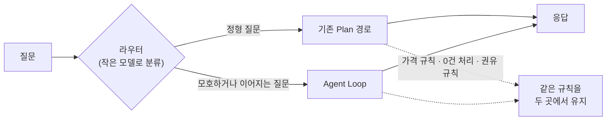
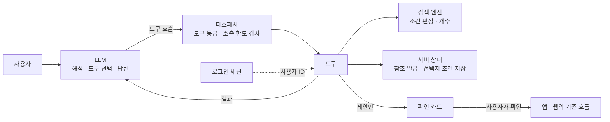
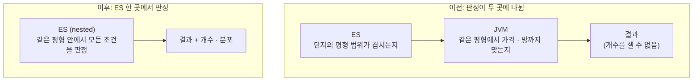
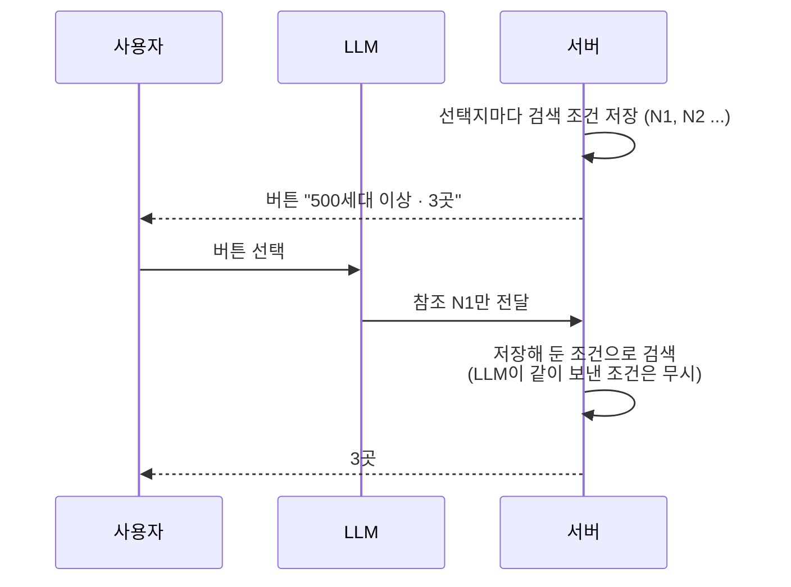
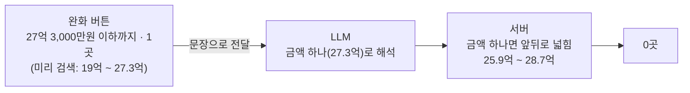
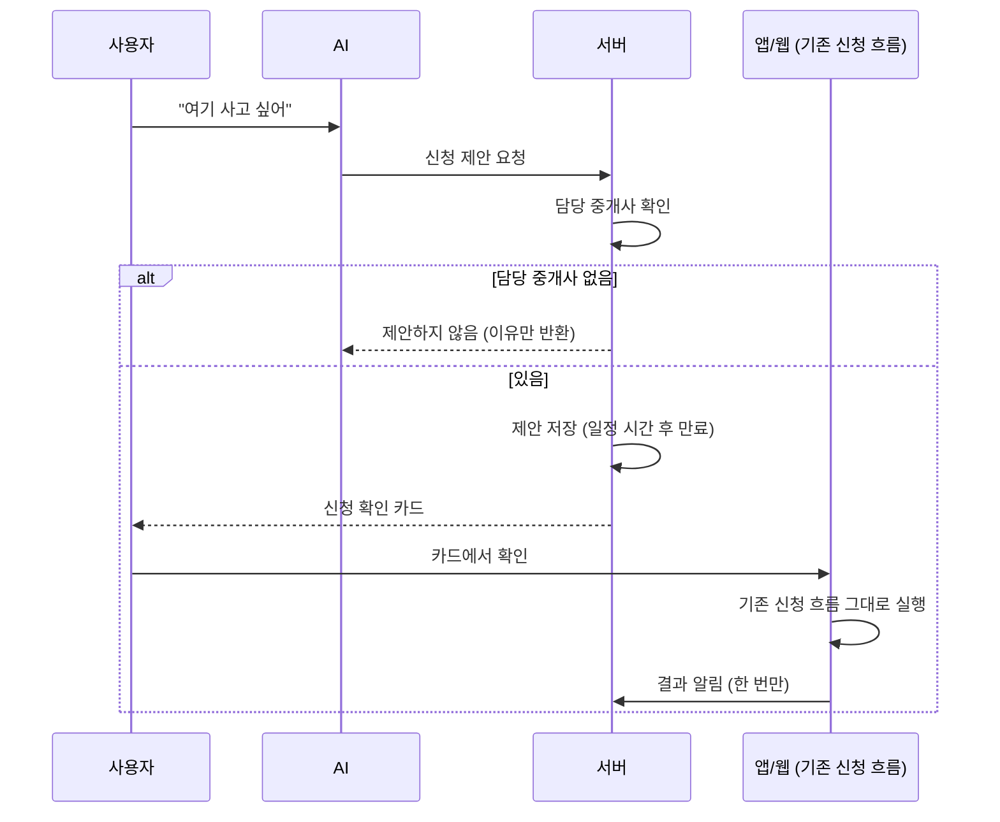
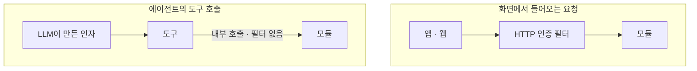
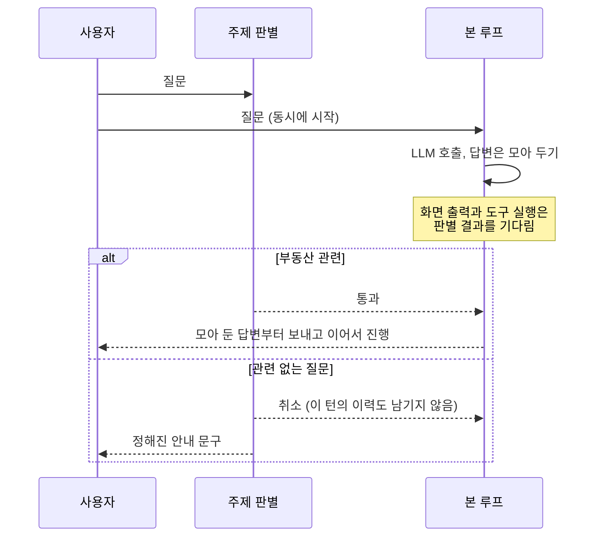

<!-- TODO(운영 반영 후): date 갱신, draft 제거, 이미지 Dropbox 링크로 교체, 운영 수치 채우기 -->

안녕하세요. 프롭테크 플랫폼에서 백엔드 개발을 하고 있는 정정일입니다.

지난번 [AI 부동산 매물 추천 시스템 구축기]()에서 "강남역 근처 30평대 신축 아파트 추천해줘" 같은 자연어로 아파트를 추천해주는 기능을 만든 이야기를 적었었는데요. 그 글에서 저는 Agent Loop 대신 Planned Tool Use를 선택했고, 이유를 이렇게 적었습니다.

> 저는 Agent Loop가 강력한 건 **도구 실행 결과를 보고 판단을 바꿔야 하는 경우**라고 생각합니다. (...) 하지만 부동산 검색은 그렇지 않았습니다.

그런데 이번에 결국 Agent Loop 기반으로 AI 기능을 다시 만들게 됐습니다. 제가 적은 말을 몇 달 만에 뒤집게 돼서 솔직히 조금 민망하기도 합니다.

이번에 만든 건 매물 추천 기능 하나가 아니라 부동산과 관련된 문제를 대화 하나에서 해결하는 **부동산 통합 AI 에이전트**를 목표로 한 서비스입니다. 단지를 찾고, 시세와 실거래가를 보고, 등기를 확인하고, 복비를 계산하고, 담당 중개사와 연결되는 것까지 하나의 대화 안에서 이어지게 하는 거죠.


이번 글에서는 왜 이런 기능을 만들게 됐고 지난 글의 판단을 왜 바꿨는지부터 시작해서, 만들면서 가장 많이 고민했던 "LLM에게 어디까지 맡길 것인가"를 버튼에 적힌 숫자, 중개 신청, 다른 사용자의 정보, 관련 없는 질문, 대화 상태라는 다섯 가지 문제로 나눠 이야기해보려 합니다. 그 다음에는 이어지는 대화를 어떻게 처리했는지, 서비스로 자연스럽게 이어지게 하려고 어떤 고민을 했는지, 그리고 느려진 응답 속도와 장애 격리까지 다룹니다. 결정마다 어떤 대안이 있었고 무엇을 포기했는지도 같이 적다 보니 글이 좀 길어졌습니다.

## 왜 부동산 통합 AI 에이전트였나

기존 AI 매물 추천은 사용자가 조건을 한 번 말하면 조건에 맞는 단지를 추천해주는 기능이었습니다. 질문 한 번에 답 한 번이었죠. 추천이 끝나면 AI의 역할도 거기서 끝났습니다. 마음에 드는 단지를 찾으면 사용자가 직접 단지 상세로 들어가고, 다시 중개 신청 화면으로 넘어가야 했습니다. 이번에 코드를 다시 보니 AI와 중개 매칭 사이에는 코드 연결이 전혀 없고 화면 이동만 이어져 있더라구요.

이번 작업은 기획팀과 새 AI 서비스를 함께 설계하면서 시작됐습니다. 기획팀이 정리해 온 고객 질문이 128개였고, 이 질문들을 아파트 찾기, 계약, 집 관리, 서비스 이용 방법이라는 4개의 대표 여정으로 묶었습니다.

128개 질문을 보면서 느낀 건 사용자분들이 원하는 게 "조건에 맞는 단지 찾기"에서 끝나지 않는다는 점이었습니다. 찾은 단지의 실거래가나 지금 나와 있는 매물을 궁금해하시기도 하고, 근처에 학교나 병원이 있는지, 복비는 얼마나 나오는지, 등기는 괜찮은지도 물어보셨습니다. 그리고 그 끝에는 대부분 "이 단지 담당 중개사와 이야기해 보고 싶다"가 있었습니다. 사용자분들은 이걸 하나의 흐름으로 겪는데, 저희 서비스는 기능 단위로 잘라서 제공하고 있었던 거죠.

그래서 기획팀과 목표를 "사용자의 문제를 AI가 이해하고, 답을 드리고, 서비스 안의 알맞은 기능으로 이어드리는 것"으로 잡았습니다. 늘어난 사용자 요구를 대화 하나에서 받고, 중개사 매칭까지 가는 단계를 줄이고, 자연어로 서비스의 기능을 바로 써 볼 수 있게 하자는 것이었습니다. 이걸 모두 합치면 부동산 문제를 대화 하나에서 해결하는 통합 AI 에이전트가 됩니다.


물론 이 방향은 제가 혼자 정한 건 아닙니다. 사용자 요구가 늘어나면 서비스가 바뀌는 건 당연한 일이고, 어떻게 바뀔지는 기획팀과 협의하면서 정해졌습니다. 제가 고민해야 했던 건 바뀐 서비스를 어떤 구조로 만들 것인가였습니다.

여기에는 저희 팀 사정도 영향을 줬습니다. 저희는 팀 규모가 작아서, 만드는 것만큼이나 만든 뒤에 계속 운영하고 고쳐 나가는 게 중요했습니다. 그래서 구조를 정할 때 "이걸 계속 유지할 수 있나"를 같이 볼 수밖에 없었습니다.

목표가 크다 보니 순서도 정했습니다. 기존 서비스에서 가장 중요한 흐름인 아파트 추천, 상세 정보 확인, 중개 신청 직전까지를 먼저 만들고, 나머지를 그 위에 하나씩 붙이기로 했습니다.

## 지난 글의 기준을 다시 적용해 보니

처음에는 기존 구조를 늘려서 대응할 수 있지 않을까 생각했습니다. Plan 단계에 의도를 몇 개 더 추가하고 도구를 더 붙이면 되지 않을까 하고요. 그런데 기존 코드를 다시 분석해 보니 늘리는 것만으로는 해결되지 않는 문제들이 있었습니다.

- LLM에 보내는 메시지가 시스템 프롬프트와 이번 질문 두 개뿐이라 "거기서 좀 더 싼 곳은?" 같은 이어지는 질문을 이해하지 못했습니다.
- 결과가 0건이어도 조건을 풀어 다시 찾을 방법이 없었습니다.
- 장소를 1순위 하나로 고정해서 "세종고등학교"가 경남의 학교로 잡히기도 했습니다. 후보가 여럿이면 되물어야 하는데, 계획을 한 번에 세우는 구조라 중간에 멈추고 되물을 수 없었습니다.

이 문제들은 모두 **도구를 실행한 결과를 보고 다음 행동을 바꿔야 하는 상황**이었습니다. 지난 글에서 "Agent Loop가 필요한 경우"라고 적었던 그 상황이죠. 지난 글에서 부동산 검색에는 이런 상황이 잘 생기지 않는다고 판단한 건, 그때 만든 게 질문 한 번을 처리하는 기능이었기 때문이라고 생각합니다. 대화가 되면 흐름이 사용자마다 다르고 앞의 결과에 따라 다음 질문이 달라집니다. 128개 질문의 흐름을 Plan 프롬프트에 다 적어 두려면 결국 지난 글에서 버렸던 고정 파이프라인처럼 될 것 같았습니다.

그래서 LLM이 도구를 고르고, 결과를 보고, 다음 도구를 고르는 Agent Loop로 가기로 했습니다.

지난 구조는 계획을 한 번 세우면 중간에 바꿀 수 없었고, 이번 구조는 도구 결과를 보고 되묻거나 다른 도구를 고를 수 있습니다. 대신 LLM을 몇 번 부를지 미리 알 수 없게 됐습니다. 응답 시간도, 비용도, LLM이 무엇을 할지도 예측하기 어려워진 거죠. 이후의 고민은 대부분 여기서 나왔습니다.

### 하이브리드 구조는 만들지 않았다

처음 설계안은 Agent Loop만 쓰는 구조가 아니었습니다. 작은 모델로 질문을 먼저 분류해서 "강남역 근처 10억 이하 30평대"처럼 정형화된 질문은 기존 Plan 경로로 보내고, 모호하거나 이어지는 질문만 Agent Loop로 보내는 하이브리드 구조를 권고안으로 적어 두었습니다. 정형 질문은 도구 순서가 정해져 있으니 기존 경로가 빠르고 싸거든요. 지난 글에서 인용했던 LLMCompiler 논문도 ReAct 방식 대비 지연은 최대 3.7배, 비용은 최대 6.7배 줄일 수 있다고 보고하고 있었구요.



그런데 결국 라우터는 만들지 않았습니다. 경로가 두 개면 가격 범위를 어떻게 넓힐지, 0건이면 어떻게 할지, 무엇을 권할지 같은 규칙을 두 곳에 똑같이 맞춰 둬야 합니다. 사용자가 대화 중에 정형 질문과 이어지는 질문을 섞어서 하면 한 대화 안에서 경로가 계속 바뀌고, 라우터가 잘못 분류했을 때 어느 쪽 문제인지 찾는 것도 일입니다. 작은 팀에서 두 경로의 규칙을 계속 같게 유지하는 건 어렵다고 판단했고, 응답 속도를 조금 손해 보더라도 경로를 하나로 두기로 했습니다. 이 결정 때문에 응답이 느려진 부분은 뒤에서 다시 이야기하겠습니다.

프레임워크도 비슷한 기준으로 골랐습니다. Spring AI 최신 버전은 Responses API를 지원하지만 Spring Boot 4가 필요했고 저희는 3.1이었습니다. LangChain4j는 쓸 수 있었지만 추상화 계층이 하나 더 생겨서, 문제가 생기면 제 코드와 프레임워크 코드를 같이 봐야 했습니다. 그래서 공식 OpenAI SDK의 Responses API 위에 루프를 직접 만들었습니다. 루프 자체는 수백 줄 정도로 단순했고, 어려운 건 루프 바깥에 있었습니다.


## LLM에게 어디까지 맡길 것인가

이번 글에서 가장 하고 싶었던 이야기입니다.

Agent Loop에서는 어떤 도구를 몇 번, 어떤 순서로, 어떤 인자로 부를지 LLM이 정합니다. 그만큼 LLM이 틀릴 수 있는 곳도 많아집니다. LLM이 조건에 맞지 않는 단지를 맞다고 하거나, 버튼에 3곳이라고 적어 놓고 5곳을 보여주거나, 사용자가 원하지 않았는데 중개 신청을 넣어 버리면 사용자에게 실제로 손해가 생길 수 있습니다. 그 책임은 LLM이 아니라 서비스가 집니다.

그래서 "LLM에게 무엇을 맡길까"보다 **"서비스가 직접 관리해야 하는 건 무엇인가"** 를 먼저 정하기로 했습니다. 그걸 정하고 나면 나머지는 LLM에게 맡겨도 되는 일이 됩니다.

분석하면서 찾아본 자료 중에 이 고민과 관련된 내용도 있었습니다. 프롬프트 인젝션 방어 패턴을 정리한 [Design Patterns for Securing LLM Agents against Prompt Injections](https://arxiv.org/abs/2506.08837) 논문에 따르면, Plan-then-execute 구조는 제어 흐름이 고정되어 있어서 프롬프트 인젝션이 일어나도 영향이 도구 인자에 그치지만, Agent Loop에서는 도구 결과로 들어온 텍스트가 다음 행동 선택에 영향을 줄 수 있다는 점이었습니다. 지난 글의 구조에서는 고정된 흐름 자체가 안전장치 역할을 했는데, Agent Loop로 가면 그 안전장치가 없어집니다. 다른 방법으로 그 역할을 대신해야 했습니다.

LLM이 관여하는 판단들을 하나씩 놓고 보니 기준은 세 가지였습니다. 틀렸을 때 사용자에게 손해가 생기는가, 되돌릴 수 있는가, 같은 입력에 같은 결과가 나와야 하는가. 여기에 저희 서비스만의 기준이 하나 더 있었습니다. 앱과 웹에 이미 있는 규칙과 같아야 하는가.

| 판단 | 누가 | 이유 |
|---|---|---|
| 사용자가 무엇을 원하는지 해석 | LLM | 틀리면 되물으면 된다 |
| 어떤 도구를, 어떤 조건으로 부를지 | LLM | 잘못 고르면 다시 고르게 한다 |
| 언제 멈출지 | 코드 | 응답 시간과 비용은 서비스가 관리해야 한다 |
| 무엇이 조건에 맞는지, 몇 곳인지 | 코드 (검색 엔진) | 화면에 보이는 숫자는 정확해야 한다 |
| 어떤 단지·장소·사용자를 가리키는지 | 서버 | LLM이 만든 식별자는 엉뚱한 단지나 다른 사람의 정보로 이어질 수 있다 |
| 무엇을 실행할지 | 사용자 + 기존 코드 | 되돌릴 수 없고, 앱·웹과 규칙이 같아야 한다 |
| 무엇에 답할지의 범위 | 코드 | 서비스의 이름으로 나가는 답이다 |
| 어떻게 말할지 | LLM | 다만 LLM이 볼 수 있는 정보는 코드가 정한다 |

정리하면 LLM에게는 해석하고, 도구를 고르고, 말하는 일을 맡겼고, 사실을 판정하고, 대상을 식별하고, 실행하는 일은 코드와 사용자에게 남겼습니다. 한 턴의 흐름으로 그려 보면 이렇습니다.



"언제 멈출지"를 예로 들면, 한 턴에 LLM은 최대 6번까지만 부르고 전체 20초를 넘기면 루프를 멈춥니다. 멈출 때는 그냥 끊지 않고 도구를 쓸 수 없게 한 상태로 "지금까지 결과로 답하라"고 한 번 더 부릅니다. 아무 답도 못 받는 것보다는 지금까지 찾은 걸로라도 답을 받는 게 낫다고 생각했습니다.

이 표를 정하고 나니 이후의 결정들은 대부분 "이걸 어디서, 어떻게 강제할 것인가"의 문제가 됐습니다. 아래에서 하나씩 이야기해보겠습니다.

### 버튼에 적힌 숫자와 결과가 다르다

버튼에 3곳이라고 적었으면 눌렀을 때 3곳이 나와야 하고, "두 번째 단지"라고 하면 화면의 두 번째 단지여야 합니다. LLM이 끼어 있으면 이게 생각보다 어렵습니다.

이 문제가 가장 먼저 드러난 건 조건 좁히기였습니다. 기획에는 결과가 8곳 이상이면 조건을 좁히는 객관식 질문을 하고, 선택지마다 남는 단지 수를 보여주자는 요구가 있었습니다.

처음 떠올린 건 지시문에 "결과가 많으면 좁히는 질문을 하라"고 적는 방법이었는데, "선택지마다 남는 단지 수"가 문제였습니다. 이 숫자를 LLM이 세게 할 수는 없었거든요. 그럼 검색 후보를 애플리케이션 메모리에 올려서 세면 될까요? 처음에는 이 방식으로 구현했는데, 다시 보니 맞지 않는 방식이었습니다. 개수와 분포를 세는 건 검색 엔진이 잘하는 일인데 후보를 전부 메모리에 올려서 애플리케이션이 세는 건 역할이 맞지 않았고, 검색 결과에 상한이 있어서 그 이상은 셀 수도 없었습니다.

그런데 Elasticsearch에서 세려고 보니 기존 구조의 문제가 보였습니다. 지난 글에서 이야기했던 포스트 필터링 때문입니다. 검색 인덱스는 단지 단위라서 ES는 "이 단지의 평형 범위가 조건과 겹치는지"까지만 보고, "같은 평형에서 평형·가격·방 개수가 동시에 맞는지"는 검색 후에 JVM에서 다시 걸렀습니다. 판정이 두 곳에 나뉘어 있었던 거죠. 이 상태로 ES에서 집계를 하면 개수가 실제보다 크게 나옵니다. 평형별 가격이 flattened 필드라 값이 문자열로 다뤄져서, 가격 범위를 숫자가 아니라 사전 순서로 비교하는 문제도 있었습니다.

결국 개수를 어디서 세느냐보다 판정이 한 곳에 있지 않은 게 문제였습니다. 그래서 평형별 시세를 nested 필드로 다시 색인해서 판정을 ES 한 곳으로 모으고, 개수와 분포도 ES에서 세게 했습니다.



판정 위치를 옮기면 기존 추천 결과가 바뀔 수 있어서, 옮기기 전에 결과가 같은지 확인해야 했습니다. 기존 JVM 판정과 216개 조건을 비교했고 불일치는 0건이었습니다. 그런데 기존에 쓰던 평형별 가격 맵과는 70개 조건에서 결과가 달랐습니다. 처음에는 제가 뭘 잘못 옮긴 줄 알았는데, 원인을 찾아보니 시세를 부분 갱신할 때 ES의 `_update`가 문서를 덮어쓰지 않고 병합하면서 **이미 사라진 호가가 맵에 그대로 남아 있었습니다.** 새 판정이 아니라 기존 데이터가 틀려 있었던 거죠. 전체 단지를 다시 색인하는 작업과 운영 반영 순서도 따로 정리해야 했습니다. 좁히기 질문 하나 때문에 검색 인덱스를 다시 만드는 게 과한가 싶기도 했지만, 화면에 보이는 숫자가 틀리는 것보다는 낫다고 판단했습니다.

어떤 조건으로 좁힐지도 코드가 고릅니다. 후보 조건마다 선택지별 개수를 병렬로 세고, 가장 큰 선택지가 전체에서 차지하는 비율이 가장 작은 조건, 즉 결과를 가장 고르게 나누는 조건을 고릅니다. LLM은 그 질문을 문장으로 만들기만 합니다.

```kotlin
// 결과를 줄이는 선택지(0 < n < 전체)만 남기고, 가장 큰 선택지가 작을수록 잘 나누는 조건이다.
val best = counted
    .map { (dimension, options) -> dimension to options.filter { (_, n) -> n != null && n in 1 until total } }
    .filter { (_, options) -> options.isNotEmpty() }
    .minByOrNull { (_, options) -> options.maxOf { it.second }.toDouble() / total }
```

그런데 개수를 정확히 세는 것만으로는 부족했습니다. 사용자가 "500세대 이상 3곳" 버튼을 누르면 LLM은 그 선택을 해석해서 검색 조건을 다시 만듭니다. 이때 조건을 조금이라도 다르게 만들면 버튼에는 3곳인데 결과는 4곳이 나올 수 있습니다. 개수를 센 시점과 다시 검색하는 시점 사이에 LLM의 해석이 한 번 더 들어가는 거죠.

그래서 선택지마다 검색 조건을 서버에 저장해 두고, LLM에게는 선택지의 참조만 넘기게 했습니다. 사용자가 버튼을 누르면 LLM은 참조만 넘기고, 서버는 저장해 둔 조건으로 그대로 검색합니다. LLM이 다른 조건을 같이 보내도 무시합니다.




대신 사용자가 "500세대 이상인데 그중에 신축만"처럼 선택지를 조금 바꿔서 말하는 경우에는 이 방식을 쓸 수 없습니다. 그래서 버튼 아래에 "원하는 조건을 직접 입력할 수도 있어요"를 항상 두었습니다. 버튼으로 고르면 서버가 저장한 조건으로 정확하게 검색하고, 직접 입력하면 LLM이 해석해서 검색합니다.

만들고 나서 보니 다른 곳에서도 같은 방식을 쓰고 있었습니다. 단지를 가리킬 때도 LLM은 실제 ID를 다루지 않고 서버가 붙인 `C1`, `C2` 같은 참조로만 말합니다. 장소도 좌표 대신 서버가 발급한 참조로만 넘기고, 대화에 없는 참조는 거부합니다. 서비스의 다른 화면으로 보내는 링크도 LLM은 "복비 계산기로 보내기" 같은 행동만 고르고 실제 주소는 서버가 만듭니다. 가격 범위를 얼마나 넓힐지도 LLM이 계산하지 않고, 사용자가 말한 금액을 그대로 넘기면 서버가 기존 검색과 같은 규칙으로 넓힙니다.

정리하면 **LLM에게 실제 값 대신 서버가 발급한 참조를 넘긴다**는 방식입니다. LLM이 값을 직접 만들면 그 값은 실행할 때마다 달라질 수 있습니다. 참조만 다루게 하면 LLM이 틀려도 "다른 참조를 고르는 것" 정도로 범위가 좁아지고, 그건 화면에 바로 드러나니 확인하기도 쉽습니다.

<!-- TODO(운영 반영 전): backend #1249(완화 버튼 조건을 서버에 저장) 반영 여부 확인. 반영 전이면 아래 세 문단과 다이어그램을 빼거나 실제 상태에 맞게 고친다. -->

이 방식을 한 곳에만 적용하면 어떻게 되는지도 겪었습니다. 운영 반영 전 마지막 실측에서, 결과가 0건일 때 보여주는 완화 버튼을 눌렀더니 다시 0건이 나왔습니다. "27억 3,000만원 이하까지 · 1곳"이라고 적힌 버튼이었는데요. 기록을 확인해 보니 버튼을 만들 때 미리 검색한 가격 범위는 19억~27.3억이었고, 버튼을 누른 뒤의 검색은 25.9억~28.7억이었습니다.



원인은 좁히기 때와 같았습니다. 좁히기 버튼은 참조 방식으로 바꿨는데, 완화 버튼은 여전히 "가격 상한을 27억 3,000만원으로 올려서 다시 찾아줘"라는 문장을 다음 턴으로 보내고 있었습니다. LLM은 이 문장을 27.3억이라는 금액 하나로 해석했고, 서버는 금액 하나를 받았을 때의 규칙대로 앞뒤로 범위를 넓혔습니다. LLM과 서버 모두 각자의 규칙대로 동작했는데 결과는 버튼과 달랐던 거죠. 완화안도 좁히기처럼 조건을 서버에 저장하고 버튼은 참조만 보내게 바꾸면 되는 문제였습니다. 비슷한 기능이 여러 곳에 있으면 같은 방식이 모두 적용됐는지 확인해야 한다는 걸 다시 느꼈습니다.

### 중개 신청은 누가 실행할 것인가

가장 오래 고민한 건 중개 신청이었습니다. 중개사 매칭까지의 단계를 줄이는 게 가장 중요한 목표였으니 대화 안에서 신청까지 이어지게 하고 싶었습니다. 그렇다고 되돌릴 수 없는 신청을 LLM이 직접 실행하게 할 수는 없었습니다.

먼저 권한을 도구에 붙였습니다. 모든 도구는 조회(READ), 제안(PROPOSE), 외부 쓰기(WRITE) 중 하나의 등급을 가지고, 도구를 실행하는 디스패처가 조회와 제안만 실행합니다. 지시문에 "신청은 하지 마"라고 적는 것만으로는 막을 수 없으니까요.

그런데 등급을 붙이다 보니 생각하지 못한 문제가 있었습니다. 조회처럼 보이는 기존 API 중에 실제로는 쓰기를 하는 것들이 있었거든요. 받은 알림을 보여주는 기존 API는 조회하는 순간 알림을 읽음 처리했고, 단지 정보를 불러오는 API 중에는 사용자 정보를 넘기면 방문 기록을 남기는 것도 있었습니다. 화면에서는 사용자가 직접 알림함을 열었으니 읽음 처리가 맞습니다. 하지만 AI가 "새 알림 있어?"에 답하려고 조회했을 뿐인데 사용자가 아직 안 본 알림이 읽음으로 바뀌면 안 되죠. 같은 API라도 화면에서 부를 때와 AI가 부를 때 의미가 달랐습니다. 그래서 기존 API가 실제로 무엇을 하는지 하나씩 다시 확인했고, 이런 곳은 조회만 하는 경로를 따로 만들었습니다.

다음은 신청을 누가 실행할지였습니다. 처음 설계는 이랬습니다. LLM은 신청 초안까지만 만들고, 사용자가 확인 버튼을 누르면 LLM을 거치지 않고 서버로 요청이 들어옵니다. 서버는 초안 ID를 멱등키로 써서 신청을 넣습니다. LLM이 같은 도구를 두 번 부르거나 네트워크가 끊겨 요청이 다시 들어와도 신청은 한 번만 되게 하려는 설계였습니다.

그런데 기존 중개 신청 흐름을 따라가 보니 신청은 클라이언트가 여러 단계의 API를 차례로 호출하고 중개사와의 대화방까지 만드는 구조였고, 어디에도 멱등키가 없었습니다. 같은 요청이 두 번 들어오면 신청도 두 번 생기고 중개사에게 알림도 두 번 갑니다.

LLM은 같은 도구를 두 번 부르기도 하고, 예산을 넘겨 중간에 멈추기도 하고, 스트림이 끊겨 재시도가 들어오기도 합니다. 이런 호출을 멱등성이 없는 기존 신청 흐름에 바로 연결하면 중복 신청이 생길 수 있었습니다.

서버가 대신 실행하는 방법도 있긴 했습니다. 기존 신청 흐름 전체를 서버로 옮기면서 멱등성까지 새로 만드는 거죠. 기술적으로는 이쪽이 더 완결된 설계였습니다. 하지만 그러면 같은 신청을 처리하는 코드가 앱·웹 쪽과 서버 쪽에 두 벌 생기고, 신청 규칙이 바뀔 때마다 두 곳을 같이 고쳐야 합니다. 하이브리드 구조를 만들지 않은 것과 같은 이유로 이 방법도 선택하지 않았습니다.

그래서 서버는 제안까지만 하고, **최종 확인은 사용자가, 실제 신청은 앱과 웹에 원래 있던 흐름이** 하도록 바꿨습니다.



LLM이 제안 도구를 열 번 불러도 생기는 건 제안 열 개이고, 실제 신청은 사용자가 확인을 누를 때 한 번만 일어납니다. AI는 "이 단지에 담당 중개사가 있고 이 조건으로 신청할 수 있다"는 제안이 정확한지를 책임지고, 신청 자체는 이미 검증된 기존 흐름이 처리합니다. 등기분석도 같은 방식으로 붙였습니다. 대화에서는 결과를 설명하고 신청 준비까지만 하고, 결제와 신청은 기존 등기분석 화면에서 합니다.


이 방식에도 단점은 있습니다. 사용자는 버튼을 한 번 더 눌러야 하고, 신청이 앱과 웹에서 일어나니 서버는 신청이 실제로 됐는지 직접 알 수 없습니다. 그래서 앱과 웹이 신청 결과를 서버에 한 번 알려 주는 API를 따로 만들었고, 오래된 제안으로 신청이 들어오지 않도록 제안에 만료 시간을 두었습니다. 서버가 직접 실행했다면 필요 없었을 작업들입니다. 그래도 중개사에게 같은 신청이 두 번 가는 것보다는 낫다고 판단했습니다.

이 방식으로 바꾸길 잘했다고 느낀 일도 있었습니다. 처음에는 같은 단지에 진행 중인 신청이 있으면 AI가 제안을 막도록 만들었습니다. 멱등키가 없으니 중복을 막는 게 안전하다고 생각했거든요. 그런데 다시 확인해 보니 저희 서비스는 진행 중인 신청이 있어도 새로 신청할 수 있는 게 정책이었고, 앱과 웹도 그렇게 동작하고 있었습니다. 제가 결함이라고 생각하고 막은 게 사실은 서비스 정책과 다른 동작이었던 거죠.

AI가 신청을 직접 실행하는 구조였다면 AI만 다른 규칙으로 동작하는 걸 한동안 몰랐을 수도 있습니다. 실행을 기존 흐름에 맡겼기 때문에 신청 규칙은 한 곳에만 남았습니다. 지금은 막지 않고 "9월 1일에 신청한 건이 진행 중이에요"처럼 사실만 알리고, 새로 신청할지는 사용자가 정합니다.

### 다른 사용자의 정보는 어떻게 막을 것인가

다른 사용자의 정보를 어떻게 막을지도 처음부터 고민했던 부분입니다.

기존 서비스에서 "내 관심 단지", "내 신청 내역" 같은 조회는 로그인한 사용자가 자기 화면에서 호출하는 구조였습니다. 화면 흐름은 사용자가 바꿀 수 없으니 어떤 사용자의 데이터를 부를지는 자연스럽게 정해졌죠. 그런데 에이전트에서는 LLM이 도구의 인자를 만듭니다. 사용자가 대화로 "다른 사람 신청 내역도 보여줘"라고 하거나 다른 사용자의 식별자처럼 보이는 값을 입력하면, LLM이 그 값을 도구 인자에 넣을 수 있습니다. **LLM이 만든 인자는 사용자 입력과 똑같이 믿을 수 없는 값**으로 봐야 했습니다.

게다가 저희 구조에서는 모듈 간 내부 호출이 HTTP 인증 필터를 거치지 않습니다. 화면에서 들어오는 요청은 인증 필터가 확인하지만, 에이전트의 도구가 다른 모듈을 부를 때는 필터를 거치지 않습니다. 도구가 받은 식별자를 그대로 쓰면 다른 사람의 데이터를 조회할 수 있게 되는 거죠.



그래서 사용자 ID는 대화에서 받지 않고 로그인 세션에서만 가져오게 했습니다. 도구를 실행할 때 사용자 ID, 대화 세션, 현재 상태처럼 LLM이 바꿀 수 없는 값은 서버가 로그인 정보로 채워 넣고, 도구 스키마에는 사용자 식별자 필드를 아예 두지 않았습니다. LLM이 다른 사람의 ID를 넣고 싶어도 넣을 곳이 없는 거죠. 나중에 도구를 추가하다 실수로 그런 필드가 생기지 않도록 모든 도구의 스키마를 검사하는 테스트도 추가했습니다. 사람이 매번 기억하는 것보다 테스트로 막아 두는 게 확실하니까요.

대화 세션도 같은 기준으로 처리했습니다. 다른 사용자의 대화 세션 번호로 요청이 들어오면 세션이 있는지조차 알려 주지 않고 없는 세션처럼 응답합니다. 앞에서 이야기한 `C1` 같은 참조도 세션 안에서만 의미가 있어서, 다른 세션의 참조를 가져와도 아무것도 가리키지 않습니다. 신청 결과를 알리는 요청도 본인의 세션, 본인의 제안에만 받습니다.

기존 API를 도구로 감쌀 때는 더 조심했습니다. 화면에서 문제없이 쓰이던 조회라고 도구에서도 안전한 건 아니었거든요. 화면에서는 사용자가 자기 데이터로 가는 경로만 알 수 있지만, 도구로 열어 두면 LLM이 아무 값이나 넣어 볼 수 있습니다. 그래서 개인 데이터를 다루는 도구는 기존 API와 상관없이 **도구 안에서 소유자를 한 번 더 확인**하게 했습니다. 확인이 두 번 되는 게 비효율적으로 보일 수도 있지만, 기존 API는 화면에서 호출된다는 전제로 만들어졌고 에이전트에서는 그 전제가 맞지 않았습니다.

LLM이 볼 필요가 없는 개인정보는 처음부터 넘기지 않았습니다. 중개사 연락처나 내부 식별자 같은 것들이요. LLM이 모르는 정보는 답변에 나올 수도 없으니까요. 그런데 이것도 생각보다 꼼꼼하게 봐야 했습니다. 등기분석 결과를 설명하는 기능을 붙일 때 소유자 이름 필드는 빼고 넘겼는데, dev에서 실제 결과를 확인해 보니 6건 중 3건은 설명 문장 안에 소유자 이름이 들어 있었습니다. 필드를 빼는 것만으로는 부족해서 문장 안의 이름까지 가리도록 했습니다.

### 부동산과 관련 없는 질문은 어떻게 할 것인가

개발 중에 테스트 삼아 "콜오브듀티가 뭐야?"라고 물어본 적이 있습니다. AI는 게임 설명을 아주 친절하게 해 줬습니다. 부동산 서비스에서요.

처음에는 이 부분을 가볍게 생각했습니다. 지시문에 "부동산 외 질문에는 정중히 거절해"라고 적어 두면 될 거라고 생각했거든요. 그런데 그렇게 적어 둔 상태에서도 위처럼 답하고 있었습니다.

따져 보니 가볍게 넘길 문제도 아니었습니다. 범용 LLM을 붙였으니 대부분의 질문에 답할 수 있고, 그러면 저희 서비스의 이름으로 부동산과 상관없는 답을 내보내게 됩니다. 그 답이 틀리거나 부적절해도 책임은 서비스에 있습니다. 한 턴에 LLM을 여러 번 부르는 구조라 다른 용도로 쓰이면 그 비용도 저희가 냅니다. 앞의 표에서 "무엇에 답할지의 범위"를 코드에 둔 이유입니다.

그래서 본 루프와 별개로 부동산 관련 여부만 판별하는 짧은 LLM 호출을 두고, 관련 없는 질문이면 본 루프를 멈추고 정해진 안내 문구로 답하게 했습니다. 고민했던 건 애매한 질문을 어떻게 할지였습니다. "이사 가는 날 짐 싸는 팁"은 부동산 질문일까요? 저는 애매하면 부동산 관련으로 보게 했고, 판별이 3초 안에 끝나지 않으면 통과시키게 했습니다. 부동산 질문을 잘못 막으면 사용자는 서비스가 고장 났다고 느끼지만, 관련 없는 질문이 가끔 통과하는 건 비용이 조금 더 드는 정도라고 봤습니다.


그런데 이걸 붙이고 나니 판별이 끝난 뒤에 본 루프가 시작돼서, 판별에 걸리는 평균 1.1초만큼 모든 질문이 늦어졌습니다. 가끔 들어오는 관련 없는 질문 때문에 모든 사용자가 1초를 더 기다리는 건 맞지 않다고 생각했습니다.

그래서 판별과 본 루프를 동시에 시작하도록 바꿨습니다. 판별 결과가 나오기 전에 일어나면 안 되는 건 두 가지였습니다. 사용자에게 답변이 보이는 것, 그리고 도구가 실행되는 것. 그래서 본 루프는 판별과 함께 시작하되 판별이 끝날 때까지 답변은 화면에 보내지 않고 모아 두고, 도구 실행은 판별 결과를 기다리게 했습니다. 부동산 질문이면 모아 둔 답변부터 보내고 이어서 진행하고, 관련 없는 질문이면 본 루프를 취소하고 그 턴의 이력도 남기지 않습니다.



관련 없는 질문에도 본 루프가 판별이 끝날 때까지는 돌기 때문에 그만큼의 호출 비용은 버려집니다. 판별 호출 자체는 질문당 약 $0.00002로 거의 무시할 수준이지만, 본 루프에서 버려지는 비용은 질문마다 다릅니다. 그래도 관련 없는 질문은 많지 않으니 모든 질문에서 1.1초를 줄이는 쪽이 낫다고 판단했고, 실제로 질문당 약 1.1초가 줄었습니다.

### 대화 상태는 어디에 둘 것인가

대화 상태를 어디에 둘지는 고민할 게 별로 없었습니다. 저는 당연히 저희가 관리해야 한다고 생각했습니다.

OpenAI의 Responses API는 대화를 공급자 서버에 저장해 두고 이어 쓰는 기능을 제공하고, 이걸 쓰면 구현이 훨씬 간단해집니다. 하지만 그러면 대화의 원본이 저희 밖에 있게 됩니다. 저장 기간도, 개인정보를 언제 지울지도 공급자 정책을 따라야 하고, 이어 쓸 때마다 앞의 대화가 다시 과금되니 비용이 줄어드는 것도 아니었습니다. 무엇보다 사용자분이 "왜 이런 결과가 나왔어요?"라고 물으셨을 때 설명할 근거가 저희에게 없게 됩니다.

그래서 공급자 저장은 끄고 대화 이력과 세션 상태를 저희 DB에 두었습니다. 대신 공급자가 해 주던 일을 직접 해야 했습니다.

- 추론 모델은 도구 호출과 함께 받은 추론 항목을 다음 요청에 다시 보내야 합니다. 공급자 저장을 끄면 이 항목을 암호화된 형태로 받아 저장했다가 되돌려 보내야 합니다.
- 도구 호출과 결과는 항상 짝이 맞아야 합니다. 예산을 넘겨 실행하지 않은 도구 호출이 이력에 남으면 다음 턴 요청이 공급자 쪽에서 거부되기도 했습니다.
- 같은 대화에 요청이 동시에 들어오면 두 요청이 같은 버전의 상태를 읽고 각자 저장해서, 한쪽 변경이 사라지고 참조가 중복으로 발급됐습니다. 한 턴이 수십 초씩 걸려서 DB 락을 그동안 잡고 있을 수는 없었습니다. 그래서 대화 단위 분산 락으로 겹치는 요청을 거절하고, 락이 만료되는 경우를 대비해 저장할 때 상태 버전을 확인하는 낙관적 락을 추가로 두었습니다.

판단 근거도 남겼습니다. Agent Loop에서는 판단이 여러 번의 LLM 호출과 도구 호출에 흩어지기 때문에, 요청 단위가 아니라 **실행 한 번의 전체 과정**을 기록 단위로 잡았습니다. 도구 호출에는 LLM에게 보내지 않는 검색 점수나 후보 목록도 같이 남겼습니다.

이 기록 덕분에 찾은 문제가 꽤 많았습니다. 처음 dev에서 "강남역 근처 30평대 매매"를 물었더니 AI가 "강남역 후보가 두 곳 있는데 어느 쪽인가요?"라고 되물었습니다. 강남역은 하나인데 말이죠. 기록을 열어 보니 같은 이름, 같은 좌표의 강남역이 노선별로 두 번 색인되어 있었고, LLM은 그 둘을 다른 장소로 보고 되물은 거였습니다. 기록이 없었다면 프롬프트만 계속 고치고 있었을 것 같습니다.

## 이어지는 대화는 어떻게 이어갈 것인가

도입에서 기존 구조의 첫 번째 한계로 "거기서 좀 더 싼 곳은?" 같은 이어지는 질문을 이해하지 못한다는 점을 적었는데요. Agent Loop로 바꾼다고 이 문제가 저절로 풀리지는 않았습니다. 대화의 원본을 저희 DB에 두기로 했으니, 매 턴 LLM에게 무엇을 보낼지도 저희가 정해야 했습니다.

"두 번째 단지 실거래가 어때?", "거기 주변에 지하철역 있어?" 같은 질문에 맞는 도구를 고르려면 LLM이 앞의 대화를 알아야 합니다. 그렇다고 대화 전체를 매번 그대로 보내면 토큰이 계속 늘어나고, 오래된 도구 결과가 새 판단을 흐리기도 합니다.

그래서 매 턴 보내는 문맥을 나눠서 조립했습니다. 최근 몇 턴은 도구 호출과 결과까지 원문 그대로 보내고, 그보다 오래된 턴은 사용자 질문과 답변만 남깁니다. 대신 지금까지 대화에서 확정된 위치와 검색 결과는 세션 상태로 정리해서 매 턴 새로 붙입니다. LLM은 오래된 도구 결과를 뒤지지 않고도 `C2`가 어떤 단지인지, 지금 기준 위치가 어디인지 알 수 있습니다.

```
[세션 상태] 이전 대화에서 확정된 위치와 검색 결과다. 지시어 해석에 쓴다.
P1 강남역(지하철역) ...
R1 결과 묶음: C1 ○○아파트, C2 △△아파트 ...
```

앞에서 이야기한 `C1`, `P1` 같은 참조가 여기서도 쓰입니다. 결과를 참조로 정리해 두니 "두 번째 단지"나 "거기" 같은 말을 LLM이 해석할 때 근거가 분명해졌습니다. 다만 오래된 턴의 질문과 답변은 아직 상한 없이 쌓이고 있어서, 최근 몇 턴만 보내는 방안은 남은 과제로 두고 있습니다.

그런데 이렇게 해 두니 반대 문제가 생겼습니다. 마포구 전세를 찾다가 "이제 송파구 매매로 볼래"라고 하면 앞의 조건이 새 검색에 섞여 들어가는 경우가 있었습니다. LLM 입장에서는 앞의 대화가 다 보이니 이어지는 질문으로 해석한 거죠. 그래서 화면에 조건 초기화 버튼을 두고, 초기화를 하면 대화 이력은 화면에 그대로 보여주되 그 이전 턴은 LLM에게 보내지 않게 했습니다. 사용자가 보는 대화와 LLM이 보는 대화를 일부러 다르게 둔 겁니다.

LLM이 도구를 잘못 부르는 경우도 있었습니다. 없는 참조를 넣거나, 필요한 인자를 빼먹거나, 대화에 없는 단지를 가리키는 경우들이요. 처음에는 이런 경우 예외를 던져서 턴을 실패로 끝냈는데, 사용자 입장에서는 그냥 에러가 난 것처럼 보였습니다. 그래서 잘못된 호출은 예외 대신 "대화에 없는 단지 참조입니다: C5"처럼 이유를 도구 결과로 돌려주게 바꿨습니다. LLM은 이 결과를 보고 인자를 고치거나 다른 도구를 골라 다시 부릅니다. 결과를 보고 다음 행동을 바꿀 수 있다는 게 Agent Loop를 택한 이유였으니, 잘못된 호출도 그 결과 중 하나로 다룬 거죠.

되묻는 방식도 고민했습니다. 기획의 원칙은 "한 번에 한 가지 질문, 객관식 우선"이었는데, 처음에는 LLM이 "거래 유형과 예산, 원하시는 범위를 알려주세요"처럼 한 번에 서너 가지를 문장으로 묻는 경우가 많았습니다. 그래서 되묻기 자체를 도구로 만들었습니다. 물을 게 하나이고 답이 몇 가지로 정해지면 이 도구로 버튼을 보내고, 장소나 금액처럼 답이 열려 있으면 문장으로 묻게 했습니다. 버튼 모양도 질문에 따라 나눴습니다. 매매·전세·월세처럼 짧은 답은 2열 버튼으로, 위치 후보처럼 설명이 필요한 건 한 줄씩 목록으로, 결과를 보여준 뒤의 가벼운 제안은 칩으로요. 여러 가지를 한꺼번에 물어야 할 때는 지금도 문장으로 묻고 있는데, 이 기준은 아직 다듬는 중입니다.

## 지시문보다 도구 설명이 더 강했다

권한을 코드로 정했다고 지시문이 필요 없어지는 건 아닙니다. LLM이 어떻게 말하고 어떤 도구를 고를지는 결국 텍스트로 알려줘야 하니까요. 그런데 지시문이 생각대로 동작하지 않는 경우가 여러 번 있었고, 그러다 보니 몇 가지 경향이 보이더라구요.

지시문에 "거래 유형을 말하지 않으면 먼저 물어봐"라고 적었는데, LLM이 계속 매매로 가정하고 바로 검색한 적이 있습니다. 원인을 찾아보니 검색 도구 설명에 "거래 유형을 말하지 않았으면 매매"라는 한 줄이 남아 있었습니다. 지시문보다 도구 설명을 따른 거죠. 선택지 버튼 도구의 설명에서 예시 첫 번째가 "거래 유형"이었더니, LLM이 다른 조건보다 거래 유형부터 버튼으로 묻기도 했습니다.

도구 결과 문구는 더 큰 영향을 줬습니다. 기획 시나리오로 테스트하다가 "헬리오시티 담당 중개사랑 이야기할 수 있어?"라고 물었더니 AI가 "앱에서 매칭을 신청해 주세요"라고 답했습니다. 대화 안에서 신청까지 이어지게 하려고 만든 기능인데 앱으로 보내고 있었던 거죠. 담당 중개사를 찾는 도구의 결과 문구가 "앱의 단지 화면에서 매칭을 신청할 수 있습니다"였기 때문이었습니다. 지시문에 답변 예시로 넣은 "카드에서 확인하세요"를 거의 모든 답변에 붙인 적도 있었고, 도구 결과에 괄호로 적어 둔 안내를 사용자에게 그대로 말한 적도 있었습니다.

제가 겪은 범위에서는 LLM이 지시문의 일반적인 규칙보다 **도구를 고르고 답을 만드는 시점에 가까이 있는 구체적인 텍스트**를 더 따랐습니다. 영향이 큰 순서로 보면 도구 결과 문구, 도구 설명, 지시문의 예시, 지시문의 규칙 순이었습니다. LLM이 판단하는 시점에 바로 앞에 있는 게 도구 설명과 도구 결과이니 어떻게 보면 당연한 것 같기도 합니다.

이걸 알고 나서 몇 가지를 바꿨습니다.

먼저 도구 결과 문구를 사용자에게 보여줄 문장이라고 생각하고 쓰게 됐습니다. 백엔드 입장에서는 도구 결과를 그냥 데이터로 생각했는데, 실제로는 도구 20개의 결과 문구가 답변의 말투를 정하고 있었습니다.

도구 설명에는 무엇을 하는지뿐 아니라 언제 쓰지 말아야 하는지도 적었습니다. 처음에는 장소 검색, 단지 검색, 단지 상세, 실거래가, 주변 시설 정도의 도구 5개로 시작했는데, 통합 AI 에이전트를 목표로 하다 보니 지금은 20개가 됐습니다. 도구가 10개를 넘어가면서 비슷한 도구 사이에서 잘못 고르는 경우가 생겼는데, OpenAI의 에이전트 가이드에도 도구가 많을 때의 문제는 개수보다 도구 간 유사성에서 생긴다는 내용이 있었습니다. 그래서 중개 신청 제안은 "여기 사고 싶어"처럼 거래 의사를 밝혔을 때 쓰고 "맘에 들어"처럼 관심만 보였을 때는 쓰지 않는다는 식으로 비슷한 도구 사이의 기준을 설명에 적었습니다. 지난 글에서 Tool 경계를 나누는 기준으로 "LLM이 이 Tool의 역할을 한 문장으로 설명할 수 있는가"를 적었는데, 이번에는 "이 Tool을 쓰지 말아야 할 때를 한 문장으로 설명할 수 있는가"가 추가된 것 같습니다.

"~하지 마"라는 지시는 거의 쓰지 않게 됐습니다. 사실 이건 이번에 처음 겪은 게 아니었습니다. 이전에 등기분석 기능을 만들 때도 특정 내용을 답변에 쓰지 않게 하려고 지시문을 고치는 PR을 다섯 번이나 올렸는데 끝내 완전히 지켜지지 않았거든요. 금지한 단어가 오히려 힌트가 되기도 했습니다. 그래서 이번에는 처음부터 사용자에게 보이면 안 되는 정보는 "말하지 마"라고 하지 않고, LLM이 볼 수 있는 곳에서 아예 뺐습니다. 이쪽이 가장 확실했습니다.

이번 작업 중에 지시문은 29번 바뀌었습니다. 그런데 그중 권한과 관련된 규칙을 지시문으로 해결한 경우는 없었습니다. 지시문은 어떻게 말할지를 다듬는 데 쓰고, 무엇을 할 수 있는지는 코드로 정했습니다.

도구를 어떻게 나눌지도 같은 이유로 정했습니다. LLM이 받는 정보가 정확해야 답변도 정확합니다. 그래서 도구는 단지 상세 화면의 섹션을 기준으로 나누고, 각 도구가 그 섹션이 쓰는 API를 그대로 호출하게 했습니다. 처음에는 단지 정보를 검색 인덱스에서 가져왔는데, 같은 단지인데 AI가 말하는 시세와 상세 화면의 시세가 달랐습니다. 사용자는 어느 쪽이 맞는지 알 수 없죠. 그래서 **도구 결과가 화면과 다르면 결함**으로 보고, 도구가 화면과 같은 데이터를 쓰게 바꿨습니다.

LLM이 틀린 것처럼 보였는데 실제로는 도구 문제였던 경우도 많았습니다. 실거래가 도구가 처음에는 대화에 이미 나온 단지의 참조만 받았는데, 화면에 없는 단지의 실거래가를 물으면 LLM이 실거래가 도구를 쓰지 못하고 단지 상세 도구로 우회했습니다. 답변은 그럴듯했지만 실거래가 차트는 나오지 않았습니다. 학교 정보 도구가 없던 때에는 주변 시설 결과에 있던 "○○초등학교 병설유치원"을 초등학교라고 답하기도 했습니다. 이런 경우는 프롬프트가 아니라 도구를 고쳐야 했습니다.

## 서비스로 어떻게 이어지게 할 것인가

권한 다음으로 고민을 많이 한 부분입니다.

LLM은 질문에 답은 꽤 잘합니다. 그런데 답을 잘한다고 서비스로 이어지지는 않았습니다. "헬리오시티 33평 29억이면 복비 얼마야?"라고 물었을 때 AI는 복비를 정확하게 계산해 주고 거기서 끝났습니다. 그 단지를 사려고 복비까지 계산해 보는 사용자라면 담당 중개사와 이야기해 볼 만한 시점인데도요. 답만 하고 끝나면 굳이 저희 서비스 안에 있을 이유가 없습니다. 범용 챗봇에 물어봐도 되니까요.

기획에서도 이 부분을 가장 중요하게 봤습니다. 기획은 답변을 답, 근거, 행동 3단으로 나누는데, 그중 답변 뒤에 서비스의 알맞은 기능으로 이어주는 "행동"을 가장 중요하게 꼽았습니다. 핵심 지표도 AI 답변에서 서비스 기능으로 넘어간 비율로 잡았습니다.

### 언제 권할 것인가

다만 저는 이게 억지스러우면 안 된다고 생각했습니다. 단지를 둘러보는 중인데 답변마다 "중개사와 연결해 드릴까요?"가 붙으면 광고처럼 느껴지고, 저라도 대화를 그만둘 것 같았거든요. 많이 권할수록 지표는 올라가겠지만 그게 서비스에 좋은 건지는 잘 모르겠더라구요.

처음에는 지시문에 "단지 추천·시세·비교 중에는 중개 연결을 권하지 않는다"고 적었습니다. 그랬더니 반대 문제가 생겼습니다. 사용자가 "여기 사고 싶어"라고 해도 AI가 한 번 더 묻거나 아예 연결해 주지 않았습니다. 억지 권유를 막으려던 규칙이 사용자가 실제로 원할 때도 막고 있었던 거죠.

그래서 기준을 "지금 무슨 이야기를 하고 있는가"에서 "사용자가 얼마나 원하고 있는가"로 바꿨습니다.

- "여기 사고 싶어"처럼 의사가 분명하면 다시 묻지 않고 바로 신청 확인 카드를 띄웁니다.
- "맘에 들어"처럼 가벼운 관심이면 "맞춤 중개 받아보기" 버튼 하나만 붙입니다.
- 정보만 묻는 질문에는 아무것도 권하지 않습니다.

의사가 분명할 때 바로 신청 확인 카드를 띄울 수 있었던 건 앞에서 최종 확인을 사용자에게 맡겼기 때문입니다. 카드는 신청이 아니라 확인 단계라서 바로 띄워도 부담이 적었습니다. AI가 신청을 직접 실행하는 구조였다면 "여기 사고 싶어" 한마디에 바로 진행하기는 어려웠을 것 같습니다. 클릭이 하나 늘어난 대신, 권유는 더 적극적으로 할 수 있게 된 거죠.

다른 서비스도 같은 방식으로 정했습니다. 특정 집의 전세 계약을 고민하거나 근저당 같은 권리 문제를 이야기하면 AI 등기분석을, 예산과 대출 이야기에는 대출 계산기를, 집을 팔려는 이야기에는 집 내놓기를 권합니다. 표현도 바꿨습니다. 저희끼리는 "매칭"이라고 부르지만 사용자에게 "매칭해 드릴까요?"는 잘 와닿지 않습니다. 그래서 "이 단지 담당 중개사에게 이 가격대 매물을 안내받아 보시겠어요?"처럼 사용자가 얻는 걸로 말하게 했습니다.

### 권유 규칙은 코드로

지금이 권할 때인지 맥락을 읽는 건 LLM이 잘합니다. 하지만 "같은 대화에서 같은 권유는 한 번만", "담당 중개사가 없으면 권하지 않는다" 같은 규칙은 지켜지지 않으면 사용자 경험이 크게 나빠집니다. 특히 "같은 권유는 한 번만"은 LLM이 앞에서 무엇을 권했는지 기억해야 하는 규칙이라 지시문만으로는 불안했습니다. 대화가 길어지면 앞의 내용은 요약되거나 빠지니까요.

그래서 권할 시점은 LLM이 판단하고, 규칙은 코드에 두었습니다. 맞춤 중개를 권하는 도구는 같은 대화에서 이 단지에 이미 권했는지, 담당 중개사가 있는지를 서버가 확인하고, 조건에 맞지 않으면 "권하지 않음"을 돌려줍니다. LLM이 권하려고 해도 서버가 거절하는 구조입니다.

만들다 보니 애매한 경우가 계속 나왔습니다. 사용자가 조건 초기화를 누르면 권유 기록도 지워야 할까요? 저는 지우지 않았습니다. 조건 초기화는 검색 조건을 비우겠다는 뜻이지 권유를 다시 받겠다는 뜻은 아니라고 봤기 때문입니다. 반대로 사용자가 직접 담당 중개사를 물으면 앞에서 이미 권했더라도 버튼을 다시 붙입니다. 이때는 사용자가 먼저 원한 거니까요.

이렇게 바꾼 뒤에는 앞의 복비 질문에도 답변 끝에 맞춤 중개 권유가 한 줄 붙게 됐습니다.

### 새로 만들지 않고 기존 화면으로 연결하기

연결되는 곳이 이미 있는 서비스 화면이어야 한다는 점도 고민했습니다. AI 안에 계산기나 등기분석을 새로 만들 수도 있었지만, 그러면 같은 기능이 두 벌이 되고 결과가 달라질 수 있습니다. AI에서 본 숫자와 기존 화면에서 본 숫자가 다르면 사용자는 둘 다 믿기 어렵죠.

그래서 AI는 대화 안에서 결과까지만 보여주고, 더 해 보고 싶으면 기존 화면으로 보내되 **대화에서 나온 값을 채운 상태로** 보내게 했습니다. 복비 계산 결과에서 계산기로 넘어가면 금액과 거래 유형이 채워진 채 결과가 바로 보이고, 등기분석 신청 확인에서 넘어가면 동·호·보증금이 채워진 채 등기분석 화면이 열립니다. 대화에서 이미 말한 걸 다른 화면에서 다시 입력하게 하면 연결했다고 보기 어렵다고 생각했습니다.

대화 안에서 보여주는 계산 결과도 기존 화면과 같아야 했습니다. 그래서 복비 계산 로직은 웹 계산기 코드를 연산 순서까지 그대로 옮기고, 웹 계산기의 실제 실행 결과를 정답으로 한 테스트로 같은지 확인했습니다. 백엔드에 맞게 새로 짤 수도 있었지만, 반올림 하나만 달라도 AI와 계산기가 다른 복비를 말하게 됩니다.

이렇게 하니 관심 단지 저장이나 알림 등록처럼 쓰기가 필요한 기능도 쓰기는 기존 화면이 기존 경로로 하게 하면, 새 쓰기 API 없이 시작할 수 있었습니다. 결제, 신청, 인증 같은 핵심 기능은 이미 검증된 경로를 그대로 쓰고, AI는 사용자의 의도를 파악해서 그 화면까지 안내하는 역할을 합니다. 만들고 보니 이번 에이전트는 새 기능이라기보다 서비스의 기존 기능들로 들어가는 새로운 진입점에 가깝다는 생각이 들었습니다.

## 답변과 화면이 서로 다른 이야기를 하는 문제

서비스 연결을 고민하다 보니 화면에 대한 고민으로 이어졌습니다. 저는 처음부터 이 기능이 긴 텍스트를 보여주는 챗봇처럼 보이지 않았으면 했습니다. 단지 10곳의 가격과 평형을 문장으로 나열하면 읽기도, 비교하기도 어렵고, 다음에 뭘 할지도 잘 보이지 않으니까요.

그래서 **결과는 카드로 보여주고, 답변은 카드에 없는 내용만 쓰게** 했습니다. 도구가 결과를 서버 이벤트로 보내면 웹이 바로 카드를 그리고, 답변은 그 아래에 2~3줄의 해설로 붙습니다. 숫자는 코드가 만든 카드가 보여주고 LLM은 해설만 쓰는 구조입니다. 실거래가는 차트와 함께 실거래 범위와 지금 매물 가격 범위를 비교하는 카드로, 매물은 최근 실거래 대비 몇 % 차이인지 보이는 목록으로, 중개 신청 진행 상황은 지금 어느 단계인지 보이는 막대로 보여줬습니다. 이 카드들은 몇 가지 시안을 실제 화면으로 만들어 비교해 보고 골랐습니다.

그런데 카드를 넣고 나니 화면에서 정보를 보여주는 곳이 여러 개가 됐습니다. LLM이 쓰는 답변, 코드가 그리는 카드, 지도 위의 핀, 선택지 버튼. dev에서 써 보면서 나온 문제들은 대부분 이것들이 서로 다른 내용을 보여주는 문제였습니다.

- 답변은 단지를 거리순으로 나열하는데 화면 목록은 추천 순위순이라, "첫 번째 단지"라고 하면 답변의 첫 번째와 화면의 첫 번째가 달랐습니다.
- 등기분석에서는 카드가 위험한 집부터 보여주는데 답변은 안전한 집을 길게 설명했습니다.
- 한 응답에서 LLM이 검색을 세 번 하면서 좁히기 버튼 묶음이 세 번 쌓였는데, 서버 상태에는 마지막 질문만 남아 있어서 앞쪽 버튼을 누르면 엉뚱한 조건으로 검색됐습니다.
- 바로가기 링크를 질문 버튼과 같은 모양으로 만들었더니, 누르면 질문이 가는지 화면이 바뀌는지 알 수 없었습니다.

고치고 보니 원칙은 하나였습니다. **화면의 모든 요소가 같은 데이터를 보게 한다.** 도구가 LLM에게 넘기는 결과 순서를 화면 순서와 맞추고, 버튼은 실행이 끝날 때 서버 상태와 일치하는 마지막 묶음만 보내고, 버튼은 질문을 보내는 용도로, 화면 이동은 카드로만 하게 해서 모양이 같으면 동작도 같게 했습니다. 매물 카드 안의 "전세만 보기" 같은 칩도 카드 안에서 정렬만 바꾸지 않고 그 조건으로 질문을 보내게 했습니다. 카드 안에서만 바꾸면 화면은 전세를 보여주는데 대화는 매매 이야기를 하고 있게 되니까요.

가장 오래 걸린 건 대화를 다시 열었을 때였습니다. 실시간으로 볼 때와 다시 열었을 때 카드나 신청 확인 카드의 위치가 달랐는데, 고칠 때마다 다른 곳에서 문제가 나와서 다섯 번을 고쳤습니다. 원인은 화면이 이벤트가 온 순서로 카드 위치를 추측하고 있었던 데 있었습니다. 결국 서버가 각 카드와 제안이 몇 번째 턴에서 만들어졌는지를 같이 저장하게 하고 나서야 해결됐습니다. 순서도 화면이 추측하지 않고 서버가 가진 값을 쓰게 한 거죠.


용어도 같은 문제였습니다. 중개 신청 진행 현황을 보여줄 때 AI가 "중개사 배정 중"이라고 말한 적이 있습니다. 그런데 저희 서비스에는 배정 중이라는 단계가 없습니다. 이미 중개사와 연결되어 통화하고 있을 수도 있는데 배정 전인 것처럼 말하면 사용자는 오해할 수밖에 없죠. 상태값이 애매하게 남아 있으면 LLM은 거기에 그럴듯한 이름을 붙입니다. 그래서 진행 단계 이름도 LLM이 정하지 않고, 실제 업무 단계에 맞춰 코드가 정한 이름만 쓰게 했습니다.

## 에이전트를 만들다 찾은 기존 서비스의 결함들

이번 작업에서 예상하지 못했던 건 에이전트를 만들면서 **기존 서비스의 결함을 꽤 많이 찾았다**는 점입니다.

앞의 절들에서 이야기한 문제들 말고도 더 있었습니다. 단지의 시세 요약과 매물 목록이 서로 다른 숫자를 보여주고 있었는데, 같은 단지의 같은 평형인데도 시세 요약의 최저 호가와 매물 건수가 매물 목록과 맞지 않았습니다.

왜 이렇게 많이 나왔을까 생각해 봤습니다. 기존 서비스에서는 화면마다 각자의 데이터를 보여줬습니다. 시세 화면은 시세 화면대로, 검색은 검색대로요. 사용자가 두 화면을 동시에 보면서 숫자를 비교할 일이 별로 없으니 조금 달라도 잘 드러나지 않았습니다. 그런데 에이전트는 한 대화에서 검색 결과, 상세 정보, 실거래가, 신청 내역을 같이 가져와 한 답변에 씁니다. 출처가 다른 숫자가 한 문장에 나란히 놓이니 맞지 않는 부분이 바로 보이더라구요.

LLM도 이런 불일치를 걸러 주지 않았습니다. 사람은 화면에서 숫자가 조금 달라도 그냥 넘어가지만, LLM은 받은 숫자를 그대로 말합니다. 시세 요약의 호가를 받으면 그 호가를 말하고, 매물 목록을 받으면 또 그 숫자를 말하니, 한 대화 안에서 같은 단지의 가격이 두 가지로 나오는 거죠.

이번 작업 시간의 상당 부분은 에이전트 자체보다 이런 기존 데이터와 규칙을 바로잡는 데 들어갔습니다. 에이전트를 만들 계획이 있다면, 에이전트가 사용할 데이터가 서로 맞는지부터 확인해 보시고 일정에도 그만큼의 시간을 따로 잡아 두시는 게 좋을 것 같습니다.

## 나빠지지는 않았을까

구조를 바꾸면서 기존 기능보다 나빠지지 않았는지 확인하고 싶었습니다. 기존 AI 추천에서 쓰던 예시 질문 16개를 양쪽에 똑같이 넣고 검색 조건이 의도대로 잡혔는지 비교했는데, 처음 결과는 16개 중 7개였습니다. 하나씩 보니 대부분은 틀렸다기보다 되물어서 생긴 차이였습니다. 처음 지시문이 너무 신중해서 조건이 충분한데도 묻고 있었던 겁니다. 지시문을 고친 뒤에는 16개 중 15개가 맞았습니다.

이 비교에서 기존 경로의 결함이 보이기도 했습니다. "서울아산병원 근처 전세"를 물었더니 기존 추천은 이름이 비슷한 다른 지역의 병원을 잡아서 김포의 단지를 추천했고, 새 구조는 후보를 보고 문맥에 맞는 서울아산병원을 골라 송파의 단지를 추천했습니다.

기획팀이 정리한 시나리오 48개로 dev에서 직접 대화해 봤을 때는 적절하게 답한 게 27개, 개선이 필요한 게 14개, 아직 기능이 없는 게 7개였습니다. 기능이 없는 7개는 통근 시간, 초품아, 갭 투자 금액, 급매처럼 아직 데이터나 도구가 없는 조건들이었습니다. 통합 AI 에이전트라는 목표까지는 아직 할 일이 많습니다.

평가에서 가장 어려웠던 건 같은 질문도 실행할 때마다 답이 조금씩 달라진다는 점이었습니다. 한 번 돌려서 맞았다고 끝낼 수가 없었죠. 지시문 한 줄을 바꿀 때마다 무엇이 좋아지고 나빠졌는지 사람이 직접 확인하기에는 한계가 있었고, 매번 수십 개 대화를 직접 해 보는 것도 현실적으로 어려웠습니다. 그래서 지금은 검색 질문 200개와 상담 질문 40개로 평가 데이터를 만들고 있습니다. 기존 테스트가 "같은 입력에 같은 출력이 나오는가"를 확인했다면, 에이전트 평가는 "같은 입력을 여러 번 돌렸을 때 얼마나 자주 맞는가"를 확인하는 쪽에 가까웠습니다.

## 느려진 응답 시간

같은 비교에서 응답 시간 중앙값은 기존 4.9초, 새 구조는 7.4초였습니다. 응답은 느려졌습니다.

어느 정도는 예상했던 부분입니다. LLM이 결과를 보고 다음 도구를 고르는 구조라 LLM 호출이 여러 번 일어날 수밖에 없고, 지난 글에서 Agent Loop를 선택하지 않았던 이유도 이것이었고, 앞에서 이야기했듯 정형 질문까지 루프로 처리하게 된 것도 영향이 있었습니다. 서비스 기획이 바뀌면서 구조가 바뀌었고, 응답이 느려지는 건 어느 정도 감수해야 한다고 생각했습니다. 이번에 더 중요했던 건 사용자가 기대하는 동작을 할 수 있게 되는 것이었습니다. 기존 구조에서는 이어지는 질문을 이해하는 것도, 중개 신청까지 연결하는 것도 할 수 없었으니까요.

다만 느려진 걸 그냥 둘 수는 없어서 몇 가지 작업을 했습니다.

<!-- TODO(운영 반영 후): 운영 응답 시간 중앙값/P95 -->

먼저 결과가 보이기까지의 시간을 줄였습니다. 처음에는 답변이 다 끝난 뒤에 카드가 붙었는데, 결과가 오는 즉시 카드를 그리고 답변을 그 아래 해설로 바꾸니 결과가 보이기까지 3초 정도 빨라졌습니다. 주제 판별을 본 루프와 동시에 돌린 것도 같은 목적이었습니다. 전체 응답 시간보다 처음 뭔가 보이기까지의 시간이 체감에 더 크다고 생각했고, 기록에도 첫 글자가 나오기까지의 시간을 따로 남겨 같이 봤습니다.

그리고 프롬프트 캐시가 깨지지 않도록 문맥 조립 순서를 고정했습니다. Agent Loop는 한 턴에 LLM을 여러 번 부르고 그때마다 지시문과 도구 정의를 다시 보냅니다. 바뀌지 않는 부분을 앞에 두고 매 턴 바뀌는 세션 상태는 항상 뒤에 붙이니, 두 번째 호출부터 입력의 85~90%가 캐시에 적중했고 많게는 99%까지 올라갔습니다. 도구 정의 순서 하나만 바뀌어도 캐시가 깨지기 때문에 순서도 고정했습니다.

제한 시간이 적용되지 않던 도구도 있었습니다. 도구 한 번에 8초 제한을 걸어 두었는데, 단지 검색이 28.7초가 걸려도 끊기지 않았습니다. 처음에는 설정이 안 먹은 줄 알았는데, 코루틴의 `withTimeout`은 코루틴이 중단되는 지점에서만 취소를 확인하고, 도구 대부분이 ES나 HTTP를 호출하는 블로킹 코드라 중단 지점이 없었던 겁니다. 단위 테스트에서는 잘 동작했는데 실제 블로킹 호출을 붙이고 나서야 드러났습니다. 그래서 도구는 별도 스코프에서 실행하고, 루프는 결과를 기다리는 쪽에만 제한 시간을 걸도록 나눴습니다.

```kotlin
/**
 * 도구를 IO 스레드에서 실행하고 기다리는 쪽에만 제한 시간을 건다.
 * 기다림을 끊어도 블로킹 호출 자체는 스레드에서 끝까지 돌지만,
 * 루프는 시간 초과 결과를 받고 바로 다음 판단으로 넘어간다. 늦게 끝난 결과는 버린다.
 */
private suspend fun withWallClockTimeout(block: suspend () -> ToolOutcome): ToolOutcome =
    withContext(Dispatchers.Default) {
        val running = toolScope.async { block() }
        try {
            withTimeout(properties.budget.toolTimeoutMillis) { running.await() }
        } finally {
            running.cancel()
        }
    }
```

블로킹 호출 자체는 끝까지 돌기 때문에 완전한 해결은 아닙니다. 늦게 끝나는 호출이 많아지면 그만큼 스레드를 차지하니까요. 그래도 사용자가 그 시간을 기다리지는 않게 됐고, 느린 검색 자체를 줄이는 작업은 따로 해야 할 것 같습니다.

마지막으로 응답 한 번의 시간보다 원하는 결과를 얻기까지의 전체 시간을 보려고 했습니다. 되묻기는 대화 한 턴이 늘어나는 일이라, 응답 한 번을 1초 줄이는 것보다 불필요한 질문 하나를 없애는 게 사용자에게는 더 크다고 생각했습니다. 그래서 0건일 때는 서버가 조건을 하나씩 넓혀 미리 검색해 보고, 결과가 있는 완화안만 버튼으로 보여주게 했습니다. 버튼을 눌렀는데 또 0건이 나와서 다시 물어야 하는 일을 줄이기 위해서였습니다.

<!-- TODO(운영 반영 후): 세션당 평균 턴 수, 첫 글자까지 시간 P50/P95 -->

## AI 장애가 서비스 전체 장애가 되지 않게

저희 백엔드는 [모듈러 모놀리식으로 전환]()한 상태였고 AI도 그 안의 모듈 하나였습니다. 그런데 dev에서 새 AI 기능으로 검색을 돌린 직후 애플리케이션이 재시작됐고, **dev 전체가 약 1분 40초 동안 503**이었습니다. 원인을 찾아보니 검색 결과에 아무도 쓰지 않는 임베딩 필드가 문서마다 숫자 수천 개씩 딸려 오고 있었고, 그걸 역직렬화하다가 메모리가 부족해진 것으로 보였습니다.

임베딩 필드는 바로 뺐지만, 문제는 필드 하나가 아니었습니다. AI 기능 하나의 실수로 로그인이나 결제 같은 다른 기능까지 같이 멈췄다는 점이었습니다. AI는 한 요청이 수 초에서 수십 초씩 걸리고 큰 데이터를 다루기도 해서 다른 기능과 부하 특성이 많이 다릅니다. 도구가 늘어날수록 그 차이는 더 커질 거고, 비슷한 일은 또 생길 수 있다고 봤습니다.

그래서 AI 모듈만 별도 서비스로 분리했습니다. 사실 이 결정은 좀 고민이 됐습니다. 모듈러 모놀리식으로 합친 지 얼마 안 됐고, 그 글에서 "MSA는 우리에겐 과했다"고 적었는데 다시 서비스를 분리하는 게 맞나 싶었거든요. 그런데 다시 생각해 보니 그 글에서도 알림 서비스와 배치는 부하 특성이 달라서 독립으로 남겨 뒀습니다. AI도 같은 이유였으니 기준이 바뀐 건 아니라고 판단했습니다.

모듈러 모놀리식으로 전환할 때 모듈 간 호출을 인터페이스로 정리해 둔 덕분에, 인터페이스는 그대로 두고 구현만 HTTP 클라이언트로 바꿔 하루 만에 dev 전환까지 끝낼 수 있었습니다.

분리하면서 모놀리스에서는 드러나지 않던 문제도 나왔습니다. 독립 실행에서는 EntityManager가 두 개 잡혀 `NoUniqueBeanDefinitionException`이 났는데, 모놀리스에서는 다른 모듈의 기본 데이터소스가 `@Primary` 역할을 하고 있어서 드러나지 않았던 문제였습니다. 모듈러 모놀리식 글에서 "MSA의 컨텍스트 분리 덕에 발생하지 않았던 문제들이 하나로 합치는 순간 발생한다"고 적었는데, 이번에는 반대로 합쳐져 있어서 안 보이던 문제가 분리하면서 나왔습니다. 그 글 마지막에 적었던 "필요에 의해 다시 분리해야 하는 순간"이 생각보다 빨리 왔네요.

## 돌이켜보면

### 기술보다 서비스가 바뀌었다

지난 글과 판단이 달라진 이유를 다시 생각해 보면, Agent Loop가 더 좋은 기술이라서 바꾼 건 아니었던 것 같습니다. 서비스가 AI로 하려는 일이 "조건에 맞는 단지 찾기"에서 "부동산 문제를 대화 하나에서 해결하기"로 바뀌었고, 바뀐 요구에 지난 글의 기준을 다시 적용해 보니 Agent Loop가 맞았습니다. 그리고 그 방향은 사용자 요구와 기획에서 나왔습니다. 저는 그걸 어떤 구조로 만들지, 그 구조에서 무엇을 지켜야 할지를 정하는 게 제 역할이라고 생각합니다.

### LLM이 틀려도 책임은 서비스에 있다

이번 작업에서 가장 많이 생각한 건 이 부분입니다. LLM에게 일을 맡길 수는 있지만, 사용자에게 틀린 숫자를 보여주거나 원하지 않는 신청이 들어가면 그건 서비스의 문제입니다.

지난 글에서 Anthropic의 "minimum autonomy"를 인용하면서 "도메인에 맞는 최소한의 자율성"이라고 적었는데, 이번에 해 보니 자율성을 얼마나 줄지보다 어디에 줄지를 정하는 게 더 어려웠습니다. 그리고 LLM에게 맡기지 않은 부분마다 비용이 따랐습니다. 사용자의 클릭 한 번, 다시 만든 검색 인덱스, 직접 관리해야 하는 대화 이력, 버려지는 호출 비용 같은 것들이요. 그래도 이 비용들은 대부분 미리 계산할 수 있는 비용이었고, LLM이 틀렸을 때 생기는 문제보다는 관리하기 쉬웠습니다.

돌아보면 이번 결정들 중 상당수는 같은 규칙이 두 곳에 생기지 않게 하려는 선택이었습니다. 처음에는 팀 규모가 작아서 어쩔 수 없이 한 선택이라고 생각했는데, 이건 팀이 커져도 지켜야 하는 원칙인 것 같습니다.

### 통합 AI 에이전트까지 남은 것들

아직 운영에 반영하기 전이고 목표까지는 남은 게 많습니다.

<!-- TODO(운영 반영 후): 반영 범위에 맞게 남은 항목 갱신 -->

이번에는 아파트를 사고 빌리는 과정부터 만들어서 집을 내놓는 쪽이나 빌라·원룸 같은 아파트 외 주거는 아직 다루지 못합니다. 추천도 개별 매물이 아니라 단지 단위입니다. 할 수 있는 행동도 아직 중개 신청과 등기분석 신청 제안뿐이라, 관심 단지 저장이나 신저가 알림 등록처럼 기획에서 붙이자고 했던 기능은 AI가 "알림 받으시겠어요?"라고 물어도 실제로 해 드릴 수가 없습니다. 이런 도구가 추가되면 사용자 확인을 거쳐 쓰는 도구가 늘어나는데, 그때 이번 글에서 정한 기준들을 다시 점검해야 할 것 같습니다.

검색 정확성도 남아 있습니다. "공덕역이나 아현역 근처"처럼 위치를 둘 이상 말하면 위치마다 따로 검색하다가 호출 한도를 넘기고 답변과 버튼이 서로 다른 경우가 있고, 통근 시간이나 초품아 같은 생활 조건은 아직 검색에 반영하지 못합니다. 응답 속도도 여러 작업을 했지만 아직 기존보다 느립니다.

## 마치며

지난 글 마지막에 "다음에 비슷한 기능을 만들 때는 처음부터 'LLM이 할 일'과 '코드가 할 일'의 경계를 먼저 정의하고 시작할 것 같다"고 적었습니다. 이번에는 실제로 그 경계를 먼저 정하고 시작했고, 그 경계를 어디에 두고 어떻게 지킬지가 이번 글의 대부분이 됐습니다.

물론 처음 정한 경계가 그대로 간 건 아닙니다. 진행 중인 신청을 막았다가 풀었고, 권유를 막았다가 다시 열었습니다. 경계는 한 번 정하고 끝나는 게 아니라 기능이 늘어날 때마다 다시 확인해야 하는 것 같습니다.

부동산 통합 AI 에이전트라는 목표에 비하면 이번 작업은 첫 단계라고 생각합니다. 그래도 사용자분들이 부동산 관련 고민을 대화 하나로 풀어 갈 수 있는 방향으로 한 걸음 나아갔다는 점에서 의미가 있었고, 개발하는 동안 개인적으로도 즐거웠습니다.

이 글에서 다룬 기능은 [부톡 아파트](https://bootalk.co.kr/apt)에서 사용해 보실 수 있습니다. <!-- TODO(운영 반영 후): 진입 위치 문구 확인 -->

이 글이 서비스에 LLM을 붙이면서 비슷한 고민을 하고 계신 분들께 조금이나마 도움이 되었으면 좋겠습니다.

긴 글 읽어주셔서 감사합니다.

---

## 참고 자료

### 관련 글

- [AI 부동산 매물 추천 시스템 구축기]()
- [MSA, 우리에겐 과했다 - 모듈러 모놀리식 전환기]()

### 참고 문헌

- Anthropic - [Building Effective Agents](https://www.anthropic.com/engineering/building-effective-agents)
- Anthropic - [Writing effective tools for agents](https://www.anthropic.com/engineering/writing-tools-for-agents)
- OpenAI - [A practical guide to building agents](https://cdn.openai.com/business-guides-and-resources/a-practical-guide-to-building-agents.pdf)
- OpenAI - [Responses API](https://platform.openai.com/docs/api-reference/responses)
- OWASP - [LLM01: Prompt Injection](https://genai.owasp.org/llmrisk/llm01-prompt-injection/)
- Beurer-Kellner et al. - [Design Patterns for Securing LLM Agents against Prompt Injections](https://arxiv.org/abs/2506.08837) (arXiv, 2025)
- Kim et al. - [An LLM Compiler for Parallel Function Calling](https://arxiv.org/abs/2312.04511) (arXiv, 2023)
