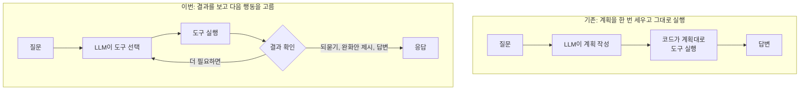
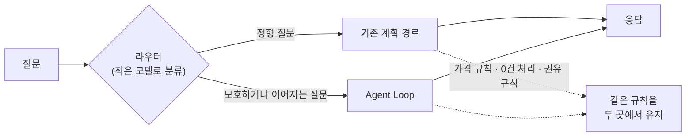
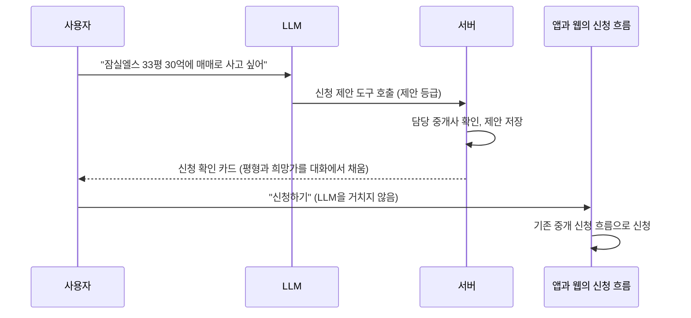
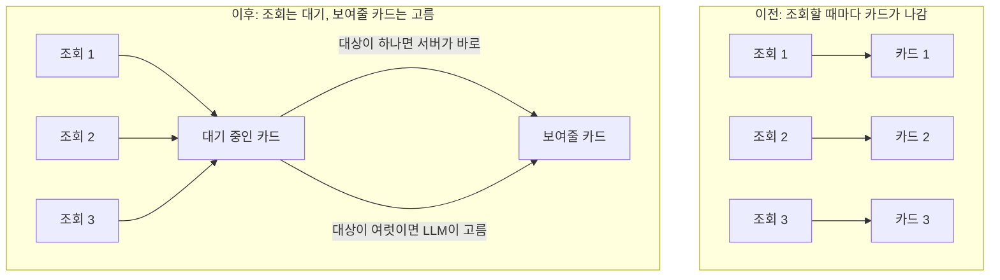

안녕하세요. 프롭테크 플랫폼에서 백엔드 개발자로 근무 중인 정정일입니다.

이번엔 부동산과 관련된 문제를 대화 하나로 해결하는 통합 AI 에이전트를 목표로 서비스를 만들고, 그 첫 단계를 운영에 반영한 이야기를 해볼까 합니다.

사용자가 "서울 근교 20억 이하 30평대 매매 아파트 찾아줘"라고 물으면 조건에 맞는 아파트와 오피스텔 단지를 찾아 지도와 카드로 보여주고, 이어서 시세나 학군을 물어보고, 마음에 드는 단지가 생기면 담당 중개사에게 신청하는 것까지 하나의 대화 안에서 이어지는 기능입니다.

*운영 화면. "서울 근교"라고만 말해도 서울과 맞닿은 시들을 찾아 지도에 경계로 표시하고, 그 안에서 조건에 맞는 단지를 카드와 지도 핀으로 함께 보여줍니다.*

사실 저는 지난번 [AI 부동산 매물 추천 시스템 구축기]()에서 Agent Loop 대신 Planned Tool Use를 선택했고, 그 이유를 이렇게 적었었습니다.

> 저는 Agent Loop가 강력한 건 **도구 실행 결과를 보고 판단을 바꿔야 하는 경우**라고 생각합니다. (...) 하지만 부동산 검색은 그렇지 않았습니다.

그런데 이번에는 기획이 바뀌면서 서비스가 AI로 하려는 일이 달라졌고, 그에 맞춰 구조도 Agent Loop로 다시 만들게 됐습니다.

이번 작업에서 가장 많이 고민한 건 **AI가 답만 하고 끝나지 않고, 중개 신청 같은 서비스의 실제 기능으로 자연스럽게 이어지게 하는 일**이었습니다. 그러다 보니 LLM에게 어디까지 맡길지도 정해야 했습니다.

이 글은 두 편으로 나눠봤습니다. 1편에서는 목표를 어떻게 잡았고 AI의 답을 서비스로 어떻게 이어지게 했는지를 먼저 다루고, LLM에게 어디까지 맡기고 무엇을 코드에 둘지 정한 이야기는 2편에서 이어가보도록 하겠습니다.

다만 시작하기에 앞서, 이 글은 저희 서비스 상황에서 문제를 만나고 판단했던 과정을 정리한 글이라 다른 상황에는 맞지 않을 수도 있습니다. 그 점을 감안하고 봐주시면 감사하겠습니다.

## Plan 방식으로 만들었던 AI 추천

기존 AI 추천은 LLM이 사용자의 질문을 보고 실행 계획을 JSON으로 한 번 세우면, 코드가 그 계획대로 도구를 실행하는 구조였습니다. 장소를 찾고, 그 근처 단지를 검색하고, 점수를 매겨 추천하는 식이었죠.

추천이 목표였을 때는 이 구조가 잘 맞았다고 생각합니다. 도구를 부르는 순서가 거의 정해져 있었고, 흐름이 고정돼 있으니 응답 시간과 비용도 예측할 수 있었거든요. 계획을 세운 뒤에는 LLM이 실행 흐름을 바꿀 수 없다는 점도 안전장치 역할을 해줬고요.

## 기획 변경과 기존 구조의 한계

이번 작업은 기획팀과 새 AI 서비스를 함께 설계하면서 시작됐습니다. 기획팀이 정리해 온 고객 질문이 128개였고, 이 질문들을 아파트 찾기, 계약, 집 관리, 서비스 이용 방법이라는 4개의 여정으로 묶었습니다.

질문들을 보니 사용자분들이 원하는 건 "조건에 맞는 단지 찾기"에서 끝나지 않았습니다. 찾은 단지의 실거래가나 지금 나와 있는 매물을 궁금해하시고, 근처 학교나 지하철, 복비가 얼마나 나오는지, 등기는 괜찮은지도 물어보셨습니다.

그리고 질문을 따라가다 보면 마지막에는 "이 단지 담당 중개사와 이야기해 보고 싶다"로 이어지는 경우가 많았습니다. 사용자분들 입장에서는 이게 다 이어지는 과정인데, 저희 서비스는 이걸 기능마다 따로 나눠서 제공하고 있었죠. 기존 AI 추천도 추천이 끝나면 역할이 끝났고, 그다음은 사용자가 직접 단지 상세로, 다시 중개 신청 화면으로 넘어가야 했습니다.

기획팀과는 목표를 **"사용자의 문제를 AI가 이해하고, 답을 드리고, 서비스 안의 알맞은 기능으로 이어드리는 것"**으로 잡았습니다. 늘어난 사용자 요구를 대화 하나에서 받고, 중개사 매칭까지 가는 단계를 줄이고, 자연어로 서비스 기능을 바로 써볼 수 있게 하자는 것이었습니다. 저희는 이걸 묶어서 "부동산 통합 AI 에이전트"라고 부르기로 했습니다.

방향은 기획팀과 협의해서 정했고, 저는 바뀐 서비스를 어떤 구조로 만들지를 맡았습니다. 목표가 큰 만큼 기존 서비스에서 가장 중요한 흐름인 아파트 추천, 상세 정보 확인, 중개 신청까지를 먼저 만들고 나머지를 그 위에 하나씩 붙이기로 했습니다.

그렇다면 기존 구조를 늘리는 것으로 충분했을까요? 처음에는 계획 단계에 의도를 몇 개 더 추가하고 도구를 더 붙이면 되지 않을까 생각했습니다. 그런데 기존 코드를 다시 분석해보니 늘리는 것만으로는 해결되지 않는 문제들이 있었습니다.

- LLM에 보내는 메시지가 시스템 프롬프트와 이번 질문 두 개뿐이라, "거기서 좀 더 싼 곳은?" 같은 이어지는 질문을 이해하지 못했습니다.
- 결과가 0건이어도 조건을 풀어 다시 찾을 방법이 없었습니다.
- 장소를 1순위 후보 하나로 고정해서, "세종고등학교"가 다른 지역의 같은 이름 학교로 잡히기도 했습니다. 후보가 여럿이면 되물어야 하는데, 계획을 한 번에 세우는 구조라 중간에 멈추고 되물을 수 없었습니다.

첫 번째는 대화 이력을 함께 보내면 기존 구조에서도 어느 정도 풀 수 있었을 겁니다. 하지만 0건일 때 조건을 푸는 일이나 후보가 여럿일 때 되묻는 일은, 도구를 실행한 결과를 보고 나서야 무엇을 할지 정할 수 있었습니다. 지난 글에서 Agent Loop가 필요하다고 적었던 경우에 해당했죠.

지난 글에서 부동산 검색에는 이런 상황이 잘 생기지 않는다고 판단한 건, 그때 만든 게 질문 한 번을 처리하는 기능이었기 때문이지 않나 싶습니다. 대화가 되면 흐름이 사용자마다 다르고, 앞의 결과에 따라 다음 질문이 달라집니다. 128개 질문의 흐름을 계획 프롬프트에 다 적어두려면 결국 지난 글에서 버렸던 고정 파이프라인과 비슷해질 것 같았습니다.

그래서 LLM이 도구를 고르고, 결과를 보고, 다음 도구를 고르는 Agent Loop로 가기로 결정했습니다. 다만 LLM이 할 수 있는 일은 저희가 직접 만든 도구로 한정했고, 이 부분은 2편에서 자세히 다루겠습니다.

### 경로를 하나로 둔 이유

처음 설계안은 Agent Loop만 쓰는 구조가 아니었습니다. 작은 모델로 질문을 먼저 분류해서, "강남역 근처 10억 이하 30평대"처럼 정형화된 질문은 기존 계획 경로로 보내고 모호하거나 이어지는 질문만 Agent Loop로 보내는 하이브리드 구조였습니다.

정형 질문은 도구 순서가 정해져 있으니 기존 경로가 빠르고 싸거든요. 지난 글에서 인용했던 LLMCompiler 논문도 ReAct 방식(생각하고, 도구를 부르고, 결과를 보고 다시 생각하는 방식) 대비 지연은 최대 3.7배, 비용은 최대 6.7배까지 줄일 수 있다고 보고하고 있었습니다.

하지만 라우터는 만들지 않기로 했습니다. 경로가 두 개면 가격 범위를 어떻게 넓힐지, 0건이면 어떻게 할지, 무엇을 권할지 같은 규칙을 두 곳에 똑같이 맞춰둬야 합니다. 사용자가 대화 중에 정형 질문과 이어지는 질문을 섞으면 한 대화 안에서 경로가 계속 바뀌고, 라우터가 잘못 분류했을 때 어느 쪽 문제인지 찾는 것도 일입니다.

저희는 팀 규모가 작아서 한 번 만든 뒤에도 계속 고쳐 나가야 했고, **두 경로의 규칙을 계속 같게 유지하는 건 저희 상황에서는 어렵다고 생각했습니다.** 물론 그만큼 응답이 느려지는 건 감수해야 했습니다.

프레임워크도 비슷한 기준으로 골랐습니다. OpenAI의 Responses API(도구 호출과 추론 모델을 함께 쓰는 새 API)를 지원하는 Spring AI 버전을 쓰려면 Spring Boot 메이저 버전을 올려야 했는데, 서비스 전체에 영향이 가는 업그레이드를 AI 작업과 묶기는 어려웠습니다. LangChain4j는 추상화 계층이 하나 더 생겨서, 문제가 생기면 제 코드와 프레임워크 코드를 같이 봐야 할 것 같았고요.

결국 공식 SDK의 Responses API 위에 루프를 직접 만들었습니다. 루프 자체는 수백 줄 정도로 생각보다 단순했고, 시간은 대부분 이 글과 2편에서 다룰 일들에 들었습니다.

## AI의 답을 서비스 기능으로

초기 버전을 써보니 LLM이 답은 꽤 잘하는데, 그 답에서 서비스 기능으로 넘어가지는 않더라고요. 예를 들어 "헬리오시티 33평 29억이면 복비 얼마야?"라고 물었을 때 AI는 복비를 정확하게 계산해주고 거기서 끝났습니다. 그 단지를 사려고 복비까지 계산해보는 사용자라면 담당 중개사와 이야기해볼 만한 시점인데도요.

기획에서도 이 부분을 가장 중요하게 봤습니다. 기획에서는 답변을 답, 근거, 행동 3단으로 나누는데, 그중에서도 서비스의 알맞은 기능으로 이어주는 "행동"이 핵심이었거든요. 지표 역시 AI 답변에서 중개 신청이나 등기분석 같은 서비스 기능으로 넘어간 비율로 잡았습니다.

그렇다면 AI의 답을 어떻게 하면 서비스의 실제 기능으로 자연스럽게 이어줄 수 있을까요? 그리고 사용자 입장에서 그게 억지스러운 권유로 느껴지지 않으려면 무엇이 필요할까요? 이번 작업의 고민은 크게 이 두 가지였습니다.

## 중개 신청까지 이어지게

서비스로 이어지는 가장 직접적인 결과는 중개 신청이었고, 대화 안에서 신청까지 이어지게 하고 싶었습니다.

먼저 정한 건 **신청을 LLM이 직접 실행하지 않는다**는 것이었습니다.

LLM은 같은 도구를 두 번 부르기도 하고 의도를 잘못 해석하기도 하는데, 신청은 한 번 들어가면 중개사에게 그대로 전달돼서 되돌리기 어렵거든요. 그래서 LLM에게는 신청을 "제안"하는 도구까지만 주고, 신청을 실행하는 도구는 주지 않았습니다. 그렇다면 사용자가 확인한 뒤의 신청은 누가 실행해야 할까요?

처음 설계는 사용자가 확인 버튼을 누르면 LLM을 거치지 않고 서버로 요청이 들어오고, 서버가 제안 ID를 멱등키로 써서 신청을 넣는 방식이었습니다. 네트워크가 끊겨 요청이 다시 들어와도 신청은 한 번만 되게 하려는 설계였죠. 다만 기존 중개 신청 흐름을 따라가보니 단계마다 화면에서 값을 받아 다음 요청을 만드는 구조라, 서버가 대화에서 한 번에 실행하기에는 맞지 않았습니다.

그래서 신청은 원래 하던 곳에서 하기로 했습니다. 지금은 서버가 신청 제안까지만 만듭니다. 사용자가 확인 카드에서 "신청하기"를 누르면 단지 화면에서 쓰던 기존 신청 흐름이 카드 안에서 그대로 실행됩니다. 신청 규칙을 한 곳에만 두고 이미 검증된 흐름을 그대로 쓰자는 생각이었습니다.

서버가 한 응답에 제안을 하나만 남기기 때문에, LLM이 제안 도구를 여러 번 부르더라도 확인 카드는 하나만 뜨고 신청도 사용자가 확인한 한 건만 들어갑니다.

*제 테스트 계정으로 찍은 운영 화면입니다. 왼쪽은 복비를 물었을 때로, 이미 이 단지에 진행 중인 신청이 있어서 새로 권하지 않고 진행 상황과 담당 중개사 대화로 이어줍니다. 오른쪽은 "사고 싶어"라고 했을 때의 확인 카드로, 평형과 희망가가 대화에서 채워져 있고 신청은 사용자가 "신청하기"를 눌러야 진행됩니다.*

등기분석도 같은 원칙으로 붙였습니다. 대화에서는 결과를 설명하고 신청 준비까지만 하고, 결제와 신청은 기존 등기분석 화면에서 합니다.

## 권유 시점

신청 말고도 AI가 권할 수 있는 서비스는 여럿 있었습니다. 다만 저는 이게 억지스러우면 안 된다고 생각했습니다.

단지를 둘러보는 중인데 답변마다 "중개사와 연결해 드릴까요?"가 붙으면 광고처럼 느껴지고, 저라도 대화를 그만둘 것 같았거든요. 권유를 자주 붙이면 지표는 올라가겠지만, 그게 서비스에 좋은 건지는 잘 모르겠더라고요.

처음에는 지시문에 "단지 추천, 시세, 비교 중에는 중개 연결을 권하지 않는다"고 적었습니다. 그랬더니 사용자가 "여기 사고 싶어"라고 해도 AI가 한 번 더 묻거나 아예 연결해주지 않았습니다. 지시문을 대화 주제만 기준으로 적어두다 보니, 사용자가 직접 원할 때도 연결하지 않았던 거죠.

그래서 **권유 여부를 사용자가 거래 의사를 얼마나 분명하게 보였는지에 따라 나눴습니다.** 아래 표의 맞춤 중개는 담당 중개사에게 원하는 조건을 전달해 매물을 문의하는, 저희 서비스의 중개 신청입니다.

| 사용자가 보인 의사 | 예시 | AI가 하는 일 |
|---|---|---|
| 분명함 | "여기 사고 싶어", "방문해서 볼 수 있어?" | 다시 묻지 않고 신청 확인 카드를 띄움 (대화에서 평형과 희망가를 채움) |
| 가벼운 관심 | "맘에 들어", 특정 단지의 시세나 실거래가를 물어봄 | 부담이 작은 단지 소식 알림부터 권하고, 맞춤 중개는 그다음 |
| 일반 정보만 물음 | "학군 어때?", "전세 계약 주의사항이 뭐야?" | 중개는 권하지 않음 (필요하면 계산기 같은 관련 화면만 안내) |

*"헬리오시티 33평 실거래가 알려줘"에 대한 답변입니다. 실거래가 카드(왼쪽)를 보여준 뒤, 답변 끝에 새 실거래와 신저가를 알려주는 알림 카드(오른쪽)를 붙였습니다.*

의사가 분명할 때 바로 신청 확인 카드를 띄울 수 있었던 건 앞에서 이야기한 것처럼 최종 확인을 사용자에게 맡겼기 때문입니다. 카드를 띄운 뒤에도 사용자가 한 번 더 눌러야 신청이 들어가니, 바로 띄워도 부담이 적다고 생각했습니다.

다른 서비스는 대화 주제에 맞춰 이어줍니다. 전세 계약을 고민하거나 근저당 같은 권리 문제를 이야기하면 AI 등기분석을 권합니다. 예산과 대출 이야기가 나오면 대출 계산기, 집을 팔려는 이야기에는 집 내놓기로 이어주고요. 사무실이나 상가를 구하거나 내놓으려는 이야기에는 사무실 전용 맞춤 중개와 내놓기로 이어줍니다.

표현도 바꿨습니다. 저희끼리는 "매칭"이라고 부르지만 사용자에게 "매칭해 드릴까요?"는 잘 와닿지 않습니다. 대신 "헬리오시티 담당 중개사에게 이 가격대 매물을 문의해 보시겠어요?"처럼 사용자가 얻는 걸 중심으로 말하도록 바꿨습니다.

## 권유 규칙

권할 시점 말고도 지켜야 할 규칙이 몇 가지 더 있었습니다. 같은 대화에서 같은 권유가 반복되면 앞에서 걱정한 광고처럼 느껴지고, 담당 중개사가 없는 단지에 중개를 권하면 눌러도 연결할 곳이 없으니까요.

사용자가 어떤 관심을 보였는지는 대화를 봐야 알 수 있어서 LLM이 판단해 권유 도구에 넘깁니다. 지켜야 하는 규칙은 서버에서 확인하고요.

예를 들어 맞춤 중개를 권하는 도구는 같은 대화에서 이 단지에 이미 권했는지, 담당 중개사가 있는지, 진행 중인 신청이 있는지를 서버에서 확인하고, 조건에 맞지 않으면 "권하지 않음"을 돌려줍니다. 알림을 먼저 권할지 맞춤 중개를 바로 권할지도 LLM이 넘긴 관심의 종류와 권유 이력을 보고 서버가 정하고, 한 응답에는 둘 중 하나만 남깁니다. 지시문에 적어두는 것만으로는 이런 규칙이 잘 지켜지지 않았는데, 이 이야기는 2편에서 이어가겠습니다.

반대로 사용자가 직접 담당 중개사를 물으면, 앞에서 이미 권했더라도 사용자가 먼저 원한 경우라 버튼을 다시 붙입니다.

## 기존 화면으로 연결

연결되는 곳은 이미 있는 서비스 화면이어야 한다고 생각했습니다. AI 안에 계산기나 등기분석을 새로 만들 수도 있었지만, 그러면 AI에서 본 숫자와 기존 화면에서 본 숫자가 달라질 수 있거든요.

AI는 대화 안에서 결과까지만 보여주고, 더 해보고 싶으면 기존 화면으로 보냅니다. 이때 **대화에서 나온 값을 채운 상태로** 보냅니다. 복비 계산 결과에서 계산기로 넘어가면 금액과 거래 유형이 채워진 채 결과가 바로 보이고, 등기분석 신청 확인에서 넘어가면 동, 호수, 보증금이 채워진 채 등기분석 화면이 열립니다.

*"잠실엘스 25억에 매매하면 복비 얼마야?"에 대한 복비 카드(왼쪽)에서 "금액 바꿔서 계산하기"를 누르면, 아파트, 매매, 25억이 채워진 채 기존 계산기가 열리고 같은 절약 금액이 보입니다(오른쪽).*

대화 안에서 보여주는 계산 결과도 기존 화면과 같아야 했습니다. 복비 계산 로직은 웹 계산기 코드를 연산 순서까지 그대로 옮기고, 웹 계산기를 실제로 실행해서 얻은 값을 정답으로 고정한 테스트를 두었습니다. 계산 로직이 한 벌 더 생긴 건 맞지만, 반올림 하나만 달라도 AI와 계산기의 복비가 달라지니 AI 쪽 계산이 웹과 달라지면 테스트가 바로 깨지게 묶어둔 거죠.

결제나 신청, 인증은 기존 화면에서 하고, AI는 그 화면까지 안내하는 데까지만 합니다. 만들고 나서 보니 이번 작업의 상당 부분은 기존 기능을 대화에서 바로 찾아 들어갈 수 있게 하는 일이었던 것 같습니다.

## 결과를 먼저 보여주는 화면 구성

서비스로 이어지게 하려면 화면도 달라야 했습니다. 저는 처음부터 이 기능이 긴 텍스트를 보여주는 챗봇처럼 보이지 않았으면 했습니다. 단지 열 곳의 가격과 평형을 문장으로 나열하면 읽기도, 비교하기도 어렵고, 다음에 뭘 할지도 잘 보이지 않으니까요.

### 조건을 다 묻기 전에 결과부터

처음 만든 버전은 조건이 부족하면 먼저 물었습니다. 거래 유형, 예산, 평형을 하나씩 확인한 뒤에 검색하는 식이었습니다. 정확하긴 했지만 사용자는 결과보다 되묻는 질문을 먼저 받는 경우가 많았습니다.

그래서 기획팀과 이야기해서 **일단 가정하고 결과부터 보여주는 쪽**으로 바꿨습니다. 거래 유형을 말하지 않으면 매매로 가정해서 바로 검색하고, 답변에서 매매로 가정했다는 걸 짚어줍니다. 결과가 많을 때는 상위 몇 곳을 먼저 보여주고 빠진 조건은 결과 아래 버튼으로 묻는데, 거래 유형을 가정한 경우에는 거래 유형부터 확인한 뒤 결과를 좁히는 질문으로 넘어갑니다.

*"마포구 15억 이하 30평대 아파트"에는 거래 유형이 없습니다. 매매로 가정해 33곳을 찾고 그 사실을 답변에 밝힌 뒤(왼쪽), 아래쪽에는 결과를 좁혀볼 수 있는 버튼을 단지 수와 함께 보여줍니다(오른쪽).*

이후에 거래 유형만큼은 먼저 묻는 방식도 다시 적용해봤습니다. 그런데 대화 기록을 비교해보니 첫 질문부터 되묻는 경우가 크게 늘었고, 매매를 기본으로 두면서 자연스럽게 이어지던 흐름도 같이 사라졌습니다. 결과가 나오면 실거래가 차트와 알림 권유가 이어지는데, 거래 유형이 정해지지 않은 동안에는 해당 도구들이 아예 불리지 않았던 거죠. 그래서 다시 결과 먼저로 되돌렸습니다. 거래 유형을 잘못 가정했더라도 다음 질문에서 바로 바꾸면 되니까요.

### 카드 고르기

가격이나 면적 같은 숫자는 코드가 만든 카드로 보여주고, LLM은 답변에서 카드에 없는 설명만 덧붙입니다. 실거래가는 차트로, 매물은 최근 실거래 대비 몇 % 차이인지 보이는 목록으로, 중개 신청 진행 상황은 지금 어느 단계인지 보이는 막대로 보여줍니다.

*"지금 나와있는 매매 매물도 보여줘"에 대한 화면입니다. 오른쪽 카드는 최근 거래 평균보다 싼 매물 수와 각 매물의 최근 거래 대비 %를, 지도는 동별 최저 호가를 보여줍니다.*

초기 버전은 답변이 다 끝난 뒤에 카드를 붙였습니다. 결과를 먼저 보여주려고 도구가 조회할 때마다 카드를 바로 그리게 바꿨는데, 이번에는 LLM이 답을 만들려고 단지 세 곳을 조회하면 카드도 세 장이 쌓였습니다. 사용자는 하나를 물었는데 화면에는 LLM이 확인해본 것들이 전부 나오는 거죠. 예외 규칙을 하나씩 추가해서 막아봤는데, 그러다 보니 이번에는 다른 곳에서 카드가 빠지는 문제가 생겼습니다.

결국 조회와 표시를 아예 나누기로 했습니다.

도구가 조회한 결과는 바로 그리지 않고 모아뒀다가, **답변이 시작되기 직전에 어떤 카드를 보여줄지 정합니다.** 보여줄 대상이 하나뿐이면 서버가 바로 내보내고, 서로 다른 대상이 둘 이상일 때만 LLM에게 고르게 합니다.

바꾸기 전후로 같은 질문과 화면 조합 56개를 비교해봤습니다. 36개는 그대로였고, 3개는 의도한 대로 나아졌습니다. 나머지 17개도 하나씩 열어봤는데, 아무것도 바꾸지 않고 같은 질문을 두 번 돌렸을 때도 생기는 정도의 흔들림이었고 바뀐 방식 때문에 나빠진 경우는 없었습니다.

물론 그만큼 감수해야 하는 부분도 있었습니다. LLM이 카드를 고르는 단계가 하나 늘면서 한 턴에 쓰는 호출과 토큰도 늘었습니다. 그래서 카드를 고르는 단계가 필요한 조건을 좁히고 토큰 상한도 다시 잡았습니다. 늘어난 비용이 감당할 만한 수준인지는 운영 데이터가 좀 쌓이면 다시 봐야 할 것 같습니다.

### 화면의 모든 요소가 같은 데이터를 보도록

카드를 넣고 나니 화면에서 정보를 보여주는 곳이 여러 개가 됐습니다. LLM이 쓰는 답변과 코드가 그리는 카드, 지도 위의 핀, 선택지 버튼까지요. 써보면서 나온 문제들은 대부분 이것들이 서로 다른 내용을 보여주는 문제였습니다.

- 답변은 단지를 거리순으로 나열하는데 화면 목록은 추천 순위순이라, "첫 번째 단지"라고 하면 답변의 첫 번째와 화면의 첫 번째가 달랐습니다.
- 한 응답에서 LLM이 검색을 여러 번 하면 조건을 고르는 버튼 묶음도 여러 번 쌓였는데, 서버는 마지막 묶음의 조건만 기억하고 있어서 앞쪽 버튼과 서버가 기억하는 조건이 어긋날 수 있었습니다.

두 문제 모두 답변, 카드, 버튼이 서로 다른 데이터를 보고 있었기 때문이라고 생각합니다. 그래서 **화면의 모든 요소가 같은 데이터를 보도록** 맞췄습니다.

도구가 LLM에게 넘기는 결과 순서는 화면 순서와 맞췄습니다. 정렬이 필요하면 거리순이나 가격순 같은 정렬을 검색 도구에 넣었는데, 그러면 LLM이 순서를 따로 만들지 않아도 되니까요. 버튼은 실행이 끝날 때 서버가 기억하는 마지막 묶음만 보내고, 버튼으로는 질문만 보냅니다. 다른 화면으로 넘어가는 건 카드에서만 하고요.

데이터 자체도 마찬가지였습니다. 에이전트는 검색 결과와 상세 정보, 실거래가를 한 답변에 같이 쓰기 때문에, 도구도 단지 상세 화면과 같은 데이터를 쓰도록 맞췄습니다.

진행 단계 이름도 같은 문제였습니다. 중개 신청 진행 현황을 보여줄 때 AI가 "중개사 배정 중"이라고 말한 적이 있는데, 저희 서비스에는 배정 중이라는 단계가 없습니다. 단계 이름을 정해주지 않았기 때문에 LLM이 상태값을 보고 그럴듯한 이름을 지어낸 거였죠. 지금은 진행 단계 이름을 실제 업무 단계에 맞춰 코드가 정하고, LLM은 그 이름만 씁니다.

{}
## 운영에서 확인한 것 (데이터 쌓이면 작성, 1편의 결론이 될 절)
- AI 답변에서 서비스 기능(맞춤 중개 신청, 등기분석, 계산기 등)으로 넘어간 비율 — 기획이 잡은 핵심 지표
- 권유를 보여준 횟수 대비 실제로 누른 비율 (억지 권유가 아니었는지 확인)
- 의사 강도별(분명함/가벼운 관심) 신청 확인 카드 → 실제 신청 전환율
- 실제 사용량: 일 대화 수, 사용자당 턴 수, 앱/웹 비율
{}

## 1편을 마치며

1편에서 다룬 내용을 정리하면 다음과 같습니다.

1. 신청은 LLM이 제안까지만 하고, 사용자가 확인하면 기존 신청 흐름에서 진행됩니다.
2. 권유는 사용자가 보인 거래 의사의 정도에 맞췄습니다.
3. 긴 문장 대신 결과와 카드를 먼저 보여주고, 빠진 조건은 결과 아래에서 물었습니다.
4. 대화 안의 결과는 기존 화면과 같은 데이터, 같은 숫자로 보여줬습니다.

그런데 이렇게 AI가 서비스의 기능으로 이어지면, AI가 틀렸을 때 사용자에게 실제로 손해가 생길 수 있습니다. 버튼에 적힌 숫자를 믿고 눌렀는데 다른 결과가 나오거나, 다른 사람의 정보가 보이는 식으로요. AI를 서비스 기능과 이어 붙이다 보니, LLM과 코드의 역할을 어떻게 나눌지도 함께 정해야 했습니다.

**LLM에게 어디까지 맡길 것인가?**

2편에서는 그 기준을 어떻게 정하고 지켰는지, 그리고 느려진 응답은 어떻게 다뤘는지 이야기해보려 합니다.

후편: [[부동산 통합 AI 에이전트 2/2편] LLM과 코드의 역할을 나누기까지]()

이 글에서 다룬 기능은 [부톡 아파트](https://bootalk.co.kr/apt) 웹과 앱에서 사용해보실 수 있습니다. 긴 글 읽어주셔서 감사합니다.

---

## 참고 자료

### 관련 글

- [AI 부동산 매물 추천 시스템 구축기]()

### 참고 문헌

- Anthropic - [Building Effective Agents](https://www.anthropic.com/engineering/building-effective-agents)
- OpenAI - [A practical guide to building agents](https://cdn.openai.com/business-guides-and-resources/a-practical-guide-to-building-agents.pdf)
- OpenAI - [Responses API](https://platform.openai.com/docs/api-reference/responses)
- Kim et al. - [An LLM Compiler for Parallel Function Calling](https://arxiv.org/abs/2312.04511) (arXiv, 2023)
