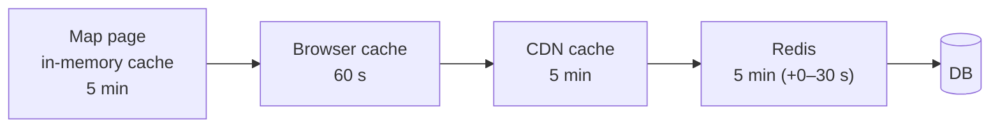

Hello, I'm Jeong Jeong-il, a backend developer working at a PropTech platform.

This time I'd like to talk about adding a cache to the map query in our service. Our map has an API that looks up the apartment complexes inside the viewport every time the user moves the map. Because this API took the viewport coordinates as they were, every request was different, and it was hard to use a cache. So we changed the unit of the request itself to make caching possible, and I want to write down what I had to think through along the way.

The approach in this post is not new in itself. Splitting map images into tiles has been around for a long time. But applying it to our query API meant deciding quite a few things ourselves, such as the tile size, the cache TTL, and when to start the query. So this post focuses on those decisions and also covers what we confirmed after rolling it out to production.

---

## Why Is It Hard to Cache a Query by Viewport Coordinates?

On our map, apartment complexes are shown as markers with their size and price.


*The map on our production site.*

Previously, this query used the coordinates of two corners of the viewport. You send the southwest and northeast corners, and the server finds the complexes between them and returns them.

```text
GET /map/complexes?swLat=37.48532&swLng=127.05688&neLat=37.52193&neLng=127.12500
```

I think this is the first design that comes to mind when building a map query API. It queries exactly what is in the viewport, so nothing is wasted.

The problem was that **every request is different.**

Even when two users look at the same neighborhood, their screen sizes differ, and moving the map by a single pixel changes the decimals of the coordinates. A cache only helps when the "same request" comes again, and with viewport coordinates the same request almost never came up twice. So even the common case of moving the map a little and coming back went all the way down to the DB every time.

I had been aware that markers on our map were appearing with a delay, and after wrapping up a large project, the [integrated real estate AI agent](), I got to look into it.

So how long was it actually taking? On our production site, I measured the time from letting go of the map to the new markers being drawn, five times each, and ours took about 0.7–1 second. I measured other real-estate map services the same way and they were under 0.2 seconds. This time included not only the round trip to the server but also the wait before the query even started, which I'll come back to later.

## Changing the Request Unit to Tiles

I decided that instead of fitting the request to the user's viewport, **we had to align it to a predefined grid of cells.**

When map services serve map images, they divide the world into equally sized cells per zoom level and have clients request images by a cell number, `z/x/y`. These cells are called tiles.

But tiles are not the only way to define cells. These are the options I looked at.

| Option | Upside | Downside |
|---|---|---|
| Round viewport coordinates to a fixed step | The existing API can be kept almost as it is | You have to define the cell size and the per-zoom levels yourself, and levels don't nest |
| Geohash | A cell is a single string, and stores like Redis support it natively | Each character splits a cell into 32, so the gap between levels is large, and the cell's aspect ratio changes with the string length |
| Tiles (z/x/y) | Each zoom level splits a cell into exactly 4, and it is already widely used for maps | You have to compute which tiles the viewport covers, and one request becomes several |

Geohash is convenient for storing a location as a string or finding nearby places. But in a case like ours, where the query unit has to change with the map's zoom, I judged that a cell size that changes 32-fold per level would be hard to work with.

I chose tiles for three reasons.

First, the tile number is the request address, so the browser, the CDN, and Redis can all cache under the same key.

Second, one large tile contains exactly four tiles of the next zoom level in. When we already have a larger tile, a zoomed-in viewport can be drawn from it.

Third, map image servers and vector tile servers already use the same scheme, so there was plenty of material to refer to.

We decided to use this grid as it is for the complex query.

```text
GET /map/complexes/tiles/13/6988/3173
```

The frontend computes which tiles the viewport covers, requests only those, and merges the returned tiles to draw the markers. The server computes the actual range each tile number covers.


*Two users looking at roughly the same area.*

With this change, people looking at the same neighborhood send **the same address for every tile their viewports share.** Even with a different screen size, or after moving the map a little, the requested tiles stay the same as long as you don't cross a tile boundary.

Of course there are downsides. Since we fetch whole tiles that the viewport touches, we also receive complexes outside the viewport, and one request becomes several. So I spent quite some time on how big the tiles should be.

### Deciding the Tile Size

Smaller tiles mean less off-screen data, but more requests per viewport. Larger tiles mean fewer requests but a lot of data nobody looks at. Looking at the cache alone, larger tiles reduce the number of distinct tiles and raise the chance of a cache hit, but that didn't mean we could just make them as large as possible.

Each time the zoom drops by one level, a tile covers four times the area. Using tiles at the same zoom as the map would need four times as many tiles as going one level lower, and going two levels lower would make a single tile cover far more than the viewport.


*The same viewport divided by three tile sizes.*

So at the zoom levels where complex markers are shown, we use **tiles one zoom level lower than the map.** This fills one viewport with about 2–6 tiles in most cases, and when a large viewport would need too many tiles, we don't split into tiles and query by viewport range in one request as before.

```ts
// map zoom 14.3 → tile zoom 13
const tileZoom = clamp(Math.floor(mapZoom) - 1, MIN_TILE_ZOOM, MAX_TILE_ZOOM);
```

The map zoom moves in fractions like 14.3, so we floor it to an integer for the tile zoom.

### Filters and the Cache Key

Our map has filters such as size, price, and move-in year. Filters are attached as query parameters and included in the cache key as they are.

The cache key is built by joining the deal type (sale, lease, and so on), the tile number, and the filter values in a fixed order, because the same filters have to give the same key even when the query parameters arrive in a different order. For the browser and the CDN the address itself is the key, so the frontend also always attaches the parameters in the same order. We also put a version at the front of the key, so that if the response format changes later, bumping the version keeps old cache entries from mixing in.

What I paid attention to here was that the number of cache keys grows with the number of filter combinations. Keys could multiply to the number of tiles times the number of filter combinations, so I wondered whether the cache would be split so finely that hits would almost never happen.

We could only confirm this after rolling out to production, and when we looked at the real requests, **90% of them had no filter at all.** There were 151 filter combinations over two days, but most requests were concentrated on the default query without filters. At least in our service, filters didn't seem to fragment the cache much.

## Putting the Cache in Four Places

We put the cache in four places, starting with the one closest to the user.



*The setup when we first rolled it out.*

- **In-memory cache on the map page**: the page holds the tiles it received for up to 5 minutes. Moving the map a little and coming back is served from here, so no request is sent at all.
- **Browser cache**: used when the page is refreshed or reopened. A browser cache can't be purged from the server once it has been delivered, so we keep it for only 60 seconds.
- **CDN cache**: if someone else recently viewed the tile, the CDN answers without reaching our server.
- **Redis**: even when the CDN doesn't have it, the server answers without querying the DB.

The first two only reuse what the same user received, while the last two (CDN and Redis) are shared caches used by many people together.

The TTLs for the browser and the CDN are set by the server through a response header.

```http
Cache-Control: public, max-age=60, s-maxage=300
```

For Redis, we added 0–30 seconds of jitter (a random offset) to the TTL. If caches created at the same moment expire together, queries can pile onto the DB at that instant, which is a cache stampede. And since I thought the map should still work even if Redis has a problem, a failed Redis read or write falls back to reading from the DB.

### How Stale Can the Data Get Across Several Layers?

A cache delays how soon data changes show up. And with several layers, it turned out this delay did not end at 5 minutes.

Here is the worst case. Redis may hold data that is just about to expire, which is up to 5 minutes 30 seconds old. If the CDN picks up that data, it keeps it for another 5 minutes, and the page holds what it received for 5 more. The browser cache counts its 60 seconds including the age the CDN reports, so we didn't add it separately. Adding these up, **in the worst case the data could be 15 minutes 30 seconds late.**


*The worst case, where each layer picks up data that is just about to expire.*

I didn't think the prices shown on map markers need to be accurate to the minute, so I decided to accept this. The detail screen you reach by tapping a complex is queried separately and is not affected by this cache.

## When Should the Query Start?

After adding the tile cache, I measured again. But even when I moved within tiles we already had and no request was sent at all, **markers still took 0.2–0.7 seconds to appear.**

If it was slow without even going to the server, I had to look at the time before the query started. I hadn't planned to look at the query timing at first, but seeing it take time even with no request going out, I started looking at when the query starts as well.

The moments when a query can start on a map are summarized in the table below.

| When | Upside | Downside |
|---|---|---|
| After the map has fully stopped | The viewport is final, so no wasted requests | If the idle signal arrives late, the query starts that much later |
| The moment you let go | No waiting for the idle signal | If the map keeps gliding with inertia after you let go, the viewport changes |
| While dragging | Data can be ready before you let go | May fetch data the user never sees |


*The three moments are marked with the moment of letting go at 0. The position of the idle signal is what we measured on the map SDK we use.*

We originally used the first approach. So I measured separately when the idle signal arrives, and on the map SDK we use it **only arrived 0.36–0.46 seconds after letting go.** A large part of the time until the markers appeared was this wait.

Of course, if the map keeps gliding with inertia after you let go, waiting for the idle signal is the right thing to do. But when I checked, our map had no inertial movement. The viewport at the moment of letting go was already the final one. So I decided there was no need to wait for the idle signal and moved the query to the moment of letting go.

We also added the third approach, because switching the request unit to tiles made it possible to prefetch the tiles that will be needed next. When querying by viewport coordinates, we had to know where the user would stop before we could build the request. But tile numbers are fixed, so we can compute in advance which tile is to the right of the current viewport, or which tile we'd need after zooming out one level.

While dragging, every 0.1 seconds we fetch the tiles for the current viewport and for one viewport ahead in the direction it is moving. After the map stops and the markers are drawn, we also fetch the area around the viewport, half a viewport wide, and the tiles for one zoom level out. The aim is that wherever the next move goes, it lands inside what we already have.


*The blue outline is the current viewport, the dashed orange outline is the range we want to prefetch, and the shaded cells are the tiles actually requested. Tiles for one zoom level out are not drawn.*

If we drew prefetched data right away during a drag, markers would flicker on a moving map. That didn't look good, so during a drag we only store what we receive and draw only after letting go.

### Limits on Prefetching

That said, tiles fetched by prefetching may never be seen by the user. It uses more of the user's data and our server resources, so we put a few limits in place.

- The number of prefetch requests running at the same time is capped; the rest wait in a queue.
- The queue length is capped as well; when it overflows, the oldest are dropped first, because if the map has already moved elsewhere the old requests are no longer needed.
- When a request's turn comes, it is skipped if the tile has already been received.
- If the browser is in data-saver mode or on a slow connection, off-screen tiles are not fetched.

## What We Saw in Production

After the rollout I measured again the same way on the production site. The time from letting go of the map to the markers appearing went **from 0.7–1 second to 0.01–0.12 seconds.** It was about 0.01–0.04 seconds for drags of 0.5 seconds or longer, and about 0.06–0.12 seconds for very short drags.


*Each range is the minimum and maximum over several measurements.*

Before the rollout, what I paid the most attention to was the number of requests. One request was now split into several tiles, with prefetching on top. Since one viewport usually needs up to 6 tiles, I first assumed requests would grow sixfold with no cache hits at all and calculated whether the server and the DB could take it. Over a whole day there was headroom, but I judged that moments when requests pile up at once could be a burden, and that is why we added the concurrency limit I mentioned above, so that prefetching doesn't pile on at the same moment.

Comparing a single day, three days after the rollout, with a single day before it, map queries reaching the server grew by only about 17%, and DB CPU usage did not go up. Requests must have grown far more than that from the tile split, so the rest seems to have been absorbed by the in-memory cache on the page.

{}
17% compares one day before with one day after (11-24). Update with a weekly average.
{}

### Hit Rate of the Shared Caches

The shared caches, however, had a lower hit rate than I expected. Of the tile requests that reached the server, the share answered straight from Redis was 2–3%. The CDN was similar: even the tiles requested most the day before were rarely answered straight from the CDN.

Why was it this low? Looking at the request logs, of the distinct tile-and-filter combinations requested over two days, **nearly half were requested only once.** Even the 20 most requested ones together made up only about 8% of all requests.


*How many times the same tile-and-filter combination was requested over two days.*

With requests spread this widely, it seems there just weren't many cases where another person requested the same tile within the 5-minute TTL.

The client-side caches, which reuse what the same user already received, seem to have been a different story. A single user looking at the map keeps moving around the same area. I think the time to show markers now comes down to starting the query earlier, the in-memory cache on the page, and prefetching.

The time saved by a cache hit also differed by layer.

| Where the cache hit | Time to response |
|---|---|
| In-page memory | No request |
| CDN (measured by requesting the same tile back to back) | 41–60 ms |
| Redis (server processing time) | median 9–10 ms |
| Miss everywhere, DB query (server processing time) | median 22–26 ms |
| Full response when everything misses | 128–268 ms |

The DB query itself is already fast, so answering from Redis only saved a little over 10 ms. The time to travel to the server and back was far larger, so a hit in a cache closer to the user, like the CDN or the page, made a bigger difference.

## Thinking About TTL

Then how much would the hit rate rise with a longer TTL?

We could calculate this from the real request logs. We lined up two days of tile requests in time order and counted a hit whenever the same tile-and-filter combination came again within the TTL. The first day was used to warm the cache and only the second day was counted. With 5 minutes the result was 2.5%, almost the same as what we observed, so I ran the calculation for other TTLs.


*Estimated hit rate by TTL, calculated from real request logs (the horizontal axis is not evenly spaced). This is for a single central cache like Redis; a CDN split by region would likely be lower.*

Even at 1 hour it was about 15%, and **it took a 12-hour TTL for half of the requests to hit.**

So should we just make the TTL long? A longer TTL would reduce the requests reaching the server and the DB, and with more answers coming from the CDN, even places a user visits for the first time would respond faster. Of course there is a downside. Price changes would show up on the map that much later. As we saw earlier, delays add up across layers, so with 6 hours each on Redis and the CDN the data could be more than 12 hours late in the worst case. The time during which a marker on the map and the detail screen show different values would grow just as much.

I went back to what the TTL should be based on in the first place.

When I first set it to 5 minutes, the value was chosen by asking "how late is acceptable?" But after looking at the request logs, I came to think we should first look at **how often the data changes.** The price data used for map markers is refreshed once a day. While the data isn't changing, there was no reason to throw the cache away.

So instead of discarding entries after a fixed time, we changed direction so that **the cache is refreshed together with the price data.** But the layers differ in how easily they can be purged, so the same approach couldn't apply to all of them.

| Cache | Shared with | Purge from the server | Approach |
|---|---|---|---|
| In-page memory | The same user | Not possible | Keep short (5 min) |
| Browser | The same user | Not possible | Keep short (60 s) |
| CDN | Many users | Needs a separate request | Long TTL, purged when prices are refreshed |
| Redis | Many users | Immediate | Long TTL, purged when prices are refreshed |

This way the shared caches build up over the day, while a price change takes at most the few minutes the client-side caches last to reach the map.

The role of Redis changes too. With a 5-minute TTL, Redis almost never answered, but once entries build up over a day, a good share of the requests reaching the server can be answered without a DB query. And since Redis is the only shared cache the server can purge right away, I decided it was right to keep this layer.

For purging, instead of deleting keys one by one, we chose to **put a data version in the cache key.** When the price data is refreshed the version changes, so later requests go to new keys and the old keys simply expire with their TTL. It is the same approach as the version we put in the key in case the response format changes.

But if the cache is emptied all at once on refresh, won't queries pile onto the DB? That was the same concern behind adding jitter earlier. I judged this case to be a little different. Even though the cache is emptied at once, it is refilled one tile at a time, as users request them. A DB query also takes only a little over 20 ms, so I concluded that it wouldn't be a burden at our current request volume.

{}
The price-refresh integration is not implemented yet (tracked in a backend issue). Before publishing, check whether it has been implemented, and add the hit rate and server request counts measured after the rollout.
{}

In the earlier calculation, keeping entries for 24 hours gave about 61%. Of course, since the cache is purged on every refresh, I think the real number will come out lower than that. I plan to adjust the exact TTL values after operating a while longer and looking at real user requests.

## Closing

That was a look at what I had to think through while switching our map query to tiles.

In this work, I think aligning requests to predefined tiles instead of viewport coordinates was the starting point that made caching possible. Even outside maps, an API that is hard to cache because each request has slightly different values might be able to use a similar approach.

Checking in the request logs whether the cache actually hits after adding it was important too, I think. I learned from the logs that the shared caches had a lower hit rate than expected and that a 5-minute TTL didn't fit our data.

I hope this post is of some help to those working through similar problems.

Thank you for reading.

### Reference

- [OpenStreetMap Wiki: Slippy map tilenames](https://wiki.openstreetmap.org/wiki/Slippy_map_tilenames)
- [MDN: Cache-Control](https://developer.mozilla.org/en-US/docs/Web/HTTP/Headers/Cache-Control)
- [MDN: NetworkInformation.saveData](https://developer.mozilla.org/en-US/docs/Web/API/NetworkInformation/saveData)
- [Toptal: Serve Map Clusters 50x Faster Using Smarter Caching](https://www.toptal.com/api-development/smarter-caching-to-serve-map-clusters)
