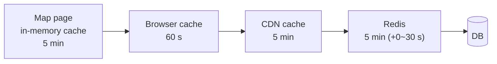
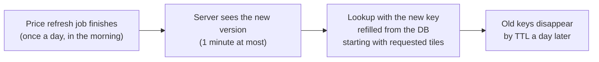

Hello.

I'm Jeong Jeong-il, a backend developer working at a PropTech platform.

Today I'd like to share **how we added a cache to the map query** in our service.

Our map has an API that looks up the apartment complexes inside the viewport every time the user moves the map. Because this API took the viewport coordinates as they were, every request was different, and it was hard to use a cache.

So **we changed the unit of the request from viewport coordinates to predefined cells (tiles), and put caches in four places: the page's memory, the browser, the CDN, and Redis.**

I'll cover how we decided the tile size, the cache TTL, and the moment the query starts, and what we checked after rolling it out to production.

---

## Why Is It Hard to Cache a Query by Viewport Coordinates?

On our map, apartment complexes are shown as markers with their size and price.


*The map on our production web.*

Previously, this query used the coordinates of two corners of the viewport. You send the southwest and northeast corners, and the server finds the complexes between them and returns them.

```text
GET /map/complexes?swLat=37.48532&swLng=127.05688&neLat=37.52193&neLng=127.12500
```

I think this is the first design that comes to mind when building a map query API. It queries exactly what is in the viewport, so nothing is wasted.

The problem was that **every request is different.**

Even when users look at the same neighborhood, their screen sizes differ, and moving the map by just 1 pixel changes the decimals of the coordinates. A cache only helps when the "same request" comes again, and with viewport coordinates the same request almost never came up. So even the common case of moving the map a little and coming back went all the way down to the DB every time.

I had been aware that markers on our map were appearing with a delay, and after wrapping up a large project, the [integrated real estate AI agent](), I came to look into this part.

So how long was it actually taking? On our production web, I measured the time from letting go of the map to the new markers being drawn, 5 times each (I recorded the time of letting go in the browser, then read the start and end of the request sent after it and the time the screen last changed), and ours took about 0.7\~1 second. I measured other real estate map services the same way and they were under 0.2 seconds. Honestly, I didn't expect the gap to be this large.

## Changing the Request Unit to Tiles

Then what would it take for the same request to come again? I decided that instead of fitting the request to the user's viewport, **we had to send it aligned to predefined cells.**

When map services serve map images, they divide the world into equally sized cells per zoom level and have clients request images by a cell number, `z/x/y`. These cells are called tiles.

But tiles are not the only way to define cells. These are the options I looked at.

| Option | Upside | Downside |
|---|---|---|
| Round viewport coordinates to a fixed step | The existing API can be used almost as it is | Even after rounding, the request is a rectangle the size of the viewport, so a different screen size or position gives a different request |
| Geohash | A cell can be expressed as a single string, and stores like Redis support it natively | Each character splits a cell into 32, so the gap between levels is large, and the cell's aspect ratio changes with the number of characters |
| Tiles (z/x/y) | Each zoom level splits a tile into exactly 4, and it is already widely used for maps | You have to compute which tiles the viewport covers yourself, and the request is split into several |

With rounding, the request still remains a single rectangle the size of the viewport. If the screen size differs, or the position differs by just one cell, the rectangle is different, so requests from different users rarely overlap. To make them overlap you would have to request each cell separately, and at that point it becomes the same approach as tiles.

Geohash is convenient for storing a location as a string or finding nearby places. But in a case like ours, where the query unit has to change with the map's zoom, I thought a cell size that changes 32-fold per character would be hard to work with. For example, the width of a 5-character Geohash cell is the same as a zoom 13 tile, and a 6-character one is the same as a zoom 15 tile. That leaves no cell that fits zoom 14 in between. The shape of the cell also changes with the number of characters.

I chose tiles for two reasons.

First, each time the map's zoom changes by one level, a tile is also split into exactly four. Whatever the map's zoom is, there is always a cell of the matching size.

Second, one larger tile contains exactly four tiles of the zoom below it. If we already have the larger tile, we can draw a zoomed-in viewport from it. The in-memory cache on the page uses it this way.

We decided to use this grid as it is for the complex query too. The tile number becomes the request address as it is, so the browser, the CDN, and Redis can all cache by the same tile unit.

```text
GET /map/complexes/tiles/13/6988/3173
```

The frontend computes which tiles the viewport covers, requests only the tiles it needs, and merges the returned tiles to draw them on the screen. The server computes the actual range a tile number covers.


*A case where two users are looking at roughly the same place.*

With this change, requests from people looking at the same neighborhood **become the same address for as many tiles as they overlap.** Even with a different screen size, or after moving the map a little, the requested tiles stay the same as long as the viewport doesn't cross a tile boundary.

Of course there are downsides. Since we fetch whole tiles that the viewport touches, we also receive complexes outside the viewport, and what used to be one request is split into several. So I thought quite a bit about what size to cut the tiles to.

### Deciding the Tile Size

Cutting tiles smaller reduces the off-screen data, but increases the number of requests one viewport needs. Cutting them larger reduces the number of requests, but we receive a lot of data nobody will look at. Looking at the cache alone, larger tiles reduce the number of distinct tiles and raise the chance of a cache hit, but that didn't mean we could just cut them as large as possible.

Each time the zoom drops by one level, one tile covers four times the area. Dividing the same viewport into tiles at three zoom levels looks like this.


*The same viewport divided by three tile sizes.*

Several tiles are fetched at the same time, and the viewport is only fully filled once the last of them has arrived. The more tiles there are, the more likely it is that one of them is late.

But making tiles larger puts more complexes into each one, which makes each request heavier. When I measured in the development environment, a request for a tile about the size of the viewport took 0.1\~0.2 seconds, while a tile covering a much wider range took 0.6\~1 second. These values include the round trip to the server.

The figure above is one example where the viewport happens to line up with tile boundaries, so the number of tiles actually needed depends on the screen size and position. Calculating the three tile sizes for two screen sizes gives the following.

| Tile zoom | One tile side on screen | 1,280×720px screen | 390×700px screen |
|---|---|---|---|
| Same zoom as the map | 256\~512px | 14 tiles on average, 2.0 times the viewport area | 6 tiles on average, 3.0 times |
| One level lower | 512\~1,024px | 6 tiles on average, 3.2 times | 3 tiles on average, 6.0 times |
| Two levels lower | 1,024\~2,048px | 3 tiles on average, 6.7 times | 2 tiles on average, 15 times |

*Calculated by varying the map position and the fractional zoom evenly. The multiple is the area received as tiles divided by the viewport area.*

Each time the tile grows by one level, the number of tiles drops to about half, but the area received grows 1.6\~2.5 times. The more area we receive, the more complexes the responses contain.

So at the zooms where complex markers are shown, we decided to use **tiles one level lower than the map's zoom.** At the same zoom a wide screen needs as many as 14 tiles on average, and two levels lower a phone would receive 15 times the viewport area. One level lower fills one viewport with about 3 tiles on average on a phone and about 6 on average on a 1,280×720px screen.

And when the screen is large enough that there would be too many tiles, we don't split into tiles and query the viewport range in one request as before. For these screens I judged that one query was better than waiting for many tiles.

```ts
// map zoom 14.3 → tile zoom 13
const tileZoom = clamp(Math.floor(mapZoom) - 1, MIN_TILE_ZOOM, MAX_TILE_ZOOM);
```

The map zoom moves in fractions like 14.3, so we set the tile zoom to the integer with the fraction dropped. As a result, map zoom 14.0 and 14.9 use tiles of the same zoom. This is also why the table above gives the tile side as a range.

### Filters and the Cache Key

Our map has filters such as size, price, and move-in year. Where to apply the filters was another thing to think about. I also considered fetching only unfiltered tiles and filtering them on the page. That way everyone could use the same cache regardless of filters.

But the size and price shown on a marker are those of a representative unit type picked from the ones matching the filters, so filtering on the page would require sending the information for every unit type of every complex. The response would grow several times over, and the filtering work would also be left to the user's device. So we decided to apply filters on the server, attached them as query parameters, and included them in the cache key as they are.

The cache key is built by joining the deal type (sale, jeonse lease, and so on), the tile number, and the filter values in a fixed order. This is because the same filters have to give the same key even when the query parameters come in a different order. For the browser and the CDN the address itself is the key, so the frontend also always attaches the parameters in the same order.

We also put a version at the front of the key. Even if the response format changes later, bumping the version keeps it from mixing with the old cache.

What worried me was that cache keys grow as filter combinations grow. Keys could be created up to the number of tiles times the number of filter combinations, so I wondered whether the cache would be split so finely that hits would almost never happen.

We could only check this after rolling out to production, and looking at the incoming requests, **90% of them had no filter.** There were 151 filter combinations over two days, but most requests were concentrated on the default query without filters. In our service, filters didn't seem to split the cache much.

## Putting the Cache in Four Places

We put the cache in four places, in order of closeness to the user.



*The setup when we first rolled it out.*

- **In-memory cache on the map page**: the page holds the tiles it received for up to 5 minutes. Moving a little and coming back ends here, so no request is sent at all. Drawing a zoomed-in viewport from a larger tile and keeping prefetched tiles also happen here, so the browser cache alone couldn't replace it.
- **Browser cache**: used when the page is refreshed or opened again. A browser cache can't be purged from the server once it has been delivered, so we keep it for only 60 seconds.
- **CDN cache**: if it is a tile someone else viewed recently, the CDN responds without going to the server. The round trip to the server is saved by that much.
- **Redis**: even when the CDN doesn't have it, the server responds without querying the DB. A CDN stores entries separately on each regional server and may evict rarely requested ones first, so we added this layer to keep requests that miss the CDN from going all the way to the DB.

Of these, the CDN and Redis are caches that many people use together, so I'll call them the shared cache below.

Before the rollout, I thought the CDN would have the biggest effect of the four. The server's processing time was tens of ms, while the round trip to the server was taking longer than that.

The TTLs for the browser and the CDN are set by the server through a response header.

```http
Cache-Control: public, max-age=60, s-maxage=300
```

For Redis, we first set the TTL to 5 minutes and added 0\~30 seconds of jitter (a random amount of extra time). If caches filled together expire at the same moment, requests could go to the DB all at once.

And since I thought the map should still be shown even if a Redis read or write fails, in that case we read from the DB and respond.

### How Late Can It Get with Several Layers?

A cache delays how soon data is reflected. And because there are several layers, when I worked it out, this delay did not end at 5 minutes.

Calculating the worst case goes like this. Redis may still hold data that is just about to expire, and in the first setup this was up to 5 minutes 30 seconds. If the CDN picks up that data, it keeps it for another 5 minutes, and the page receives that and holds it for 5 more minutes. Adding these up, **in the worst case it could be up to 15 minutes 30 seconds late** (the browser cache counts its 60 seconds including the time spent in the CDN, so I didn't add it separately).


*The worst case, where each layer picks up data that is just about to expire.*

I didn't think the price shown on a map marker has to be accurate to the minute, so I decided to accept this much. The detail screen you enter by selecting a complex is also queried separately, regardless of this cache.

## When Should the Query Start?

After adding the tile cache, I measured again in the development environment. But even when I moved a little, came back, or zoomed in within the tiles we already had, so that not a single request was sent, **markers were taking 0.2\~0.7 seconds to appear.**

At first I hadn't planned to look at the query timing, but since it was taking time without even going to the server, I ended up looking at the time before the query starts as well.

So I went back to the 0.7\~1 second I measured at the beginning and split it by segment.

| Segment | Time taken |
|---|---|
| From letting go to starting the query | 0.45\~0.78 seconds |
| Server response | 0.19\~0.30 seconds |
| From receiving the response to drawing the markers | 0.03\~0.06 seconds |

*Measured 5 times on the production web, with the minimum and maximum written separately for each segment. Runs where the idle signal came early are included.*

The time that passed before the query even started was 58\~78% of the total. This segment included the time spent waiting for the signal that the map had stopped, and another 0.3 seconds of waiting after the signal came.

The 0.3-second wait had been put in so that, during consecutive interactions, a late response would not overwrite the latest markers. But late responses were already being discarded separately by numbering the requests. So I removed this wait first, before adding tiles.

The problem was the time spent waiting for the idle signal. I hadn't looked that far at the time, and this time was still fully included in the 0.2\~0.7 seconds I measured again.

The moments when a query can start on a map are summarized in the table below.

| When | Upside | Downside |
|---|---|---|
| After the map has fully stopped | The viewport is final, so there are no wasted requests | If the idle signal comes late, the query starts that much later |
| The moment you let go | No waiting for the idle signal | If the map keeps moving with inertia after you let go, the viewport changes |
| While dragging | Data can already be fetched before you let go | May fetch data that won't be looked at |


*The three moments are marked with the moment of letting go as 0. The position of the idle signal is the value measured on the map SDK we use.*

We originally used the first approach. The 0.2\~0.7 seconds measured in the development environment also included actions such as coming back and zooming in, so I measured separately, for drags only, when the idle signal comes. On the map SDK we use now, it **only came 0.36\~0.46 seconds after letting go.** For a move by dragging, most of the time until the markers appeared was this wait.

Of course, if the map keeps moving with inertia after you let go, waiting for the idle signal is the right thing to do. But when I checked, our map has no inertial movement, so the viewport didn't change any further after letting go. So I judged there was no need to wait for the idle signal and moved the query to the moment of letting go.

We also added the third approach on top of this. Changing the request unit to tiles made it possible to prefetch, that is, to fetch the tiles needed next in advance. When querying by viewport coordinates, we had to know where the user would stop before we could build the request. But tile numbers are fixed, so we can compute in advance which tile is to the right of the current viewport, or which tiles we'd need after zooming out one level.

Then how far should we prefetch? The wider the range, the more likely the next move falls inside what we've fetched, but we also fetch more tiles that won't be looked at. So we decided it case by case.

While dragging, we know the direction of movement. So every 0.1 seconds we fetch only the tiles for the current viewport and for one viewport ahead in the direction the viewport is moving.

After the map has stopped and the markers are drawn, we can't know which way the user will go next, so we fetch only half a viewport around the viewport. Long moves are handled by the prefetch during dragging, so I judged that after stopping it was enough to cover small moves.

For zoom, we fetch only the tiles for one level of zooming out. Zooming in can be drawn from a larger tile we already have, but when zooming out changes the tile zoom, we have nothing fetched at all. This case was also the slowest when I measured.


*The blue outline is the current viewport, the dashed orange line is the range we want to prefetch, and the shaded cells are the tiles actually requested. The tiles for one level of zooming out are not drawn.*

If prefetched data were drawn right away during a drag, markers would flicker on a moving map. That didn't look good, so during a drag we only receive and store the data, and draw only after letting go.

### Limits on Prefetching

However, the user may never look at the tiles fetched by prefetching. That means using that much more of the user's data and of our server resources, so we put a few limits in place.

- We cap the number of prefetch requests sent at the same time and put the rest in a queue.
- The queue length is capped too, and when it is exceeded the oldest ones are dropped first. If the map has already moved elsewhere, old requests are no longer needed.
- When a request's turn comes, we don't send it if the tile has already been fetched.
- If the browser is in data-saver mode or on a slow connection, we don't fetch tiles outside the viewport.

After adding the limits, I moved the map 20 times in the development environment and counted the requests. Including prefetches, 18 new requests were sent in total. That is 0.9 requests per move on average, and in 13 of the 20 moves not a single request was sent.

When querying by viewport coordinates, one request was sent per move, so the number of requests while moving the map did not increase. However, when first entering the map, what used to be one request grows to the number of tiles the viewport covers.

## What We Saw in Production

After rolling out to production, I measured again on the production web. The time from letting go to the markers appearing **went from 0.7\~1 second to 0.01\~0.12 seconds.** It was 0.01\~0.04 seconds for drags of 0.5 seconds or longer, and 0.06\~0.12 seconds for very short drags. Markers now appear almost right after you let go.

Of course, these numbers are for moves made by dragging. When there are no fetched tiles, such as going to a distant place through search, we have to wait for the server response as before.

I think this is thanks to removing the 0.3-second wait, moving the query to the moment of letting go, and drawing right away without waiting for the server response when the tiles are already fetched.


*The minimum and maximum of several measurements taken while varying the drag duration.*

Before the rollout, what worried me most was the number of requests. What used to be one request is split into several tiles, with prefetching added on top. One viewport needs 6 tiles on average, so I first assumed requests would grow 6 times with not a single cache hit and calculated whether the server and the DB could hold up. Over a whole day there was headroom, but I judged that moments when requests come in all at once could be a burden. This is also why we capped the number of concurrent prefetch requests.

Comparing one day, three days after the rollout, with one day before it, map queries reaching the server grew by only 17%, and the DB's CPU usage did not go up either. Requests must have grown far more than that from the split into tiles, so the rest seems to have been handled by the page's in-memory cache.

{}
17% compares one day before the rollout with one day after (11-24). Update with a weekly average.
{}

### Hit Rate of the Shared Cache

The cache shared by many people, however, had a lower hit rate than I expected. When I checked the share of tile requests reaching the server that were answered straight from Redis, it was 2\~3% at this point, when the TTL was 5 minutes. The CDN was in a similar situation, and even the tiles requested most the day before were rarely answered straight from the CDN. I had thought the CDN would have the biggest effect, but the side shared by many people was hardly being used.

Why was it this low? Looking at the request logs, of the distinct tile and filter combinations requested over two days, **nearly half were requested only once.** Even the 20 most requested ones together made up only 8% of all requests.

Counted by requests, 31% of all requests over the two days were the first request for that tile and filter combination, and such requests cannot hit no matter what the TTL is.


*How many times the same tile and filter combination was requested over two days.*

I also split it by zoom. When the map is viewed from far away, we show markers grouped by neighborhood instead of complexes, and these tiles account for 10% of requests but only 3% of combinations. Each combination was requested 11 times on average. In contrast, for tiles at the zooms where complex markers are shown, each combination was requested 2\~3 times on average.

For complex tiles, the number of tiles grows four times with each zoom level. With requests spread that widely, there weren't many cases where another person requested the same tile again within the 5-minute TTL.

The cache on the page side, which reuses what the same person already received, seems to have been in a somewhat different situation. When one person looks at the map, they keep going back and forth around the same place. That is also why, in the 20 map moves earlier, 13 of them sent no request at all.

The time saved by a cache hit also differed by layer.

| Where the cache hit happened | Time to response |
|---|---|
| Page memory | No request |
| CDN (measured by requesting the same tile back to back) | 41\~60ms |
| Redis (server processing time) | median 9\~10ms |
| Miss everywhere, DB query (server processing time) | median 22\~26ms |
| Until the response starts when everything misses | 128\~268ms |

The DB query itself is already on the fast side, so even when Redis answers, the median only drops by a little over 10 ms. In the slowest 5%, the gap was larger, with Redis at 15\~20ms and the DB query at 98\~121ms. Still, the round trip to the server is far larger, so the effect was bigger when the hit happened in a cache close to the user, like the CDN or the page.

## Thinking About TTL

Then how much would the hit rate go up with a longer TTL?

This could be calculated from the real request logs. I put two days of requests in time order and counted a hit when the same tile and filter combination came again within the TTL. The first day was used only to fill the cache.

Calculating with 5 minutes first gave 2.5%, which was almost the same as the value we saw in production, so I ran the calculation for other TTLs. Of course, 5 minutes is the only point I compared against the production value, so I think the longer TTLs should be taken only as a reference.


*Estimated hit rate by TTL, calculated from real request logs (the horizontal axis is not evenly spaced). This is for a cache gathered in one place like Redis, and I think a CDN split by region would be lower than this.*

Even with the TTL extended to 1 hour it was about 15%, and **for half to hit, entries had to be kept for 12 hours.** Looking only at requests with a filter, it stopped at 35% even when kept for 24 hours, so requests with filters benefit less from the cache.

I also recalculated cutting the tiles larger. Making the tile one level larger at the zooms where complex markers are shown raised the hit rate from 58% to 69% when kept for a day. In exchange, the area received more than doubles. I judged that the burden of larger responses outweighed the gain in hit rate, so we are keeping the current size.

So should we just set a long TTL? A longer TTL reduces the requests going to the server and the DB, and with more responses coming from the CDN, even places visited for the first time would respond faster.

But when prices change, it shows up on the map that much later. Delays add up across layers, so with 6 hours each for Redis and the CDN, it could be more than 12 hours late in the worst case. The time during which the value on a map marker and the value on the detail screen look different also grows by that much.

I went back to thinking about what the TTL should be based on in the first place.

At first we started with a TTL of 5 minutes. But after looking at the request logs, I came to think we should first look at **how often the data changes.** The price data used for map markers is refreshed once a day. While the data doesn't change, there was no reason to throw the cache away.

So instead of discarding entries after time passes, we changed direction so that **the cache is refreshed together when the price data is refreshed.** However, how far each layer can be purged differs, so we couldn't apply it the same way to every layer.

| Cache | Shared by | Purging from the server | Direction |
|---|---|---|---|
| Page memory | One person | Not possible | Keep short (5 minutes) |
| Browser | One person | Not possible | Keep short (60 seconds) |
| CDN | Many people | Needs a separate request | Keep long and purge on refresh |
| Redis | Many people | Possible right away | Keep long and purge on refresh |

This way the shared cache builds up over the day, while a price change takes a few minutes at most to be reflected on the map.

Then the role Redis plays changes too. With a 5-minute TTL, Redis almost never answered, but once entries build up over a day, more of the requests that miss the CDN and reach the server can be answered without a DB query. Redis is also the only shared cache that can be purged right away from the server. And as I mentioned earlier, the gap from the DB query is large in the slowest 5%, so I thought it was right to keep this layer.

To purge Redis, instead of deleting keys one by one, we chose to **put a data version in the cache key.** Deleting keys means finding all the keys scattered across tile and filter combinations, and a response built from old data could be stored again while the deletion is in progress. With the version in the key, there is no need to find and delete keys.

When the price data is refreshed the version changes, so requests after that go to new keys, and the old keys disappear on their own once the TTL passes. It is the same approach as the version we put in the key earlier, in case the response format changes.

For the data version, we use the update time of the table that the price refresh job rewrites in its last step. This time only changes once the job has finished. So we don't have to touch the refresh job and only read the value on the query side.

But if we looked up this value on every request, even a cache hit would mean one trip to the DB. So the server keeps using a value it has read for 1 minute.

The order in which things are refreshed is as follows.



*The order in which the Redis cache changes after prices are refreshed.*

At the first refresh on the morning after the production rollout, I confirmed that lookups moved to keys of the new version right after the refresh job finished.

We extended the Redis TTL to one day. The TTL is now used only to remove old keys.

Going from a 5-minute TTL to a day also means more data builds up in Redis, so I first calculated whether there was enough memory. Measuring response sizes in the production request logs, the median was about 5KB, but tiles in areas with many complexes exceed tens of KB, so the average was 21KB.

I multiplied this by the number of combinations requested in a day, and doubled it because right after the version changes the old keys also remain until their TTL passes. It was still less than a quarter of the Redis memory limit, so I judged there was headroom.

For the browser and the CDN the address itself is the key, so this approach of changing only the key inside the server can't purge them. Putting a version in the address as well is possible, but then the page first has to know what the current version is. So for the CDN we extended the retention to one day and, when the price data is refreshed, purge everything at once by the tag attached to tile responses.

There was one ordering issue here. The server takes up to 1 minute to see the new version, and if the CDN is purged before that, the old response can be stored again. So we purge 2 minutes after the version changes.

Whether the version has changed is checked by a job that runs every minute, so the purge happens within 3 minutes at the longest (if it fails, it is retried on the next cycle). Adding the 5 minutes the page holds its tiles, the change is reflected on the map within 8 minutes of the refresh job finishing.

With longer CDN retention the browser cache's share shrinks, but it is a layer that can't be purged from the server, so we left it at 60 seconds.

But if the cache is purged all at once on refresh, won't queries pile onto the DB? This isn't something jitter can spread out either, so I worked it out from the request volume, and I concluded it would not be a burden at the current volume.

When the TTL was 5 minutes, most requests reaching the server were not in Redis and queried the DB, and even in that state the DB's CPU usage did not go up. Right after a refresh, we just go back to that same state for a while. Of course, if requests grow well beyond the current level, I think this is something to work out again.

{}
To add to this section after measuring a full day:
- Hit rate: value before the rollout → value for a full day after. Compare with the estimate of 55%.
- How the hit rate drops right after a refresh and fills back up (graph by time of day).
- Actual Redis memory usage (as a ratio), DB CPU, number of requests reaching the server.
- Replace "I plan to check in production what it actually comes out to … and adjust" in the last paragraph below with the measured results.
{}

In the calculation by TTL, keeping entries for 24 hours gave 61%. Recalculating with the same request logs, with the cache purged every morning when the price refresh finishes, gives 55%. Of course, this value treats the shared cache as a single place. In practice the CDN takes the repeated requests first, so I think the number measured at Redis will come out lower than this. I plan to check in production what it actually comes out to, and to adjust the specific TTL values after looking at real users' requests.

## Closing

That was a summary of what I thought through while changing our map query to tile units.

In this work, I think the most important thing was changing the request unit from viewport coordinates to tiles. Both the page-side cache and prefetching were possible because the request unit was fixed to tiles. Even if it isn't a map, I think something similar could be tried for an API that is hard to cache because the values differ slightly on every request.

Looking back, I think the markers came to appear quickly thanks to the query timing, the page-side cache, and prefetching, more than the shared cache.

Honestly, I thought of the cache first this time too, but when I actually measured, the time spent waiting before the query started was longer. It made me think that next time I should split the elapsed time by segment first, before adding a cache.

I'm also glad I checked in the request logs whether hits were actually happening. If I hadn't looked at the logs, I think I would have gone on without knowing that the shared cache was hardly being used, or that a 5-minute TTL didn't fit our data. If I did it again, I think I would look at the request logs first for the shared cache and decide the TTL from there.

I hope this post is of some help to those working through similar problems.

Thank you for reading this long post.

### Reference

- [OpenStreetMap Wiki: Slippy map tilenames](https://wiki.openstreetmap.org/wiki/Slippy_map_tilenames)
- [MDN: Cache-Control](https://developer.mozilla.org/en-US/docs/Web/HTTP/Headers/Cache-Control)
- [MDN: NetworkInformation.saveData](https://developer.mozilla.org/en-US/docs/Web/API/NetworkInformation/saveData)
- [Toptal: Serve Map Clusters 50x Faster Using Smarter Caching](https://www.toptal.com/api-development/smarter-caching-to-serve-map-clusters)
