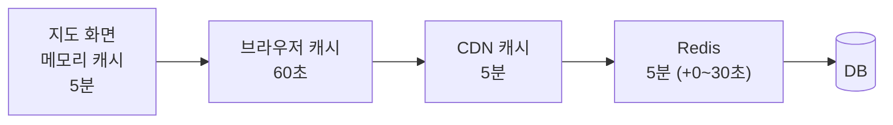

*사진: Unsplash의 delfi de la Rua*

안녕하세요. 프롭테크 플랫폼에서 백엔드 개발자로 근무 중인 정정일입니다.

이번에는 저희 서비스의 지도 조회에 캐시를 붙인 이야기를 해볼까 합니다. 저희 지도에는 사용자가 지도를 옮길 때마다 화면 안에 있는 아파트 단지를 조회하는 API가 있는데요, 이 API는 화면의 좌표를 그대로 받다 보니 요청이 매번 달라져서 캐시를 쓰기가 어려웠습니다. 그래서 요청하는 단위 자체를 바꿔서 캐시를 쓸 수 있게 만들었는데, 그 과정에서 고민했던 것들을 적어보려고 합니다.

사실 이 글에서 다루는 방식 자체가 새로운 건 아닙니다. 지도 이미지를 타일로 나눠 받는 방식은 오래전부터 쓰여왔으니까요. 다만 이걸 조회 API에 적용하려다 보니 타일 크기나 캐시 TTL처럼 직접 정해야 하는 것들이 꽤 있었습니다. 그래서 이번 글에서는 그 부분을 중심으로, 운영에 반영한 뒤에 확인한 내용까지 다뤄보려고 합니다.

---

## 화면 좌표로 조회하면 왜 캐시가 어려울까

저희 지도에서는 아파트 단지를 평형, 가격과 함께 마커로 보여줍니다.


*운영 웹의 지도 화면입니다.*

기존에는 이 조회를 화면의 두 모서리 좌표로 하고 있었습니다. 화면의 남서쪽 끝과 북동쪽 끝 좌표를 보내면 서버가 그 사이에 있는 단지를 찾아서 돌려주는 방식이죠.

```text
GET /map/complexes?swLat=37.48532&swLng=127.05688&neLat=37.52193&neLng=127.12500
```

지도 조회 API를 만든다고 하면 가장 먼저 떠올릴 만한 방식인 것 같습니다. 화면에 보이는 만큼만 정확히 조회하니까 낭비도 없습니다.

문제는 **요청이 매번 달라진다는 점**이었습니다.

같은 동네를 보고 있더라도 사용자마다 화면 크기가 다르고, 지도를 1픽셀만 옮겨도 좌표의 소수점 아래가 달라집니다. 캐시는 "같은 요청"이 다시 와야 쓸 수 있는데, 화면 좌표로는 같은 요청이라는 게 거의 나오지 않았던 거죠. 그래서 지도를 조금 옮겼다가 되돌아오는 흔한 이동에도 매번 DB까지 조회가 내려가고 있었습니다.

그렇다면 실제로는 얼마나 걸리고 있었을까요? 브라우저에서 손을 뗀 시점부터 새 마커가 그려진 시점까지를 5번씩 재봤는데, 저희는 0.7~1초 정도가 걸렸습니다. 같은 방법으로 다른 부동산 지도 서비스들도 재봤는데 0.2초 안쪽이더라고요. 사실 이 시간에는 서버를 다녀오는 시간 말고도 조회를 시작하기까지 기다리는 시간이 섞여 있었는데, 이 부분은 뒤에서 따로 이야기하겠습니다.

## 요청 단위를 타일로 바꾸기

저는 요청을 사용자의 화면에 맞추는 대신, **미리 정해둔 칸에 맞춰서 보내도록 바꿔야 한다고 판단했습니다.**

지도 서비스들은 지도 이미지를 내려줄 때 세계를 줌 단계마다 같은 크기의 칸으로 나눠두고, `z/x/y`라는 칸 번호로 이미지를 요청하게 합니다. 이 칸을 타일(Tile)이라고 부르는데, 단지 조회에도 같은 격자를 쓰기로 했습니다.

```text
GET /map/complexes/tiles/13/6988/3173
```

화면에 걸친 타일이 어떤 것들인지는 프론트에서 계산해서 필요한 타일만 요청하고, 받은 타일들을 합쳐서 화면에 그립니다. 타일 번호가 실제로 어느 범위인지는 서버가 계산합니다.


*두 사용자가 비슷한 곳을 보고 있는 경우입니다.*

이렇게 바꾸면 같은 동네를 보는 사람들의 요청은 **겹치는 타일만큼 같은 주소가 됩니다.** 화면 크기가 다르거나 지도를 조금 옮기더라도 타일 경계를 넘지 않으면 요청하는 타일은 그대로거든요.

물론 단점도 있습니다. 화면에 걸친 타일을 통째로 받기 때문에 화면 밖의 단지까지 받게 되고, 한 번이던 요청이 여러 번으로 나뉩니다. 그래서 타일을 어떤 크기로 자를지를 꽤 고민했습니다.

### 타일 크기 정하기

타일을 작게 자르면 화면 밖 데이터는 줄어드는데, 대신 한 화면에 필요한 요청 수가 늘어납니다. 반대로 크게 자르면 요청 수는 줄지만 보지도 않을 데이터를 많이 받게 되구요. 사실 캐시만 놓고 보면 타일이 클수록 서로 다른 타일의 수가 줄어서 캐시 히트 가능성은 높아지는데, 그렇다고 무작정 크게 자를 수는 없었습니다.

타일은 줌이 한 단계 낮아질 때마다 한 장이 담는 넓이가 네 배가 됩니다. 지도와 같은 줌의 타일을 쓰면 한 화면에 타일이 네 배나 필요하고, 두 단계를 낮추면 타일 한 장이 화면보다 훨씬 넓은 범위를 담게 됩니다.


*같은 화면을 세 가지 타일 크기로 나눠본 그림입니다.*

그래서 저희는 단지 마커가 보이는 줌에서는 **지도의 줌보다 한 단계 낮은 줌의 타일**을 쓰기로 했습니다. 이렇게 하면 한 화면이 보통 타일 2~6장 정도로 채워지고, 화면이 커서 12장을 넘게 되는 경우에는 타일로 나누지 않고 기존처럼 화면 범위로 한 번에 조회합니다.

```ts
// 지도 줌 14.3 → 타일 줌 13
const tileZoom = clamp(Math.floor(mapZoom) - 1, MIN_TILE_ZOOM, MAX_TILE_ZOOM);
```

지도 줌은 14.3처럼 소수점 단위로 움직이는데, 타일 줌은 정수로 내렸습니다. 줌을 조금 바꿨는데 다른 타일을 요청하게 되면 캐시 히트가 다시 안 나게 되기 때문입니다.

### 필터와 캐시 키

저희 지도에는 평형, 가격, 입주년도 같은 필터가 있습니다. 필터는 쿼리 파라미터로 붙이고, 캐시 키에도 그대로 포함시켰습니다. 필터 조합이 같아야 같은 응답이니까요.

여기서 제가 신경 쓴 건 필터 조합이 늘어나는 만큼 캐시 키도 늘어난다는 점이었습니다. 타일 수에 필터 조합 수를 곱한 만큼 키가 생길 수 있으니, 캐시가 잘게 쪼개져서 히트가 거의 안 나게 되지 않을까 싶었죠.

이 부분은 운영에 반영하고 나서야 확인할 수 있었는데요, 실제로 들어온 요청을 보니 **필터를 걸지 않은 요청이 90%였습니다.** 필터 조합은 이틀 동안 151가지가 나왔지만 대부분의 요청은 필터 없는 기본 조회에 몰려 있었습니다. 적어도 저희 서비스에서는 필터가 캐시를 쪼개는 영향이 크지 않았던 것 같습니다.

## 캐시를 네 곳에 두기

그럼 캐시는 어디에 두어야 할까요? 저는 사용자에게 가까운 순서대로 네 곳에 나눠서 두었습니다.



- **지도 화면의 메모리 캐시**: 받은 타일을 화면이 최대 5분 동안 들고 있습니다. 조금 옮겼다가 되돌아오는 이동은 여기서 끝나기 때문에 요청 자체가 나가지 않습니다.
- **브라우저 캐시**: 새로고침을 하거나 페이지를 다시 열었을 때 쓰입니다. 한 번 내려간 브라우저 캐시는 서버에서 비울 수가 없어서 60초만 보관합니다.
- **CDN 캐시**: 다른 사람이 최근에 본 타일이면 서버까지 가지 않고 CDN에서 응답합니다.
- **Redis**: CDN에 없더라도 서버가 DB를 조회하지 않고 응답합니다.

앞의 두 곳은 본인이 받은 것만 다시 쓰는 캐시이고, 뒤의 두 곳(CDN, Redis)은 여러 사람이 함께 쓰는 공유 캐시입니다.

브라우저와 CDN의 TTL은 서버가 응답 헤더로 정해줍니다.

```http
Cache-Control: public, max-age=60, s-maxage=300
```

Redis 쪽은 TTL에 0~30초의 Jitter(무작위 지연)를 더했습니다. 같은 시각에 만들어진 캐시가 한꺼번에 만료되면 그 순간 DB로 조회가 몰리는 Cache Stampede(캐시 폭주 현상)가 생길 수 있거든요. 그리고 Redis 조회나 저장이 실패하더라도 지도는 보여야 한다고 생각해서, 그럴 때는 DB에서 읽어서 응답하도록 했습니다.

CDN 캐시를 켤 때는 응답 헤더도 함께 봐야 했습니다. CDN이 한 사람에게 준 응답을 다른 사람에게도 그대로 줄 수 있어야 하기 때문입니다. 타일 응답은 로그인 여부와 상관없이 누구에게나 같은 공개 데이터라서, 헤더만 맞춰주면 되었습니다.

### 여러 층에 두면 얼마나 늦어질까

캐시를 두면 그만큼 데이터가 늦게 반영됩니다. 그런데 캐시가 여러 층이다 보니, 따져보면 이 지연이 5분으로 끝나지 않았습니다.

최악의 경우를 계산해보면 이렇습니다. Redis에 만료 직전의 데이터가 남아 있을 수 있는데, 이게 최대 5분 30초입니다. CDN이 그 데이터를 받아가면 거기서 다시 5분을 보관하고, 화면도 그걸 받아서 5분 동안 들고 있게 됩니다. 브라우저 캐시는 CDN이 보낸 경과 시간까지 합쳐 60초를 세기 때문에 따로 더하지 않았습니다. 이렇게 더해보면 **최악의 경우에는 15분 30초까지 늦어질 수 있었습니다.**


*각 층이 만료 직전의 데이터를 이어받는 최악의 경우입니다.*

저는 지도 마커에 보이는 가격이 분 단위로 정확해야 하는 값은 아니라고 생각해서 이 정도는 감수하기로 했습니다. 단지를 눌러서 들어가는 상세 화면은 이 캐시와 상관없이 따로 조회하기도 하구요.

## 언제 조회를 시작할 것인가

타일로 바꾸면서 하나 더 할 수 있게 된 게 있는데, 바로 다음에 필요할 타일을 미리 받아두는 프리페치(Prefetch)입니다.

화면 좌표로 조회할 때는 사용자가 어디에서 멈출지 알아야만 요청을 만들 수 있었습니다. 그런데 타일은 번호가 정해져 있으니, 지금 화면의 오른쪽 타일이나 한 단계 줌아웃했을 때의 타일이 무엇인지 미리 계산할 수 있습니다.

캐시에 데이터가 있더라도 조회를 늦게 시작하면 소용이 없기 때문에, 조회를 시작하는 시점도 함께 살펴봤습니다. 지도에서 조회를 시작할 수 있는 시점은 크게 세 가지가 있습니다.

| 시점 | 장점 | 단점 |
|---|---|---|
| 지도가 완전히 멈춘 뒤 | 화면이 확정된 뒤라 헛된 요청이 없음 | 멈춤 신호가 늦게 오면 그만큼 늦게 출발 |
| 손을 떼는 순간 | 멈춤 신호를 기다리지 않음 | 손을 뗀 뒤에도 지도가 더 움직인다면 화면이 달라짐 |
| 드래그하는 동안 | 손을 떼기 전에 이미 받아둘 수 있음 | 보지 않을 데이터까지 받을 수 있음 |


*손을 뗀 순간을 0으로 놓고 세 시점을 표시했습니다. 멈춤 신호의 위치는 저희가 쓰는 지도 SDK에서 잰 값입니다.*

저희는 원래 첫 번째 방식이었습니다. 그런데 재보니 지금 쓰고 있는 지도 SDK에서는 멈춤 신호가 **손을 뗀 뒤 0.36~0.46초가 지나서야 오고 있었습니다.** 캐시에 데이터가 이미 있어도 이 시간만큼은 기다려야 했던 거죠.

물론 손을 뗀 뒤에도 지도가 더 움직인다면 멈춤 신호를 기다리는 게 맞습니다. 하지만 확인해보니 손을 떼면 지도가 그 자리에서 바로 멈추고 있었습니다. 그래서 굳이 멈춤 신호까지 기다릴 필요는 없다고 판단해서 조회 시점을 손을 떼는 순간으로 옮겼습니다.

그리고 여기에 세 번째 방식인 프리페치를 더했습니다. 드래그하는 동안에는 0.1초 간격으로 현재 화면과, 화면이 옮겨 가는 방향으로 화면 하나만큼 앞쪽의 타일을 받아두도록 했습니다. 지도가 멈춰서 마커를 그린 뒤에는 화면 둘레로 화면 절반만큼의 범위와, 한 단계 줌아웃했을 때의 타일도 받아둡니다. 다음에 어느 쪽으로 이동하더라도 받아둔 범위 안에 들어오게 하기 위해서입니다.


*파란 테두리가 지금 화면, 주황색 점선이 미리 받으려는 범위이고, 색칠한 칸이 실제로 요청하는 타일입니다. 한 단계 줌아웃 타일은 그리지 않았습니다.*

미리 받은 데이터를 드래그 중에 바로 그리면 움직이는 지도 위에서 마커가 깜빡이게 됩니다. 이게 보기에 좋지 않아서 드래그 중에는 받아서 보관만 하고, 그리는 건 손을 뗀 뒤에만 하도록 했습니다.

### 프리페치 제한

그런데 프리페치로 받은 타일은 사용자가 끝내 안 볼 수도 있습니다. 그만큼 사용자의 데이터와 서버 자원을 더 쓰게 되는 거라서 몇 가지 제한을 두었습니다.

- 동시에 보내는 프리페치 요청은 6개까지만 허용하고, 나머지는 큐에 쌓아둡니다.
- 큐는 24개까지만 쌓고, 넘으면 가장 오래된 것부터 버립니다. 지도가 이미 다른 곳으로 갔다면 오래된 요청은 필요 없기 때문입니다.
- 차례가 왔을 때 이미 받아둔 타일이면 요청하지 않습니다.
- 브라우저가 데이터 절약 모드이거나 2G 연결이면 화면 밖의 타일은 받지 않습니다.

```ts
const isSpeculativePrefetchAllowed = () => {
  const connection = navigator.connection;
  if (!connection) return true;
  if (connection.saveData) return false;
  return !/(^|-)2g$/.test(connection.effectiveType ?? '');
};
```

## 운영에서 본 결과

운영에 반영한 뒤에 같은 방법으로 다시 재봤습니다. 손을 뗀 뒤 마커가 뜨기까지 **0.7~1초가 걸리던 게 0.01~0.12초가 되었습니다.** 0.5초 이상 드래그하면 0.01~0.04초 정도였고, 아주 짧게 드래그했을 때는 0.06~0.12초 정도가 나왔습니다.


*각각 여러 번 잰 값의 최소와 최대입니다.*

반영하기 전에 제가 가장 신경 쓴 건 요청 수였습니다. 한 번이던 요청이 타일 여러 장으로 나뉘는 데다 프리페치까지 더해지니까요. 한 화면에 타일이 보통 6장까지 필요하다 보니, 요청이 6배로 늘고 캐시 히트가 하나도 나지 않는 경우를 가정해서 서버와 DB가 버틸 수 있는지를 먼저 계산해봤습니다. 하루 전체로 보면 여유가 있었지만 요청이 한꺼번에 몰리는 순간에는 부담이 될 수도 있다고 판단했고, 앞에서 말씀드린 동시 요청 제한도 그래서 넣게 된 겁니다.

반영하고 사흘 뒤의 하루를 반영 전 하루와 비교해보니, 서버까지 온 지도 조회는 17% 정도만 늘었고, DB의 CPU 사용률도 오르지 않았습니다. 타일로 나뉘면서 요청이 훨씬 늘었을 텐데 이 정도였으니, 나머지는 화면의 메모리 캐시에서 처리된 것 같습니다.

{}
17%는 반영 전 하루와 반영 후 하루(11-24) 비교. 주 단위 평균으로 갱신.
{}

### 공유 캐시의 적중률

그런데 여러 사람이 공유하는 캐시는 생각보다 적중률이 낮았습니다. 서버까지 온 타일 요청 중에서 Redis에서 바로 응답한 비율을 확인해보니 **2~3%밖에 되지 않았습니다.** CDN 쪽도 사정이 비슷해서, 전날 가장 많이 요청된 타일들도 CDN에서 바로 응답되는 경우는 드물었습니다.

왜 이렇게 낮았을까요? 요청 기록을 살펴보니 이틀 동안 요청된 서로 다른 타일과 필터 조합 중에서 **절반 가까이가 한 번만 요청된 것이었습니다.** 가장 많이 요청된 20개를 합쳐도 전체 요청의 8% 정도밖에 안 됐습니다.


*이틀 동안 같은 타일·필터 조합이 몇 번씩 요청됐는지 나눠본 것입니다.*

요청이 이렇게 넓게 퍼져 있다 보니 TTL 5분 안에 다른 사람이 같은 타일을 다시 요청하는 경우가 많지 않았던 것 같습니다.

반면 본인이 받은 것을 다시 쓰는 화면 쪽 캐시는 사정이 좀 달랐던 것 같습니다. 한 사람이 지도를 볼 때는 같은 곳 주변을 계속 오가게 되니까요. 지금 마커가 뜨는 시간은 조회 시점을 앞당긴 것과 화면의 메모리 캐시, 프리페치 덕분이라고 생각합니다.

각 층에서 캐시 히트가 났을 때 줄어드는 시간도 차이가 있었습니다.

| 캐시 히트가 난 곳 | 응답까지 걸린 시간 |
|---|---|
| 화면 메모리 | 요청 없음 |
| CDN (같은 타일을 연달아 요청해서 측정) | 41~60ms |
| Redis (서버 처리 시간 기준) | 중앙값 9~10ms |
| 모두 미스가 나서 DB 조회 (서버 처리 시간 기준) | 중앙값 22~26ms |
| 모두 미스가 났을 때의 전체 응답 | 128~268ms |

DB 조회 자체가 이미 빠른 편이다 보니 Redis에서 응답하더라도 10여 ms 정도밖에 줄지 않더라고요. 그보다는 서버까지 오가는 시간이 훨씬 커서, CDN이나 화면처럼 사용자 쪽에 가까운 캐시에서 히트가 났을 때 효과가 더 컸습니다.

## TTL에 대한 고민

그렇다면 TTL을 늘리면 적중률은 얼마나 올라갈까요?

이건 실제 요청 기록으로 계산해볼 수 있었습니다. 이틀 동안의 타일 요청을 시간 순서대로 놓고, 같은 타일과 필터 조합의 요청이 TTL 안에 다시 오면 히트로 세는 방식입니다. 앞의 하루는 캐시를 채우는 구간으로 쓰고 뒤의 하루만 셌습니다. 먼저 5분으로 계산해보니 2.5%가 나왔고, 실제로 확인한 값과 거의 같아서 TTL을 바꿔가며 계산해봤습니다.


*실제 요청 기록으로 계산한 TTL별 예상 적중률입니다(가로축 간격은 일정하지 않습니다). Redis처럼 한 곳에 모이는 캐시 기준이고, 지역별로 나뉘는 CDN은 이보다 낮을 것 같습니다.*

TTL을 1시간으로 늘려도 15% 정도였고, **절반이 히트하려면 12시간은 보관해야 했습니다.**

"그럼 TTL을 길게 잡으면 되는 거 아닌가?" 싶지만, 그렇게 간단하지는 않았습니다.

TTL을 늘리면 서버와 DB까지 가는 요청은 줄어들고, CDN에서 응답하는 경우가 늘어나서 처음 가보는 곳도 응답이 빨라질 겁니다. 다만 가격이 바뀌어도 지도에는 그만큼 늦게 반영됩니다. 앞에서 본 것처럼 층마다 지연이 더해지기 때문에, Redis와 CDN을 각각 6시간으로 잡으면 최악의 경우 12시간 넘게 늦어질 수 있습니다. 지도 마커에 보이는 값과 상세 화면의 값이 서로 다르게 보이는 시간도 그만큼 길어집니다.

TTL을 길게 가져가려면 데이터가 바뀌었을 때 캐시를 비워주는 방법이 함께 있어야 한다고 생각합니다. 그런데 층마다 비울 수 있는 정도가 달랐습니다.

| 캐시 | 함께 쓰는 범위 | 서버에서 비우기 | 지금 TTL |
|---|---|---|---|
| 화면 메모리 | 본인 | 불가 | 5분 |
| 브라우저 | 본인 | 불가 | 60초 |
| CDN | 여러 사람 | 따로 요청해야 함 | 5분 |
| Redis | 여러 사람 | 바로 가능 | 5분 (+0~30초) |

그래서 저는 층마다 TTL을 다르게 가져가는 것도 방법이지 않을까 생각하고 있습니다(이 부분은 아직 제 개인적인 생각입니다). 서버에서 바로 비울 수 있는 Redis는 길게, 비우기 어려운 브라우저는 지금처럼 짧게 두는 식으로요. 다만 이건 데이터가 하루에 몇 번, 언제 바뀌는지까지 같이 봐야 하는 부분이라 아직 값을 정하지는 못했습니다.

## 마치며

지금까지 저희 지도 조회를 타일 단위로 바꾸면서 고민했던 것들을 정리해봤습니다.

이번 작업에서 저는 요청을 화면 좌표가 아니라 미리 정해둔 타일 단위에 맞춘 것이 캐시를 쓸 수 있게 된 출발점이었다고 생각합니다. 꼭 지도가 아니더라도 요청마다 값이 조금씩 달라져서 캐시를 쓰기 어려운 API라면 비슷하게 적용해볼 수 있지 않을까 싶습니다.

TTL은 요청 기록을 더 쌓아보면서 조정해볼 생각입니다.

이 글이 비슷한 고민을 하고 계시는 분들께 조금이나마 도움이 되었으면 좋겠습니다.

긴 글 읽어주셔서 감사합니다.

### Reference

- [OpenStreetMap Wiki: Slippy map tilenames](https://wiki.openstreetmap.org/wiki/Slippy_map_tilenames)
- [MDN: Cache-Control](https://developer.mozilla.org/ko/docs/Web/HTTP/Headers/Cache-Control)
- [MDN: NetworkInformation.saveData](https://developer.mozilla.org/en-US/docs/Web/API/NetworkInformation/saveData)
- [Toptal: Serve Map Clusters 50x Faster Using Smarter Caching](https://www.toptal.com/api-development/smarter-caching-to-serve-map-clusters)
