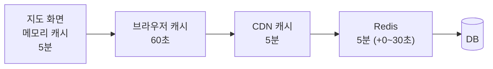
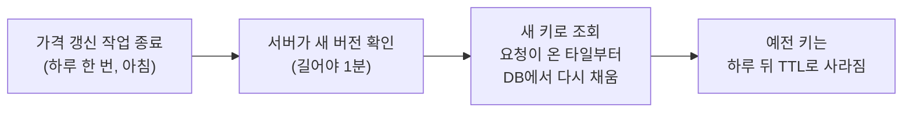

안녕하세요.

프롭테크 플랫폼에서 백엔드 개발자로 근무 중인 정정일입니다.

오늘은 저희 서비스의 **지도 조회에 캐시를 붙인 과정**을 공유해볼까 합니다.

저희 지도에는 사용자가 지도를 옮길 때마다 화면 안에 있는 아파트 단지를 조회하는 API가 있습니다. 이 API는 화면의 좌표를 그대로 받다 보니 요청이 매번 달라져서 캐시를 쓰기가 어려웠습니다.

그래서 **요청하는 단위를 화면 좌표에서 미리 정해둔 칸(타일)으로 바꾸고, 화면의 메모리와 브라우저, CDN, Redis 네 곳에 캐시를 두었습니다.**

타일 크기와 캐시 TTL, 조회를 시작하는 시점을 어떻게 정했는지, 그리고 운영에 반영한 뒤에 무엇을 확인했는지 담아보려 합니다.

---

## 화면 좌표로 조회하면 왜 캐시가 어려울까

저희 지도에서는 아파트 단지를 평형, 가격과 함께 마커로 보여줍니다.


*운영 웹의 지도 화면입니다.*

기존에는 이 조회를 화면의 두 모서리 좌표로 하고 있었습니다. 화면의 남서쪽 끝과 북동쪽 끝 좌표를 보내면 서버가 그 사이에 있는 단지를 찾아서 돌려주는 방식이죠.

```text
GET /map/complexes?swLat=37.48532&swLng=127.05688&neLat=37.52193&neLng=127.12500
```

지도 조회 API를 만든다고 하면 가장 먼저 떠올릴 만한 방식인 것 같습니다. 화면에 보이는 만큼만 정확히 조회하니까 낭비도 없습니다.

문제는 **요청이 매번 달라진다는 점**이었습니다.

같은 동네를 보고 있더라도 사용자마다 화면 크기가 다르고, 지도를 1픽셀만 옮겨도 좌표의 소수점 아래가 달라집니다. 캐시는 "같은 요청"이 다시 와야 쓸 수 있는데, 화면 좌표로는 같은 요청이라는 게 거의 나오지 않았던 거죠. 그래서 지도를 조금 옮겼다가 되돌아오는 흔한 이동에도 매번 DB까지 조회가 내려가고 있었습니다.

지도에서 마커가 뜨는 데 딜레이가 발생하고 있다는 건 인지하고 있었는데요, [부동산 통합 AI 에이전트]()라는 큰 프로젝트를 마무리한 뒤 이 부분을 살펴보게 되었습니다.

그렇다면 실제로는 얼마나 걸리고 있었을까요? 운영 중인 웹에서 손을 뗀 시점부터 새 마커가 그려진 시점까지를 5번씩 재봤는데, 저희는 0.7\~1초 정도가 걸렸습니다. 같은 방법으로 다른 부동산 지도 서비스들도 재봤는데 0.2초 안쪽이더라고요. 딜레이가 있다는 건 알고 있었지만, 솔직히 이 정도로 차이가 날 줄은 몰랐습니다.

잴 때는 브라우저에서 손을 떼는 시각을 기록해두고, 그 뒤에 나간 요청의 시작과 끝, 그리고 화면이 마지막으로 바뀐 시각을 읽었습니다. 이 시간에는 서버를 다녀오는 시간 말고도 조회를 시작하기까지 기다리는 시간이 섞여 있었습니다.

## 요청 단위를 타일로 바꾸기

그렇다면 같은 요청이 다시 오게 하려면 어떻게 해야 할까요? 저는 요청을 사용자의 화면에 맞추는 대신, **미리 정해둔 칸에 맞춰서 보내도록 바꿔야 한다고 판단했습니다.**

지도 서비스들은 지도 이미지를 내려줄 때 세계를 줌 단계마다 같은 크기의 칸으로 나눠두고, `z/x/y`라는 칸 번호로 이미지를 요청하게 합니다. 이 칸을 타일(Tile)이라고 부릅니다.

그런데 칸을 정하는 방법이 타일만 있는 건 아닙니다. 제가 살펴본 방법은 다음과 같습니다.

| 방법 | 장점 | 단점 |
|---|---|---|
| 화면 좌표를 일정 단위로 반올림 | 기존 API를 거의 그대로 쓸 수 있음 | 반올림해도 요청은 화면 크기만 한 사각형이라, 화면 크기와 위치가 다르면 요청이 달라짐 |
| Geohash | 문자열 하나로 칸을 표현할 수 있고, Redis 같은 저장소가 기본으로 지원함 | 한 글자마다 칸이 32개로 쪼개져서 단계 사이의 간격이 크고, 글자 수에 따라 칸의 가로세로 비율이 달라짐 |
| 타일(z/x/y) | 줌 한 단계마다 정확히 4장으로 나뉘고, 지도에서 이미 널리 쓰는 방식 | 화면에 걸친 타일을 직접 계산해야 하고, 요청이 여러 번으로 나뉨 |

화면 좌표를 반올림하는 방법은 요청이 여전히 화면 크기만 한 사각형 하나로 남습니다. 화면 크기가 다르거나 위치가 칸 하나만큼만 달라도 사각형이 달라져서, 사용자끼리 요청이 잘 겹치지 않습니다. 겹치게 하려면 칸 하나씩 따로 요청해야 하는데, 그러면 결국 타일과 같은 방식이 되구요.

Geohash는 위치를 문자열로 저장하거나 가까운 곳을 찾을 때는 편한 방식입니다. 다만 저희처럼 지도의 줌에 따라 조회 단위가 달라져야 하는 경우에는, 글자 하나에 32배씩 달라지는 칸 크기가 다루기 어렵다고 판단했습니다. 예를 들어 칸의 가로 폭이 5글자 Geohash는 줌 13 타일과 같고, 6글자는 줌 15 타일과 같습니다. 그러면 그 사이인 줌 14에 맞는 칸이 없는 거죠. 칸의 모양도 글자 수에 따라 달라지구요.

제가 타일을 고른 이유는 두 가지였습니다.

첫째, 지도의 줌이 한 단계 바뀔 때마다 타일도 정확히 네 장으로 나뉩니다. 지도의 줌이 무엇이든 거기에 맞는 크기의 칸이 항상 있는 거죠.

둘째, 큰 타일 한 장이 아래 줌의 타일 네 장을 정확히 포함합니다. 받아둔 큰 타일이 있으면 그걸로 확대한 화면도 그릴 수 있습니다. 화면의 메모리 캐시에서 이렇게 쓰고 있습니다.

단지 조회에도 이 격자를 그대로 쓰기로 했습니다. 타일 번호가 그대로 요청 주소가 되어서 브라우저, CDN, Redis가 모두 같은 타일 단위로 캐시할 수 있습니다.

```text
GET /map/complexes/tiles/13/6988/3173
```

화면에 걸친 타일이 어떤 것들인지는 프론트에서 계산해서 필요한 타일만 요청하고, 받은 타일들을 합쳐서 화면에 그립니다. 타일 번호가 실제로 어느 범위인지는 서버가 계산합니다.


*두 사용자가 비슷한 곳을 보고 있는 경우입니다.*

이렇게 바꾸면 같은 동네를 보는 사람들의 요청은 **겹치는 타일만큼 같은 주소가 됩니다.** 화면 크기가 다르거나 지도를 조금 옮기더라도 타일 경계를 넘지 않으면 요청하는 타일은 그대로거든요.

물론 단점도 있습니다. 화면에 걸친 타일을 통째로 받기 때문에 화면 밖의 단지까지 받게 되고, 한 번이던 요청이 여러 번으로 나뉩니다. 그래서 타일을 어떤 크기로 자를지를 꽤 고민했습니다.

### 타일 크기 정하기

타일을 작게 자르면 화면 밖 데이터는 줄어드는데, 대신 한 화면에 필요한 요청 수가 늘어납니다. 반대로 크게 자르면 요청 수는 줄지만 보지도 않을 데이터를 많이 받게 되구요. 캐시만 놓고 보면 타일이 클수록 서로 다른 타일의 수가 줄어서 캐시 히트 가능성은 높아지는데, 그렇다고 무작정 크게 자를 수는 없었습니다.

타일은 줌이 한 단계 낮아질 때마다 한 장이 담는 넓이가 네 배가 됩니다. 같은 화면을 세 가지 줌의 타일로 나눠보면 아래와 같습니다.


*같은 화면을 세 가지 타일 크기로 나눠본 그림입니다.*

결국 요청 수와 요청 하나의 크기 사이의 트레이드오프였습니다. 타일 여러 장은 동시에 받는데요, 그중 가장 늦게 도착한 한 장까지 와야 화면이 다 채워집니다. 타일이 많아질수록 그중 한 장이 늦을 가능성도 같이 커지는 거죠.

그렇다고 타일을 키우면 한 장에 담기는 단지가 많아져서 요청 하나가 무거워집니다. 개발 환경에서 재봤을 때 화면 크기와 비슷한 타일은 요청 하나가 0.1\~0.2초였는데, 그보다 훨씬 넓은 범위를 담는 타일은 0.6\~1초가 걸렸습니다. 서버까지 오가는 시간을 포함한 값입니다.

위 그림은 화면이 타일 경계에 맞아떨어진 한 가지 예라서, 실제로 필요한 타일 수는 화면 크기와 위치에 따라 달라집니다. 화면 크기 두 가지로 세 가지 타일 크기를 계산해보면 다음과 같습니다.

| 타일 줌 | 화면에서 타일 한 변 | 1,280×720px 화면 | 390×700px 화면 |
|---|---|---|---|
| 지도와 같은 줌 | 256\~512px | 평균 14장, 화면의 2.0배 넓이 | 평균 6장, 3.0배 |
| 한 단계 낮은 줌 | 512\~1,024px | 평균 6장, 3.2배 | 평균 3장, 6.0배 |
| 두 단계 낮은 줌 | 1,024\~2,048px | 평균 3장, 6.7배 | 평균 2장, 15배 |

*지도의 위치와 소수점 줌을 고르게 바꿔가며 계산한 값입니다. 배수는 타일로 받게 되는 넓이를 화면 넓이로 나눈 값입니다.*

타일을 한 단계 키울 때마다 타일 수는 절반쯤으로 줄어드는데, 받는 넓이는 1.6\~2.5배로 늘어납니다. 받는 넓이가 늘어나는 만큼 응답에 담기는 단지도 늘어납니다.

그래서 저희는 단지 마커가 보이는 줌에서는 **지도의 줌보다 한 단계 낮은 줌의 타일**을 쓰기로 했습니다. 같은 줌은 넓은 화면에서 타일이 평균 14장이나 필요해지고, 두 단계를 낮추면 휴대폰에서는 화면의 15배 넓이를 받게 되거든요. 한 단계를 낮추면 한 화면이 휴대폰에서는 평균 3장, 1,280×720px 화면에서는 평균 6장 정도로 채워집니다.

그리고 화면이 커서 타일이 너무 많아지는 경우에는 타일로 나누지 않고 기존처럼 화면 범위로 한 번에 조회합니다. 이런 화면에서는 타일 여러 장을 기다리는 것보다 한 번에 조회하는 게 낫다고 판단했습니다.

```ts
// 지도 줌 14.3 → 타일 줌 13
const tileZoom = clamp(Math.floor(mapZoom) - 1, MIN_TILE_ZOOM, MAX_TILE_ZOOM);
```

지도 줌은 14.3처럼 소수점 단위로 움직여서, 타일 줌은 소수점을 내린 정수로 맞췄습니다. 그러다 보니 지도 줌이 14.0일 때와 14.9일 때 같은 줌의 타일을 쓰게 됩니다. 위 표에서 타일 한 변을 범위로 적은 것도 이 때문입니다.

### 필터와 캐시 키

저희 지도에는 평형, 가격, 입주년도 같은 필터가 있습니다. 필터를 어디에서 적용할지도 고민이었습니다. 필터 없는 타일만 받아두고 화면에서 걸러내는 방법도 생각해봤습니다. 이렇게 하면 필터와 상관없이 모두가 같은 캐시를 쓸 수 있습니다.

그런데 마커에 보이는 평형과 가격은 필터에 맞는 평형 중에서 대표를 골라 보여주는 값이라, 화면에서 거르려면 단지마다 모든 평형의 정보를 내려줘야 했습니다. 응답이 몇 배로 커지는 데다 걸러내는 처리까지 사용자의 기기에 맡기게 됩니다. 그래서 필터는 서버에서 적용하기로 하고, 쿼리 파라미터로 붙여서 캐시 키에도 그대로 포함시켰습니다.

캐시 키는 거래 유형(매매, 전세 등), 타일 번호, 필터 값을 정해진 순서로 이어 붙여서 만들었습니다. 쿼리 파라미터의 순서가 달라도 같은 필터면 같은 키가 되어야 하기 때문입니다. 브라우저와 CDN은 주소 자체가 키라서, 프론트에서도 파라미터를 항상 같은 순서로 붙여서 보냅니다. 그리고 키 앞부분에는 버전도 넣어두었습니다. 나중에 응답 형식이 바뀌더라도 버전만 올리면 예전 캐시와 섞이지 않습니다.

필터 조합이 늘어나는 만큼 캐시 키도 늘어난다는 점은 걱정이었습니다. 타일 수에 필터 조합 수를 곱한 만큼 키가 생길 수 있으니, 캐시가 잘게 쪼개져서 히트가 거의 안 나게 되지 않을까 싶었죠.

이 부분은 운영에 반영하고 나서야 확인할 수 있었는데요, 들어온 요청을 보니 **필터를 걸지 않은 요청이 90%였습니다.** 필터 조합은 이틀 동안 151가지가 나왔지만 대부분의 요청은 필터 없는 기본 조회에 몰려 있었습니다. 저희 서비스에서는 필터가 캐시를 쪼개는 영향이 크지 않았던 것 같습니다.

## 캐시를 네 곳에 두기

캐시는 사용자에게 가까운 순서대로 네 곳에 나눠서 두었습니다.



*처음 반영했을 때의 구성입니다.*

- **지도 화면의 메모리 캐시**: 받은 타일을 화면이 최대 5분 동안 들고 있습니다. 조금 옮겼다가 되돌아오는 이동은 여기서 끝나기 때문에 요청 자체가 나가지 않습니다. 큰 타일로 확대한 화면을 그리거나 미리 받아둔 타일을 보관하는 것도 여기서 하고 있어서, 브라우저 캐시만으로는 대신할 수 없었습니다.
- **브라우저 캐시**: 새로고침을 하거나 페이지를 다시 열었을 때 쓰입니다. 한 번 내려간 브라우저 캐시는 서버에서 비울 수가 없어서 60초만 보관합니다.
- **CDN 캐시**: 다른 사람이 최근에 본 타일이면 서버까지 가지 않고 CDN에서 응답합니다. 서버까지 오가는 시간이 그만큼 줄어듭니다.
- **Redis**: CDN에 없더라도 서버가 DB를 조회하지 않고 응답합니다. CDN은 지역별 서버마다 따로 보관하고 요청이 드문 항목은 먼저 내보내기도 해서, CDN에 없는 요청도 DB까지는 가지 않게 하려고 두었습니다.

화면의 메모리와 브라우저 캐시는 본인이 받은 것만 다시 쓰는 캐시이고, CDN과 Redis는 여러 사람이 함께 쓰는 공유 캐시입니다.

솔직히 반영하기 전에는 이 중에서 CDN의 효과가 가장 클 거라고 생각했습니다. 서버가 처리하는 시간은 수십 ms였는데, 서버까지 오가는 데에는 그보다 더 긴 시간이 걸리고 있었기 때문입니다.

브라우저와 CDN의 TTL은 서버가 응답 헤더로 정해줍니다.

```http
Cache-Control: public, max-age=60, s-maxage=300
```

Redis 쪽은 처음에 TTL을 5분으로 두고 0\~30초의 Jitter(무작위로 더하는 시간)를 넣었습니다. 한꺼번에 채워진 캐시들이 동시에 만료되면 요청이 한꺼번에 DB로 몰리는 Cache Stampede가 생길 수 있으니까요.

그리고 Redis 조회나 저장이 실패하더라도 지도는 보여야 한다고 생각해서, 그럴 때는 DB에서 읽어서 응답하도록 했습니다.

### 여러 층에 두면 얼마나 늦어질까

캐시를 두면 그만큼 데이터가 늦게 반영됩니다. 그런데 캐시가 여러 층이라서, 따져보면 이 지연이 5분으로 끝나지 않았습니다.

최악의 경우를 계산해보면 이렇습니다. Redis에 만료 직전의 데이터가 남아 있을 수 있는데, 처음 구성에서는 이게 최대 5분 30초였습니다. CDN이 그 데이터를 받아가면 거기서 다시 5분을 보관하고, 화면도 그걸 받아서 5분 동안 들고 있게 됩니다. 브라우저 캐시는 따로 더하지 않았습니다. 브라우저는 CDN에 머문 시간까지 합쳐서 60초를 세거든요. 이렇게 더해보면 **최악의 경우에는 15분 30초까지 늦어질 수 있었습니다.**


*각 층이 만료 직전의 데이터를 이어받는 최악의 경우입니다.*

저는 지도 마커에 보이는 가격이 분 단위로 정확해야 하는 값은 아니라고 생각해서 이 정도는 감수하기로 했습니다. 단지를 눌러서 들어가는 상세 화면은 이 캐시와 상관없이 따로 조회하기도 하구요.

## 언제 조회를 시작할 것인가

타일 캐시를 붙이고 나서 개발 환경에서 다시 재봤습니다. 그런데 받아둔 타일 안에서 조금 이동하거나 되돌아오거나 확대해서 요청이 한 건도 나가지 않는데도 **마커가 뜨기까지 0.2\~0.7초**가 걸리고 있었습니다.

처음에는 조회 시점까지 볼 생각은 없었는데요, 서버를 다녀오지 않는데도 시간이 걸리고 있어서 조회를 시작하기 전의 시간도 함께 보게 되었습니다.

그래서 처음에 잰 0.7\~1초로 돌아가서 구간별로 다시 나눠봤습니다.

| 구간 | 걸린 시간 |
|---|---|
| 손을 뗀 뒤 조회를 시작하기까지 | 0.45\~0.78초 |
| 서버 응답 | 0.19\~0.30초 |
| 응답을 받은 뒤 마커를 그리기까지 | 0.03\~0.06초 |

*운영 웹에서 5번 잰 값이고, 구간마다 최소와 최대를 따로 적었습니다.*

조회를 시작하기도 전에 지나간 시간이 전체의 58\~78%였습니다. 이 구간에는 지도가 멈췄다는 신호를 기다리는 시간과, 신호가 온 뒤에 0.3초를 더 기다리는 시간이 들어 있었습니다.

0.3초 대기는 연속으로 조작할 때 늦게 도착한 응답이 최신 마커를 덮어쓰지 않게 하려던 것이었습니다. 그런데 늦은 응답은 요청에 번호를 매겨서 따로 버리고 있었기 때문에, 이 대기는 타일을 붙이기 전에 먼저 없앴습니다.

그 뒤에도 멈춤 신호를 기다리는 시간은 남아 있었는데요, 다시 잰 0.2\~0.7초에 이 시간이 들어 있었습니다.

지도에서 조회를 시작할 수 있는 시점을 표로 정리해보면 다음과 같습니다.

| 시점 | 장점 | 단점 |
|---|---|---|
| 지도가 완전히 멈춘 뒤 | 화면이 확정된 뒤라 헛된 요청이 없음 | 멈춤 신호가 늦게 오면 그만큼 늦게 출발 |
| 손을 떼는 순간 | 멈춤 신호를 기다리지 않음 | 손을 뗀 뒤에도 지도가 관성으로 더 움직인다면 화면이 달라짐 |
| 드래그하는 동안 | 손을 떼기 전에 이미 받아둘 수 있음 | 보지 않을 데이터까지 받을 수 있음 |


*손을 뗀 순간을 0으로 놓고 세 시점을 표시했습니다. 멈춤 신호의 위치는 저희가 쓰는 지도 SDK에서 잰 값입니다.*

저희는 원래 첫 번째 방식을 쓰고 있었습니다. 개발 환경에서 잰 0.2\~0.7초에는 되돌아오기나 확대 같은 조작도 섞여 있어서, 드래그만 놓고 멈춤 신호가 언제 오는지를 따로 재봤습니다. 지금 쓰고 있는 지도 SDK에서는 **손을 뗀 뒤 0.36\~0.46초가 지나서야 오고 있었습니다.** 드래그로 옮긴 경우에는 마커가 뜨기까지 걸린 시간의 대부분이 이 대기였던 거죠.

물론 손을 뗀 뒤에도 지도가 관성으로 더 움직인다면 멈춤 신호를 기다리는 게 맞습니다. 하지만 확인해보니 저희 지도에는 관성 이동이 없어서, 손을 뗀 뒤에는 화면이 더 바뀌지 않았습니다. 그래서 굳이 멈춤 신호까지 기다릴 필요는 없다고 판단해서 조회 시점을 손을 떼는 순간으로 옮겼습니다.

여기에 세 번째 방식도 더했습니다. 요청 단위를 타일로 바꾸면서 다음에 필요할 타일을 미리 받아두는 프리페치(Prefetch)를 할 수 있게 되었기 때문입니다. 화면 좌표로 조회할 때는 사용자가 어디에서 멈출지 알아야만 요청을 만들 수 있었습니다. 그런데 타일은 번호가 정해져 있으니, 지금 화면의 오른쪽 타일이나 한 단계 줌아웃했을 때의 타일이 무엇인지 미리 계산할 수 있습니다.

프리페치 범위는 넓게 잡을수록 다음 이동이 받아둔 범위 안에 들어올 가능성이 높아지지만, 보지 않을 타일도 많이 받게 됩니다. 그래서 경우를 나눠서 정했습니다.

드래그하는 동안에는 이동 방향을 알 수 있습니다. 그래서 0.1초 간격으로 현재 화면과, 화면이 옮겨 가는 방향으로 화면 하나만큼 앞쪽의 타일만 받아두도록 했습니다.

지도가 멈춰서 마커를 그린 뒤에는 다음에 어느 쪽으로 갈지 알 수 없어서 화면 둘레로 화면 절반만큼만 받아두고 있습니다. 멀리 이동하는 경우는 드래그 중의 프리페치가 맡고 있어서, 멈춘 뒤에는 조금 움직이는 경우만 받아두면 된다고 판단했습니다.

줌은 한 단계 줌아웃했을 때의 타일만 받아둡니다. 확대는 받아둔 큰 타일로 그릴 수 있지만, 줌아웃해서 타일의 줌이 바뀌면 받아둔 게 하나도 없는 상태가 되거든요. 재봤을 때도 이 경우가 가장 느렸습니다.


*파란 테두리가 지금 화면, 주황색 점선이 미리 받으려는 범위이고, 색칠한 칸이 실제로 요청하는 타일입니다. 한 단계 줌아웃 타일은 그리지 않았습니다.*

미리 받은 데이터를 드래그 중에 바로 그리면 움직이는 지도 위에서 마커가 깜빡입니다. 이게 보기에 좋지 않아서 드래그 중에는 받아서 보관만 하고, 그리는 건 손을 뗀 뒤에만 하도록 했습니다.

### 프리페치 제한

그런데 프리페치로 받은 타일은 사용자가 끝내 안 볼 수도 있습니다. 그만큼 사용자의 데이터와 서버 자원을 더 쓰게 되는 거라서 몇 가지 제한을 두었습니다.

- 동시에 보내는 프리페치 요청 수에 상한을 두고, 나머지는 큐에 쌓아둡니다.
- 큐도 길이에 상한을 두고, 넘으면 가장 오래된 것부터 버립니다. 지도가 이미 다른 곳으로 갔다면 오래된 요청은 필요 없기 때문입니다.
- 차례가 왔을 때 이미 받아둔 타일이면 요청하지 않습니다.
- 브라우저가 데이터 절약 모드이거나 느린 연결이면 화면 밖의 타일은 받지 않습니다.

제한을 넣은 뒤에 개발 환경에서 지도를 20번 옮기면서 요청 수를 세어봤습니다. 프리페치까지 포함해서 새로 나간 요청은 모두 18건이었습니다. 이동 한 번에 평균 0.9건이고, 20번 중 13번은 요청이 한 건도 나가지 않았습니다.

화면 좌표로 조회할 때는 이동할 때마다 한 건씩 나갔으니, 지도를 옮기는 동안의 요청 수가 늘지는 않았습니다. 다만 지도에 처음 들어올 때는 한 건이던 요청이 화면에 걸친 타일 수만큼으로 늘어나게 됩니다.

## 운영에서 본 결과

운영에 반영한 뒤에 운영 웹에서 다시 재봤습니다. 손을 뗀 뒤 마커가 뜨기까지 **0.7\~1초가 걸리던 게 0.01\~0.12초가 되었습니다.** 0.5초 이상 드래그하면 0.01\~0.04초였고, 아주 짧게 드래그했을 때는 0.06\~0.12초가 나왔습니다. 손을 떼면 거의 바로 마커가 뜨는 정도가 된 거죠.

물론 이 수치는 드래그로 이동한 경우의 값입니다. 검색으로 먼 곳에 가는 것처럼 받아둔 타일이 없는 경우에는 전과 같이 서버 응답을 기다려야 합니다.

0.3초 대기를 없애고 조회 시점을 손을 떼는 순간으로 옮긴 데다, 받아둔 타일이 있으면 서버 응답을 기다리지 않고 바로 그리게 된 덕분인 것 같습니다.


*드래그하는 시간을 바꿔가며 여러 번 잰 값의 최소와 최대입니다.*

반영하기 전에 제가 가장 걱정한 건 요청 수였습니다. 한 번이던 요청이 타일 여러 장으로 나뉘는 데다 프리페치까지 더해지니까요. 한 화면에 타일이 평균 6장 필요해서, 요청이 6배로 늘고 캐시 히트가 하나도 나지 않는 경우를 가정해서 서버와 DB가 버틸 수 있는지를 먼저 계산해봤습니다. 하루 전체로 보면 여유가 있었지만 요청이 한꺼번에 몰리는 순간에는 부담이 될 수도 있다고 판단했습니다. 프리페치의 동시 요청 수에 상한을 둔 것도 이 때문입니다.

반영하고 사흘 뒤의 하루를 반영 전 하루와 비교해보니, 서버까지 온 지도 조회는 17%만 늘었고, DB의 CPU 사용률도 오르지 않았습니다. 타일로 나뉘면서 요청이 훨씬 늘었을 텐데 이 정도였으니, 나머지는 화면의 메모리 캐시에서 처리된 것 같습니다.

{}
17%는 반영 전 하루와 반영 후 하루(11-24) 비교. 주 단위 평균으로 갱신.
{}

### 공유 캐시의 적중률

그런데 여러 사람이 공유하는 캐시는 생각보다 적중률이 낮았습니다. 서버까지 온 타일 요청 중에서 Redis에서 바로 응답한 비율을 확인해보니, TTL이 5분이던 이때는 2\~3%였습니다. 캐시를 네 곳에나 두었는데, 여러 사람이 함께 쓰는 쪽은 거의 쓰이지 않고 있었던 거죠. CDN 쪽도 사정이 비슷해서, 전날 가장 많이 요청된 타일들도 CDN에서 바로 응답되는 경우는 드물었습니다.

왜 이렇게 낮았을까요? 요청 기록을 살펴보니 이틀 동안 요청된 서로 다른 타일과 필터 조합 중에서 **절반 가까이가 한 번만 요청된 것**이었습니다. 가장 많이 요청된 20개를 합쳐도 전체 요청의 8%밖에 안 됐습니다.

요청 수로 보면 이틀 동안 전체 요청의 31%가 그 타일과 필터 조합으로는 처음 온 요청이었는데요, 이런 요청은 TTL이 얼마든 히트할 수 없습니다.


*이틀 동안 같은 타일·필터 조합이 몇 번씩 요청됐는지 나눠본 것입니다.*

줌별로도 나눠봤습니다. 지도를 멀리서 볼 때는 단지 대신 동 단위로 묶은 마커를 보여주는데, 이 타일은 요청의 10%를 차지하지만 조합 수로는 3%뿐이었습니다. 조합 하나가 평균 11번씩 요청된 겁니다. 반면 단지 마커가 보이는 줌의 타일은 조합 하나가 평균 2\~3번이었습니다.

묶음 타일은 장수 자체가 적어서 같은 타일에 요청이 모이는데, 단지 타일은 줌이 한 단계 올라갈 때마다 장수가 네 배로 늘어나서 요청이 여러 타일로 흩어지는 거죠.

요청이 이렇게 넓게 퍼져 있다 보니 TTL 5분 안에 다른 사람이 같은 타일을 다시 요청하는 경우가 많지 않았던 것 같습니다.

본인이 받은 것을 다시 쓰는 화면 쪽 캐시는 사정이 좀 달랐던 것 같습니다. 한 사람이 지도를 볼 때는 같은 곳 주변을 계속 오가게 되니까요. 지금 마커가 뜨는 시간은 조회 시점을 앞당긴 것과 화면의 메모리 캐시, 프리페치 덕분이라고 생각합니다.

각 층에서 캐시 히트가 났을 때 줄어드는 시간도 차이가 있었습니다.

| 캐시 히트가 난 곳 | 응답까지 걸린 시간 |
|---|---|
| 화면 메모리 | 요청 없음 |
| CDN (같은 타일을 연달아 요청해서 측정) | 41\~60ms |
| Redis (서버 처리 시간 기준) | 중앙값 9\~10ms |
| 모두 미스가 나서 DB 조회 (서버 처리 시간 기준) | 중앙값 22\~26ms |
| 모두 미스가 났을 때 응답이 시작되기까지 | 128\~268ms |

DB 조회 자체가 이미 빠른 편이다 보니 Redis에서 응답하더라도 중앙값으로는 10여 ms 정도밖에 줄지 않더라고요. 느린 쪽 5%에서는 Redis가 15\~20ms, DB 조회가 98\~121ms로 차이가 더 나긴 했습니다. 그래도 서버까지 오가는 시간이 훨씬 크다 보니, CDN이나 화면처럼 사용자 쪽에 가까운 캐시에서 히트가 났을 때 효과가 더 컸습니다.

## TTL에 대한 고민

그렇다면 TTL을 늘리면 적중률은 얼마나 올라갈까요?

이건 실제 요청 기록으로 계산해볼 수 있었습니다. 이틀 동안의 타일 요청을 시간 순서대로 놓고, 같은 타일과 필터 조합의 요청이 캐시에 저장된 뒤 TTL 안에 다시 오면 히트로 세어봤습니다. 첫날 요청은 캐시를 채우는 데만 쓰고 둘째 날 요청만 셌습니다.

먼저 5분으로 계산해보니 2.5%가 나왔고, 운영에서 확인한 값과 거의 같아서 TTL을 바꿔가며 계산해봤습니다. 물론 운영 값과 맞춰본 건 5분 한 가지뿐이고, 서버까지 온 요청만 가지고 계산한 값이기도 합니다. 그래서 TTL이 긴 쪽은 참고용으로만 봐야 할 것 같습니다.


*실제 요청 기록으로 계산한 TTL별 예상 적중률입니다(가로축 간격은 일정하지 않습니다). Redis처럼 한 곳에 모이는 캐시 기준이고, 지역별로 나뉘는 CDN은 이보다 낮을 것 같습니다.*

TTL을 1시간으로 늘려도 약 15%였고, **절반이 히트하려면 12시간**은 보관해야 했습니다. 필터를 건 요청만 따로 보면 24시간을 보관해도 35%에 그쳐서, 필터가 붙은 요청은 캐시의 덕을 덜 보게 됩니다.

타일을 더 크게 자르는 것도 다시 계산해봤는데요, 단지 마커가 보이는 줌의 요청만 놓고 봤을 때 타일을 한 단계 더 키워도 하루 보관했을 때의 적중률이 58%에서 69%로 오르는 정도였습니다(한 화면에서 같은 큰 타일을 가리키게 되는 요청은 한 건으로 셌습니다). 대신 받는 넓이는 두 배 넘게 늘어납니다. 공유 캐시에서 히트가 나서 줄어드는 시간보다 응답이 커져서 늘어나는 부담이 더 크다고 봐서, 지금 크기를 유지하고 있습니다.

그럼 TTL을 길게 잡으면 되는 걸까요? TTL을 늘리면 서버와 DB까지 가는 요청은 줄어들고, CDN에서 응답하는 경우가 늘어나서 처음 가보는 곳도 응답이 빨라질 겁니다.

하지만 가격이 바뀌어도 지도에는 그만큼 늦게 반영됩니다. 층마다 지연이 더해지기 때문에, Redis와 CDN을 각각 6시간으로 잡으면 최악의 경우 12시간 넘게 늦어질 수 있습니다. 지도 마커에 보이는 값과 상세 화면의 값이 서로 다르게 보이는 시간도 그만큼 길어집니다.

TTL을 무엇을 기준으로 정해야 하는지부터 다시 생각해봤습니다.

처음에는 TTL을 5분으로 두고 시작했습니다. 그런데 요청 기록을 보고 나서는 **데이터가 얼마나 자주 바뀌는지**를 먼저 봐야 한다고 생각하게 되었습니다. 지도 마커에 쓰는 가격 데이터는 하루에 한 번 갱신됩니다. 데이터가 바뀌지 않는 동안에는 캐시를 버릴 이유가 없었던 거죠.

그래서 시간이 지나면 버리는 방식 대신, **가격 데이터가 갱신될 때 캐시도 함께 갱신되도록** 방향을 바꿨습니다. 다만 층마다 비울 수 있는 정도가 달라서 모든 층에 똑같이 적용할 수는 없었습니다.

| 캐시 | 함께 쓰는 범위 | 서버에서 비우기 | 방향 |
|---|---|---|---|
| 화면 메모리 | 본인 | 불가 | 짧게 유지 (5분) |
| 브라우저 | 본인 | 불가 | 짧게 유지 (60초) |
| CDN | 여러 사람 | 따로 요청해야 함 | 길게 두고 갱신 때 비움 |
| Redis | 여러 사람 | 바로 가능 | 길게 두고 갱신 때 비움 |

이렇게 하면 공유 캐시는 하루 동안 쌓이면서도, 가격이 바뀐 뒤 지도에 반영되기까지는 길어야 몇 분 정도면 됩니다.

그러면 Redis가 맡는 역할도 달라집니다. TTL이 5분일 때는 Redis에서 응답하는 경우가 거의 없었지만, 하루 동안 쌓이게 되면 CDN에 없어서 서버까지 온 요청도 DB 조회 없이 응답할 수 있는 경우가 늘어납니다. 그리고 서버에서 바로 비울 수 있는 공유 캐시는 Redis뿐이라서, 저는 이 층을 계속 두는 게 맞다고 생각했습니다. 느린 쪽 5%에서는 Redis와 DB 조회의 차이가 크기도 했습니다.

Redis를 비울 때는 키를 하나씩 지우지 않고 **캐시 키에 데이터 버전을 넣는 방식**을 선택했습니다. 키를 지우는 방식은 타일과 필터 조합으로 흩어진 키를 전부 찾아야 하고, 지우는 사이에 예전 데이터로 만든 응답이 다시 저장될 수도 있습니다. 버전을 키에 넣으면 키를 찾아서 지울 필요가 없습니다.

가격 데이터가 갱신되면 버전이 바뀌어서 그 뒤의 요청은 새 키로 가게 되고, 예전 키는 TTL이 지나면 알아서 사라집니다. 응답 형식이 바뀔 때를 대비해 키에 넣어둔 버전과 같은 방식입니다.

데이터 버전은 가격 갱신 작업이 마지막 단계에서 다시 쓰는 테이블의 갱신 시각으로 정했습니다. 이 시각은 작업이 끝나야 바뀌거든요. 그래서 갱신 작업 쪽은 건드리지 않고 조회하는 쪽에서 읽기만 하면 됩니다. 작업이 중간에 실패하면 시각이 그대로라 키도 그대로이고, 다시 실행해서 끝나면 그때 새 키로 넘어갑니다.

그런데 요청마다 이 값을 조회하면 캐시 히트가 나더라도 DB를 한 번씩 다녀오게 됩니다. 그래서 서버가 한 번 읽은 값은 1분 동안 그대로 쓰기로 했고, 값을 읽지 못했을 때는 마지막으로 읽은 값을 계속 쓰도록 했습니다.

갱신되는 순서를 정리하면 이렇습니다.



*가격이 갱신된 뒤 Redis 캐시가 바뀌는 순서입니다.*

버전이 바뀐 뒤에 들어오는 요청은 새 키를 찾게 되는데요, 새 키에는 아직 아무것도 없으니 요청이 온 타일부터 DB를 조회해서 채워집니다. 전체를 한꺼번에 다시 만드는 게 아닌 거죠. 운영에 반영한 다음 날 아침의 첫 갱신에서도 갱신 작업이 끝난 직후부터 새 버전의 키로 넘어가는 것을 확인했습니다.

Redis의 TTL은 하루로 늘렸습니다. 버전이 바뀌면 예전 키는 더 읽히지 않습니다. 그래서 이제 TTL은 예전 키를 지우는 용도로만 쓰이고 있습니다.

5분이던 TTL이 하루가 되면 Redis에 쌓이는 양도 늘어날 테니, 메모리가 충분한지부터 계산해봤습니다. 운영 요청 기록에서 응답을 뽑아 크기를 재보니 중앙값은 5KB 정도였습니다. 그런데 단지가 많은 지역의 타일은 수십 KB가 넘어서 평균은 21KB였구요. 여기에 하루 동안 요청되는 조합의 수를 곱하면 하루치 양이 나옵니다. 버전이 바뀐 직후에는 예전 키가 TTL이 지날 때까지 남아 있어서 그 두 배까지 늘어날 수 있는데, 두 배로 잡아도 Redis 메모리 한도의 4분의 1이 안 돼서 여유가 있다고 판단했습니다.

브라우저와 CDN은 주소 자체가 키라서, 서버 안에서 키만 바꾸는 이 방식으로는 비울 수 없습니다. 주소에도 버전을 넣는 방법이 있긴 하지만 그러려면 화면이 지금 버전이 무엇인지를 먼저 알아야 합니다. 그래서 CDN은 보관 시간을 하루로 늘려두고, 가격 데이터가 갱신되면 타일 응답에 붙여둔 태그로 한 번에 비우도록 했습니다.

여기서 순서가 문제였는데요, 서버가 새 버전을 확인하는 데 최대 1분이 걸리기 때문에 그 전에 비우면 예전 응답이 CDN에 다시 저장될 수 있습니다. 그래서 버전이 바뀌고 2분이 지난 뒤에 비우도록 했습니다. 이 확인은 1분마다 도는 작업이 하고 있어서 길어도 3분 안에는 비워지는 거죠. 여기에 화면이 타일을 들고 있는 5분까지 더하면, 가격이 바뀐 뒤 8분 안에는 지도에 반영됩니다. 비우기가 실패하면 다음 주기에 다시 시도합니다.

CDN의 보관이 길어지면서 브라우저 캐시가 쓰이는 경우는 줄어듭니다. CDN에 60초 넘게 있던 응답은 브라우저가 받자마자 만료된 것으로 보거든요. 그래서 브라우저 캐시는 CDN에 막 채워진 응답에만 쓰이는데, 헤더로만 정하는 층이라 그대로 두었습니다.

그런데 갱신 때 캐시가 한꺼번에 비워지면 DB로 조회가 몰리지는 않을까요? 저는 지금 요청량에서는 부담이 되지 않는다고 봤습니다.

TTL이 5분이던 때에는 서버까지 온 요청의 대부분이 Redis에 없어서 DB를 조회하고 있었는데, 그 상태에서도 DB의 CPU 사용률은 오르지 않았기 때문입니다. 갱신 직후에는 잠시 그때와 같은 상태로 돌아가는 거구요. 물론 요청이 지금보다 많이 늘어나면 다시 따져봐야 할 부분이라고 생각합니다.

{}
하루를 온전히 실측한 뒤 이 절에 추가할 것:
- 적중률: 반영 전 값 → 반영 후 하루치 값. 예상치 55%와 비교.
- 갱신 직후 적중률이 떨어졌다가 다시 채워지는 추이(시간대별 그래프).
- Redis 메모리 실제 사용량(비율로), DB CPU, 서버까지 온 요청 수.
- 아래 마지막 문단의 "실제로 얼마가 나오는지는 운영에서 확인해보고 … 조정할 생각입니다"를 실측 결과로 교체.
{}

TTL별 계산에서 24시간 보관은 61%였습니다. 같은 요청 기록에 가격 갱신이 끝나는 아침마다 캐시가 비워지는 것을 넣어서 다시 계산해보면 55%가 나옵니다. 물론 이건 공유 캐시를 한 곳으로 보고 계산한 값입니다. 실제로는 CDN이 반복 요청을 먼저 받아가기 때문에 Redis에서 재면 이보다 낮게 나올 수도 있을 것 같습니다. 실제로 얼마가 나오는지는 운영에서 확인해보고, 구체적인 TTL 값도 실제 사용자분들의 요청을 본 뒤에 조정할 생각입니다.

## 마치며

지금까지 저희 지도 조회를 타일 단위로 바꾸면서 고민했던 것들을 정리해봤습니다.

이번 작업에서 저는 요청 단위를 화면 좌표에서 타일로 바꾼 것이 가장 중요했다고 생각합니다. 꼭 지도가 아니더라도 요청마다 값이 조금씩 달라져서 캐시를 쓰기 어려운 API라면 비슷하게 적용해볼 수 있지 않을까 싶습니다.

돌이켜보면 마커가 빨리 뜨게 된 건 공유 캐시보다 조회 시점과 화면 쪽 캐시, 프리페치 덕분이었던 것 같습니다. 그런데 화면 쪽 캐시와 프리페치도 요청 단위가 타일로 정해져 있어서 할 수 있었던 것이구요. 그중에서도 시간이 가장 많이 줄어든 건 0.3초 대기를 없애고 조회 시점을 옮긴 부분이었던 것 같습니다. 솔직히 처음에는 캐시만 붙이면 빨라질 거라고 생각했는데, 막상 재보니 시간이 걸리던 곳은 다른 데 있었습니다. 다시 한다면 캐시를 붙이기 전에 걸리는 시간을 구간별로 먼저 나눠볼 것 같습니다.

그리고 캐시를 붙인 뒤에 히트가 나는지를 요청 기록으로 확인해본 것도 중요했다고 생각합니다. 공유 캐시의 적중률이 생각보다 낮다는 것과 5분이라는 TTL이 저희 데이터와 맞지 않는다는 건 기록을 보고 알게 되었습니다.

이 글이 비슷한 고민을 하고 계시는 분들께 조금이나마 도움이 되었으면 좋겠습니다.

긴 글 읽어주셔서 감사합니다.

### Reference

- [OpenStreetMap Wiki: Slippy map tilenames](https://wiki.openstreetmap.org/wiki/Slippy_map_tilenames)
- [MDN: Cache-Control](https://developer.mozilla.org/ko/docs/Web/HTTP/Headers/Cache-Control)
- [MDN: NetworkInformation.saveData](https://developer.mozilla.org/en-US/docs/Web/API/NetworkInformation/saveData)
- [Toptal: Serve Map Clusters 50x Faster Using Smarter Caching](https://www.toptal.com/api-development/smarter-caching-to-serve-map-clusters)
