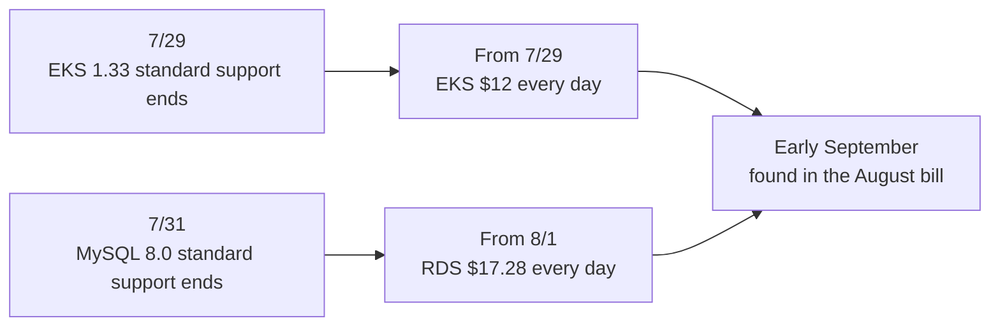
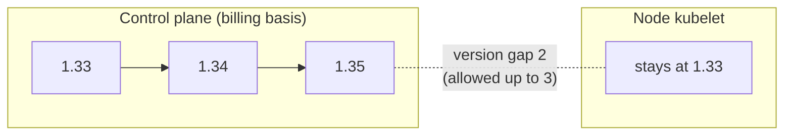

Hello, I'm Jeong Jeong-il, a backend developer working at a PropTech platform.

This post is about upgrading our EKS 1.33 cluster and RDS MySQL 8.0 last September, after both had reached the end of standard support. It wasn't planned work. I hadn't kept track of the end-of-support dates, and I only found out when I looked at the August bill.

So this post starts with the bill. I'll go over how I found the cause, what changes when the versions go up, and why I upgraded only the control plane first and left the nodes as they were, which is not the order the EKS documentation recommends. MySQL was upgraded to 8.4 for the same reason, and I'll cover that briefly toward the end.

I'm not an infrastructure specialist; at my current company I handle both backend and infrastructure. Please read this as a record of running into a problem, looking things up, and making decisions for our situation, rather than as a definitive answer.

---

## The August AWS Cost Increase

In early September, while looking at the August AWS costs, I noticed something odd. The production account cost was close to double July's.

At first I assumed we had launched something new or traffic had grown, but breaking it down by service told a different story.

```
Service          August vs. July
Amazon RDS      +$534.89
Amazon EKS      +$334.80
Tax             (increased in line with the two above)
EC2 - Compute   slightly down
Others (CloudWatch, S3, ELB, VPC ...)    no change
```

EC2 actually went down, and only RDS and EKS went up. We hadn't added any instances and the node count was the same, so I concluded the increase wasn't usage-driven.

## Extended Support Charges

Drilling down to the usage type made the cause obvious.

```
APN2-ExtendedSupport:Yr1-Yr2:MySQL8.0    $534.24
APN2-AmazonEKS-Hours:extendedSupport     $371.00
```

Looking at it day by day made the pattern even clearer.



The same amount every day means a policy switched on at a certain date, not usage. Nothing had changed on our side. The standard support for the versions we were running had ended, and AWS automatically moved them to extended support.

AWS sends notices before standard support ends, and the notice did arrive in our account. The problem was that I couldn't access the mailbox registered as the AWS account contact at the time. The handover didn't happen properly when the person in charge changed, and since I handle infrastructure on my own, checking who was reading that mailbox had been pushed back. Looking back, it was a setup where nobody would see these dates unless I checked them myself. I've since taken over that account and manage it directly.

### What EKS Charges Are Based On

EKS is billed per cluster per hour: $0.10 per hour on a standard support version and $0.60 on an extended support version. Per day, that's an extra $0.50 × 24 hours = $12, which matched the daily amount.

The important part was that this charge is based on the version of the cluster, that is, the control plane. The node version has nothing to do with it. This became the basis for deciding the order of work later.

RDS is billed per instance vCPU, with a minimum of 2 vCPUs. With three 8.0 instances: 3 × 2 vCPU × 24 hours × $0.12 = $17.28 per day. Working through the numbers, I found that our smallest development DB was paying 4.7 times its instance cost in extended support charges.

Together that came to about $905 a month (before tax), and the RDS rate doubles from the third year. Since it only gets more expensive the longer we waited, I decided to deal with it right away.

## Upgrade Scope and Order

### Target Version

EKS only lets you upgrade one minor version at a time. Standard support for 1.34 also ends in December 2026, so stopping at 1.34 would mean going through the same thing a few months later. I decided to upgrade twice, to 1.35 (standard support until March 27, 2027).

I looked at what changes with each version separately for the control plane side and the node side.

| Version | Control plane / API side | Node side |
|---|---|---|
| 1.34 | DRA GA, consistent reads from cache GA | cgroup driver autodetection GA |
| 1.35 | Job `managedBy` GA, SPDY → WebSocket transition GA | cgroup v1 support removed, kube-proxy IPVS mode deprecated, last version to support containerd 1.x |

On the API side, my biggest concern was whether we were using any API that would be removed. Checking the control plane metric `apiserver_requested_deprecated_apis`, the only hit was `core/v1 endpoints`, which isn't scheduled for removal. Most of the changes that could affect operations were on the node side.

### Why In-Place

Most EKS upgrade stories you find use Blue-Green: create a new cluster and move traffic over. Rollback is easy and you can skip versions, so I was drawn to it at first too.

But I didn't think it fit our situation. Development and production share one cluster, separated by namespaces and node groups, so moving to a new cluster meant moving both together. Meanwhile the extended support charge was accruing every day, and since I handle infrastructure alone, I also wanted to avoid a period of running two clusters side by side. So I went with an in-place upgrade of the existing cluster.

### Settings Blocking a Node Rollout

The order the EKS documentation recommends is to upgrade the control plane, bring the nodes to the same version, and then move to the next version. But when I checked the cluster before rolling the nodes, there were problems that meant I couldn't just go ahead.

```
NAME            MIN AVAILABLE   ALLOWED DISRUPTIONS
service-a-pdb   1               0
service-b-pdb   1               0
service-c-pdb   1               0
```

There were three PDBs with `minAvailable: 1` on single-pod services, so those pods couldn't be evicted, and the ingress controller was a single pod with no PDB. Updating the node groups as-is would fail on the first three with `PodEvictionFailure`, and the moment the node running the ingress was drained, all external traffic would be cut off.

These were fixable, but fixing them was a separate piece of work. In particular, I had to think through, service by service, whether increasing the pod count was even the right thing to do. So I looked at the pricing structure together with the Kubernetes version skew policy. The charge is based on the control plane version, and the kubelet is allowed to be up to three minor versions older than kube-apiserver.

| Control plane | Node (kubelet) | Version gap | |
|---|---|---|---|
| 1.34 | 1.33 | 1 | Allowed |
| 1.35 | 1.33 | 2 | Allowed |
| 1.36 | 1.33 | 3 | Allowed, but no further upgrades possible |

### Why Only the Control Plane First



I decided to upgrade only the control plane to 1.35 and leave the nodes at 1.33. A control plane upgrade doesn't touch the nodes, so no pods restart, and the charge stops immediately. The nodes would be upgraded on a separate schedule after making the ingress redundant and sorting out the PDBs.

Deviating from the recommended order gave me pause. Still, rather than being pushed by the cost into doing the node rollout at the same time and cutting off the ingress, I thought it was right to separate the urgent work from the risky work. I did write down that there's a limit to how long the nodes can stay at 1.33: the nodes have to be upgraded before the control plane goes to 1.36.

## Control Plane Upgrade

### Node Group Version Inheritance in the Terraform Module

When I changed `cluster_version` to 1.34 in Terraform and looked at the plan, it included the three node groups changing from 1.33 to 1.34. The `terraform-aws-modules/eks` module (v20.37.2) we use makes node groups follow the cluster version unless you give them a version explicitly.

```hcl
# node_groups.tf:304
cluster_version = try(each.value.cluster_version,
                      var.eks_managed_node_group_defaults.cluster_version,
                      time_sleep.this[0].triggers["cluster_version"])
```

Having decided to upgrade only the control plane, if I had skimmed the plan, the node rollout would have happened along with it. So I pinned the version in the node group defaults.

```hcl
eks_managed_node_group_defaults = {
  cluster_version = "1.33"
}
```

Planning again, the changes dropped from 10 to 7, and the three that dropped out were the node groups. Since then, rather than only looking at the `N to change` count, I separately check whether `aws_eks_node_group` is in the change list.

Planning this root module without a target also picked up changes unrelated to EKS. Settings that had been changed in the console earlier weren't reflected in the code, so applying as-is would have rolled back the production DB engine version and removed security group rules that were in use. So for the EKS work, I created a plan file with `-target=module.eks` and applied only that file.

One add-on also caught me. The default coredns version for 1.34 was lower than the version we were running, so using the default would actually have been a downgrade. The same was true for 1.35. Since then, I pick add-on versions directly from the compatibility list instead of leaving them to the default.

### Upgrade Results

| Step | Time | Result |
|---|---|---|
| 1.33 → 1.34 | about 8 min | 0 pods restarted, 0 unhealthy pods, 0 ingress restarts, nodes stayed at 1.33 |
| 1.34 → 1.35 | similar | same result |

Since `kubectl` and ArgoCD requests could fail briefly while the API server was being replaced, I paused ArgoCD syncs during the upgrade.

### What `supportType` Means

My plan said "after the upgrade, confirm that `upgradePolicy.supportType` changes from `EXTENDED` to `STANDARD`," but after upgrading to 1.34 the value was still `EXTENDED`.

It turned out this field isn't a status showing whether the cluster is currently on extended support. It's a policy that decides what happens when standard support ends. With `EXTENDED`, the cluster moves to extended support and you pay for it; with `STANDARD`, AWS upgrades it automatically. So I confirmed that the charge had stopped by looking at the daily amounts in Cost Explorer, not at this value.

Leaving this value as-is means the charge will come back in the same way when standard support for 1.35 ends on March 27, 2027. I thought choosing the timing myself was better than an automatic upgrade at a time I didn't pick, so I kept `EXTENDED`. That means I have to move before then.

### Charges

| | August | September |
|---|---|---|
| EKS extended support | $372.00 | $13.27 |
| MySQL 8.0 extended support | $535.68 | $25.92 |

What remained in September was the charge for the few days before the upgrade, and since October started the daily amount has been $0.

## MySQL 8.0 → 8.4

RDS MySQL 8.0 had the same cause, so I upgraded it to 8.4 LTS. Here I'll only cover the parts where my judgment changed.

### `mysql_native_password` Default

My biggest worry was that `mysql_native_password` is disabled by default in MySQL 8.4. All our DB accounts used it, so according to the community documentation, the application would be unable to connect the moment we upgraded. I had started planning an account migration, but when I queried the RDS `mysql8.4` default parameters directly, the result was different.

```bash
aws rds describe-engine-default-parameters \
  --db-parameter-group-family mysql8.4
```

```
mysql_native_password   ON    IsModifiable: false
```

RDS keeps this plugin enabled and fixed. If I had gone only by the community documentation, I think I would have done an unnecessary account migration on the production DB first.

### Option Groups and Major Versions

The production DB isn't Multi-AZ, so downtime was unavoidable, and I rehearsed on the development DB first. In the rehearsal, the apply failed after 13 seconds.

```
api error InvalidParameterCombination:
Current Option Group (<audit-option-group>-mysql80) is non-default.
You need to explicitly specify a new Option Group in this case (default or custom)
```

Like parameter groups, option groups are tied to the major version. The option group for audit logging had been created in the console long ago and wasn't in the Terraform code, so it didn't show up in the plan and only failed at apply time. The production DBs used the same kind of option group, so if I had first hit this in production, I think I would have spent the whole announced maintenance window finding the cause.

### Measuring Downtime

I measured actual downtime from the shutdown to the restarted event in the RDS events.

| Target | Data | Downtime |
|---|---|---|
| Development DB | the larger one | 2 min 45 s |
| Another DB | about one seventh | 2 min 01 s |

The data was nearly seven times smaller, but downtime didn't drop much. I think this is because a major version upgrade updates the data dictionary and system tables rather than user data. The application recovered without a restart, with HikariCP establishing new connections.

## What's Left

The charge has stopped, but the EKS upgrade is only half done. The nodes are still on 1.33, and the AMI is the same one built in March. Managed node groups don't replace the AMI on their own within the same version, so as long as the nodes aren't replaced, OS and kernel patches don't get in either.

So the next job is the nodes. Before that, I need to make the ingress controller redundant and decide, service by service, how to change the three PDBs that block draining. Standard support for 1.35 ends on March 27, 2027, and to avoid moving close to the deadline again like this time, I plan to sort out the nodes first.

## Closing

This taught me that leaving versions un-upgraded also has a cost. On-premises, an old version would have remained something like a future security issue, but in the cloud it showed up on the bill starting the day after support ended.

Most of the moments when my judgment changed came from querying actual values rather than reading documentation. That was true of the RDS authentication plugin, and also of `supportType` and the node group changes in the Terraform plan. I plan to approach the next node upgrade the same way, checking as I go.

I hope this is of some help to anyone preparing a similar EKS or RDS upgrade. Thank you for reading.

---

### Reference

- [Amazon EKS Kubernetes versions lifecycle](https://docs.aws.amazon.com/eks/latest/userguide/kubernetes-versions.html)
- [Update existing cluster to new Kubernetes version](https://docs.aws.amazon.com/eks/latest/userguide/update-cluster.html)
- [View cluster upgrade policy](https://docs.aws.amazon.com/eks/latest/userguide/view-upgrade-policy.html)
- [Amazon EKS pricing](https://aws.amazon.com/eks/pricing/)
- [Kubernetes Version Skew Policy](https://kubernetes.io/releases/version-skew-policy/)
- [Kubernetes v1.34 release](https://kubernetes.io/blog/2025/08/27/kubernetes-v1-34-release/)
- [Kubernetes v1.35 release](https://kubernetes.io/blog/2025/12/17/kubernetes-v1-35-release/)
- [Kubernetes: Pod Disruption Budgets](https://kubernetes.io/docs/concepts/workloads/pods/disruptions/)
- [Amazon RDS Extended Support charges](https://docs.aws.amazon.com/AmazonRDS/latest/UserGuide/extended-support-charges.html)
- [Major version upgrades for RDS for MySQL](https://docs.aws.amazon.com/AmazonRDS/latest/UserGuide/USER_UpgradeDBInstance.MySQL.Major.html)
