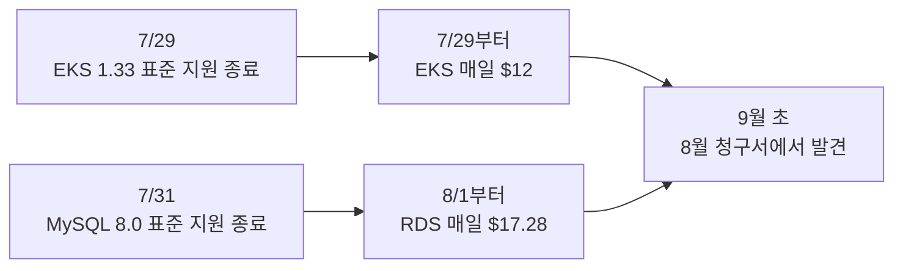
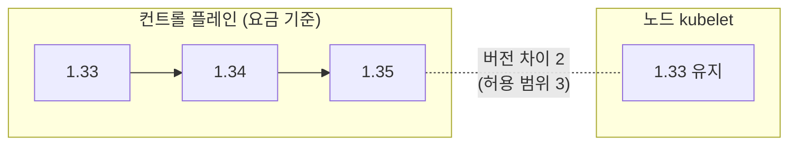

안녕하세요. 프롭테크 플랫폼에서 백엔드 개발자로 근무 중인 정정일입니다.

이번엔 지난 9월, AWS 표준 지원 기간이 끝난 EKS 1.33 클러스터와 RDS MySQL 8.0을 버전업한 이야기를 해볼까 합니다. 미리 계획해서 하게 된 작업은 아니고 지원 종료 일정을 미리 챙기지 못해 8월 서버 비용 금액이 예상보다 많이 나오게 됐고 그로 인해 부랴부랴 준비해서 작업하게 된 내용을 담고 있습니다.

그래서 이 글도 제가 이 작업을 시작하게 된 계기인 AWS Billing에서부터 출발해볼까 합니다. 서버 비용 상승의 원인을 어떻게 찾았는지, 버전이 올라가면 무엇이 바뀌는지, 그리고 저는 어떤 식으로 작업했는지 다뤄보도록 하겠습니다.

다만 시작하기에 앞서 저는 인프라를 전문으로 하는 사람은 아니고, 지금 회사에서 백엔드와 인프라를 함께 맡고 있습니다. 이게 정답이라고 공유하는 글이라기보단 문제를 만나서 탐색하고 저희 상황에 맞게 판단한 과정을 기록으로 남겼다는 점에 중점을 두고 봐주시면 감사하겠습니다.

---

## 8월 AWS 비용 증가

9월 초에 회사 재무 담당자분께서 8월 AWS 비용과 관련해 저희 팀에 문의를 주셨습니다. 평소보다 요금이 많이 부과됐는데 원인을 공유해줄 수 있냐는 문의였죠. 바로 비용을 확인해보니 서버 비용이 이전 몇 달간의 평균 금액보다 약 두 배 가까이 부과되어 있었습니다.

처음 보자마자 어라? 싶었습니다. 8월에 서버 리소스를 증량하거나 서비스를 추가하거나 하지 않은 상태였거든요. 트래픽이 엄청나게 늘어났다거나 하지도 않았기 때문에 다른 부분을 살펴봐야겠다 싶었습니다.

```
서비스           7월 대비 8월
Amazon RDS      +$534.89
Amazon EKS      +$334.80
Tax             (위 두 항목만큼 증가)
EC2 - Compute   소폭 감소
그 외(CloudWatch, S3, ELB, VPC ...)    변동 없음
```

세부적으로 살펴보니 EC2는 오히려 비용이 소폭 줄었고 늘어난 건 RDS와 EKS뿐이었습니다. 인스턴스를 추가한 적도 없고 노드 수도 그대로였기 때문에, 사용량 때문에 생긴 비용은 아니라고 봤습니다.

## 연장 지원 요금

사용량 유형(Usage Type)까지 내려가 보니 이전에 보지 못한 항목들이 바로 보이더라고요.

```
APN2-ExtendedSupport:Yr1-Yr2:MySQL8.0    $534.24
APN2-AmazonEKS-Hours:extendedSupport     $371.00
```

저희가 사용하는 서비스의 특정 버전의 표준 지원 기간이 종료돼 발생한 금액이었습니다.



저희 서비스 구성이 바뀐 건 없는데, 쓰던 버전의 표준 지원이 끝나면서 AWS가 자동으로 연장 지원으로 넘긴 것이었습니다.

> AWS 표준 지원이란?
> EKS나 RDS처럼 오픈소스(쿠버네티스, MySQL 등)를 AWS가 관리형으로 제공하는 서비스에는 버전마다 지원 기간이 정해져 있습니다. 표준 지원(Standard Support) 기간에는 AWS가 해당 버전에 보안 패치와 버그 수정을 제공하고, 추가 요금 없이 평소 요금으로 쓸 수 있습니다. 이 기간이 끝나면 연장 지원(Extended Support)으로 넘어가는데, 연장 지원 기간에도 보안 패치는 계속 제공되지만 업그레이드할 시간을 더 주는 대가로 추가 요금이 붙습니다. 연장 지원까지 끝나면 AWS가 지원되는 버전으로 자동 업그레이드합니다.

AWS는 표준 지원 종료 전에 안내를 발송해 주는데, 저희 계정에도 안내 메일은 와 있었습니다. 다만 AWS 계정 연락처로 등록된 메일 계정을 당시에는 제가 확인할 수 없었습니다. AWS의 기본 연락처로 등록된 메일 계정이 담당자가 바뀌는 과정에서 매끄럽게 인수인계가 되지 않았고, 인프라를 혼자 맡다 보니 그 계정을 누가 보고 있는지 확인하는 일이 뒤로 밀려 있었습니다. 돌아보면 제가 챙기지 못한 부분이 있다는 걸 깨달아 마음이 무거웠습니다. 지금은 해당 계정을 넘겨받아 제가 직접 관리하고 있습니다.

### EKS 요금의 기준

EKS는 클러스터당 시간 단위로 과금됩니다. 표준 지원 버전이면 시간당 $0.10, 연장 지원 버전이면 $0.60입니다. 하루로 치면 $0.50 × 24시간 = $12가 추가되고, 저희 비용 관리에서 확인했을 때 APN2-AmazonEKS-Hours:extendedSupport가 일별로 찍힌 금액이 해당 금액이었죠.

그렇다면 결국 이 요금을 다시금 기존에 내던 요금으로 줄이기 위해선 AWS에서 표준 지원해주는 버전으로 EKS를 버전업할 필요가 있었습니다. 그렇기에 EKS를 빠르게 버전업하기로 마음먹었습니다.

그 후 관련한 사항들을 리서치하고 리스크를 판단하고 어떤 작업들을 해야 할지 판단하는 과정을 거치게 됐습니다. 클러스터에는 컨트롤 플레인과 노드풀이 존재하는데 EKS 내부의 모든 노드풀과 컨트롤 플레인이 제가 EKS를 구성하던 당시의 표준 지원 버전인 1.33으로 구성돼 있었기 때문에 서비스 영향도가 클 수 있겠다 싶었습니다.

그러나 여기서 한 가지 중요한 문서를 읽게 됐습니다. AWS에서 EKS 버전 지원에 따른 요금을 부과하는 기준이 클러스터, 즉 컨트롤 플레인의 버전을 기준으로 매겨진다는 점이었습니다. 노드가 어느 버전인지는 요금과 상관이 없었습니다. 이 사실이 작업 규모와 순서를 정하는 큰 기준이 됐습니다.

RDS는 인스턴스 vCPU 수만큼 과금되고 최소 2 vCPU로 계산됩니다. 8.0 인스턴스 3대 × 2 vCPU × 24시간 × $0.12 = 하루 $17.28이었습니다. 계산하다 보니 가장 작은 개발용 DB는 인스턴스 요금보다 연장 지원 요금을 4.7배 더 내고 있었습니다. 꽤 큰 금액이었죠.

둘을 합치면 월 약 $905(세전)였고, RDS는 3년 차부터 단가가 두 배로 오릅니다. 미룰수록 비싸지고 요금은 더 나가니 최대한 빠르게 바로 정리하기로 했습니다.

## 업그레이드 범위와 순서

### 목표 버전

그럼 이제 어디까지 버전을 올려야 하는가가 그다음 고민이었는데 EKS 1.34의 표준 지원도 2026년 12월에 끝나기 때문에, 1.34까지만 버전업을 하면 몇 달 뒤 같은 일을 다시 겪게 될 걸로 판단됐습니다. 그래서 1.35(표준 지원 2027년 3월 27일까지)까지 올리기로 결정했습니다.

다만 EKS는 마이너 버전을 한 번에 하나씩만 올릴 수 있습니다. 1.33에서 바로 1.35로 가지 못하고 1.33 → 1.34 → 1.35 이런 식으로 단계적인 버전업이 필요하죠.

그렇다면 버전에 따른 어떤 변경점들이 있는지 검토해야 했습니다. 쿠버네티스는 버전이 올라가면서 오래된 API를 제거하기도 하고, 기본값이나 동작 방식이 바뀌기도 하고, 노드에서 쓰는 cgroup이나 컨테이너 런타임 같은 구성 요소의 지원을 끝내기도 합니다. 1.33에서 문제없이 쓰던 리소스나 설정이 새 버전에서는 거부되거나 다르게 동작할 수 있다는 뜻입니다. 앞에서 요금이 컨트롤 플레인 기준이라는 걸 확인했기 때문에, 변경점도 컨트롤 플레인 쪽과 노드 쪽으로 나눠서 검토했습니다.

| 버전 | 컨트롤 플레인 / API 쪽 | 노드 쪽 |
|---|---|---|
| 1.34 | DRA GA, 캐시 기반 일관된 읽기 GA | cgroup 드라이버 자동 감지 GA |
| 1.35 | Job `managedBy` GA, SPDY → WebSocket 전환 GA | cgroup v1 지원 제거, kube-proxy IPVS 모드 deprecated, containerd 1.x를 지원하는 마지막 버전 |

컨트롤 플레인 쪽에서 제일 걱정한 건 저희가 쓰고 있는 API가 새 버전에서 제거되는 경우였습니다. 쿠버네티스는 버전이 올라가면서 오래된 API를 하나씩 없애는데, 그런 API를 쓰고 있으면 업그레이드 뒤에 배포가 깨지게 됩니다. API 서버는 deprecated API가 호출될 때마다 `apiserver_requested_deprecated_apis`라는 메트릭에 기록을 남깁니다. 이걸로 확인해보니 잡힌 건 `core/v1 endpoints` 하나였고, 제거 예정이 없는 API라 문제가 되지 않았습니다.

노드 쪽은 사정이 달랐습니다. 1.35에서는 cgroup v1을 쓰는 노드에서 kubelet이 기본 설정으로 뜨지 않고, kube-proxy의 IPVS 모드가 deprecated되며, containerd 1.x를 지원하는 마지막 버전이 됩니다. 노드의 OS 설정이나 런타임에 따라 노드 자체가 뜨지 않거나 네트워크 동작이 달라질 수 있는 변경들이라, 노드를 올릴 때는 저희 노드가 각각 어떤 상태인지 먼저 확인해야 했습니다.

### in-place 방식을 고른 이유

변경점을 검토한 다음에는 어떤 방식으로 올릴지 정해야 했습니다. EKS 업그레이드 사례를 찾아보면 새 버전으로 클러스터를 하나 더 만들고 트래픽을 옮기는 Blue-Green 방식이 많습니다. 문제가 생기면 기존 클러스터로 트래픽을 되돌리면 되고, 1.33에서 1.35로 바로 건너뛸 수도 있다는 장점이 있습니다.

하지만 저희 상황에서는 비용이 컸습니다. 저희는 개발과 운영 환경이 한 클러스터 안에 네임스페이스와 노드그룹으로 나뉘어 있어서, 새 클러스터로 가려면 둘을 함께 옮겨야 했습니다. 애플리케이션뿐 아니라 캐시, 검색 엔진, 모니터링처럼 EBS 볼륨에 데이터를 두는 서비스도 데이터를 옮겨야 하고, 외부 트래픽을 받는 로드밸런서와 DNS도 모두 새 클러스터로 바꿔야 합니다. 그동안에는 컨트롤 플레인과 노드 비용이 두 벌로 나가고, 연장 지원 요금도 계속 붙습니다. 이 작업을 혼자 진행하면서 두 클러스터의 설정을 맞춰 가는 기간이 길어질수록 실수할 여지도 커진다고 봤습니다. 그래서 기존 클러스터를 그대로 올리는 in-place 방식을 택했습니다.

### 노드 롤링을 막던 설정

in-place로 정한 뒤에는 앞에서 걱정했던 서비스 영향도를 확인해야 했습니다. EKS 문서가 권장하는 순서는 컨트롤 플레인을 올리고, 노드도 같은 버전으로 맞춘 뒤 다음 버전으로 넘어가는 것입니다. 노드를 새 버전으로 맞추려면 새 노드를 띄우고 기존 노드에 있던 파드를 하나씩 옮기는 롤링이 필요한데, 이 과정을 버틸 수 있는 상태인지 클러스터를 먼저 점검해봤습니다.

여기서 걸린 게 PDB(PodDisruptionBudget)였습니다. PDB는 노드를 비울 때 "이 서비스의 파드는 최소 몇 개는 살아 있어야 한다"는 조건을 거는 설정입니다. 노드를 비우는 쪽은 이 조건을 어기지 않는 선에서만 파드를 내보낼 수 있습니다.

```
NAME            MIN AVAILABLE   ALLOWED DISRUPTIONS
service-a-pdb   1               0
service-b-pdb   1               0
service-c-pdb   1               0
```

세 서비스 모두 파드가 1개인데 `minAvailable: 1`, 즉 "최소 1개는 살아 있어야 한다"로 걸려 있었습니다. 파드가 하나뿐이니 내보낼 수 있는 파드가 0개가 되고, 사실상 "절대 내리지 마라"와 같은 설정이었죠. 이대로 노드그룹을 업데이트하면 이 파드들을 옮기지 못해 `PodEvictionFailure`로 실패하게 됩니다. 게다가 외부 트래픽을 받는 인그레스 컨트롤러도 파드 하나에 PDB조차 없어서, 그 파드가 있는 노드가 비워지는 순간 외부 트래픽이 전부 끊기는 상태였습니다.

고칠 수 있는 문제였지만 바로 고칠 수는 없었습니다. 가장 쉬운 방법은 파드를 2개로 늘리는 것인데, 세 서비스 중에는 중복 처리를 막기 위해 한 번에 하나만 떠 있어야 하는 서비스도 있어서 서비스마다 다른 방법을 정해야 했습니다. 인그레스 컨트롤러도 파드를 늘리는 것만으로는 부족하고, 두 파드가 같은 노드에 뜨지 않게 배치를 정하고 실제로 끊김 없이 넘어가는지 확인까지 해야 했습니다. 그동안에도 연장 지원 요금은 하루에 약 $29씩 나가고 있었습니다.

그래서 앞에서 읽은 요금 기준을 다시 떠올렸습니다. 요금이 컨트롤 플레인 버전 기준이라면, 노드를 잠시 그대로 둬도 되는지가 관건이었습니다. 쿠버네티스에는 버전 차이(skew) 정책이 있는데, 노드에서 도는 kubelet은 컨트롤 플레인의 kube-apiserver보다 마이너 버전이 3개까지 낮아도 됩니다.

| 컨트롤 플레인 | 노드(kubelet) | 버전 차이 | |
|---|---|---|---|
| 1.34 | 1.33 | 1 | 허용 |
| 1.35 | 1.33 | 2 | 허용 |
| 1.36 | 1.33 | 3 | 허용되지만 여기서 더는 못 올림 |

### 컨트롤 플레인만 먼저 올린 이유



1.35까지 올려도 노드와의 차이는 2라 허용 범위 안이었습니다. 그래서 컨트롤 플레인만 1.35까지 올리고 노드는 1.33에 두기로 했습니다. 컨트롤 플레인 업그레이드는 노드를 건드리지 않아 파드가 재시작되지 않고, 요금은 바로 멈춥니다. 노드는 인그레스를 이중화하고 PDB를 정리한 뒤 별도 일정으로 올리기로 했습니다.

물론 권장 순서에서 벗어나는 만큼 감수해야 하는 점도 있었습니다. 노드는 1.33 AMI 그대로라 그동안 나오는 OS와 커널 패치가 들어가지 않고, 버전 차이가 허용 범위 끝에 가까워지기 때문에 컨트롤 플레인을 1.36으로 올리기 전에는 반드시 노드를 먼저 올려야 합니다. 그래도 요금을 멈추는 일과 노드 롤링처럼 서비스가 끊길 수 있는 일을 한 번에 묶는 것보다는, 둘을 나눠서 노드 롤링은 준비를 마친 뒤에 하는 쪽이 맞다고 판단했습니다. 노드 업그레이드 기한은 따로 기록해 두었습니다.

## 컨트롤 플레인 업그레이드

### Terraform 모듈의 노드그룹 버전 상속

방향이 정해졌으니 이제 실제로 올릴 차례였습니다. 저희 EKS는 Terraform으로 관리하고 있어서, 클러스터 버전을 바꾸는 것도 코드의 `cluster_version` 값을 1.34로 바꾸는 것부터 시작했습니다. 그런데 바꾸고 나서 plan을 보니, 컨트롤 플레인만 바뀔 줄 알았던 변경 목록에 노드그룹 3개가 1.33 → 1.34로 바뀌는 항목까지 들어 있었습니다.

원인은 저희가 쓰는 `terraform-aws-modules/eks` 모듈(v20.37.2)의 동작이었습니다. 이 모듈은 노드그룹에 버전을 따로 지정하지 않으면 클러스터 버전을 그대로 따라갑니다.

```hcl
# node_groups.tf:304
cluster_version = try(each.value.cluster_version,
                      var.eks_managed_node_group_defaults.cluster_version,
                      time_sleep.this[0].triggers["cluster_version"])
```

컨트롤 플레인만 올리겠다고 정해 놓고 plan을 대충 넘겼다면, 피하려던 노드 롤링이 그대로 같이 일어났을 겁니다. 그래서 노드그룹 기본값에 버전을 명시해서 고정했습니다.

```hcl
eks_managed_node_group_defaults = {
  cluster_version = "1.33"
}
```

다시 plan을 보니 변경이 10개에서 7개로 줄었고, 빠진 3개가 노드그룹이었습니다. 그 뒤로는 `N to change` 숫자만 보지 않고 `aws_eks_node_group`이 변경 목록에 있는지를 따로 확인하고 있습니다.

plan을 보다가 하나 더 걸린 게 있었습니다. EKS와 상관없는 변경까지 같이 잡혀 있었던 겁니다. 예전에 콘솔에서 직접 바꾼 설정들이 코드에 반영되지 않은 채로 남아 있어서, Terraform은 그걸 코드 상태로 되돌리려 했습니다. 그대로 apply했다면 운영 DB 엔진 버전을 예전 버전으로 되돌리고, 지금 쓰고 있는 보안 그룹 규칙을 지우려 했을 겁니다. 그래서 이번 작업은 `-target=module.eks` 옵션으로 EKS 모듈만 대상으로 plan 파일을 만들고, 그 파일만 apply했습니다. 코드와 실제 상태가 어긋난 부분은 따로 정리하기로 했습니다.

클러스터 버전을 올릴 때는 coredns, kube-proxy, vpc-cni 같은 EKS 애드온도 새 버전에 맞게 같이 올려야 합니다. 처음에는 AWS가 버전별로 정해둔 기본 버전을 쓰면 되겠다고 생각했는데, coredns의 1.34 기본 버전이 오히려 저희가 운영 중인 버전보다 낮았습니다. 기본값을 그대로 쓰면 업그레이드가 아니라 다운그레이드가 되는 상황이었죠. 1.35에서도 마찬가지였습니다. 그 뒤로는 애드온 버전을 기본값에 맡기지 않고, 호환 목록에서 직접 골라 지정하고 있습니다.

### 업그레이드 결과

| 단계 | 소요 | 결과 |
|---|---|---|
| 1.33 → 1.34 | 약 8분 | 재시작된 파드 0개, 비정상 파드 0건, 인그레스 재시작 0회, 노드 1.33 유지 |
| 1.34 → 1.35 | 비슷 | 같은 결과 |

컨트롤 플레인이 교체되는 동안에는 API 서버로 가는 요청이 잠깐씩 실패할 수 있습니다. 배포 도구인 ArgoCD도 API 서버와 계속 통신하기 때문에, 그동안은 ArgoCD Sync를 멈춰두고 진행했습니다.

### `supportType`의 의미

업그레이드가 끝난 뒤 요금이 멈췄는지 확인하는 과정에서 예상과 다른 값이 하나 있었습니다. 계획에는 "업그레이드 후 `upgradePolicy.supportType`이 `EXTENDED`에서 `STANDARD`로 바뀌는지 확인한다"고 적어뒀는데, 1.34로 올린 뒤에도 값은 `EXTENDED` 그대로였습니다.

찾아보니 이 필드는 지금 연장 지원 중인지를 나타내는 상태값이 아니라, 표준 지원이 끝났을 때 어떻게 할지를 정하는 정책값이었습니다. `EXTENDED`면 연장 지원으로 넘어가 요금을 내고, `STANDARD`면 AWS가 자동으로 업그레이드합니다. 그래서 요금이 멈췄는지는 이 값이 아니라 Cost Explorer의 일별 금액으로 확인했습니다.

이 값을 그대로 두면 1.35 표준 지원이 끝나는 2027년 3월 27일에 같은 방식으로 요금이 다시 붙습니다. 그렇다고 `STANDARD`로 바꾸면 원하지 않는 시점에 자동 업그레이드가 일어날 수 있습니다. 저는 시점을 직접 고르는 쪽이 낫다고 보고 `EXTENDED`를 유지했습니다. 대신 그 전에 먼저 움직여야 합니다.

### 요금

| | 8월 | 9월 |
|---|---|---|
| EKS 연장 지원 | $372.00 | $13.27 |
| MySQL 8.0 연장 지원 | $535.68 | $25.92 |

9월에 남은 금액은 업그레이드 전까지 며칠 동안 나간 요금이고, 10월 들어서는 일별 금액이 0원입니다.

## MySQL 8.0 → 8.4

EKS를 정리하고 나니 남은 건 RDS였습니다. 앞에서 본 것처럼 MySQL 8.0도 같은 이유로 연장 지원 요금이 붙고 있었습니다.

목표 버전은 8.4로 정했습니다. MySQL은 8.0 이후로 출시 방식이 바뀌어서, 오래 지원하는 LTS 버전과 다음 버전이 나오면 지원이 끝나는 Innovation 버전으로 나뉩니다. Innovation 버전은 다음 버전이 나오면 버그와 보안 수정이 끊기기 때문에, 운영 DB에 쓰면 몇 달마다 메이저 업그레이드를 다시 해야 합니다. 그래서 운영 DB에는 LTS를 쓰기로 했고, 8.4가 LTS였습니다. RDS에서 8.4의 표준 지원은 2029년 7월까지라 당분간 같은 일을 겪을 걱정도 없었습니다. EKS 때처럼 작업에 들어가기 전에 버전에 따른 변경점부터 검토했고, 여기서는 그중 판단이 바뀌었던 부분만 적겠습니다.

### `mysql_native_password` 기본값

가장 걱정한 건 인증 방식이었습니다. MySQL 계정은 접속할 때 쓰는 인증 플러그인이 정해져 있는데, 8.4에서는 예전 방식인 `mysql_native_password`가 기본으로 꺼집니다. 저희 DB 계정은 애플리케이션 계정을 포함해 모두 이 방식을 쓰고 있어서, 커뮤니티 문서대로라면 업그레이드하는 순간 애플리케이션이 DB에 접속하지 못하게 됩니다.

그래서 계정을 새 방식으로 바꾸는 계획부터 세우고 있었는데, 그 전에 RDS에서도 실제로 같은 기본값인지 확인해야 했습니다. RDS의 `mysql8.4` 기본 파라미터를 직접 조회해보니 결과가 달랐습니다.

```bash
aws rds describe-engine-default-parameters \
  --db-parameter-group-family mysql8.4
```

```
mysql_native_password   ON    IsModifiable: false
```

RDS는 이 플러그인을 켜둔 채로 고정하고 있었습니다. 커뮤니티 문서만 보고 판단했다면 필요 없는 계정 전환을 운영 DB에서 먼저 했을 것 같습니다.

### 옵션 그룹과 메이저 버전

운영 DB는 Multi-AZ 구성이 아니라서, 메이저 버전 업그레이드 중에는 DB가 잠시 내려가는 걸 피할 수 없었습니다. 운영 DB를 내리기 전에 절차에 빠진 게 없는지, 실제로 얼마나 내려가는지 알고 싶어서 개발 DB로 먼저 리허설을 했습니다. 그런데 리허설에서 apply가 13초 만에 실패했습니다.

```
api error InvalidParameterCombination:
Current Option Group (<audit-option-group>-mysql80) is non-default.
You need to explicitly specify a new Option Group in this case (default or custom)
```

RDS에는 파라미터 그룹 말고도 옵션 그룹이라는 설정이 있습니다. 감사 로그 플러그인처럼 DB에 붙는 추가 기능을 설정하는 곳인데, 파라미터 그룹처럼 메이저 버전에 묶여 있어서 8.4로 가려면 8.4용 옵션 그룹을 새로 지정해야 합니다. 문제는 저희 감사 로그용 옵션 그룹이 예전에 콘솔에서 만든 리소스라 Terraform 코드에 없었다는 점이었습니다. 그래서 plan에는 아무것도 나오지 않았고, apply에서야 실패한 겁니다. 8.4용 옵션 그룹을 새로 만들고 같은 설정을 옮긴 뒤 다시 진행했습니다.

운영 DB들도 같은 방식으로 만든 옵션 그룹을 쓰고 있었습니다. 운영에서 이걸 처음 만났다면, 공지한 작업 시간 안에 원인을 찾느라 시간을 다 썼을 것 같습니다.

### 다운타임 측정

리허설을 하면서 실제 다운타임도 재봤습니다. RDS 이벤트에서 인스턴스가 shutdown된 시점부터 restarted된 시점까지를 다운타임으로 봤습니다.

| 대상 | 데이터 | 다운타임 |
|---|---|---|
| 개발 DB | 큰 쪽 | 2분 45초 |
| 다른 DB | 7분의 1 정도 | 2분 01초 |

데이터가 7배 가까이 작은데도 다운타임은 크게 줄지 않았습니다. 찾아보니 메이저 업그레이드는 사용자 데이터를 다시 쓰는 게 아니라 데이터 딕셔너리와 시스템 테이블을 갱신하는 작업이라 그런 것 같습니다. 덕분에 운영 DB도 2~3분 정도로 예상하고 일정을 잡을 수 있었습니다. 애플리케이션은 따로 재시작하지 않아도, 커넥션 풀(HikariCP)이 끊긴 커넥션을 버리고 새로 맺으면서 복구됐습니다.

## 남은 일

이렇게 요금은 멈췄지만 EKS 업그레이드는 아직 절반만 끝난 상태입니다. 노드는 여전히 1.33이고, 노드 AMI도 3월에 만들어진 그대로입니다. 관리형 노드그룹은 같은 쿠버네티스 버전 안에서도 AMI를 알아서 새 것으로 바꿔주지 않아서, 노드를 교체하지 않는 동안에는 OS나 커널 패치도 들어가지 않습니다.

그래서 다음 작업은 노드입니다. 그 전에 인그레스 컨트롤러를 이중화하고, 노드 롤링을 막던 PDB 세 개를 서비스별로 어떻게 바꿀지 정해야 합니다. 1.35 표준 지원 종료일은 2027년 3월 27일인데, 이번처럼 종료일이 지나서야 움직이지 않도록 노드부터 먼저 정리하려고 합니다.

## 마치며

이번 일로 버전을 올리지 않고 두는 데도 비용이 든다는 걸 알게 됐습니다. 온프레미스였다면 오래된 버전은 언젠가 생길 보안 문제 정도로 남았을 텐데, 클라우드에서는 지원 종료일 다음 날부터 청구서에 찍혔습니다.

작업하면서 판단이 바뀐 순간은 대부분 문서를 읽을 때보다 실제 값을 조회할 때였습니다. RDS의 인증 플러그인이 그랬고, `supportType`과 Terraform plan의 노드그룹 변경도 그랬습니다. 다음 노드 업그레이드도 같은 방식으로 확인하면서 진행하려고 합니다.

비슷하게 EKS나 RDS 업그레이드를 앞두고 계신 분들께 조금이나마 도움이 됐으면 좋겠습니다. 읽어주셔서 감사합니다.

---

### Reference

- [Amazon EKS Kubernetes versions lifecycle](https://docs.aws.amazon.com/eks/latest/userguide/kubernetes-versions.html)
- [Update existing cluster to new Kubernetes version](https://docs.aws.amazon.com/eks/latest/userguide/update-cluster.html)
- [View cluster upgrade policy](https://docs.aws.amazon.com/eks/latest/userguide/view-upgrade-policy.html)
- [Amazon EKS pricing](https://aws.amazon.com/eks/pricing/)
- [Kubernetes Version Skew Policy](https://kubernetes.io/releases/version-skew-policy/)
- [Kubernetes v1.34 release](https://kubernetes.io/blog/2025/08/27/kubernetes-v1-34-release/)
- [Kubernetes v1.35 release](https://kubernetes.io/blog/2025/12/17/kubernetes-v1-35-release/)
- [Kubernetes: Pod Disruption Budgets](https://kubernetes.io/docs/concepts/workloads/pods/disruptions/)
- [Amazon RDS Extended Support charges](https://docs.aws.amazon.com/AmazonRDS/latest/UserGuide/extended-support-charges.html)
- [Major version upgrades for RDS for MySQL](https://docs.aws.amazon.com/AmazonRDS/latest/UserGuide/USER_UpgradeDBInstance.MySQL.Major.html)
