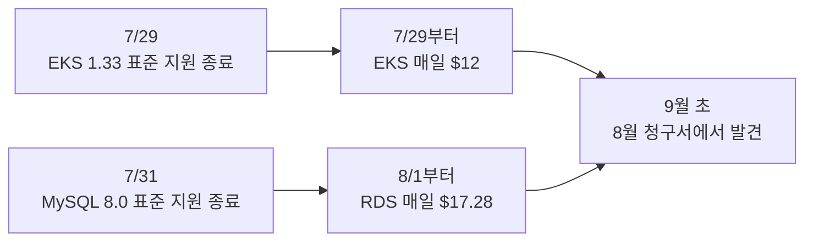
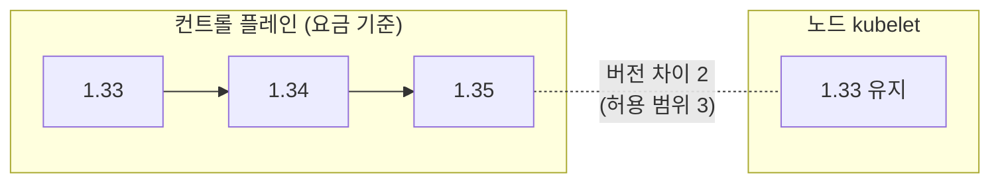

안녕하세요. 프롭테크 플랫폼에서 백엔드 개발자로 근무 중인 정정일입니다.

이번 글은 지난 9월, 표준 지원이 끝난 EKS 1.33 클러스터와 RDS MySQL 8.0을 올린 이야기입니다. 계획해서 시작한 작업은 아니었습니다. 지원 종료 일정을 미리 챙기지 못했고, 그 사실을 8월 청구서를 보고서야 알게 됐습니다.

그래서 이 글은 청구서에서 출발합니다. 원인을 어떻게 찾았는지, 버전이 올라가면 무엇이 바뀌는지, 그리고 EKS 문서가 권장하는 순서와 달리 컨트롤 플레인만 먼저 올리고 노드는 그대로 둔 이유를 정리해보려 합니다. 같은 이유로 MySQL도 8.4로 올렸는데, 이 부분은 뒤에서 짧게 다루겠습니다.

저는 인프라를 전문으로 하는 사람은 아니고, 지금 회사에서 백엔드와 인프라를 함께 맡고 있습니다. 정답이라기보다는 문제를 만나서 찾아보고 저희 상황에 맞게 판단해본 기록으로 봐주시면 감사하겠습니다.

---

## 8월 AWS 비용 증가

9월 초에 8월 AWS 비용을 보다가 숫자가 이상하다는 걸 알았습니다. 운영 계정 비용이 7월의 두 배 가까이 나와 있었습니다.

처음에는 뭔가 새로 띄웠거나 트래픽이 늘었다고 생각했는데, 서비스별로 나눠 보니 예상과 달랐습니다.

```
서비스           7월 대비 8월
Amazon RDS      +$534.89
Amazon EKS      +$334.80
Tax             (위 두 항목만큼 증가)
EC2 - Compute   소폭 감소
그 외(CloudWatch, S3, ELB, VPC ...)    변동 없음
```

EC2는 오히려 줄었고 늘어난 건 RDS와 EKS뿐이었습니다. 인스턴스를 추가한 적도 없고 노드 수도 그대로였기 때문에, 사용량 때문에 생긴 비용은 아니라고 봤습니다.

## 연장 지원 요금

사용량 유형(Usage Type)까지 내려가 보니 원인이 바로 보였습니다.

```
APN2-ExtendedSupport:Yr1-Yr2:MySQL8.0    $534.24
APN2-AmazonEKS-Hours:extendedSupport     $371.00
```

일별로 다시 조회하니 패턴이 더 분명했습니다.



매일 같은 금액이 찍힌다는 건 사용량이 아니라 어떤 날짜를 기점으로 정책이 켜졌다는 뜻이죠. 저희 쪽에서 바뀐 건 아무것도 없었는데, 쓰던 버전의 표준 지원이 끝나면서 AWS가 자동으로 연장 지원으로 넘긴 것이었습니다.

AWS는 표준 지원 종료 전에 안내를 보내고, 저희 계정에도 안내 메일은 와 있었습니다. 다만 AWS 계정 연락처로 등록된 메일 계정을 당시에는 제가 볼 수 없었습니다. 담당자가 바뀌는 과정에서 인수인계가 되지 않았고, 인프라를 혼자 맡다 보니 그 계정을 누가 보고 있는지 확인하는 일이 뒤로 밀려 있었습니다. 돌아보면 제가 챙기지 않으면 이런 일정은 아무도 보지 않는 구조였습니다. 지금은 그 계정을 넘겨받아 제가 직접 관리하고 있습니다.

### EKS 요금의 기준

EKS는 클러스터당 시간 단위로 과금됩니다. 표준 지원 버전이면 시간당 $0.10, 연장 지원 버전이면 $0.60입니다. 하루로 치면 $0.50 × 24시간 = $12가 추가되고, 일별로 찍힌 금액과 같았습니다.

여기서 중요한 건 이 요금이 클러스터, 즉 컨트롤 플레인의 버전을 기준으로 매겨진다는 점이었습니다. 노드가 어느 버전인지는 요금과 상관이 없습니다. 이 사실이 뒤에서 작업 순서를 정하는 기준이 됐습니다.

RDS는 인스턴스 vCPU 수만큼 과금되고 최소 2 vCPU로 계산됩니다. 8.0 인스턴스 3대 × 2 vCPU × 24시간 × $0.12 = 하루 $17.28이었습니다. 계산하다 보니 가장 작은 개발용 DB는 인스턴스 요금보다 연장 지원 요금을 4.7배 더 내고 있었습니다.

둘을 합치면 월 약 $905(세전)였고, RDS는 3년 차부터 단가가 두 배로 오릅니다. 미룰수록 비싸지는 구조라 바로 정리하기로 했습니다.

## 업그레이드 범위와 순서

### 목표 버전

EKS는 마이너 버전을 한 번에 하나씩만 올릴 수 있습니다. 1.34의 표준 지원도 2026년 12월에 끝나기 때문에, 1.34에서 멈추면 몇 달 뒤 같은 일을 다시 겪게 됩니다. 그래서 1.35(표준 지원 2027년 3월 27일까지)까지 두 번 올리기로 했습니다.

버전이 올라가면 무엇이 바뀌는지는 컨트롤 플레인 쪽과 노드 쪽으로 나눠서 봤습니다.

| 버전 | 컨트롤 플레인 / API 쪽 | 노드 쪽 |
|---|---|---|
| 1.34 | DRA GA, 캐시 기반 일관된 읽기 GA | cgroup 드라이버 자동 감지 GA |
| 1.35 | Job `managedBy` GA, SPDY → WebSocket 전환 GA | cgroup v1 지원 제거, kube-proxy IPVS 모드 deprecated, containerd 1.x를 지원하는 마지막 버전 |

API 쪽에서는 제거되는 API를 쓰는지가 제일 걱정이었습니다. 컨트롤 플레인 메트릭 `apiserver_requested_deprecated_apis`로 확인해보니 잡힌 건 `core/v1 endpoints` 하나였고 제거 예정이 없는 API였습니다. 반면 운영에 영향을 줄 만한 변경은 대부분 노드 쪽에 몰려 있었습니다.

### in-place 방식을 고른 이유

EKS 업그레이드 사례를 찾아보면 새 클러스터를 만들어 트래픽을 옮기는 Blue-Green 방식이 많습니다. 롤백이 쉽고 버전을 건너뛸 수 있어서 저도 처음에는 끌렸습니다.

그런데 저희 상황에서는 맞지 않는다고 봤습니다. 개발과 운영 환경이 같은 클러스터에 네임스페이스와 노드그룹으로 나뉘어 있어서, 새 클러스터로 가려면 둘을 함께 옮겨야 했습니다. 그동안에도 연장 지원 요금은 매일 나가고 있었고, 인프라를 혼자 맡고 있어서 클러스터 두 개를 같이 운영하는 기간도 피하고 싶었습니다. 그래서 기존 클러스터를 그대로 올리는 in-place 방식을 택했습니다.

### 노드 롤링을 막던 설정

EKS 문서가 권장하는 순서는 컨트롤 플레인을 올리고, 노드도 같은 버전으로 맞춘 뒤 다음 버전으로 넘어가는 것입니다. 그런데 노드 롤링 전에 클러스터를 점검해보니 그대로 진행하면 안 되는 문제가 있었습니다.

```
NAME            MIN AVAILABLE   ALLOWED DISRUPTIONS
service-a-pdb   1               0
service-b-pdb   1               0
service-c-pdb   1               0
```

파드가 1개인데 `minAvailable: 1`이라 evict할 수 없는 PDB가 세 개 있었고, 인그레스 컨트롤러는 파드 하나에 PDB도 없었습니다. 이대로 노드그룹을 업데이트하면 앞의 셋은 `PodEvictionFailure`로 실패하고, 인그레스가 있는 노드가 drain되는 순간 외부 트래픽이 모두 끊깁니다.

고칠 수 있는 문제였지만 그 자체로 별도 작업이었습니다. 특히 파드 수를 늘리는 게 맞는지부터 서비스마다 따져봐야 했습니다. 그래서 요금 구조와 쿠버네티스 버전 차이(skew) 정책을 같이 봤습니다. 요금은 컨트롤 플레인 버전 기준이고, kubelet은 kube-apiserver보다 마이너 버전이 3개까지 낮아도 됩니다.

| 컨트롤 플레인 | 노드(kubelet) | 버전 차이 | |
|---|---|---|---|
| 1.34 | 1.33 | 1 | 허용 |
| 1.35 | 1.33 | 2 | 허용 |
| 1.36 | 1.33 | 3 | 허용되지만 여기서 더는 못 올림 |

### 컨트롤 플레인만 먼저 올린 이유



컨트롤 플레인만 1.35까지 올리고 노드는 1.33에 두기로 했습니다. 컨트롤 플레인 업그레이드는 노드를 건드리지 않아 파드가 재시작되지 않고, 요금은 바로 멈춥니다. 노드는 인그레스를 이중화하고 PDB를 정리한 뒤 별도 일정으로 올리기로 했습니다.

권장 순서에서 벗어나는 선택이라 고민이 됐습니다. 그래도 비용에 쫓겨 노드 롤링까지 한 번에 하다가 인그레스가 끊기는 것보다는, 급한 일과 위험한 일을 나누는 쪽이 맞다고 봤습니다. 대신 노드를 1.33에 둘 수 있는 기간에 한계가 있다는 점은 기록해 두었습니다. 컨트롤 플레인을 1.36으로 올리기 전에는 노드를 먼저 올려야 합니다.

## 컨트롤 플레인 업그레이드

### Terraform 모듈의 노드그룹 버전 상속

Terraform에서 `cluster_version`을 1.34로 바꾸고 plan을 보니 노드그룹 3개가 1.33 → 1.34로 바뀌는 항목이 들어 있었습니다. 저희가 쓰는 `terraform-aws-modules/eks` 모듈(v20.37.2)은 노드그룹에 버전을 따로 주지 않으면 클러스터 버전을 따라갑니다.

```hcl
# node_groups.tf:304
cluster_version = try(each.value.cluster_version,
                      var.eks_managed_node_group_defaults.cluster_version,
                      time_sleep.this[0].triggers["cluster_version"])
```

컨트롤 플레인만 올리겠다고 정해 놓고 plan을 대충 봤다면, 노드 롤링이 그대로 같이 일어났을 겁니다. 그래서 노드그룹 기본값으로 버전을 고정했습니다.

```hcl
eks_managed_node_group_defaults = {
  cluster_version = "1.33"
}
```

다시 plan을 보니 변경이 10개에서 7개로 줄었고, 빠진 3개가 노드그룹이었습니다. 그 뒤로는 `N to change` 숫자만 보지 않고 `aws_eks_node_group`이 변경 목록에 있는지를 따로 확인하고 있습니다.

이 루트 모듈을 범위 지정 없이 plan하면 EKS와 상관없는 변경도 같이 잡혔습니다. 예전에 콘솔에서 바꾼 설정들이 코드에 반영되지 않아서, 그대로 apply하면 운영 DB 엔진 버전을 되돌리고 쓰고 있는 보안 그룹 규칙을 지우려 했습니다. 그래서 EKS 작업은 `-target=module.eks`로 plan 파일을 만들고 그 파일만 apply했습니다.

애드온도 하나 걸렸습니다. coredns의 1.34 기본 버전이 운영 중인 버전보다 낮아서, 기본값을 쓰면 오히려 다운그레이드가 되는 상황이었습니다. 1.35에서도 같았습니다. 그 뒤로는 애드온 버전을 기본값에 맡기지 않고 호환 목록에서 직접 고르고 있습니다.

### 업그레이드 결과

| 단계 | 소요 | 결과 |
|---|---|---|
| 1.33 → 1.34 | 약 8분 | 재시작된 파드 0개, 비정상 파드 0건, 인그레스 재시작 0회, 노드 1.33 유지 |
| 1.34 → 1.35 | 비슷 | 같은 결과 |

API 서버가 교체되는 동안 `kubectl`이나 ArgoCD 요청이 잠깐 실패할 수 있어서 그동안은 ArgoCD Sync를 멈췄습니다.

### `supportType`의 의미

계획에는 "업그레이드 후 `upgradePolicy.supportType`이 `EXTENDED`에서 `STANDARD`로 바뀌는지 확인한다"고 적어뒀는데, 1.34로 올린 뒤에도 값은 `EXTENDED` 그대로였습니다.

찾아보니 이 필드는 지금 연장 지원 중인지를 나타내는 상태값이 아니라, 표준 지원이 끝났을 때 어떻게 할지를 정하는 정책값이었습니다. `EXTENDED`면 연장 지원으로 넘어가 요금을 내고, `STANDARD`면 AWS가 자동으로 업그레이드합니다. 그래서 요금이 멈췄는지는 이 값이 아니라 Cost Explorer의 일별 금액으로 확인했습니다.

이 값을 그대로 두면 1.35 표준 지원이 끝나는 2027년 3월 27일에 같은 방식으로 요금이 다시 붙습니다. 원하지 않는 시점에 자동 업그레이드가 일어나는 것보다는 시점을 직접 고르는 쪽이 낫다고 보고 `EXTENDED`를 유지했습니다. 대신 그 전에 먼저 움직여야 합니다.

### 요금

| | 8월 | 9월 |
|---|---|---|
| EKS 연장 지원 | $372.00 | $13.27 |
| MySQL 8.0 연장 지원 | $535.68 | $25.92 |

9월에 남은 금액은 업그레이드 전까지 며칠 동안 나간 요금이고, 10월 들어서는 일별 금액이 0원입니다.

## MySQL 8.0 → 8.4

RDS MySQL 8.0도 같은 원인이었기 때문에 8.4 LTS로 올렸습니다. 여기서는 판단이 바뀌었던 부분만 적겠습니다.

### `mysql_native_password` 기본값

가장 걱정한 건 MySQL 8.4에서 `mysql_native_password`가 기본으로 꺼진다는 점이었습니다. 저희 DB 계정이 모두 이 방식을 쓰고 있어서, 커뮤니티 문서대로라면 업그레이드하는 순간 애플리케이션이 접속하지 못합니다. 그래서 계정 전환 계획부터 세우고 있었는데, RDS의 `mysql8.4` 기본 파라미터를 직접 조회해보니 결과가 달랐습니다.

```bash
aws rds describe-engine-default-parameters \
  --db-parameter-group-family mysql8.4
```

```
mysql_native_password   ON    IsModifiable: false
```

RDS는 이 플러그인을 켜둔 채로 고정하고 있었습니다. 커뮤니티 문서만 보고 판단했다면 필요 없는 계정 전환을 운영 DB에서 먼저 했을 것 같습니다.

### 옵션 그룹과 메이저 버전

운영 DB는 Multi-AZ가 아니라 다운타임을 피할 수 없어서, 개발 DB로 먼저 리허설했습니다. 리허설에서 apply가 13초 만에 실패했습니다.

```
api error InvalidParameterCombination:
Current Option Group (<audit-option-group>-mysql80) is non-default.
You need to explicitly specify a new Option Group in this case (default or custom)
```

옵션 그룹도 파라미터 그룹처럼 메이저 버전에 묶여 있습니다. 감사 로그용 옵션 그룹이 예전에 콘솔에서 만든 리소스라 Terraform 코드에 없었고, 그래서 plan에는 나오지 않고 apply에서만 실패했습니다. 운영 DB들도 같은 옵션 그룹을 쓰고 있었기 때문에, 운영에서 처음 만났다면 공지한 작업 시간 안에 원인을 찾느라 시간을 다 썼을 것 같습니다.

### 다운타임 측정

실제 다운타임은 RDS 이벤트의 shutdown부터 restarted까지로 쟀습니다.

| 대상 | 데이터 | 다운타임 |
|---|---|---|
| 개발 DB | 큰 쪽 | 2분 45초 |
| 다른 DB | 7분의 1 정도 | 2분 01초 |

데이터가 7배 가까이 작은데 다운타임은 크게 줄지 않았습니다. 메이저 업그레이드가 사용자 데이터가 아니라 데이터 딕셔너리와 시스템 테이블을 갱신하는 작업이라 그런 것 같습니다. 애플리케이션은 재시작 없이 HikariCP가 커넥션을 새로 맺으며 복구됐습니다.

## 남은 일

요금은 멈췄지만 EKS 업그레이드는 절반만 끝난 상태입니다. 노드는 아직 1.33이고, AMI도 3월에 만들어진 그대로입니다. 관리형 노드그룹은 같은 버전 안에서도 AMI를 알아서 바꿔주지 않아서, 노드를 교체하지 않는 동안에는 OS와 커널 패치도 들어가지 않습니다.

그래서 다음 작업은 노드입니다. 그 전에 인그레스 컨트롤러를 이중화하고, drain을 막는 PDB 세 개를 서비스별로 어떻게 바꿀지 정해야 합니다. 1.35 표준 지원 종료일은 2027년 3월 27일인데, 이번처럼 종료일 근처에서 움직이지 않도록 노드부터 먼저 정리하려고 합니다.

## 마치며

이번 일로 버전을 올리지 않고 두는 데도 비용이 든다는 걸 알게 됐습니다. 온프레미스였다면 오래된 버전은 언젠가 생길 보안 문제 정도로 남았을 텐데, 클라우드에서는 지원 종료일 다음 날부터 청구서에 찍혔습니다.

작업하면서 판단이 바뀐 순간은 대부분 문서를 읽을 때보다 실제 값을 조회할 때였습니다. RDS의 인증 플러그인이 그랬고, `supportType`과 Terraform plan의 노드그룹 변경도 그랬습니다. 다음 노드 업그레이드도 같은 방식으로 확인하면서 진행하려고 합니다.

비슷하게 EKS나 RDS 업그레이드를 앞두고 계신 분들께 조금이나마 도움이 됐으면 좋겠습니다. 읽어주셔서 감사합니다.

---

### Reference

- [Amazon EKS Kubernetes versions lifecycle](https://docs.aws.amazon.com/eks/latest/userguide/kubernetes-versions.html)
- [Update existing cluster to new Kubernetes version](https://docs.aws.amazon.com/eks/latest/userguide/update-cluster.html)
- [View cluster upgrade policy](https://docs.aws.amazon.com/eks/latest/userguide/view-upgrade-policy.html)
- [Amazon EKS pricing](https://aws.amazon.com/eks/pricing/)
- [Kubernetes Version Skew Policy](https://kubernetes.io/releases/version-skew-policy/)
- [Kubernetes v1.34 release](https://kubernetes.io/blog/2025/08/27/kubernetes-v1-34-release/)
- [Kubernetes v1.35 release](https://kubernetes.io/blog/2025/12/17/kubernetes-v1-35-release/)
- [Kubernetes: Pod Disruption Budgets](https://kubernetes.io/docs/concepts/workloads/pods/disruptions/)
- [Amazon RDS Extended Support charges](https://docs.aws.amazon.com/AmazonRDS/latest/UserGuide/extended-support-charges.html)
- [Major version upgrades for RDS for MySQL](https://docs.aws.amazon.com/AmazonRDS/latest/UserGuide/USER_UpgradeDBInstance.MySQL.Major.html)
