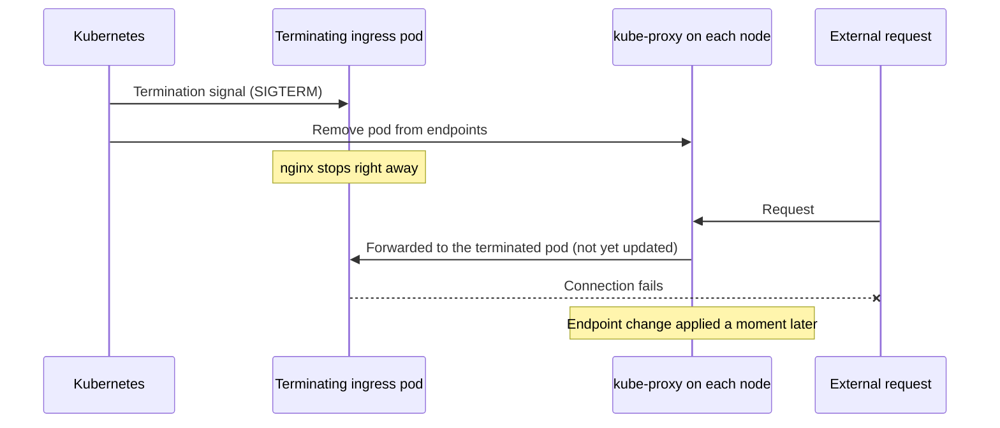
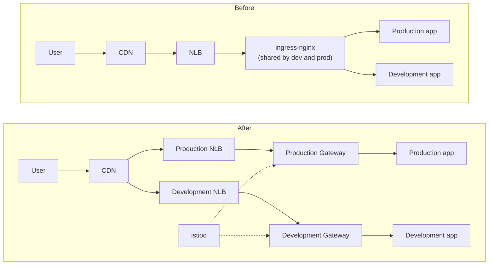
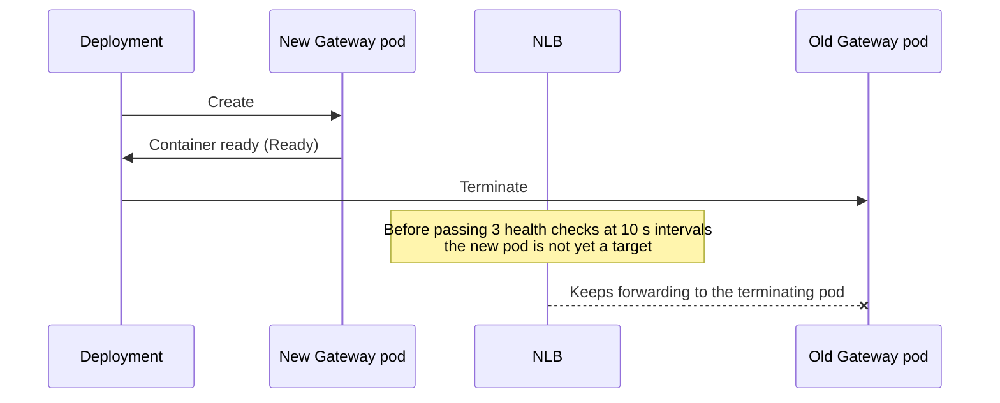

Previous: [[EKS Upgrade 1/2] EKS and MySQL After End of Standard Support: Stopping the Extended Support Charges]()

Hello, I'm Jeong Jeong-il, a backend developer working at a PropTech platform.

In the previous post, I wrote about upgrading only the EKS control plane to 1.35 to stop the extended support charges, while leaving the nodes at 1.33. This post is about upgrading those deferred nodes.

The original goal was just to bring the nodes to 1.35. But once the nodes were aligned and I checked the next upgrade, what was blocking the next version wasn't Kubernetes but the ingress controller we had installed ourselves. So I ended up moving the ingress to Gateway API and upgrading the cluster all the way to 1.37.

What I cared about most throughout was not interrupting the service. Every time I rolled the nodes, I kept sending requests from outside and counted the failures. When failures showed up, I found the cause, fixed it, and measured again. Those numbers are the core of this post.

---

## Why the Nodes Had to Be Upgraded

After the September work, the cluster was at control plane 1.35 and nodes 1.33. The charge had stopped, but there were two reasons it couldn't stay that way.

One was that the node AMI was still the one built in March. Managed node groups don't replace the AMI on their own within the same Kubernetes version, so as long as the nodes aren't replaced, none of the OS, kernel, or containerd security patches released in the meantime get in.

The other was the version gap. It was already 2, and upgrading the control plane to 1.36 would make it 3. Kubernetes only allows a gap of up to 3, so from there, the control plane can't go any further unless the nodes are upgraded first. To do the next upgrade before standard support for 1.35 ends on March 27, 2027, the nodes had to catch up first.

## Settings Blocking a Node Rollout

At first I thought, "Couldn't I just attach one more node during the rollout?" Looking into it, a managed node group update already launches new nodes first and then cordons (stops scheduling new pods on) and drains (evicts pods from) the old ones. The problem wasn't capacity; it was how the pods were set up.

I took the two issues found in September and added one more.

| Target | State | When the node is drained |
|---|---|---|
| Ingress controller | 1 pod, no PDB | All external traffic is cut off until the new pod is up |
| Services A, B, C | 1 pod + `minAvailable: 1` | Eviction is refused and the update fails |
| Search engine | 2 pods, no anti-affinity or PDB | If both land on the same node, both go down together |

`minAvailable: 1` on a single pod is effectively the same as saying "never take this down." These settings had stayed hidden as long as there was no reason to replace nodes.

## Handling Each Service

The easiest fix would be to run two pods for everything, but two of the services were batch-style services that must run as a single instance to avoid duplicate processing.

For those two, I kept a single pod and only changed the PDB to `maxUnavailable: 1`. Eviction during a drain deletes the old pod first, and then the ReplicaSet creates a new one, so there's never a moment when two pods run at the same time. I accepted the roughly one-minute pause until the new pod came up.

Thinking this through, I learned one more thing. Both services used the default `RollingUpdate` strategy (maxSurge 25%, maxUnavailable 25%). With one pod, maxSurge rounds up to 1 and maxUnavailable rounds down to 0. That means the old pod keeps running until the new one is Ready, so on every deployment, two pods could briefly overlap. So I changed the strategy to `Recreate`. The requirement that only one instance runs at a time had to be enforced by the deployment strategy, not by the PDB.

For the ingress controller and the search engine, I ran two pods each and added node-level anti-affinity and PDBs so the two pods wouldn't land on the same node. For services that can briefly stop because reads can fall back to the source, like a cache, and for internal monitoring tools, I decided to allow short interruptions. The standard I set was that the paths user requests go through must not be interrupted.

## Upgrading the Nodes to 1.35 and What I Measured

### Ingress Shutdown Handling

With two ingress pods, I expected zero downtime. But when I rolled the ingress while sending a request every second from outside, 1 out of 89 requests failed with a 3-second timeout. Matching the failure time against events, it was the moment the old ingress pod received its termination signal.



When Kubernetes deletes a pod, it starts sending the termination signal and removing the pod from the endpoints at the same time. It takes a little while for the endpoint change to reach every node, and if nginx stops first during that window, connections still headed to that pod fail.

ingress-nginx has a `--shutdown-grace-period` option that keeps accepting requests for a set time after receiving the termination signal. I set it to 15 seconds and measured again.

| Measurement | Pods terminated | Failures |
|---|---|---|
| Rollout that applies the option | 2 pods without the option | 2 of 78 |
| `rollout restart` after applying | 2 pods with the option | 0 of 102 |

There was a reason for splitting the measurement in two. Shutdown behavior follows the settings of the pod being terminated. In the rollout that applies the option, the pods going down don't have the option yet, so if I had measured only that rollout, I think I would have concluded the option had no effect. This experience helped once more later when fixing the Gateway.

### Rehearsal on the Development Node Group

The development node group lives in the same cluster as production, separated by taints, so I could rehearse on the same control plane and add-ons. I left the node group defaults as they were and set a version only on the development node group.

```hcl
eks_managed_node_group_defaults = {
  cluster_version = "1.33"   # production node groups unchanged
}

eks_managed_node_groups = {
  dev = {
    cluster_version = "1.34" # development node group first
  }
}
```

One thing came up in the rehearsal. In the development environment, the server that hands out configuration to other services was a single pod. That server and the services waiting on it were moved at the same time, so some services couldn't get their configuration and kept restarting. A node group update evicts pods while respecting PDBs, but it doesn't take care of the startup order between services. For production, I confirmed that the configuration server had two pods and a PDB, so one would remain during the drain, and moved on.

### Production Node Groups

Production has a spot node group for stateless services and an on-demand node group for services that use volumes. During the rollout, I sent a request every second to each of the ingress, app, and legacy paths. Measuring only the ingress response wouldn't show failures while app pods were being moved.

| Step | Time | External request failures |
|---|---|---|
| spot 1.33 → 1.34 | 17 min 27 s | ingress and legacy 0 of 999, app 1 of 999 |
| on-demand 1.33 → 1.34 | 7 min 49 s | 0 of 455 |
| production all at once 1.34 → 1.35 | about 12 min | ingress and legacy 0 of 676, app 4 of 676 |

The access logs showed that the failures on the app path were 503s returned by the app itself, not by the ingress. Spring Boot switches readiness to `REFUSING_TRAFFIC` and returns 503 when it starts shutting down, and I believe requests reached the terminating pod before it was removed from the endpoints. It meant the same propagation delay I saw at the ingress also existed for app pods.

Since 1.35 has big node-side changes, I checked it on the development nodes first. `/sys/fs/cgroup` was mounted as `cgroup2`, kube-proxy was in `iptables` mode, and containerd was 2.x, so the removal of cgroup v1, the IPVS deprecation, and the end of containerd 1.x support didn't affect us.

With that, all nodes were on 1.35, and the version gap with the control plane was 0.

## Components Blocking 1.37

With the nodes aligned, I wanted to go straight to 1.37. Standard support for 1.37 runs until December 2027, eight months more than 1.35.

Nothing on the Kubernetes side was in the way. EKS upgrade insights showed no use of APIs removed in 1.37, and neither 1.36 nor 1.37 removes any GA or beta APIs. The five EKS add-ons were also compatible with 1.37 at their current versions.

What got in the way were the components we had installed ourselves.

| Component | State |
|---|---|
| ingress-nginx | The version in use was officially supported only up to versions well below 1.35. The project reached end of support in March 2026 |
| Argo CD | A major upgrade from 2.x to 3.6 was needed for 1.37 to be in its tested range |
| Node Termination Handler | Even the latest version was only tested up to 1.32 |

For EKS add-ons, AWS provides the compatibility list per version through its API, but for controllers installed with Helm, you have to look up the supported range for each project separately. In September I had only checked the EKS version and hadn't looked at this list.

### Why ingress-nginx Was Retired

The biggest of the three was ingress-nginx. The retirement announcement on the official Kubernetes blog explains why.


*The [retirement announcement](https://kubernetes.io/blog/2025/11/11/ingress-nginx-retirement/) on the official Kubernetes blog (November 11, 2025)*

> For years, the project has had only one or two people doing development work, on their own time, after work hours and on weekends.
>
> What were once considered helpful options have sometimes come to be considered serious security flaws, such as the ability to add arbitrary NGINX configuration directives via the "snippets" annotations.

An ingress controller used by many clusters had been maintained by one or two people in their spare time, and convenient features like snippets had turned into security problems. The successor project that was being prepared also stopped because not enough people joined.

The announcement also has this sentence.

> Existing deployments will continue to work, so unless you proactively check, you may not know you are affected until you are compromised.

Reading it reminded me of September. With EKS too, the cluster was running without any problems, so I didn't know standard support had ended until I saw the bill. ingress-nginx doesn't send that kind of signal through the bill, so if I hadn't looked into it this time, I think I would have gone even longer without knowing.

## Choosing a Replacement

The announcement says there's no drop-in replacement and recommends Gateway API or another Ingress controller. We decided to go with Gateway API, because no more features are being added to the Ingress API and new features are going into Gateway API instead.

> What is Gateway API?
> It's a standard API that defines how external traffic is connected to services inside a Kubernetes cluster. Where Ingress put all the configuration in one resource and left detailed features to controller-specific annotations, Gateway API separates the entry point that receives traffic (Gateway) from the routing rules (HTTPRoute), and defines features like path rewriting as standard fields. The implementations that actually handle traffic are provided separately by projects such as Istio, Envoy Gateway, and NGINX Gateway Fabric.

### Choosing a Gateway API Implementation

Gateway API is a specification, and you have to choose an implementation that actually handles the traffic. Kubernetes doesn't recommend a specific implementation, so I compared them against our own criteria.

| Criterion | What I considered |
|---|---|
| Keeping up with new Kubernetes versions | The controller shouldn't block cluster upgrades like this time. At the time I looked, Envoy Gateway didn't state support for 1.37, while Istio 1.31 supports 1.32 through 1.37 |
| Maintainers and support policy | I wanted to avoid something maintained by one or two people |
| Future plans | We may consider a service mesh within about a year |

The first criterion mattered most. If I chose an implementation whose stated support only reached the version I was upgrading to now, I thought I'd run into the same thing again at the next upgrade. NGINX Gateway Fabric was also a candidate, but whichever implementation we chose, it would need to be upgraded continuously itself. Given that, I thought Istio was better since we could carry the same component forward to a mesh later. I went in knowing, though, that while we're not using Istio as a mesh, it could be a heavy choice for just the Gateway functionality.

I also set one rule. We wouldn't use Istio-specific extensions (EnvoyFilter) and would build everything with standard Gateway API resources only. One of the reasons for leaving ingress-nginx was non-standard configuration like snippets piling up, and I didn't want to repeat that after moving.

### Separating the Development and Production Gateways

Previously, a single ingress controller handled both development and production traffic. This time, I kept one istiod as the control plane, but split the Gateways that actually receive traffic (Envoy and NLB) into development and production.



I wanted to keep configuration mistakes on the development side from spreading to production traffic, and when upgrading Istio, we can try it on the development Gateway first. AWS-specific settings (NLB annotations, node placement) are kept in a single ConfigMap per Gateway and not in the HTTPRoutes that define the paths. The idea was to reduce what needs changing if we ever move to another cluster.

## Behavior Differences Found During the Migration

I converted each Ingress file into one HTTPRoute file, one to one. I did the conversion with a script, but finding where the two controllers interpreted the same configuration differently took more time than the conversion itself.

### Moving the Rewrites

In nginx, we were stripping prefixes with `rewrite-target: /$2` on regex paths like `/service(/|$)(.*)`. At first I thought this couldn't be moved because Gateway API has no regex substitution, but all of our rewrites were for "stripping the leading prefix." That gives the same result with a `PathPrefix` match and `ReplacePrefixMatch: /`.

```yaml
- matches:
    - path:
        type: PathPrefix
        value: /service
  filters:
    - type: URLRewrite
      urlRewrite:
        path:
          type: ReplacePrefixMatch
          replacePrefixMatch: /
```

However, a rule using this filter can only have one `PathPrefix` match, so I had to create a separate rule for each prefix. As a result, some routes went over the 16-rule limit per HTTPRoute, so I split them. Server-side dry-run caught this constraint right away.

### Response Comparison Tests

I sent the same 586 requests to nginx and to the new Gateway and compared the responses. To first check whether the comparison itself could be trusted, I sent them to the same nginx twice and confirmed the difference was 0 before starting.

The first comparison showed as many as 442 differences, but most were due to badly designed tests: checking CORS with an origin that wasn't allowed, mixing in hosts that hadn't been migrated yet, or counting header formatting differences that mean the same thing to a browser. After filtering those out, there were two kinds of real behavior differences.

| Difference | nginx | Gateway |
|---|---|---|
| Hosts with at least one regex path | Treats every path on that host as a regex prefix, so `/ai` also matches `/aisx` | Matches as written |
| Case in regex paths | Ignored | Respected |

In both cases the Gateway was stricter and closer to what was originally intended. This was the first time I learned that nginx's `use-regex` applies to the whole host, not just one path.

For regex paths, though, the Gateway was stricter in a way that needed fixing. Envoy regexes must match the whole path, while nginx only needed the beginning to match. So I appended `.*` to regexes that didn't end with `$`.

There was one CORS issue too. The existing configuration was sending an allowed origin of `*` together with allowing credentials, a combination browsers reject. When moving to the Gateway, I changed it so credentials are turned off where the origin is `*`.

Finally, I ran close to an hour of production access logs against the new Gateway's routes, and there were 0 requests that didn't match.

### istiod Chart Defaults

When I installed istiod, the Helm chart defaults were one pod with a PDB of `minAvailable: 1`. It was the same combination I had identified earlier as blocking node rollouts. I installed it with two pods and node-level anti-affinity instead. Since then, I check the PDB defaults first whenever I install a chart.

### Traffic Cutover Order

The cutover was done per host by changing the origin of the CDN record to the new NLB. I moved the development hosts first and tried logging in and the main API flows myself, and then moved production starting with internal hosts like monitoring.

Once I didn't follow the order. For one host, I changed the DNS before applying the HTTPRoute, and two requests that came in during that one second couldn't find a route and got 404s. After that, I changed DNS only after confirming the route was applied. Connections the CDN had already opened to the old origin continued for about 1 to 2 minutes after changing the record, so during that time I watched the access logs on both sides.

After moving every host, I confirmed there were 0 real requests reaching the old nginx, and removed the controller and the old NLB.

## Argo CD and Node Termination Handler

I upgraded Argo CD from 2.x to 3.6 in one go. The same Argo CD manages both development and production apps, so there was nothing separate to rehearse on. So of the defaults that changed in 3.0, I deliberately pinned the resource tracking method, the reconcile interval, and NetworkPolicy creation to their previous behavior, to reduce how much changed at once. Before the upgrade I saved the sync and health status of every app to a file, pulled it again after the upgrade, and compared them: 0 differences. Applying it took 56 seconds, and since Argo CD is on the deployment path, not the request path, there were no service request failures during that time either.

I removed the Node Termination Handler instead of upgrading it. It's a component that receives spot interruption notices and drains the node, but the project documentation says it isn't needed when you use managed node groups. With managed node groups, EKS does the same work itself. All of our node groups were managed, and I also confirmed that spot rebalancing was enabled. Checking things for the upgrade, I could see not only what needed upgrading but also what could be removed.

## Why 1.36 and 1.37 Were Done Back to Back

I did 1.36 and 1.37 with the same procedure, back to back on the same day.

I knew it's usually safer to leave a few days between versions and watch. I still decided to finish in one go because of my situation. I handle infrastructure alone while also doing other development, so if I stopped here, I thought it would take quite a while just to get back up to speed on the cluster state and the day's changes the next time I picked it up. I chose to finish while I had the clearest picture, right after sorting out the nodes, the ingress, and Argo CD.

Instead, since I wasn't taking breaks between versions, I decided to verify at every step before moving on. For each version, I upgraded the control plane, rolled the development node group first, and then raised the node group default to roll the production node groups together. During each step, I kept sending requests from outside and watched the failure count. I only moved to production when development had no problems, and when failures appeared, I moved to the next step only after finding and fixing the cause. Problems that don't show up right after an upgrade and only appear days later can't be caught this way, so I left that to monitoring after the work was done.

## The 1.36 Upgrade and Gateway Shutdown Handling

Each control plane upgrade took about 8 minutes, with 0 request failures. The problems came from the nodes. Now, rolling the nodes would move Gateway pods instead of nginx, and I hadn't measured the Gateway's shutdown handling yet. So before moving to production, I measured it by restarting the development Gateway. To avoid missing even brief failures, from this point I sent about 4 requests per second instead of one per second.

### Development Gateway Rollout Strategy

The first restart never finished rolling out. There are two development nodes, the two Gateway pods had required anti-affinity to keep them on different nodes, and the default rolling strategy starts one new pod first. The new pod had no node to go to and stayed Pending. The two existing pods kept serving requests, so there were no failures, but I changed the development Gateway to take down one existing pod first (`maxSurge: 0`).

### NLB Health Checks and Pod Ready Timing

After fixing the strategy and rolling out again, 12 out of 459 requests failed this time. There were two causes.



First, Ready as Kubernetes sees it and healthy as the NLB sees it were different. The NLB considers a new target healthy only after three health checks at 10-second intervals, but Kubernetes saw the new pod as Ready before that and took down the old pod. Second, even after the old pod was removed as a target, the NLB kept sending new connections to it for a while. It was the same kind of problem as the endpoint propagation delay I saw with nginx, this time in the NLB.

I solved the first with the AWS Load Balancer Controller's pod readiness gate.

> What is a pod readiness gate?
> It's a feature that adds one more condition for a pod to become Ready. With the AWS Load Balancer Controller's readiness gate enabled, a container being ready isn't enough; the pod only becomes Ready after it's registered as an NLB target and passes the health checks. Just adding a label to a namespace applies it automatically to the pods in it.

With this, rollouts and PDBs wait based on the NLB rather than Kubernetes. For the second, I increased `terminationDrainDuration` to 30 seconds so Envoy keeps accepting connections after receiving the termination signal. Restarting again gave 0 failures out of 519.

### Production Node Rollout Results

I applied the same settings to the production Gateway and rolled the production nodes to 1.36. The result was 13 failures out of 1,841. I matched each failure time against events.

| Failure | Count | Cause |
|---|---|---|
| 35 to 43 s after a Gateway pod terminated | 6 | The NLB kept sending connections to the terminated pod after 30 s. A 30 s drain wasn't enough |
| While the LBC leader pod was moving | 6 | The controller leader on the same node was moved, and NLB target deregistration stopped for 20 s until a new leader was elected |
| App pod termination | 1 | The app-side propagation delay seen with 1.35 |

I assumed that since development had 0 failures, production would too, but draining production nodes had a condition development didn't: the controller that manages the NLB targets also moves along with the nodes.

So I increased the Envoy drain to 90 seconds to cover both the NLB deregistration delay and the leader handover time, and added a `preStop` to the app pods that waits 15 seconds before shutting down, a setting I had meant to add since 1.35. While applying these settings to production, there were 0 failures out of 573.

## 1.37 Upgrade Results

| Step | Time | External request failures |
|---|---|---|
| Control plane 1.36 → 1.37 | about 8 min | 0 of 756 |
| Development node group | 10 min 31 s | Development API down for about 4 min (single-pod development app; accepted since the environment has no users) |
| Production node groups | about 16 min | 6 of 2,405 |

Failures on the Gateway path went to 0. The remaining 6 were clustered within 7 seconds. The requests recorded in the Gateway access logs showed the client disconnecting first while waiting for a response, and the app logs at the same time showed cache server reconnection failures. As the spot node was drained, a cache server pod was moved, and while the app waited to reconnect, responses went over 3 seconds. I had thought a short cache outage was fine since reads can fall back to the DB, but in practice the responses themselves were delayed for the few seconds spent waiting to reconnect. I think whether a cache can be allowed to stop depends on how quickly the app gives up when it can't use the cache. I've left the cache server's PDB and the app's timeout as next work.

Here are the 1.36 and 1.37 production node rollouts side by side, minute by minute.


For reference, even after the rollout was completely done and nothing was happening, the 4-requests-per-second measurement recorded 3 three-second timeouts out of 2,082 requests. That means the measurement path itself has about this much noise, so please read the numbers in the tables above with that margin in mind.

With that, the control plane and all nodes were on 1.37. Standard support for 1.37 runs until December 1, 2027.


*The final state as seen in the EKS console and with kubectl: the control plane, all three node groups, and all six nodes are on 1.37.*

## Closing

What I spent the most time on in this work was the difference in timing between when a pod becomes ready and when it's removed. The moment a container was ready, the moment it was removed from the endpoints, and the moment the NLB considered it healthy were all different, and a few requests dropped at each of those gaps. When I read the documentation, I thought I understood it, but until I measured at one-second intervals, I couldn't tell where requests were being dropped.

This was also the first time I put together the supported ranges for the components we installed ourselves. Since those were what actually blocked the next upgrade, I plan to look at that list first before the next one.

The development environment stopped for a few minutes each time the nodes were moved. That's because it runs a single pod, and I accepted it this time, but I'm still thinking about whether it's right to leave it that way.

Thank you for reading this long post. I hope it's of some help to anyone preparing a similar upgrade or ingress migration.

---

### Reference

- [Amazon EKS: Update a managed node group](https://docs.aws.amazon.com/eks/latest/userguide/update-managed-node-group.html)
- [Amazon EKS managed node groups (Spot capacity rebalancing)](https://docs.aws.amazon.com/eks/latest/userguide/managed-node-groups.html)
- [Kubernetes Version Skew Policy](https://kubernetes.io/releases/version-skew-policy/)
- [Kubernetes: Pod Disruption Budgets](https://kubernetes.io/docs/concepts/workloads/pods/disruptions/)
- [Kubernetes: Termination of Pods](https://kubernetes.io/docs/concepts/workloads/pods/pod-lifecycle/#pod-termination)
- [ingress-nginx command line arguments](https://kubernetes.github.io/ingress-nginx/user-guide/cli-arguments/)
- [Ingress NGINX Retirement: What You Need to Know](https://kubernetes.io/blog/2025/11/11/ingress-Nginx-retirement/)
- [Gateway API: HTTPRoute](https://gateway-api.sigs.k8s.io/api-types/httproute/)
- [Istio: Kubernetes Gateway API](https://istio.io/latest/docs/tasks/traffic-management/ingress/gateway-api/)
- [Istio ProxyConfig: terminationDrainDuration](https://istio.io/latest/docs/reference/config/istio.mesh.v1alpha1/#ProxyConfig)
- [AWS Load Balancer Controller: Pod readiness gate](https://kubernetes-sigs.github.io/aws-load-balancer-controller/latest/deploy/pod_readiness_gate/)
- [Argo CD upgrading 2.14 to 3.0](https://argo-cd.readthedocs.io/en/stable/operator-manual/upgrading/2.14-3.0/)
- [Argo CD tested Kubernetes versions](https://argo-cd.readthedocs.io/en/stable/operator-manual/tested-kubernetes-versions/)
- [AWS Node Termination Handler](https://github.com/aws/aws-node-termination-handler)
