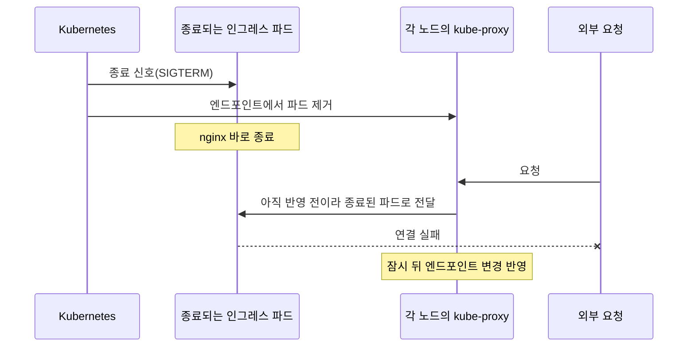
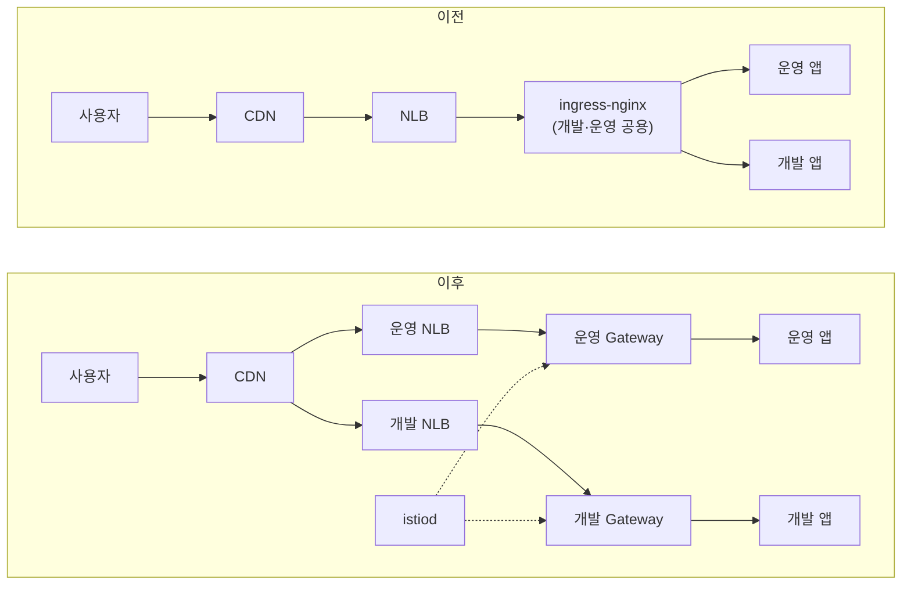
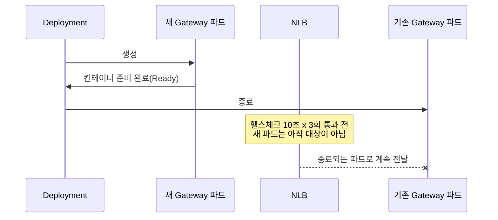

전편: [[EKS 업그레이드 1/2편] 표준 지원이 끝난 EKS와 MySQL, 연장 지원 요금을 멈추기까지]()

안녕하세요. 프롭테크 플랫폼에서 백엔드 개발자로 근무 중인 정정일입니다.

지난 글에서는 연장 지원 요금을 멈추려고 EKS 컨트롤 플레인만 1.35로 올리고, 노드는 1.33에 남겨둔 이야기를 했습니다. 이번 글은 그 미뤄 둔 노드를 올린 이야기입니다.

처음 목표는 노드를 1.35로 맞추는 것까지였습니다. 그런데 노드를 맞추고 다음 업그레이드를 점검하다 보니, 다음 버전을 막고 있는 건 쿠버네티스가 아니라 저희가 직접 설치한 인그레스 컨트롤러였습니다. 그래서 인그레스를 Gateway API로 옮기고, 클러스터를 1.37까지 올리게 됐습니다.

이 과정에서 서비스가 끊기지 않게 하는 게 가장 신경 쓴 부분이었습니다. 그래서 노드를 롤링할 때마다 외부에서 요청을 계속 보내 실패 건수를 쟀고, 실패가 나오면 원인을 찾아 고친 뒤 다시 쟀습니다. 그 숫자들이 이 글의 중심입니다.

---

## 노드를 올려야 했던 이유

9월 작업 뒤 클러스터는 컨트롤 플레인 1.35, 노드 1.33인 상태였습니다. 요금은 멈췄지만 이대로 둘 수 없는 이유가 두 가지 있었습니다.

하나는 노드 AMI가 3월에 만들어진 그대로였다는 점입니다. 관리형 노드그룹은 같은 쿠버네티스 버전 안에서도 AMI를 알아서 바꿔주지 않아서, 노드를 교체하지 않는 동안 OS, 커널, containerd 패치가 들어가지 않습니다.

다른 하나는 버전 차이입니다. 이미 차이가 2였고, 컨트롤 플레인을 1.36으로 올리면 3이 됩니다. 그다음부터는 노드를 먼저 올리지 않으면 컨트롤 플레인을 더 올릴 수 없습니다. 1.35 표준 지원이 끝나는 2027년 3월 27일 전에 다음 업그레이드를 하려면, 노드가 먼저 따라와야 했습니다.

## 노드 롤링을 막던 설정

처음에는 "롤링하는 동안 노드를 하나 더 붙여두면 되지 않을까" 생각했습니다. 찾아보니 관리형 노드그룹 업데이트는 원래 새 노드를 먼저 띄우고 기존 노드를 cordon, drain합니다. 용량이 아니라 파드 구성이 문제였습니다.

9월에 확인한 두 가지에 하나를 더해 정리했습니다.

| 대상 | 상태 | 노드를 drain 할 때 |
|---|---|---|
| 인그레스 컨트롤러 | 파드 1개, PDB 없음 | 새 파드가 뜰 때까지 외부 트래픽이 모두 끊김 |
| 서비스 A, B, C | 파드 1개 + `minAvailable: 1` | evict가 거부돼 업데이트가 실패 |
| 검색 엔진 | 파드 2개, anti-affinity와 PDB 없음 | 같은 노드에 몰리면 함께 내려감 |

파드가 1개인데 `minAvailable: 1`이면 사실상 "절대 내리지 마라"와 같은 설정입니다. 노드를 교체할 일이 없던 동안에는 드러나지 않았던 설정들이었습니다.

## 서비스별 대응

가장 쉬운 방법은 전부 파드를 2개로 늘리는 것인데, 서비스 중 두 개는 중복 처리를 막기 위해 한 번에 하나만 떠 있어야 하는 배치성 서비스였습니다.

이 둘은 파드를 1개로 두고 PDB만 `maxUnavailable: 1`로 바꿨습니다. drain 할 때의 eviction은 기존 파드를 먼저 지우고 나서 ReplicaSet이 새 파드를 만들기 때문에 두 파드가 동시에 떠 있는 순간이 없습니다. 새 파드가 뜰 때까지 1분 정도 멈추는 건 받아들였습니다.

이걸 따지다가 하나를 더 알게 됐습니다. 두 서비스의 배포 전략은 기본값인 `RollingUpdate`(maxSurge 25%, maxUnavailable 25%)였는데, 파드가 1개면 maxSurge는 올림해서 1, maxUnavailable은 내림해서 0이 됩니다. 새 파드가 Ready가 될 때까지 기존 파드가 함께 떠 있다는 뜻이라, 배포할 때마다 두 파드가 잠깐씩 겹칠 수 있었습니다. 그래서 배포 전략을 `Recreate`로 바꿨습니다. 한 번에 하나만 떠 있어야 한다는 조건은 PDB가 아니라 배포 전략으로 지켜야 했습니다.

인그레스 컨트롤러와 검색 엔진은 파드를 2개로 두고, 두 파드가 같은 노드에 뜨지 않도록 노드 단위 anti-affinity와 PDB를 걸었습니다. 캐시처럼 잠깐 멈춰도 원본 조회로 대신할 수 있는 서비스와 내부 모니터링 도구는 짧은 중단을 허용하기로 했습니다. 사용자 요청이 지나가는 경로만큼은 끊기지 않는 것을 기준으로 잡았습니다.

## 노드 1.35 업그레이드와 측정

### 인그레스 종료 처리

인그레스를 2개로 늘렸으니 무중단이 될 거라고 생각했는데, 인그레스를 롤링하면서 외부에서 1초 간격으로 요청을 보내보니 89건 중 1건이 3초 타임아웃으로 실패했습니다. 실패 시각을 이벤트와 맞춰보니 기존 인그레스 파드가 종료 신호를 받은 시각과 같았습니다.



쿠버네티스는 파드를 지울 때 종료 신호를 보내는 일과 엔드포인트에서 파드를 빼는 일을 동시에 시작합니다. 엔드포인트 변경이 각 노드에 반영되기까지 시간이 조금 걸리는데, 그 사이에 nginx가 먼저 멈추면 아직 그 파드로 가던 연결이 실패합니다.

ingress-nginx에는 종료 신호를 받은 뒤에도 정한 시간 동안 요청을 계속 받게 하는 `--shutdown-grace-period` 옵션이 있습니다. 15초로 설정하고 다시 쟀습니다.

| 측정 | 종료된 파드 | 실패 |
|---|---|---|
| 옵션을 반영하는 롤링 | 옵션 적용 전 파드 2개 | 78건 중 2건 |
| 옵션 반영 후 `rollout restart` | 옵션 적용 후 파드 2개 | 102건 중 0건 |

측정을 두 번으로 나눈 이유가 있습니다. 종료 동작은 종료되는 파드의 설정을 따릅니다. 옵션을 반영하는 롤링에서 내려가는 파드는 아직 옵션이 없는 파드라서, 그 롤링만 쟀다면 옵션이 효과가 없다고 결론 냈을 것 같습니다. 이 경험은 뒤에서 Gateway를 고칠 때 한 번 더 도움이 됐습니다.

### 개발 노드그룹 리허설

개발 환경 노드그룹은 운영과 같은 클러스터 안에 taint로 분리되어 있어서, 같은 컨트롤 플레인과 애드온 위에서 리허설할 수 있었습니다. 노드그룹 기본값은 그대로 둔 채 개발 노드그룹에만 버전을 지정했습니다.

```hcl
eks_managed_node_group_defaults = {
  cluster_version = "1.33"   # 운영 노드그룹은 그대로
}

eks_managed_node_groups = {
  dev = {
    cluster_version = "1.34" # 개발 노드그룹만 먼저
  }
}
```

리허설에서 하나 걸린 게 있었습니다. 개발 환경에서는 다른 서비스들에 설정을 내려주는 서버가 파드 하나였는데, 이 서버와 이걸 기다리는 서비스들이 같은 시점에 옮겨지면서 몇몇 서비스가 설정을 못 받고 재시작을 반복했습니다. 노드그룹 업데이트는 PDB를 지키며 파드를 내보내지만, 서비스 사이의 기동 순서까지 챙겨주지는 않았습니다. 운영에서는 설정 서버가 파드 2개에 PDB가 있어 drain 중에도 하나가 남는다는 걸 확인하고 넘어갔습니다.

### 운영 노드그룹

운영은 무상태 서비스가 올라가는 spot 노드그룹과, 볼륨을 쓰는 서비스가 올라가는 on-demand 노드그룹입니다. 롤링하는 동안 인그레스, 앱, 레거시 경로에 각각 1초 간격으로 요청을 보냈습니다. 인그레스 응답만 재면 앱 파드가 옮겨지는 동안의 실패가 보이지 않기 때문입니다.

| 단계 | 소요 | 외부 요청 실패 |
|---|---|---|
| spot 1.33 → 1.34 | 17분 27초 | 인그레스·레거시 999건 중 0건, 앱 999건 중 1건 |
| on-demand 1.33 → 1.34 | 7분 49초 | 455건 중 0건 |
| 운영 일괄 1.34 → 1.35 | 약 12분 | 인그레스·레거시 676건 중 0건, 앱 676건 중 4건 |

앱 경로에서 나온 실패는 접근 로그로 보니 인그레스가 아니라 앱이 직접 돌려준 503이었습니다. Spring Boot는 종료를 시작하면 readiness를 `REFUSING_TRAFFIC`으로 바꾸고 503을 돌려주는데, 종료 중인 파드가 엔드포인트에서 빠지기 전에 요청이 그 파드로 간 것으로 보고 있습니다. 인그레스에서 본 반영 지연이 앱 파드에도 있다는 뜻이었습니다.

1.35는 노드 쪽 변경이 큰 버전이라 개발 노드에서 먼저 확인했습니다. `/sys/fs/cgroup`이 `cgroup2`로 마운트돼 있었고, kube-proxy는 `iptables` 모드, containerd는 2.x여서 cgroup v1 제거, IPVS deprecated, containerd 1.x 지원 종료 모두 해당이 없었습니다.

이렇게 노드 전부가 1.35가 되고 컨트롤 플레인과의 버전 차이가 0이 됐습니다.

## 1.37을 막던 컴포넌트

노드까지 맞추고 나니 1.37까지 바로 올리고 싶었습니다. 1.37은 표준 지원이 2027년 12월까지라 1.35보다 8개월 여유가 있습니다.

쿠버네티스 쪽은 걸리는 게 없었습니다. EKS upgrade insights에서 1.37에서 제거되는 API 사용은 없었고, 1.36과 1.37 모두 GA나 beta API 제거가 없었습니다. EKS 애드온 5개도 지금 버전 그대로 1.37과 호환됐습니다.

걸린 건 저희가 직접 설치한 컴포넌트였습니다.

| 컴포넌트 | 상태 |
|---|---|
| ingress-nginx | 쓰던 버전의 공식 지원 범위가 1.35보다 한참 아래. 프로젝트는 2026년 3월에 지원 종료 |
| Argo CD | 1.37이 테스트 범위에 들어가려면 2.x에서 3.6으로 메이저 업그레이드 필요 |
| Node Termination Handler | 최신 버전도 1.32까지만 테스트 |

EKS 애드온은 AWS가 버전별 호환 목록을 API로 알려주지만, Helm으로 직접 설치한 컨트롤러는 프로젝트마다 지원 범위를 따로 찾아봐야 합니다. 9월에는 EKS 버전만 확인했고 이 목록은 보지 않았습니다.

### ingress-nginx 지원 종료 배경

셋 중 가장 큰 건 ingress-nginx였습니다. 쿠버네티스 공식 블로그의 지원 종료 공지에 이유가 적혀 있습니다.

> For years, the project has had only one or two people doing development work, on their own time, after work hours and on weekends.
>
> What were once considered helpful options have sometimes come to be considered serious security flaws, such as the ability to add arbitrary NGINX configuration directives via the "snippets" annotations.

많은 클러스터가 쓰던 인그레스 컨트롤러가 한두 명의 개인 시간으로 유지되고 있었고, 편하게 쓰던 snippets 같은 기능이 오히려 보안 문제가 됐다는 설명입니다. 후속으로 준비하던 프로젝트도 사람이 모이지 않아 함께 중단됐습니다.

공지에는 이런 문장도 있습니다.

> Existing deployments will continue to work, so unless you proactively check, you may not know you are affected until you are compromised.

이 문장을 읽고 9월 생각이 났습니다. EKS도 클러스터가 아무 문제 없이 돌고 있어서 표준 지원이 끝난 걸 몰랐고, 청구서를 보고서야 알았습니다. ingress-nginx는 그런 신호가 청구서로 오지 않으니, 이번에 직접 찾아보지 않았다면 더 오래 몰랐을 것 같습니다.

## 대체 방식 선택

공지에서도 바로 바꿔 끼울 수 있는 대체재는 없다고 하고, Gateway API나 다른 Ingress 컨트롤러를 권합니다. 저희는 Gateway API로 가기로 했습니다. Ingress API는 기능이 더 추가되지 않고, 새 기능은 Gateway API 쪽에 들어가고 있었기 때문입니다.

### Gateway API 구현체 선택

Gateway API는 스펙이고 실제로 트래픽을 처리하는 구현체는 따로 골라야 합니다. 쿠버네티스 쪽에서 특정 구현체를 권하지는 않아서, 저희 기준으로 비교했습니다.

| 기준 | 생각한 것 |
|---|---|
| 쿠버네티스 신버전 추적 | 이번처럼 컨트롤러가 클러스터 업그레이드를 막지 않아야 함. 조사 시점에 Envoy Gateway는 1.37 지원이 명시돼 있지 않았고, Istio 1.31은 1.32~1.37을 지원 |
| 관리 주체와 지원 정책 | 한두 명이 유지하는 구조는 피하고 싶었음 |
| 앞으로의 계획 | 1년 안쪽으로 서비스 메시를 검토할 수 있음 |

첫 번째 기준이 가장 컸습니다. 지원 버전이 지금 올리려는 버전까지만 적혀 있는 구현체를 고르면, 다음 업그레이드에서 이번과 같은 일을 다시 겪을 것 같았습니다. NGINX Gateway Fabric도 후보였지만, 어느 구현체든 그 자체를 계속 업그레이드해야 하는 건 같았습니다. 그렇다면 나중에 메시까지 같은 컴포넌트로 이어갈 수 있는 Istio가 낫다고 봤습니다. 다만 Istio를 메시로 쓰지 않는 지금은 Gateway 기능만 쓰는 데 비해 무거운 선택일 수 있다는 점은 알고 갔습니다.

한 가지 원칙도 정했습니다. Istio 전용 확장(EnvoyFilter)은 쓰지 않고, Gateway API 정식 리소스로만 구성하기로 했습니다. ingress-nginx를 떠나는 이유 중 하나가 snippets처럼 표준 밖의 설정이 쌓인 것이었는데, 옮겨 가서 같은 일을 반복하고 싶지 않았습니다.

### 개발·운영 Gateway 분리

기존에는 인그레스 컨트롤러 하나가 개발과 운영 트래픽을 함께 받았습니다. 이번에는 컨트롤 플레인인 istiod는 하나로 두고, 실제 트래픽을 받는 Gateway(Envoy와 NLB)는 개발과 운영을 나눴습니다.



개발 쪽 설정 실수가 운영 트래픽에 번지지 않게 하고 싶었고, Istio를 올릴 때도 개발 Gateway부터 바꿔볼 수 있기 때문입니다. AWS 전용 설정(NLB 어노테이션, 노드 배치)은 Gateway마다 ConfigMap 한 곳에만 두고, 경로를 정의하는 HTTPRoute에는 넣지 않았습니다. 나중에 다른 클러스터로 옮길 때 고칠 곳을 줄이려는 생각이었습니다.

## 이관하면서 확인한 동작 차이

Ingress 파일 하나당 HTTPRoute 파일 하나로 1:1 변환했습니다. 변환은 스크립트로 했는데, 변환 자체보다 두 컨트롤러가 같은 설정을 다르게 해석하는 부분을 찾는 데 시간이 더 걸렸습니다.

### rewrite 옮기기

nginx에서는 `/service(/|$)(.*)` 같은 정규식 경로에 `rewrite-target: /$2`를 걸어 접두어를 떼고 있었습니다. 처음에는 Gateway API에 정규식 치환이 없어서 이걸 못 옮긴다고 생각했는데, 저희 rewrite는 전부 "앞의 접두어를 떼는" 용도였습니다. 이건 `PathPrefix` 매치에 `ReplacePrefixMatch: /`를 쓰면 같은 결과가 나오죠.

```yaml
- matches:
    - path:
        type: PathPrefix
        value: /service
  filters:
    - type: URLRewrite
      urlRewrite:
        path:
          type: ReplacePrefixMatch
          replacePrefixMatch: /
```

다만 이 필터를 쓰는 규칙에는 `PathPrefix` 매치가 하나만 있어야 해서, 접두어마다 규칙을 따로 만들어야 했습니다. 그러다 보니 HTTPRoute 하나에 넣을 수 있는 규칙 16개를 넘겨서 라우트를 나눴습니다. 이 제약은 서버 쪽 dry-run에서 바로 잡혔습니다.

### 응답 비교 테스트

nginx와 새 Gateway에 같은 요청 586건을 보내 응답을 비교했습니다. 비교를 믿을 수 있는지부터 보려고, 같은 nginx에 두 번 보내 차이가 0인지 먼저 확인하고 시작했습니다.

첫 비교에서는 차이가 442건이나 나왔는데, 대부분 테스트를 잘못 짠 탓이었습니다. 허용되지 않은 origin으로 CORS를 확인했거나, 아직 옮기지 않은 호스트를 섞었거나, 브라우저에서는 의미가 같은 헤더 표기 차이까지 다르다고 센 경우였습니다. 이걸 걸러내고 나니 실제 동작 차이는 두 종류였습니다.

| 차이 | nginx | Gateway |
|---|---|---|
| 정규식이 하나라도 있는 호스트 | 그 호스트의 모든 경로를 정규식 접두어로 처리해서 `/ai`가 `/aisx`도 잡음 | 적힌 대로 매치 |
| 정규식 경로의 대소문자 | 무시 | 구분 |

둘 다 Gateway 쪽이 더 엄격했고, 원래 의도에 가까운 동작이었습니다. nginx의 `use-regex`가 경로 하나가 아니라 호스트 전체에 적용된다는 건 이번에 처음 알았습니다.

정규식 경로는 반대로 Gateway가 더 엄격해서 손을 봐야 했습니다. Envoy의 정규식은 경로 전체와 일치해야 하는데 nginx는 앞부분만 맞으면 됐습니다. 그래서 `$`로 끝나지 않는 정규식에는 끝에 `.*`를 붙였습니다.

CORS도 하나 있었습니다. 기존 설정은 허용 origin `*`와 credentials 허용을 함께 보내고 있었는데, 이 조합은 브라우저가 거부하는 응답입니다. Gateway로 옮기면서 origin이 `*`인 곳은 credentials를 끄도록 바꿨습니다.

마지막으로 운영 접근 로그 1시간 가까운 분량을 새 Gateway의 라우트에 대 보니, 매치되지 않는 요청은 0건이었습니다.

### istiod 차트 기본값

istiod를 설치하고 보니 Helm 차트 기본값이 파드 1개에 PDB `minAvailable: 1`이었습니다. 앞에서 노드 롤링을 막는다고 정리했던 조합과 같았습니다. 파드 2개와 노드 단위 anti-affinity로 바꿔 설치했습니다. 이 일 이후로는 차트를 설치할 때 PDB 기본값을 먼저 확인하고 있습니다.

### 트래픽 전환 순서

전환은 호스트마다 CDN 레코드의 원본을 새 NLB로 바꾸는 방식으로 했습니다. 개발 호스트를 먼저 옮겨 로그인과 주요 API 흐름을 직접 써 본 뒤, 운영은 모니터링처럼 내부용 호스트부터 옮겼습니다.

한 번은 순서를 지키지 못했습니다. HTTPRoute를 반영하기 전에 DNS를 먼저 바꾼 호스트가 있었고, 그 사이 1초 동안 들어온 요청 2건이 라우트를 못 찾아 404가 났습니다. 그 뒤로는 라우트 반영을 확인한 뒤에 DNS를 바꿨습니다. CDN이 기존 원본에 맺어 둔 연결은 레코드를 바꾸고도 1~2분 정도 이어져서, 그동안은 두 쪽 접근 로그를 같이 봤습니다.

모든 호스트를 옮긴 뒤 기존 nginx로 들어오는 실제 요청이 0건인 걸 확인하고, 컨트롤러와 기존 NLB를 지웠습니다.

## Argo CD와 Node Termination Handler

Argo CD는 2.x에서 3.6으로 한 번에 올렸습니다. 같은 Argo CD가 개발과 운영 앱을 함께 관리하고 있어서 따로 리허설할 대상이 없었습니다. 그래서 3.0에서 바뀐 기본값 중 리소스 추적 방식, reconcile 주기, NetworkPolicy 생성은 일부러 이전 동작으로 고정해 한 번에 바뀌는 것을 줄였습니다. 업그레이드 전에 모든 앱의 sync와 health 상태를 파일로 저장해 두고, 업그레이드 뒤 다시 뽑아 비교했는데 차이가 0건이었습니다. 적용은 56초 걸렸고, Argo CD는 배포 경로일 뿐 요청 경로가 아니어서 그동안 서비스 요청 실패도 없었습니다.

Node Termination Handler는 올리지 않고 지웠습니다. spot 회수 알림을 받아 노드를 비우는 컴포넌트인데, 프로젝트 문서에 관리형 노드그룹을 쓰면 필요 없다고 적혀 있었습니다. 관리형 노드그룹은 EKS가 같은 일을 직접 합니다. 저희 노드그룹은 모두 관리형이었고, spot 리밸런싱 설정이 켜져 있는 것도 확인했습니다. 업그레이드를 점검하다 보니 올릴 것만이 아니라 지워도 되는 것도 함께 보였습니다.

## 1.36과 1.37을 이어서 진행한 이유

1.36과 1.37은 같은 절차로, 같은 날 이어서 진행했습니다.

보통은 버전 사이에 며칠씩 두고 지켜보는 게 더 안전하다는 건 알고 있었습니다. 그래도 한 번에 끝내기로 한 건 제 상황 때문이었습니다. 인프라를 혼자 맡으면서 다른 개발도 같이 하고 있어서, 여기서 멈추면 다음에 다시 시작할 때 클러스터 상태와 그날 바꾼 것들을 다시 파악하는 데만 꽤 시간이 들 것 같았습니다. 노드, 인그레스, Argo CD를 정리하면서 맥락을 가장 잘 잡고 있을 때 끝내는 쪽을 택했습니다.

대신 쉬어가지 않는 만큼 단계마다 확인하고 넘어가기로 했습니다. 버전마다 컨트롤 플레인을 올리고, 개발 노드그룹을 먼저 롤링한 뒤, 노드그룹 기본값을 올려 운영 노드그룹을 한 번에 롤링했습니다. 각 단계 동안 외부에서 요청을 계속 보내 실패 건수를 봤고, 개발에서 문제가 없을 때만 운영으로, 실패가 나오면 원인을 찾아 고친 뒤에만 다음 단계로 넘어갔습니다. 업그레이드 직후에는 안 보이고 며칠 지나야 드러나는 문제는 이 방식으로는 잡을 수 없어서, 그 부분은 끝난 뒤 지켜보는 것으로 남겼습니다.

## 1.36 업그레이드와 Gateway 종료 처리

컨트롤 플레인 업그레이드는 각각 약 8분 걸렸고 그동안 요청 실패는 0건이었습니다. 문제는 노드에서 나왔습니다. 이제 노드를 롤링하면 nginx 대신 Gateway 파드가 옮겨지는데, Gateway의 종료 처리는 아직 재본 적이 없었습니다. 그래서 운영으로 넘어가기 전에 개발 Gateway를 재시작하면서 재봤습니다. 짧은 실패도 놓치지 않으려고 이때부터는 1초에 한 건이 아니라 초당 4건 정도로 요청을 보냈습니다.

### 개발 Gateway 롤아웃 전략

첫 재시작은 롤아웃이 끝나지 않았습니다. 개발 노드는 2대인데 Gateway 파드 2개를 서로 다른 노드에 두도록 필수 anti-affinity를 걸어 두었고, 기본 롤링 전략은 새 파드를 먼저 하나 띄웁니다. 새 파드가 들어갈 노드가 없어 Pending으로 남은 겁니다. 기존 파드 2개가 계속 요청을 받고 있어서 실패는 없었지만, 개발 Gateway는 기존 파드를 먼저 하나 내리도록(`maxSurge: 0`) 바꿨습니다.

### NLB 헬스체크와 파드 Ready 시점

전략을 고친 뒤 다시 롤아웃하니 이번에는 459건 중 12건이 실패했습니다. 원인은 두 가지였습니다.



첫째, 쿠버네티스가 보는 Ready와 NLB가 보는 healthy가 달랐습니다. NLB는 새 대상을 10초 간격 헬스체크 3번을 통과해야 정상으로 보는데, 쿠버네티스는 그보다 먼저 새 파드를 Ready로 보고 기존 파드를 내렸습니다. 둘째, 기존 파드가 대상에서 빠진 뒤에도 NLB는 한동안 그 파드로 새 연결을 보냈습니다. nginx 때 본 엔드포인트 반영 지연과 같은 종류의 문제가 NLB에서도 있었습니다.

첫 번째는 AWS Load Balancer Controller의 pod readiness gate로 풀었습니다. 네임스페이스에 레이블을 붙이면, 파드는 NLB 대상으로 healthy가 돼야 Ready가 됩니다. 롤아웃과 PDB가 쿠버네티스 기준이 아니라 NLB 기준으로 기다리게 되는 겁니다. 두 번째는 Envoy가 종료 신호를 받은 뒤에도 연결을 계속 받도록 `terminationDrainDuration`을 30초로 늘렸습니다. 다시 재시작해보니 519건 중 0건이었습니다.

### 운영 노드 롤링 결과

운영 Gateway에도 같은 설정을 넣고 운영 노드를 1.36으로 롤링했습니다. 결과는 1,841건 중 13건 실패였습니다. 실패 시각을 이벤트와 하나씩 맞춰 봤습니다.

| 실패 | 건수 | 원인 |
|---|---|---|
| Gateway 파드 종료 35~43초 뒤 | 7 | NLB가 30초가 지나서도 종료된 파드로 연결을 보냄. 30초 drain이 부족 |
| LBC 리더 파드가 옮겨지는 동안 | 6 | 같은 노드에 있던 컨트롤러 리더가 옮겨져, 새 리더가 정해질 때까지 20초 동안 NLB 대상 해제가 멈춤 |
| 앱 파드 종료 | 1 | 1.35 때 본 앱 쪽 반영 지연 |

개발에서 0건이었다고 운영에서도 0건일 거라고 생각했는데, 운영 노드 drain에는 개발에서는 없던 조건이 있었습니다. NLB 대상을 관리하는 컨트롤러 자신도 노드와 함께 옮겨진다는 점입니다.

그래서 Envoy drain을 90초로 늘려 NLB 해제 지연과 리더 교체 시간을 함께 덮도록 했고, 앱 파드에는 종료 전에 15초 기다리는 `preStop`을 넣었습니다. 1.35 때부터 넣으려던 설정입니다. 이 설정을 운영에 반영하는 동안에도 573건 중 실패는 0건이었습니다.

## 1.37 업그레이드 결과

| 단계 | 소요 | 외부 요청 실패 |
|---|---|---|
| 컨트롤 플레인 1.36 → 1.37 | 약 8분 | 756건 중 0건 |
| 개발 노드그룹 | 10분 31초 | 개발 API 약 4분 중단(개발 앱이 파드 1개, 사용자가 없는 환경이라 허용) |
| 운영 노드그룹 | 약 16분 | 2,405건 중 6건 |

Gateway 경로의 실패는 0건이 됐습니다. 남은 6건은 7초 안에 몰려 있었는데, Gateway 접근 로그에 남은 요청은 응답을 기다리던 클라이언트가 먼저 끊은 것으로 찍혀 있었고, 같은 시각 앱 로그에는 캐시 서버 재연결 실패가 찍혀 있었습니다. spot 노드가 비워지면서 캐시 서버 파드가 옮겨졌고, 그동안 앱이 재연결을 기다리느라 응답이 3초를 넘긴 것이었습니다. 캐시는 멈춰도 DB에서 읽으면 되니 짧은 중단은 괜찮다고 봤는데, 실제로는 재연결을 기다리는 몇 초 동안 응답 자체가 늦어졌습니다. 캐시가 멈춰도 되는지는 캐시를 쓸 수 없을 때 앱이 얼마나 빨리 포기하는지까지 봐야 판단할 수 있는 것 같습니다. 캐시 서버의 PDB와 앱의 타임아웃은 다음 작업으로 남겨 두었습니다.

이렇게 컨트롤 플레인과 노드가 모두 1.37이 됐습니다. 1.37의 표준 지원은 2027년 12월 1일까지입니다.

## 마치며

이번 작업에서 가장 오래 붙잡고 있었던 건 파드가 준비되고 빠지는 시점의 차이였습니다. 컨테이너가 준비된 시점, 엔드포인트에서 빠진 시점, NLB가 정상으로 본 시점이 모두 달랐고, 그 차이마다 요청이 몇 건씩 떨어졌습니다. 문서로 읽었을 때는 이해했다고 생각했는데, 1초 간격으로 재보기 전까지는 어디서 떨어지는지 알 수 없었습니다.

그리고 이번에 처음으로 직접 설치한 컴포넌트들의 지원 범위를 정리해 봤습니다. 실제로 다음 업그레이드를 막은 건 이쪽이었기 때문에, 다음 업그레이드 전에는 이 목록부터 다시 볼 생각입니다.

개발 환경은 노드를 옮길 때마다 몇 분씩 멈췄습니다. 파드가 하나뿐이라 그런 거고, 이번에는 받아들였지만 계속 그대로 두는 게 맞는지는 아직 고민 중입니다.

긴 글 읽어주셔서 감사합니다. 비슷한 업그레이드나 인그레스 이관을 앞두고 계신 분들께 조금이나마 도움이 됐으면 좋겠습니다.

---

### Reference

- [Amazon EKS: Update a managed node group](https://docs.aws.amazon.com/eks/latest/userguide/update-managed-node-group.html)
- [Amazon EKS managed node groups (Spot capacity rebalancing)](https://docs.aws.amazon.com/eks/latest/userguide/managed-node-groups.html)
- [Kubernetes Version Skew Policy](https://kubernetes.io/releases/version-skew-policy/)
- [Kubernetes: Pod Disruption Budgets](https://kubernetes.io/docs/concepts/workloads/pods/disruptions/)
- [Kubernetes: Termination of Pods](https://kubernetes.io/docs/concepts/workloads/pods/pod-lifecycle/#pod-termination)
- [ingress-nginx command line arguments](https://kubernetes.github.io/ingress-nginx/user-guide/cli-arguments/)
- [Ingress NGINX Retirement: What You Need to Know](https://kubernetes.io/blog/2025/11/11/ingress-Nginx-retirement/)
- [Gateway API: HTTPRoute](https://gateway-api.sigs.k8s.io/api-types/httproute/)
- [Istio: Kubernetes Gateway API](https://istio.io/latest/docs/tasks/traffic-management/ingress/gateway-api/)
- [Istio ProxyConfig: terminationDrainDuration](https://istio.io/latest/docs/reference/config/istio.mesh.v1alpha1/#ProxyConfig)
- [AWS Load Balancer Controller: Pod readiness gate](https://kubernetes-sigs.github.io/aws-load-balancer-controller/latest/deploy/pod_readiness_gate/)
- [Argo CD upgrading 2.14 to 3.0](https://argo-cd.readthedocs.io/en/stable/operator-manual/upgrading/2.14-3.0/)
- [Argo CD tested Kubernetes versions](https://argo-cd.readthedocs.io/en/stable/operator-manual/tested-kubernetes-versions/)
- [AWS Node Termination Handler](https://github.com/aws/aws-node-termination-handler)
