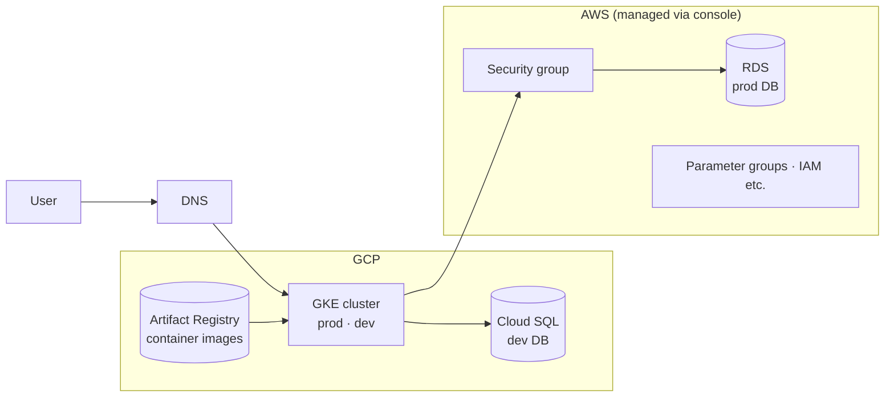
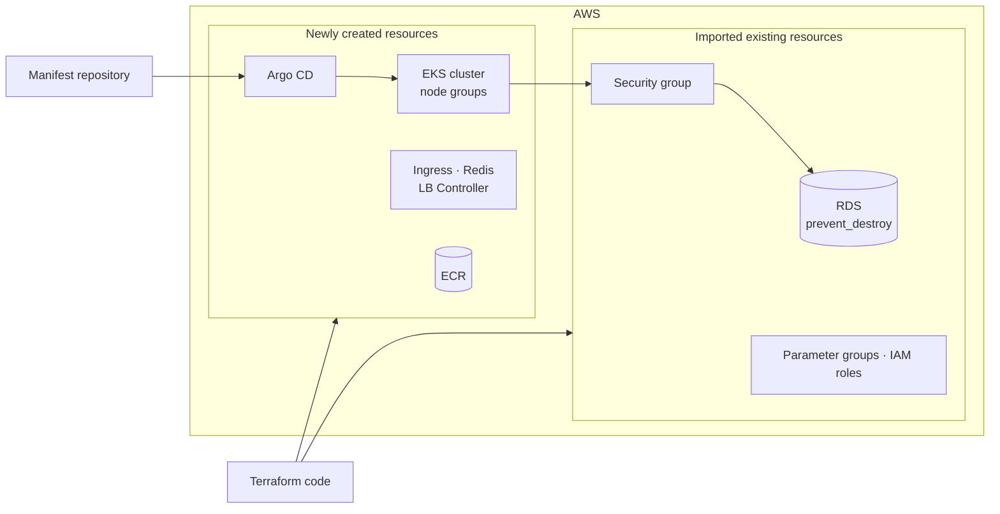
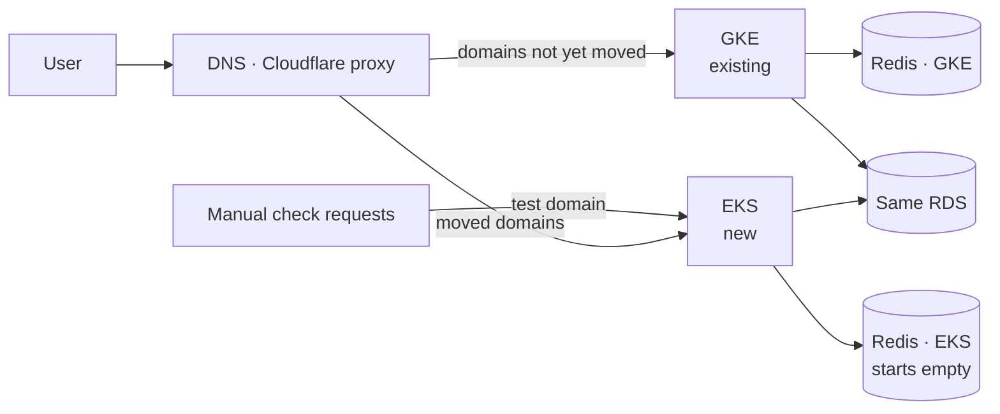

Hello, I'm Jeong Jeong-il, a backend developer working at a PropTech platform.

This time I'd like to talk about moving our servers from GKE to AWS EKS between March and April this year. The trigger was that the credits we had received through the GCP startup program were running out, and we chose AWS as the destination.

The thing was, most of our AWS resources had only ever been managed through the console. So this post starts with how we brought those resources into Terraform code, and then covers how we stood up EKS next to them and moved our services over.

Before I begin, I'm not an infrastructure specialist; at my current company I handle both backend and infrastructure. Rather than a post sharing the right answer, I'd appreciate it if you read this as a record of the order in which we made decisions in our situation.

---

## When the Credits Were Running Out

We chose GKE when we [adopted Kubernetes]() in 2025. Around that time we were selected for the GCP startup program and received credits for one year, which let us run an infrastructure that even included a development cluster.

Those credits were set to end in April 2026. Before that, to cut server costs first, we merged the 13 separate services into a [modular monolith]() and reduced the number of pods significantly. The cloud migration covered in this post was the work we did after that.

Once the credits ended we would be paying for the servers ourselves, and at that point our infrastructure was split across two clouds. We had to look at accounts and permissions, bills, and network settings separately in GCP and AWS, and when something went wrong we had to check two consoles. With a small team, I thought managing two clouds together was a burden, so we decided to consolidate everything into AWS as the credits ended.

Because the production DB was already on AWS, moving only the servers meant we didn't have to move or sync any production data.

## The Setup Before the Move

Our production DB had been running on AWS RDS since before we adopted GKE; when we adopted Kubernetes, we moved only the servers to GKE. The services on GKE were connecting to RDS outside their cloud.



On the Kubernetes side, we managed everything with a manifest repository and Argo CD, so we could check in code what was running and how. On the AWS side, on the other hand, resources like RDS, security groups, parameter groups, and IAM roles had mostly been created and modified in the console.

## Why We Imported Existing Resources Before Building EKS

The EKS cluster had to connect to the existing RDS and security groups, and we planned to move services in stages rather than all at once. That meant that during the move there would be **a period when services still on GKE and services already on EKS would be looking at the same RDS at the same time**. During that period, the RDS security group had to allow connections from both GKE and the EKS nodes, and changing either one incorrectly could cut off access to the production DB.

If we built EKS with Terraform, the rule letting EKS nodes connect to RDS would also be added from Terraform. But with the security group outside Terraform, we couldn't see in the plan which rules it currently had and what it would look like after the change. I didn't want to change what sits in front of the production DB that way, so before building EKS we decided to first bring into code the existing resources EKS would depend on.

## Bringing Existing Resources into Code

### Import Blocks and Zero Changes

We imported the existing resources with `import` blocks, available since Terraform 1.5. You write down which real resource to bring in under which name in the code. The plan, which shows what will change before you apply, lists the resources to be imported, and when you apply they go into Terraform's state file.

```hcl
import {
  to = aws_db_instance.main
  id = "main-db"
}

import {
  to = aws_security_group.rds
  id = "sg-xxxxxxxx"
}
```

I decided nothing should change on the production DB during the import step, so we worked through the issues below one by one until the plan showed "imports only, zero changes."

| What showed up in the plan | What we did |
|---|---|
| Hand-written `.tf` differed from console defaults, producing several changes | Generated config from the real resources with `-generate-config-out` |
| The provider's `default_tags` added tags to every resource | Removed `default_tags` during the import step |
| Resources created with CDK (CloudFormation) | Excluded from Terraform management |
| Generated config has no `lifecycle` block | Added `prevent_destroy` and `ignore_changes` to the production DB by hand |

At first I wrote the RDS config by hand in `.tf` files. Resources created in the console carry many settings filled in with defaults at creation time, and copying them one by one, I missed some values or wrote others differently. So I threw away the hand-written config and generated it from the real resources with `terraform plan -generate-config-out`. Since that config copies the actual values, only the imports showed up, with no changes.

`default_tags` was a setting I had added to attach common tags to every resource, but the existing resources didn't have those tags, so the import came with changes adding them. Adding tags isn't a risky change in itself, but I felt that zero changes was the right bar for the import step.

If we had also imported the CDK-created resources into Terraform, the two tools would each try to pull the same resources back to match their own code. To keep one resource under one tool, we deliberately left the CDK side alone.

### Settings That Protect the Production DB

We added the following to the production DB by hand.

```hcl
resource "aws_db_instance" "main" {
  # ... generated config

  lifecycle {
    prevent_destroy = true
    ignore_changes  = [password]
  }
}
```

`prevent_destroy` makes the plan fail with an error if it would delete this resource or delete and recreate it. Even if a bad code change makes the DB a replacement target, we can stop before it is actually deleted. However, if the resource block itself is removed from the code, this setting disappears with it, so it doesn't guard against every mistake. We started with RDS and later extended it across the imported resources (security groups, parameter groups, IAM roles and policy attachments, and so on).

`ignore_changes = [password]` tells Terraform not to treat a different password value as a change. We don't keep the password in code, and this guards against someone later putting a value in the code and overwriting the production DB password.

### Keeping Security Group Rules in One Style

At first I wrote the rule letting EKS nodes reach RDS as a separate `aws_security_group_rule` resource. The imported security group had its rules written inside it as `ingress` blocks.

```hcl
# Rules written inside the security group (existing rules brought in by import)
resource "aws_security_group" "rds" {
  ingress { ... }
}

# EKS node rule written as a separate resource
resource "aws_security_group_rule" "rds_from_eks" {
  security_group_id = aws_security_group.rds.id
  ...
}
```

If you mix these two styles on the same security group, `aws_security_group` assumes only the rules written inside it should exist and tries to remove the rule created by the separate resource. The separate resource, in turn, tries to create that rule again. Every apply ends up removing and re-adding the rule. We had to avoid any setup where a rule on the production DB's security group could disappear even briefly, so we moved the EKS rule into the security group's `ingress` blocks as well and kept to one style.

## Standing Up EKS Next to GKE

With the existing resources in code, we built EKS. The cluster and node groups were created with the `terraform-aws-modules/eks` module, and we created new image repositories (ECR) as well. The base components on top of the cluster (ingress controller, Argo CD, Redis, AWS Load Balancer Controller) went into the same Terraform code as Helm releases. The list of applications Argo CD watches was also created from the same code, so even the deployment targets were defined in code.


*Argo CD summary screen today. 36 production and development applications run on a single EKS cluster.*



We created the Argo CD applications with Terraform's `kubernetes_manifest` resource, which needs to connect to the Kubernetes API already at plan time. Since the plan itself fails if the cluster doesn't exist yet, the first creation was done in two steps: apply the cluster and networking first, then apply everything.

Rather than designing the EKS setup from scratch, we matched it to how we had been running GKE. If we changed how things were run in the middle of the migration, I thought it would be hard to tell whether a problem came from the migration or from the change in approach. Even where I saw things I wanted to change, this time we only moved things over and left improvements until after the migration.

- On GKE we had turned off Argo CD auto-sync for production apps and synced manually, so we turned off auto-sync on EKS as well.
- GKE provides metrics-server by default, but EKS needs it installed separately. HPA, which adjusts pod counts automatically, relies on it, so we added it as an EKS add-on.

For the manifests, we left the production directory GKE was using as it was, copied it into a separate EKS directory, and changed only the parts that differ between clouds. The ingress settings stayed the same.

| Item | GKE | EKS (at initial move) |
|---|---|---|
| Image registry | GCP Artifact Registry | ECR |
| Storage class | GKE default storage class | gp3 |
| Image pull auth | GCP auth secret | No secret, node permissions |
| Node placement | GKE node pool name | Only services holding data on the on-demand node group; no placement for the rest |

### Development Environment

We moved the development environment around the same time. The dev DB was on Cloud SQL, so we did a one-time full copy into a dev RDS with AWS DMS, and the dev servers run in the same EKS cluster with their own dev namespace and dedicated node group. The CronJob we used on GKE to run dev services only during working hours was moved to EKS the same way.

## Switching DNS Domain by Domain

We moved the production services blue/green. We kept GKE running, brought up the same services on EKS, and switched DNS to EKS one domain at a time once each was verified. We opened lower-impact services like monitoring on EKS first, and moved the main API on April 15.



Each domain was moved in this order.

1. Bring the service up on EKS, point a test domain (not the production domain) at EKS, and verify by calling it directly.
2. Once verified, switch that domain's DNS to EKS.
3. If something goes wrong, switch DNS back to GKE. The GKE services are still running, so rolling back needs no other work.

When you change a DNS record, cached entries on users' devices or ISP resolvers can keep sending requests to the old address for a while. Our domains go through the Cloudflare proxy, so we didn't need to worry about this. Users always receive Cloudflare's addresses, and changing the record only changes the origin Cloudflare forwards requests to, from GKE to EKS.


*Cloudflare DNS screen (today). The api record is proxied. The origin address is blurred.*

We could have considered a canary approach that shifts traffic gradually, but since both environments looked at the same RDS and each domain could be switched back right away, I judged blue/green to be enough.

While both clusters were running there was one RDS, but each cluster had its own Redis. Because the backend finds Redis by an in-cluster address, services on GKE used GKE's Redis and services on EKS used the Redis newly brought up on EKS.

I thought this was fine because, at the time, the backend used Redis only as a cache for apartment complex details and autocomplete results. The refresh tokens used to keep users logged in were stored in the DB, not Redis, so users stayed logged in no matter which cluster their requests went to.

With all source data in RDS, even if the Redis on EKS started empty, the only difference was that the first few requests read from the DB to fill the cache. If we had been using Redis for sessions or locks, I think we would have had to unify Redis first.

During the cutover, we kept sending requests and checked that there were no periods where responses dropped or errors appeared. We finished the migration by moving the main API and cleaning up the GKE manifests, and there was no service downtime throughout.

## After the Move

Today our production and dev servers (EKS), DBs (RDS), and image registries (ECR) are all on AWS. Infrastructure changes since then are checked with a plan from this Terraform code before we apply them.

Costs went down too.

| | GKE (late Feb, after the modular monolith) | EKS (May–Jun, right after the move) |
|---|---|---|
| How it was calculated | Compute Engine + Kubernetes Engine, about KRW 65,000 per day converted to monthly | Monthly sum of cluster-related items in Cost Explorer |
| Monthly cost | About KRW 1.97 million | About USD 530 (about KRW 740,000 at KRW 1,400/USD) |


*Daily cost for Compute Engine and Kubernetes Engine only, from the GCP billing console (before credits). It dropped to around KRW 60,000 a day after the modular monolith switch in late February, and to almost zero after we moved the main API on April 15.*

The billing items don't line up exactly between the two clouds, so it's hard to call this a precise comparison, but cluster costs fell to less than half. On EKS, as planned in the Kubernetes adoption post for after the credits, we built part of the node groups on spot instances, and spot instances accounted for more than a third of node costs in May and June.


*Monthly cost from AWS Cost Explorer, summing only nodes (EC2), EC2-related costs such as EBS and NAT, EKS, load balancers, and VPC. Tax excluded. August is higher because of the extended support charge applied after our EKS version's standard support ended.*

## Closing

We carried out the EKS version upgrades in September and November with this Terraform code. In September, a change meant to upgrade only the control plane also included the node groups, and we caught it in the plan before applying and pinned the node group version. I wrote up that process in [EKS Upgrade Part 1]() and [Part 2]().

Thank you for reading.

### Reference

- [Terraform: Import existing resources (import block)](https://developer.hashicorp.com/terraform/language/import)
- [Terraform: Generating configuration](https://developer.hashicorp.com/terraform/language/import/generating-configuration)
- [Terraform: The lifecycle meta-argument](https://developer.hashicorp.com/terraform/language/meta-arguments/lifecycle)
- [Terraform AWS provider: aws_security_group](https://registry.terraform.io/providers/hashicorp/aws/latest/docs/resources/security_group)
- [Terraform Kubernetes provider: kubernetes_manifest](https://registry.terraform.io/providers/hashicorp/kubernetes/latest/docs/resources/manifest)
- [terraform-aws-modules/eks](https://registry.terraform.io/modules/terraform-aws-modules/eks/aws/latest)
- [AWS Database Migration Service](https://docs.aws.amazon.com/dms/latest/userguide/Welcome.html)
- [Amazon EKS: Install metrics-server](https://docs.aws.amazon.com/eks/latest/userguide/metrics-server.html)
- [Cloudflare: Proxy status](https://developers.cloudflare.com/dns/proxy-status/)
