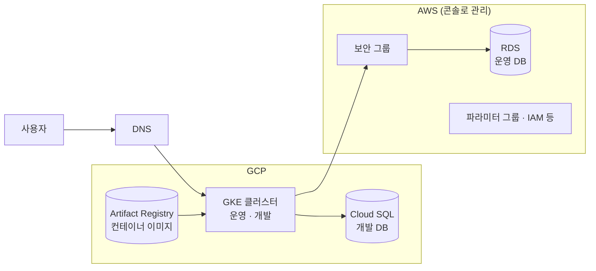
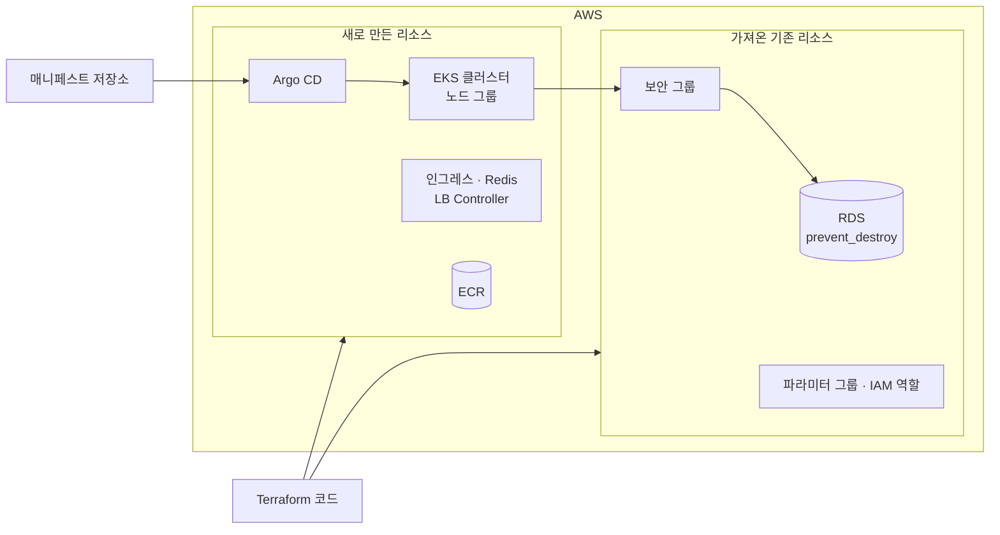
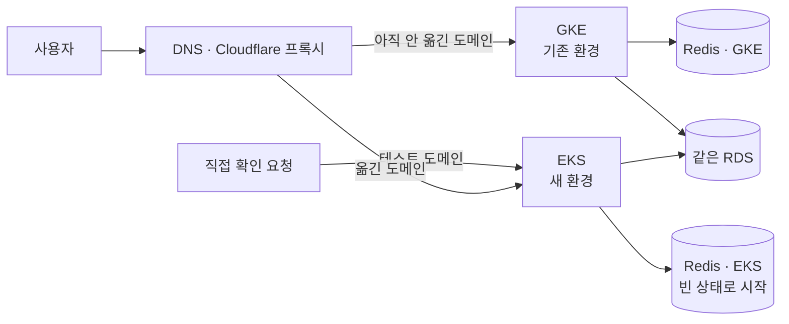

안녕하세요. 프롭테크 플랫폼에서 백엔드 개발자로 근무 중인 정정일입니다.

이번에는 지난 3월부터 4월까지 서버를 GKE에서 AWS EKS로 옮긴 이야기를 해볼까 합니다. 계기는 GCP 스타트업 프로그램으로 받던 크레딧이 끝나가던 것이었고, 옮길 곳은 AWS로 정했습니다.

다만 AWS 쪽 리소스는 대부분 콘솔로만 관리되고 있었습니다. 그래서 이 글은 그 리소스들을 Terraform 코드로 가져온 과정에서 시작해서, 그 옆에 EKS를 세우고 서비스를 옮긴 과정까지 다뤄보려고 합니다.

시작하기에 앞서 저는 인프라를 전문으로 하는 사람은 아니고, 지금 회사에서 백엔드와 인프라를 함께 맡고 있습니다. 정답을 공유하는 글이라기보다는 저희 상황에서 어떤 순서로 판단했는지를 기록한 글로 봐주시면 감사하겠습니다.

---

## 크레딧이 끝나가던 상황

저희는 2025년에 [쿠버네티스를 도입]()하면서 GKE를 선택했습니다. 마침 GCP 스타트업 프로그램에 선정돼 1년 동안 크레딧을 지원받게 됐고, 그 크레딧으로 개발 클러스터까지 갖춘 인프라를 운영할 수 있었죠.

이 크레딧은 2026년 4월에 끝날 예정이었습니다. 그 전에 서버 비용부터 줄이려고 13개로 나뉘어 있던 서비스를 [모듈러 모놀리스로 합쳐]() 파드 수를 크게 줄였습니다. 이번 글에서 다룰 클라우드 이전은 그다음에 진행한 작업입니다.

크레딧이 끝나면 서버 비용을 직접 내야 했는데, 그 시점에 저희 인프라는 두 클라우드에 나뉘어 있었습니다. 계정과 권한, 청구서, 네트워크 설정을 GCP와 AWS에서 따로 봐야 했고, 장애가 나면 콘솔도 두 곳을 확인해야 했습니다. 팀 규모가 작은 상황에서 두 클라우드를 함께 관리하는 건 부담이라고 생각했고, 크레딧이 끝나는 시점에 맞춰 AWS 하나로 모으기로 했습니다.

운영 DB가 이미 AWS에 있었기 때문에, 서버만 옮기면 운영 데이터는 옮기거나 동기화하지 않아도 됐습니다.

## 옮기기 전의 구조

GKE를 도입하기 전부터 운영 DB는 AWS RDS로 운영하고 있었고, 쿠버네티스를 도입할 때는 서버만 GKE로 옮겼습니다. GKE의 서비스들은 클라우드 밖에 있는 RDS로 접속하고 있었습니다.



쿠버네티스 쪽은 매니페스트 저장소와 Argo CD로 관리하고 있어서, 무엇이 어떻게 떠 있는지 코드로 확인할 수 있었습니다. 반면 AWS 쪽의 RDS와 보안 그룹, 파라미터 그룹, IAM 역할 같은 리소스는 대부분 콘솔에서 만들고 수정해온 상태였습니다.

## 왜 EKS보다 기존 리소스부터 코드로 가져왔는가

EKS 클러스터는 기존 RDS와 보안 그룹에 연결돼야 했고, 서비스는 한 번에 옮기지 않고 나눠서 옮길 계획이었습니다. 그러면 옮기는 동안에는 GKE에 남아 있는 서비스와 EKS로 넘어온 서비스가 **같은 RDS를 동시에 바라보는 기간**이 생깁니다. 이 기간에는 RDS 보안 그룹에 GKE에서 오는 접속과 EKS 노드에서 오는 접속이 모두 허용돼 있어야 하고, 둘 중 하나라도 잘못 바꾸면 운영 DB 접속이 끊길 수 있었습니다.

EKS를 Terraform으로 만들면 EKS 노드가 RDS에 접속하는 규칙도 Terraform에서 추가하게 됩니다. 그런데 보안 그룹이 Terraform 밖에 있으면, 그 보안 그룹에 지금 어떤 규칙이 있고 변경 후에는 어떤 모습이 되는지를 plan에서 함께 볼 수가 없습니다. 운영 DB 앞단을 그렇게 바꾸고 싶지는 않았고, 그래서 EKS를 만들기 전에 EKS가 기대게 될 기존 리소스부터 코드로 가져오기로 했습니다.

## 기존 리소스를 코드로 가져오기

### import 블록과 변경 0건

기존 리소스는 Terraform 1.5부터 들어온 `import` 블록으로 가져왔습니다. 어떤 실제 리소스를 코드의 어떤 이름으로 가져올지 적어두는 방식입니다. 적용 전에 바뀔 내용을 보여주는 plan에서 가져올 대상이 표시되고, apply하면 Terraform 상태 파일(state)에 들어갑니다.

```hcl
import {
  to = aws_db_instance.main
  id = "main-db"
}

import {
  to = aws_security_group.rds
  id = "sg-xxxxxxxx"
}
```

운영 DB는 가져오는 단계에서 아무것도 바뀌지 않아야 한다고 판단했고, plan 결과가 "가져오기만 있고 변경은 0건"이 될 때까지 아래 문제들을 하나씩 정리했습니다.

| plan에서 걸린 것 | 처리 |
|---|---|
| 직접 작성한 `.tf`가 콘솔 기본값과 달라 변경이 여러 건 잡힘 | `-generate-config-out`으로 실제 리소스에서 설정을 생성 |
| provider의 `default_tags` 때문에 모든 리소스에 태그 추가가 잡힘 | import 단계에서는 `default_tags`를 뺌 |
| CDK(CloudFormation)로 만든 리소스 | Terraform 관리 대상에서 제외 |
| 자동 생성된 설정에는 `lifecycle`이 없음 | 운영 DB에 `prevent_destroy`, `ignore_changes`를 직접 추가 |

처음에는 RDS 쪽 설정을 직접 `.tf` 파일로 작성했습니다. 콘솔에서 만든 리소스에는 생성할 때 기본값으로 들어간 설정이 많아서, 하나하나 옮겨 적다 보니 빠지거나 다르게 적은 값이 있었습니다. 그래서 직접 작성한 설정은 버리고 `terraform plan -generate-config-out`으로 실제 리소스에서 설정을 만들었습니다. 실제 값을 그대로 옮겨온 설정이라 변경 없이 import만 잡혔습니다.

`default_tags`는 모든 리소스에 공통 태그를 붙이려고 넣어둔 설정이었는데, 기존 리소스에는 그 태그가 없으니 import와 동시에 태그를 추가하는 변경이 잡혔습니다. 태그 추가 자체는 위험한 변경이 아니지만, import 단계에서는 변경 0건을 기준으로 삼는 게 맞다고 봤습니다.

CDK로 만든 리소스를 Terraform으로도 가져오면 두 도구가 같은 리소스를 서로 자기 코드에 맞게 되돌리려고 합니다. 한 리소스는 한 도구만 관리하도록 CDK 쪽은 일부러 남겨뒀습니다.

### 운영 DB를 지키는 설정

운영 DB에는 아래 설정을 직접 추가했습니다.

```hcl
resource "aws_db_instance" "main" {
  # ... 자동 생성된 설정

  lifecycle {
    prevent_destroy = true
    ignore_changes  = [password]
  }
}
```

`prevent_destroy`는 이 리소스를 삭제하거나 삭제 후 재생성하는 계획이 나오면 plan 단계에서 에러를 내게 하는 설정입니다. 코드를 잘못 고쳐서 DB가 교체 대상이 되더라도 실제로 지워지기 전에 멈출 수 있습니다. 다만 리소스 블록 자체를 코드에서 지우면 이 설정도 같이 사라지기 때문에, 모든 실수를 막아주는 장치는 아닙니다. 이 설정은 RDS부터 걸고, 이후 import한 리소스 전반(보안 그룹, 파라미터 그룹, IAM 역할과 정책 연결 등)으로 넓혔습니다.

`ignore_changes = [password]`는 비밀번호 값이 달라도 Terraform이 변경으로 보지 않게 하는 설정입니다. 코드에는 비밀번호를 적지 않았는데, 나중에 누군가 코드에 값을 넣더라도 운영 DB 비밀번호를 덮어쓰지 않도록 막아둔 것입니다.

### 보안 그룹 규칙을 한 가지 방식으로 맞추기

EKS 노드가 RDS에 접속하는 규칙은 처음에 별도의 `aws_security_group_rule` 리소스로 작성했습니다. import한 보안 그룹은 규칙이 보안 그룹 안에 `ingress`로 적혀 있는 상태였습니다.

```hcl
# 보안 그룹 안에 적힌 규칙 (import로 가져온 기존 규칙)
resource "aws_security_group" "rds" {
  ingress { ... }
}

# 별도 리소스로 작성한 EKS 노드 규칙
resource "aws_security_group_rule" "rds_from_eks" {
  security_group_id = aws_security_group.rds.id
  ...
}
```

같은 보안 그룹에 이 두 방식을 섞으면 `aws_security_group`은 자기 안에 적힌 규칙만 있어야 한다고 보고, 별도 리소스로 만든 규칙을 지우려 합니다. 반대로 별도 리소스는 그 규칙을 다시 만들려고 합니다. apply할 때마다 규칙이 지워졌다가 다시 생기는 변경이 반복되는 거죠. 운영 DB 보안 그룹에서 규칙이 잠깐이라도 지워질 수 있는 구성은 피해야 했기 때문에, EKS 규칙도 보안 그룹 안의 `ingress`로 옮겨 한 가지 방식으로 맞췄습니다.

## GKE 옆에 EKS 세우기

기존 리소스가 코드로 들어온 뒤에 EKS를 만들었습니다. 클러스터와 노드 그룹은 `terraform-aws-modules/eks` 모듈로 만들었고, 이미지 저장소(ECR)도 새로 만들었습니다. 클러스터 위에 올라가는 기본 구성(인그레스 컨트롤러, Argo CD, Redis, AWS Load Balancer Controller)도 Helm 릴리스로 같은 Terraform 코드에 넣었습니다. Argo CD가 바라볼 애플리케이션 목록도 같은 코드에서 만들어, 배포 대상까지 코드로 잡히도록 했습니다.


*현재 Argo CD 요약 화면입니다. 운영과 개발 애플리케이션 36개가 EKS 클러스터 하나에서 돌고 있습니다.*



Argo CD 애플리케이션은 Terraform의 `kubernetes_manifest` 리소스로 만들었는데, 이 리소스는 plan 단계에서 이미 쿠버네티스 API에 접속해야 합니다. 클러스터가 아직 없으면 plan 자체가 실패하기 때문에, 처음 만들 때만 클러스터와 네트워크를 먼저 apply하고 그다음 전체를 apply하는 두 단계로 진행했습니다.

EKS 쪽 설정은 새로 설계하기보다는 GKE에서 운영하던 방식에 그대로 맞췄습니다. 이전하는 중에 운영 방식까지 바꾸면, 문제가 생겼을 때 원인이 이전인지 방식 변경인지 구분하기 어렵다고 생각했거든요. 바꾸고 싶은 부분이 보여도 이번에는 옮기는 데까지만 하고, 개선은 이전이 끝난 뒤로 미뤘습니다.

- GKE에서는 운영 앱의 Argo CD 자동 Sync를 끄고 수동으로 Sync하고 있어서, EKS에서도 자동 Sync를 꺼두었습니다.
- GKE는 metrics-server를 기본으로 제공하지만 EKS는 따로 설치해야 합니다. 파드 수를 자동으로 조절하는 HPA가 이 값을 보기 때문에 EKS 애드온으로 추가했습니다.

매니페스트는 GKE가 쓰던 운영용 디렉터리는 그대로 두고, EKS용 디렉터리를 따로 복사한 뒤 클라우드마다 다른 부분만 고쳤습니다. 인그레스 설정은 그대로 썼습니다.

| 항목 | GKE | EKS (처음 옮길 때) |
|---|---|---|
| 이미지 저장소 | GCP Artifact Registry | ECR |
| 스토리지 클래스 | GKE 기본 스토리지 클래스 | gp3 |
| 이미지 받기 인증 | GCP용 인증 시크릿 | 시크릿 없이 노드 권한으로 |
| 노드 지정 | GKE 노드 풀 이름 | 데이터를 들고 있는 서비스만 온디맨드 노드 그룹, 나머지는 지정 없음 |

### 개발 환경

개발 환경도 같은 시기에 옮겼습니다. 개발 DB는 Cloud SQL에 있어서 AWS DMS로 개발용 RDS에 한 번 전체 복사했고, 개발 서버는 같은 EKS 안에 개발 네임스페이스와 전용 노드 그룹을 두고 띄웠습니다. GKE에서 쓰던, 업무 시간에만 개발 서비스를 띄우는 CronJob도 같은 방식으로 EKS에 옮겼습니다.

## 도메인별로 DNS 돌리기

운영 서비스는 블루/그린 방식으로 옮겼습니다. GKE를 그대로 운영하면서 EKS에 같은 서비스를 띄우고, 확인이 끝난 도메인부터 DNS를 EKS로 돌리는 방식입니다. 모니터링처럼 영향이 적은 서비스를 먼저 EKS에서 열었고, 메인 API는 4월 15일에 옮겼습니다.



도메인 하나는 이런 순서로 옮겼습니다.

1. EKS에 서비스를 띄우고, 운영 도메인이 아닌 테스트 도메인을 EKS에 연결해 직접 호출해보며 확인합니다.
2. 확인이 끝나면 그 도메인의 DNS를 EKS로 돌립니다.
3. 문제가 생기면 DNS를 다시 GKE로 돌립니다. GKE 쪽 서비스는 그대로 떠 있어서 되돌리는 데 다른 작업이 필요하지 않습니다.

DNS 레코드를 바꾸면 사용자 기기나 통신사 DNS에 남은 캐시 때문에 한동안 옛 주소로 요청이 갈 수 있습니다. 저희 도메인은 Cloudflare 프록시를 거치고 있어서 이 부분을 신경 쓸 필요가 없었습니다. 사용자가 받는 주소는 늘 Cloudflare의 주소이고, 레코드를 바꾸면 Cloudflare가 요청을 넘기는 원본만 GKE에서 EKS로 바뀝니다.


*Cloudflare DNS 화면(현재). api 도메인 레코드가 프록시(Proxied) 상태입니다. 원본 주소는 가렸습니다.*

트래픽을 조금씩 나눠서 보내는 카나리 방식도 생각해볼 수 있었지만, 두 환경이 같은 RDS를 보고 있고 도메인 단위로 바로 되돌릴 수 있어서 블루/그린으로 충분하다고 봤습니다.

두 클러스터가 함께 도는 동안 RDS는 하나였지만, Redis는 클러스터마다 따로 떠 있었습니다. 백엔드가 Redis를 클러스터 안의 주소로 찾기 때문에, GKE의 서비스는 GKE의 Redis를, EKS의 서비스는 EKS에 새로 띄운 Redis를 보게 됩니다.

이렇게 둬도 괜찮다고 본 건, 당시 백엔드에서 Redis를 아파트 단지 상세 정보와 자동완성 결과를 담아두는 캐시로만 쓰고 있었기 때문입니다. 로그인 유지에 쓰는 리프레시 토큰도 Redis가 아니라 DB에 저장하고 있어서, 사용자가 어느 클러스터로 요청을 보내든 로그인 상태는 유지됐습니다.

원본 데이터는 모두 RDS에 있으니, EKS 쪽 Redis가 비어 있는 상태로 시작해도 처음 몇 번의 요청이 DB에서 데이터를 읽어 캐시를 채우는 정도의 차이만 있었습니다. 세션이나 락 용도로 쓰고 있었다면 Redis도 하나로 맞추는 작업이 먼저 필요했을 거라고 봅니다.

전환하는 동안에는 계속 요청을 보내면서 응답이 끊기거나 에러가 나는 구간이 없는지 확인했습니다. 메인 API를 옮기면서 GKE용 매니페스트까지 정리해 이전을 마무리했고, 그동안 서비스가 중단된 시간은 없었습니다.

## 옮긴 뒤

지금은 운영·개발 서버(EKS)와 DB(RDS), 이미지 저장소(ECR)가 모두 AWS에 있습니다. 이후 인프라 변경은 이 Terraform 코드에서 plan으로 먼저 확인하고 apply하고 있습니다.

비용도 줄었습니다.

| | GKE (2월 말, 모듈러 모놀리스 전환 후) | EKS (이전 직후 5~6월) |
|---|---|---|
| 산정 방식 | Compute Engine + Kubernetes Engine, 하루 약 65,000원을 월로 환산 | Cost Explorer의 클러스터 관련 항목 월 합계 |
| 월 비용 | 약 197만 원 | 약 530달러 (1달러 1,400원으로 약 74만 원) |


*GCP 청구 화면에서 Compute Engine과 Kubernetes Engine만 골라 본 일별 비용입니다(크레딧 적용 전). 2월 하순 모듈러 모놀리스 전환 뒤 하루 6만 원대로 내려갔고, 메인 API를 옮긴 4월 15일 이후로는 거의 0원입니다.*

두 클라우드의 요금 항목이 완전히 같지는 않아서 정확한 비교라고 하긴 어렵지만, 클러스터 비용으로 보면 절반 아래로 줄었습니다. EKS에서는 쿠버네티스 도입 글에서 크레딧 이후 계획으로 적어둔 대로 노드 그룹 일부를 스팟 인스턴스로 구성했고, 5~6월 노드 비용의 3분의 1 이상이 스팟 인스턴스 요금이었습니다.


*AWS Cost Explorer에서 노드(EC2), EBS·NAT 같은 EC2 부대 비용, EKS, 로드밸런서, VPC 요금만 더한 월 비용입니다. 세금은 뺐습니다. 8월 금액이 높은 건 EKS 버전의 표준 지원이 끝나 붙은 연장 지원 요금 때문입니다.*

## 마치며

EKS 버전 업그레이드는 9월과 11월에 이 Terraform 코드로 진행했습니다. 9월에는 컨트롤 플레인만 올리려던 변경에 노드 그룹까지 함께 바뀌는 항목이 들어 있었는데, apply 전에 plan에서 확인하고 노드 그룹 버전을 고정할 수 있었습니다. 그 과정은 [EKS 업그레이드 1편]()과 [2편]()에 정리해두었습니다.

읽어주셔서 감사합니다.

### Reference

- [Terraform: Import existing resources (import block)](https://developer.hashicorp.com/terraform/language/import)
- [Terraform: Generating configuration](https://developer.hashicorp.com/terraform/language/import/generating-configuration)
- [Terraform: The lifecycle meta-argument](https://developer.hashicorp.com/terraform/language/meta-arguments/lifecycle)
- [Terraform AWS provider: aws_security_group](https://registry.terraform.io/providers/hashicorp/aws/latest/docs/resources/security_group)
- [Terraform Kubernetes provider: kubernetes_manifest](https://registry.terraform.io/providers/hashicorp/kubernetes/latest/docs/resources/manifest)
- [terraform-aws-modules/eks](https://registry.terraform.io/modules/terraform-aws-modules/eks/aws/latest)
- [AWS Database Migration Service](https://docs.aws.amazon.com/dms/latest/userguide/Welcome.html)
- [Amazon EKS: Install metrics-server](https://docs.aws.amazon.com/eks/latest/userguide/metrics-server.html)
- [Cloudflare: Proxy status](https://developers.cloudflare.com/dns/proxy-status/)
