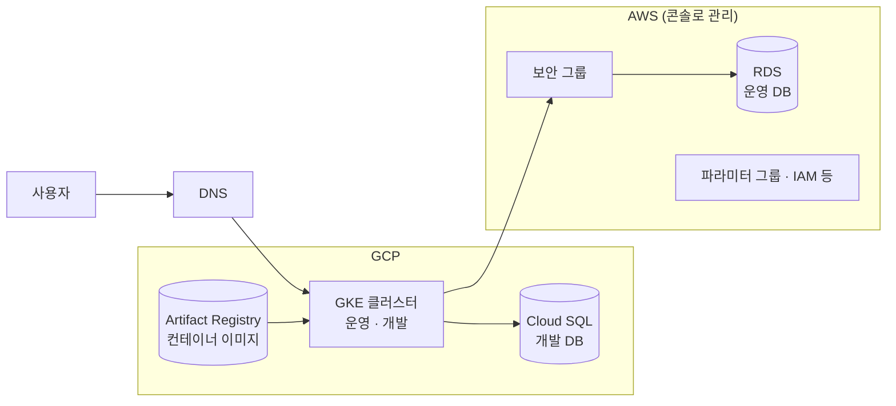
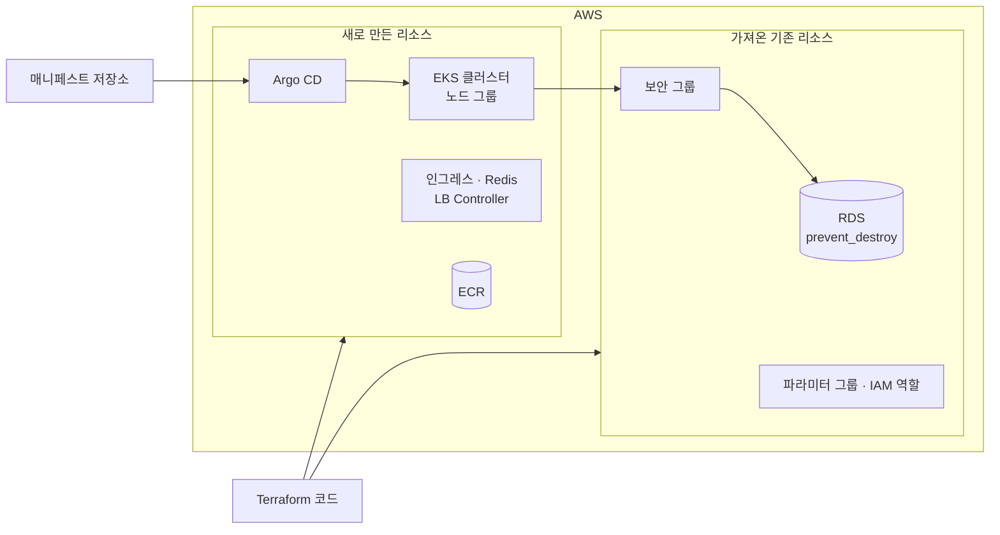
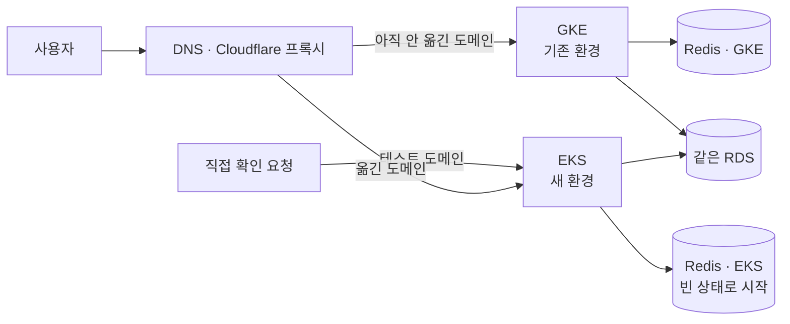

안녕하세요. 프롭테크 플랫폼에서 백엔드 개발자로 근무 중인 정정일입니다.

이번에는 지난 3월부터 4월까지 저희 서버를 GKE에서 AWS EKS로 옮긴 이야기를 해볼까 합니다. GCP 스타트업 프로그램으로 지원받던 크레딧이 끝나가면서 옮기게 된 건데요. 막상 진행해보니 옮기는 작업 자체보다 옮기기 전에 해야 했던 일이 생각보다 더 컸던 것 같습니다. AWS 쪽 리소스 대부분이 콘솔로만 관리되고 있었기 때문입니다.

그래서 이번 글에서는 그 리소스들을 Terraform 코드로 가져온 이야기부터 시작해서, 그 옆에 EKS를 세우고 서비스를 하나씩 옮긴 이야기까지 다뤄보려고 합니다.

시작하기 전에 미리 말씀드리면 저는 인프라를 전문으로 하는 사람은 아닙니다. 지금 회사에서 백엔드와 인프라를 함께 맡고 있구요. 그래서 이 글은 "이게 정답이다"라고 공유하는 글이라기보다는, 문제를 만나서 저희 상황에 맞게 하나씩 판단해 나간 과정을 기록으로 남긴 글에 가깝습니다. 그런 점을 감안해서 넓은 마음으로 봐주시면 감사하겠습니다.

---

## 크레딧이 끝나가던 상황

저희는 2025년에 [쿠버네티스를 도입]()하면서 GKE를 선택했습니다. 마침 그 무렵 GCP 스타트업 프로그램에 선정되어서 1년 동안 크레딧을 지원받게 되었는데, 덕분에 개발 클러스터까지 갖춘 인프라를 비용 부담 없이 운영할 수 있었습니다.

문제는 이 크레딧이 **2026년 4월에 끝난다는 점**이었습니다.

그래서 크레딧이 끝나기 전에 서버 비용부터 줄여보자는 생각으로, 13개로 나뉘어 있던 서비스를 [모듈러 모놀리스로 합쳐]() 파드 수를 크게 줄였습니다. 이번 글에서 다룰 클라우드 이전은 그다음 단계라고 보시면 될 것 같습니다.

그럼 왜 하필 AWS였을까요?

크레딧이 끝나면 서버 비용은 이제 저희가 직접 내야 합니다. 그런데 그 시점에 저희 인프라는 GCP와 AWS 두 곳에 나뉘어 있었습니다. 계정이나 권한, 청구서, 네트워크 설정 같은 것들을 클라우드마다 따로 봐야 했고, 장애가 나면 콘솔도 두 군데를 왔다 갔다 하면서 확인해야 했죠.

사실 저희처럼 팀 규모가 작은 상황에서는 이렇게 관리 포인트가 두 배로 늘어나는 게 생각보다 큰 부담이라고 생각했습니다. 클라우드가 하나 더 있으면 봐야 할 곳도 그만큼 하나 더 늘어나는 거라서요. 그래서 크레딧이 끝나는 시점에 맞춰 **AWS 하나로 모으기로 했습니다.**

게다가 운영 DB는 이미 AWS에 있었습니다. 그래서 서버만 옮기면 운영 데이터는 따로 옮기거나 동기화할 필요가 없었는데요, 이 점도 AWS를 고른 이유 중 하나였습니다.

## 옮기기 전의 구조

아무튼 먼저 옮기기 전의 구조부터 짚고 넘어가겠습니다.

저희는 GKE를 도입하기 전부터 운영 DB를 AWS RDS로 운영하고 있었습니다. 쿠버네티스를 도입할 때도 서버만 GKE로 옮기고 DB는 그대로 두었구요. 그래서 GKE에 떠 있는 서비스들이 클라우드 밖에 있는 RDS로 접속하는, 조금은 특이한 구조로 운영되고 있었습니다.



쿠버네티스 쪽은 매니페스트 저장소와 Argo CD로 관리하고 있었습니다. 그래서 지금 무엇이 어떻게 떠 있는지는 코드만 보면 확인이 가능했습니다.

그치만 AWS 쪽은 사정이 좀 달랐습니다. RDS나 보안 그룹, 파라미터 그룹, IAM 역할 같은 리소스들이 **대부분 콘솔에서 만들어지고 콘솔에서 수정되어 온 상태**였습니다. 어떤 설정이 왜 들어가 있는지 확인하려면 콘솔에 들어가서 하나하나 열어봐야 했고, 지금 상태를 확인할 수 있는 곳도 사실상 콘솔밖에 없었습니다.

## 왜 EKS보다 기존 리소스부터 코드로 가져왔는가

그렇다면 EKS를 바로 만들면 되지, 왜 기존 리소스부터 코드로 가져왔을까요?

결론부터 말씀드리면, 옮기는 동안 **GKE와 EKS가 같은 RDS를 동시에 바라보는 기간**이 생기기 때문이었습니다.

저희는 서비스를 한 번에 옮기지 않고 나눠서 옮길 계획이었습니다. 이렇게 되면 옮기는 도중에는 아직 GKE에 남아 있는 서비스와 이미 EKS로 넘어온 서비스가 같이 있게 되고, 이 둘이 모두 같은 RDS를 쓰게 됩니다.

이 기간에는 RDS 보안 그룹에 GKE에서 오는 접속과 EKS 노드에서 오는 접속이 모두 허용되어 있어야 합니다. 만약 EKS 쪽 규칙을 추가하다가 기존 GKE 쪽 규칙을 잘못 건드리기라도 하면, 그 순간 운영 DB 접속이 끊길 수도 있었습니다.

그리고 EKS를 Terraform으로 만들게 되면 EKS 노드가 RDS에 접속하기 위한 규칙도 자연스럽게 Terraform에서 추가하게 됩니다. 문제는 정작 그 규칙이 들어갈 보안 그룹 자체는 Terraform 밖에 있었다는 점입니다. 이 상태에서는 새로 추가하는 규칙은 plan에 나오지만, 보안 그룹에 지금 어떤 규칙이 있고 변경하고 나면 기존 규칙까지 합쳐서 어떤 모습이 되는지는 plan에서 한 번에 볼 수가 없습니다. plan만 봐서는 변경한 뒤의 전체 모습을 알 수 없는 상태였던 거죠.

저는 운영 DB 앞단을 이렇게 확인도 못 한 채로 바꾸는 건 위험하다고 봤습니다(규칙 하나 추가하는 정도면 콘솔에서 조심해서 확인하면 되지 않냐고 하실 수도 있긴 합니다). 그래서 **EKS를 만들기 전에, EKS가 기대게 될 기존 리소스부터 코드로 가져오기로 했습니다.**

## 기존 리소스를 코드로 가져오기

### import 블록과 변경 0건

기존 리소스는 Terraform 1.5부터 들어온 `import` 블록을 이용해서 가져왔습니다. 가져올 리소스의 ID와 코드상의 주소를 아래처럼 `import` 블록에 적어두면 plan에서 import 대상으로 나오고, apply를 하면 state에 들어가는 방식입니다.

```hcl
import {
  to = aws_db_instance.main
  id = "main-db"
}

import {
  to = aws_security_group.rds
  id = "sg-xxxxxxxx"
}
```

이 단계에서 제가 가장 신경 쓴 건 운영 DB만큼은 가져오는 단계에서 아무것도 바뀌면 안 된다는 점이었습니다. 가져오기만 하려던 작업에서 운영 DB 설정이 하나라도 바뀐다면, 의도하지 않은 변경을 운영 DB에 apply하게 되는 거니까요.

그래서 plan 결과가 **"가져오기만 있고 변경은 0건"**이 될 때까지, plan에서 걸리는 것들을 하나씩 정리했습니다. 걸렸던 것들을 표로 정리해보면 다음과 같습니다.

| plan에서 걸린 것 | 처리 |
|---|---|
| 직접 작성한 `.tf`가 콘솔 기본값과 달라 변경이 여러 건 잡힘 | `-generate-config-out`으로 실제 리소스에서 설정을 생성 |
| provider의 `default_tags` 때문에 모든 리소스에 태그 추가가 잡힘 | import 단계에서는 `default_tags`를 뺌 |
| CDK(CloudFormation)로 만든 리소스 | Terraform 관리 대상에서 제외 |
| 자동 생성된 설정에는 `lifecycle`이 없음 | 운영 DB에 `prevent_destroy`, `ignore_changes`를 직접 추가 |

처음에는 RDS 쪽 설정을 제가 직접 `.tf` 파일로 작성했습니다. 그런데 콘솔에서 만든 리소스에는 생성할 때 기본값으로 들어간 설정이 생각보다 많더라고요. 이걸 하나하나 옮겨 적다 보니 중간에 빠뜨린 값도 있었고 다르게 적은 값도 있었습니다. 그 상태로 plan을 돌려보니 변경이 여러 건 잡혔습니다.

그래서 직접 작성한 건 버리고, `terraform plan -generate-config-out`으로 실제 리소스에서 설정을 뽑아서 썼습니다. 실제 리소스의 값을 그대로 가져온 설정이라 이번에는 변경 없이 import만 잡혔습니다. 사실 어떻게 보면 당연한 결과이긴 합니다.

또 하나 걸렸던 게 provider의 `default_tags`였습니다. 모든 리소스에 공통 태그를 붙이려고 넣어둔 설정이었는데요. 기존 리소스에는 당연히 그 태그가 없으니까, import를 하는 순간 태그를 추가하는 변경도 같이 잡혀버렸습니다.

솔직히 태그를 추가하는 것 자체는 위험한 변경이 아닙니다. 그래도 import 단계에서만큼은 **변경 0건이라는 기준을 그대로 지키는 게 맞다고 생각**했습니다. 위험하지 않은 변경이라고 해도 기준에서 벗어나는 건 똑같기 때문에, 이 설정도 일단 빼고 진행했습니다.

마지막으로 CDK로 만든 리소스는 일부러 가져오지 않았습니다. 이걸 Terraform으로도 가져오게 되면 같은 리소스를 CDK와 Terraform이 각자 자기 코드를 기준으로 관리하게 됩니다. 그러면 한쪽에서 바꾼 값이 다른 쪽에서 배포나 apply를 할 때 다시 되돌려지는 상황이 생길 수 있습니다. 그래서 CDK 쪽은 그대로 남겨뒀습니다. **한 리소스는 한 도구만 관리하는 게 맞다고 생각**했거든요(이 부분은 제 개인적인 생각입니다).

### 운영 DB를 지키는 설정

자동으로 생성된 설정에는 `lifecycle` 블록이 들어가지 않습니다. 그래서 운영 DB에는 아래 설정을 직접 추가했습니다.

```hcl
resource "aws_db_instance" "main" {
  # ... 자동 생성된 설정

  lifecycle {
    prevent_destroy = true
    ignore_changes  = [password]
  }
}
```

먼저 `prevent_destroy`는 이 리소스를 삭제하거나, 삭제 후 다시 만드는 plan이 나오면 **plan 단계에서 에러를 내게 하는 설정**입니다. 예를 들어 제가 코드를 잘못 고쳐서 운영 DB가 교체 대상이 되더라도, 실제로 지워지기 전에 plan에서 멈추게 됩니다.

물론 이 설정이 모든 실수를 막아주는 건 아닙니다. 리소스 블록 자체를 코드에서 지워버리면 `prevent_destroy`도 같이 사라지기 때문에 그 경우는 이 설정으로 막을 수가 없습니다. 그래도 없는 것보다는 훨씬 낫다고 생각해서 RDS부터 걸어두었습니다. 이후에는 import한 리소스 전반(보안 그룹, 파라미터 그룹, IAM 역할과 정책 연결 등)으로 넓혔습니다.

`ignore_changes = [password]`는 비밀번호 값이 달라도 변경으로 보지 않게 하는 설정입니다. 코드에는 비밀번호를 적어두지 않았는데, 혹시 나중에 누군가 코드에 값을 넣더라도 운영 DB 비밀번호가 덮어써지지 않도록 막아둔 겁니다.

### 보안 그룹 규칙을 한 가지 방식으로 맞추기

EKS 노드가 RDS에 접속하는 규칙은 처음에 별도의 `aws_security_group_rule` 리소스로 작성했습니다. 그런데 import로 가져온 보안 그룹을 보니 규칙이 보안 그룹 안에 `ingress`로 직접 적혀 있었습니다.

```hcl
# 보안 그룹 안에 적힌 규칙 (import로 가져온 기존 규칙)
resource "aws_security_group" "rds" {
  ingress { ... }
}

# 별도 리소스로 작성한 EKS 노드 규칙
resource "aws_security_group_rule" "rds_from_eks" {
  security_group_id = aws_security_group.rds.id
  ...
}
```

이렇게 같은 보안 그룹에 inline `ingress`와 별도의 `aws_security_group_rule`을 섞어 쓰면 문제가 생깁니다. `aws_security_group` 쪽은 inline으로 적힌 규칙만 있는 상태를 기준으로 diff를 잡습니다. 그래서 별도 리소스로 추가된 규칙은 삭제 대상이 되고, 그 규칙이 삭제되면 이번엔 `aws_security_group_rule` 쪽에서 다시 생성 대상으로 잡힙니다. 두 정의가 서로 충돌하면서 apply를 할 때마다 규칙이 지워졌다가 다시 생기는 diff가 계속 반복되는 겁니다.

운영 DB의 보안 그룹에서 규칙이 잠깐이라도 지워질 수 있는 구성은 무조건 피해야 한다고 판단했습니다. 그래서 EKS 규칙도 보안 그룹 안의 `ingress`로 옮겨서 **한 가지 방식으로 맞췄습니다.**

## GKE 옆에 EKS 세우기

기존 리소스가 코드로 들어오고 나서야 EKS를 만들기 시작했습니다. 클러스터와 노드 그룹은 `terraform-aws-modules/eks` 모듈로 만들었고, 이미지 저장소(ECR)도 이때 새로 만들었습니다.

클러스터 위에 올라가는 기본 구성들(인그레스 컨트롤러, Argo CD, Redis, AWS Load Balancer Controller)도 Helm 릴리스로 같은 Terraform 코드에 넣었습니다. Argo CD가 바라볼 애플리케이션 목록까지 같은 코드에서 만들어서, **배포 대상까지 전부 코드로 잡히도록** 했습니다.


*현재 Argo CD 요약 화면입니다. 운영과 개발 애플리케이션 36개가 EKS 클러스터 하나에서 돌고 있습니다.*



그런데 여기서 순서 문제가 하나 있었습니다. Argo CD 애플리케이션은 Terraform의 `kubernetes_manifest` 리소스로 만들었는데, 이 리소스는 plan 단계에서부터 쿠버네티스 API에 접속을 해야 하더라고요. 그러니 클러스터가 아직 없는 상태에서는 plan 자체가 실패할 수밖에 없었습니다.

그래서 처음 만들 때만 클러스터와 네트워크를 먼저 apply하고, 그다음에 전체를 apply하는 식으로 두 번에 나눠서 진행했습니다.

EKS 쪽 설정은 새로 설계하기보다는 최대한 GKE에서 운영하던 방식에 그대로 맞췄습니다. 이전하는 와중에 운영 방식까지 같이 바꿔버리면, 나중에 문제가 생겼을 때 이게 이전 때문인지 방식을 바꿔서인지 구분하기가 어려울 것 같았습니다.

그래서 바꾸고 싶은 부분이 눈에 보여도 **이번에는 옮기는 데까지만 하고, 개선은 이전이 끝난 뒤로 미뤘습니다.**

- GKE에서는 운영 앱의 Argo CD 자동 Sync를 끄고 수동으로 Sync하고 있었기 때문에, EKS에서도 똑같이 자동 Sync를 꺼두었습니다.
- GKE는 metrics-server를 기본으로 제공하지만 EKS는 따로 설치해야 합니다. HPA가 이 값을 보고 동작하기 때문에 EKS 애드온으로 추가했습니다.

매니페스트는 GKE가 쓰던 운영용 디렉터리는 손대지 않고 그대로 두었습니다. 대신 EKS용 디렉터리를 따로 복사해서 클라우드마다 다른 부분만 고쳤습니다. 인그레스 설정은 그대로 썼고, 바뀐 부분을 정리해보면 다음과 같습니다.

| 항목 | GKE | EKS (처음 옮길 때) |
|---|---|---|
| 이미지 저장소 | GCP Artifact Registry | ECR |
| 스토리지 클래스 | GKE 기본 스토리지 클래스 | gp3 |
| 이미지 받기 인증 | GCP용 인증 시크릿 | 시크릿 없이 노드 권한으로 |
| 노드 지정 | GKE 노드 풀 이름 | 데이터를 들고 있는 서비스만 온디맨드 노드 그룹, 나머지는 지정 없음 |

### 개발 환경

개발 환경도 같은 시기에 함께 옮겼습니다.

개발 DB는 GCP의 Cloud SQL에 있었기 때문에 AWS DMS를 이용해서 개발용 RDS로 데이터를 한 번 전체 복사했습니다. 개발 서버는 같은 EKS 클러스터 안에 개발 네임스페이스와 전용 노드 그룹을 따로 두고 띄웠습니다. GKE에서 쓰던, 업무 시간에만 개발 서비스를 띄우는 CronJob도 같은 방식으로 EKS에 옮겨왔구요.

## 도메인별로 DNS 돌리기

이제 실제로 운영 서비스를 옮길 차례였습니다.

운영 서비스는 블루/그린 방식으로 옮겼습니다. GKE는 그대로 운영하면서 EKS에 같은 서비스를 하나 더 띄워두고, 확인이 끝난 도메인부터 DNS를 EKS로 돌리는 방식입니다. 모니터링처럼 영향이 적은 서비스를 먼저 EKS에서 열었고, 메인 API는 4월 15일에 옮겼습니다.



도메인 하나를 옮길 때는 이런 순서로 진행했습니다.

1. EKS에 서비스를 띄우고, 운영 도메인이 아닌 테스트 도메인을 EKS에 연결해서 직접 호출해보며 확인합니다.
2. 확인이 끝나면 그 도메인의 DNS를 EKS로 돌립니다.
3. 혹시 문제가 생기면 DNS를 다시 GKE로 돌립니다. GKE 쪽 서비스는 그대로 떠 있기 때문에 되돌리는 데 다른 작업은 필요하지 않습니다.

DNS를 바꿔보신 분들이라면 한 번쯤 신경 쓰셨을 것 같은데요, 바로 사용자 기기나 통신사 DNS에 남아 있는 캐시입니다. 레코드를 바꾸더라도 캐시가 남아 있는 동안에는 한동안 옛 주소로 요청이 갈 수 있습니다.

그런데 저희 도메인은 Cloudflare 프록시를 거치고 있어서 이 부분은 크게 신경 쓰지 않아도 되었습니다. 사용자가 받는 주소는 늘 Cloudflare의 주소이고, 레코드를 바꾸면 Cloudflare가 요청을 넘겨주는 원본만 GKE에서 EKS로 바뀌는 구조였거든요. 그래서 사용자 쪽 DNS 캐시는 이번 전환과 크게 상관이 없었습니다.


*Cloudflare DNS 화면(현재). api 도메인 레코드가 프록시(Proxied) 상태입니다. 원본 주소는 가렸습니다.*

물론 트래픽을 조금씩 나눠서 보내는 카나리 방식도 고려해볼 수는 있었습니다. 다만 저희는 두 환경이 같은 RDS를 보고 있었고, 문제가 생기면 도메인 단위로 바로 되돌릴 수도 있었습니다. 그래서 저희 상황에서는 **블루/그린으로도 충분하다고 판단했습니다.**

앞서 두 환경이 같은 RDS를 본다고 말씀드렸는데요, Redis는 조금 달랐습니다. Redis는 클러스터마다 따로 떠 있었고, 백엔드는 Redis를 클러스터 안의 주소로 찾아갑니다. 그래서 GKE의 서비스는 GKE에 있는 Redis를, EKS의 서비스는 EKS에 새로 띄운 Redis를 보게 됩니다.

그렇다면 Redis가 이렇게 둘로 나뉘어 있어도 괜찮았을까요?

저는 괜찮다고 판단했습니다. 당시 저희 백엔드는 Redis를 **아파트 단지 상세 정보와 자동완성 결과를 담아두는 캐시로만** 쓰고 있었기 때문입니다. 로그인 유지에 쓰는 리프레시 토큰도 Redis가 아니라 DB에 저장하고 있어서, 사용자가 어느 클러스터로 요청을 보내든 로그인 상태는 그대로 유지되었습니다.

원본 데이터는 전부 RDS에 있으니 EKS 쪽 Redis가 텅 빈 상태로 시작하더라도, 처음 몇 번의 요청이 DB에서 데이터를 읽어와 캐시를 채우는 정도의 차이만 있었습니다. 만약 Redis를 세션이나 락 용도로 쓰고 있었다면, 그때는 Redis도 하나로 맞추는 작업부터 먼저 했어야 했을 것 같습니다.

전환하는 동안에는 계속 요청을 보내보면서 응답이 끊기거나 에러가 나는 구간이 없는지 확인했습니다. 그리고 메인 API를 옮기면서 GKE용 매니페스트까지 정리하는 것으로 이전을 마무리했습니다.

**그동안 서비스가 중단된 시간은 없었습니다.**

## 옮긴 뒤

이제는 운영과 개발 서버(EKS), DB(RDS), 이미지 저장소(ECR)가 모두 AWS에 모여 있습니다. 이후의 인프라 변경도 이 Terraform 코드에서 plan으로 먼저 확인한 다음 apply하는 식으로 진행하고 있습니다.

비용도 꽤 줄었습니다. 이전 전후를 표로 정리해보면 다음과 같습니다.

| | GKE (2월 말, 모듈러 모놀리스 전환 후) | EKS (이전 직후 5~6월) |
|---|---|---|
| 산정 방식 | Compute Engine + Kubernetes Engine, 하루 약 65,000원을 월로 환산 | Cost Explorer의 클러스터 관련 항목 월 합계 |
| 월 비용 | 약 197만 원 | 약 530달러 (1달러 1,400원으로 약 74만 원) |


*GCP 청구 화면에서 Compute Engine과 Kubernetes Engine만 골라 본 일별 비용입니다(크레딧 적용 전). 2월 하순 모듈러 모놀리스 전환 뒤 하루 6만 원대로 내려갔고, 메인 API를 옮긴 4월 15일 이후로는 거의 0원입니다.*

사실 두 클라우드의 요금 항목이 완전히 같지는 않기 때문에 정확한 비교라고 하기는 어렵습니다. 그래도 클러스터 비용만 놓고 보면 **월 약 197만 원에서 약 74만 원 수준으로, 절반 아래로 줄었습니다.**

줄어든 이유 중 하나는 노드 구성이었던 것 같습니다. [쿠버네티스 도입 글]()에서 크레딧이 끝나면 검토해보겠다고 적어뒀던 스팟 인스턴스를 이번에 EKS에서 실제로 적용했는데요, 5~6월 기준으로 **노드 비용의 3분의 1 이상이 스팟 인스턴스 요금**이었습니다. 말하고 보니 그때 적어둔 것 중 하나를 이번에 실제로 해보게 되었네요.


*AWS Cost Explorer에서 노드(EC2), EBS·NAT 같은 EC2 부대 비용, EKS, 로드밸런서, VPC 요금만 더한 월 비용입니다. 세금은 뺐습니다. 8월 금액이 높은 건 EKS 버전의 표준 지원이 끝나 붙은 연장 지원 요금 때문입니다.*

## 마치며

지금까지 콘솔로만 관리하던 기존 리소스를 먼저 Terraform으로 가져오고, 그 옆에 EKS를 세운 뒤 도메인별로 DNS를 돌려가며 GKE에서 EKS로 옮긴 과정을 정리해봤습니다.

이번 이전에서 저는 이미 돌아가고 있는 리소스를 건드리지 않고 코드로 가져오는 작업이 가장 중요했다고 생각합니다(EKS를 잘 만드는 것보다도요). 이 작업을 먼저 해둔 덕분에 두 클러스터가 같은 RDS를 쓰는 동안에도 **보안 그룹 변경을 plan으로 확인하면서 진행할 수 있었습니다.**

이후 EKS 버전 업그레이드도 9월과 11월에 이 Terraform 코드로 진행했습니다. 9월에는 컨트롤 플레인만 올리려던 변경에 노드 그룹까지 같이 바뀌는 항목이 들어 있었는데, apply 전에 plan에서 이걸 확인하고 노드 그룹 버전을 고정할 수 있었습니다. 그 과정은 [EKS 업그레이드 1편]()과 [2편]()에 정리해두었습니다.

이 글이 비슷한 고민을 하고 계시는 분들께 조금이나마 도움이 되었으면 좋겠습니다.

긴 글 읽어주셔서 감사합니다.

### Reference

- [Terraform: Import existing resources (import block)](https://developer.hashicorp.com/terraform/language/import)
- [Terraform: Generating configuration](https://developer.hashicorp.com/terraform/language/import/generating-configuration)
- [Terraform: The lifecycle meta-argument](https://developer.hashicorp.com/terraform/language/meta-arguments/lifecycle)
- [Terraform AWS provider: aws_security_group](https://registry.terraform.io/providers/hashicorp/aws/latest/docs/resources/security_group)
- [Terraform Kubernetes provider: kubernetes_manifest](https://registry.terraform.io/providers/hashicorp/kubernetes/latest/docs/resources/manifest)
- [terraform-aws-modules/eks](https://registry.terraform.io/modules/terraform-aws-modules/eks/aws/latest)
- [AWS Database Migration Service](https://docs.aws.amazon.com/dms/latest/userguide/Welcome.html)
- [Amazon EKS: Install metrics-server](https://docs.aws.amazon.com/eks/latest/userguide/metrics-server.html)
- [Cloudflare: Proxy status](https://developers.cloudflare.com/dns/proxy-status/)
